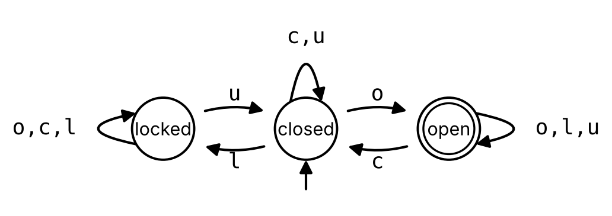

# State Machines and Finite Automata

Code

State machines and their state diagrams, runs, deterministic finite automata and their languages, designing automata, and state-transition tables

Published

Last modified: 2026-10-29 13:50:37 (PDT)

> **NOTE:**
>
> The topics of this chapter follow the course calendar, and their order follows Kameron Decker Harris’s Fall 2026 lecture notes introducing the theory of computation. These come from those notes:
>
> - the three parts of the theory of computation, computability, complexity and automata theory, with the halting problem and the P versus NP problem as examples of the first two;
> - automata as the precise form of “computer”, and the question of whether a machine accepts a string as the precise form of “problem”;
> - a state machine drawn as a directed graph, with an arrow into the initial state and a double circle for an accepting state.
>
> These follow the course’s handout on graph extensions:
>
> - a finite automaton seen as a directed graph whose vertices are states and whose labeled edges are transitions, with a start state and accepting states;
> - reading a string one symbol at a time, following the edge labeled with each symbol, and accepting the string when the machine ends in an accepting state.
>
> The transition function, runs, the extended transition function, languages, dead states, complements and state-transition tables are added here. The notes do not cover nondeterministic automata or regular expressions, so this chapter does not either. The examples, the exercises, the Racket functions and the proofs are new.

# 1 State machines

> **NOTE:**
>
> **Exercise 1 (A door with a lock)** A door is always in one of three conditions: closed, open or locked. Four actions can be done to it:
>
> - `o`: push it open, which opens a closed door and does nothing to a locked or an open one;
> - `c`: shut it, which closes an open door and does nothing otherwise;
> - `l`: turn the key to lock, which locks a closed door and does nothing otherwise;
> - `u`: turn the key to unlock, which unlocks a locked door, leaving it closed, and does nothing otherwise.
>
> The door starts closed, and these actions are done in this order:
>
> \\ \mathtt{o}, \mathtt{l}, \mathtt{c}, \mathtt{l}, \mathtt{o}, \mathtt{u}, \mathtt{o}. \\
>
> In which condition is the door at the end?

> **NOTE:**
>
> *Solution 1*. Follow the door one action at a time:
>
> | action    |        | `o`  | `l`  |  `c`   |  `l`   |  `o`   |  `u`   | `o`  |
> |:----------|:------:|:----:|:----:|:------:|:------:|:------:|:------:|:----:|
> | condition | closed | open | open | closed | locked | locked | closed | open |
>
> The first `l` does nothing, because the door is open, and the second `o` does nothing, because the door is locked. At the end the door is open.

> **NOTE:**
>
> *Remark 1* (Where state machines come from). The theory of computation ([Wikipedia contributors 2026h](#ref-wikipedia_theory_of_computation)) asks what computers can do. It has three parts:
>
> - *computability theory* asks which problems a computer can solve at all. For example, no program can decide, for every program \\P\\ and input \\I\\, whether \\P\\ stops when it runs on \\I\\; this is the halting problem ([Wikipedia contributors 2026d](#ref-wikipedia_halting_problem)).
> - *complexity theory* asks how much time the problems that can be solved need. Whether every problem whose answers can be checked quickly can also be solved quickly is the P versus NP problem ([Wikipedia contributors 2026e](#ref-wikipedia_p_versus_np_problem)), which no one had solved as of 2026.
> - *automata theory* makes “computer” and “problem” precise, so that the other two parts can prove things about them. A computer becomes an abstract machine, called an *automaton* (plural *automata*), and a problem becomes the question of which strings ([Definition: String](../chapters/recursion.llms.md#def-string)) the machine answers yes for.
>
> The halting problem and the P versus NP problem are about machines that can do anything a general program can, called Turing machines ([Wikipedia contributors 2026i](#ref-wikipedia_turing_machine)). This chapter studies the simplest automata, which remember only one of finitely many situations. They are far less powerful than Turing machines, and cannot model a general program.

> **NOTE:**
>
> **Definition 1 (State machine)** A **state machine** \\M = (S, \Sigma, \delta, s_0)\\ consists of
>
> - a nonempty finite set \\S\\ ([Definition: Set](../chapters/sets.llms.md#def-set)), whose elements are called *states*;
> - an alphabet \\\Sigma\\ ([Definition: Alphabet](../chapters/recursion.llms.md#def-alphabet)), whose symbols are called *inputs*;
> - a function ([Definition: Function (map, mapping, transformation)](../chapters/functional-programming.llms.md#def-function)) \\\delta : S \times \Sigma \to S\\ on the Cartesian product ([Definition: Cartesian product](../chapters/sets.llms.md#def-cartesian-product)) \\S \times \Sigma\\, called the *transition function*;
> - an *initial state* \\s_0 \in S\\.
>
> When \\M\\ is in state \\s\\ and reads the input \\x\\, it moves to the state \\\delta(s, x)\\. Names and tuples for these machines vary between sources: for example, the finite-state machines of ([Wikipedia contributors 2026b](#ref-wikipedia_finite_state_machine)) also carry a set of final states in the tuple.

> **NOTE:**
>
> **Example 1 (The door as a state machine)** The door of [Exercise 1](#exr-door-presses) is a state machine ([Definition 1](#def-state-machine)) with
>
> - states \\S = {\mathopen{}\left\\\text{closed}, \text{open}, \text{locked}\right\\\mathclose{}}\\;
> - inputs \\\Sigma = {\mathopen{}\left\\\mathtt{o}, \mathtt{c}, \mathtt{l}, \mathtt{u}\right\\\mathclose{}}\\;
> - initial state \\s_0 = \text{closed}\\;
> - the transition function \\\delta\\ with
>
> \\ \begin{aligned} \delta(\text{closed}, \mathtt{o}) &= \text{open}, & \delta(\text{closed}, \mathtt{c}) &= \text{closed}, \\ \delta(\text{closed}, \mathtt{l}) &= \text{locked}, & \delta(\text{closed}, \mathtt{u}) &= \text{closed}, \\ \delta(\text{open}, \mathtt{o}) &= \text{open}, & \delta(\text{open}, \mathtt{c}) &= \text{closed}, \\ \delta(\text{open}, \mathtt{l}) &= \text{open}, & \delta(\text{open}, \mathtt{u}) &= \text{open}, \\ \delta(\text{locked}, \mathtt{o}) &= \text{locked}, & \delta(\text{locked}, \mathtt{c}) &= \text{locked}, \\ \delta(\text{locked}, \mathtt{l}) &= \text{locked}, & \delta(\text{locked}, \mathtt{u}) &= \text{closed}. \end{aligned} \\
>
> The set \\S \times \Sigma\\ has \\3 \cdot 4 = 12\\ pairs, and \\\delta\\ gives one state for each of them, including the pairs where the action does nothing, such as \\\delta(\text{locked}, \mathtt{o}) = \text{locked}\\.

> **NOTE:**
>
> **Definition 2 (State diagram)** The **state diagram** ([Wikipedia contributors 2026f](#ref-wikipedia_state_diagram)) of a state machine \\M = (S, \Sigma, \delta, s_0)\\ ([Definition 1](#def-state-machine)) is the directed graph ([Definition: Directed graph (digraph)](../chapters/graphs.llms.md#def-directed-graph)) with
>
> - vertex set \\S\\;
> - for each state \\s\\ and each input \\x\\, one edge from \\s\\ to \\\delta(s, x)\\, labeled \\x\\.
>
> The labels are extra data attached to the edges: the directed graph itself is only its vertices and edges. It is drawn with an extra arrow, which starts at no state, pointing to the initial state \\s_0\\. Two inputs \\x \ne y\\ with \\\delta(s, x) = \delta(s, y)\\ give parallel edges ([Definition: Parallel edges](../chapters/graphs.llms.md#def-parallel-edges)) of the directed graph, which are drawn as one arrow labeled with all of their inputs.

> **NOTE:**
>
> **Example 2 (The state diagram of the door)** [Figure 1](#fig-door) is the state diagram ([Definition 2](#def-state-diagram)) of the door ([Example 1](#exm-door-machine)). The loop at closed is labeled \\\mathtt{c}, \mathtt{u}\\: it stands for two parallel loops, one labeled \\\mathtt{c}\\ and one labeled \\\mathtt{u}\\, since \\\delta(\text{closed}, \mathtt{c}) = \delta(\text{closed}, \mathtt{u}) = \text{closed}\\.
>
> [](../images/automata-door.png "Figure 1: The state diagram of the door.")
>
> Figure 1: The state diagram of the door.

> **NOTE:**
>
> *Remark 2* (Every state has one edge for each input). In the state diagram ([Definition 2](#def-state-diagram)) of a state machine with inputs \\\Sigma\\, each state \\s\\ is the start of exactly one edge labeled \\x\\ for each input \\x\\, because \\\delta(s, x)\\ is one state. So every state has out-degree ([Definition: Out-degree](../chapters/graphs.llms.md#def-out-degree)) \\{\mathopen{}\left\|\Sigma\right\|\mathclose{}}\\, counting each label of a drawn arrow as its own edge. In [Figure 1](#fig-door) every state has out-degree 4. The in-degrees ([Definition: In-degree](../chapters/graphs.llms.md#def-in-degree)) add up to the same total, \\3 \cdot 4 = 12\\, as [Theorem: Degrees in a directed graph](../chapters/graphs.llms.md#thm-directed-degrees) says.

# 2 Runs

> **NOTE:**
>
> **Exercise 2 (Following the door)** The door ([Example 1](#exm-door-machine)) starts closed, and these actions are done in this order:
>
> \\ \mathtt{l}, \mathtt{o}, \mathtt{u}, \mathtt{o}, \mathtt{l}. \\
>
> Write down the whole sequence of conditions the door passes through, starting with the condition it is in before the first action.

> **NOTE:**
>
> *Solution 2*. The sequence starts with closed, and each later condition is \\\delta\\ of the condition before it and the action:
>
> \\ \begin{aligned} \delta(\text{closed}, \mathtt{l}) &= \text{locked}, \\ \delta(\text{locked}, \mathtt{o}) &= \text{locked}, \\ \delta(\text{locked}, \mathtt{u}) &= \text{closed}, \\ \delta(\text{closed}, \mathtt{o}) &= \text{open}, \\ \delta(\text{open}, \mathtt{l}) &= \text{open}. \end{aligned} \\
>
> So the sequence is
>
> \\ \text{closed}, \text{locked}, \text{locked}, \text{closed}, \text{open}, \text{open}: \\
>
> six conditions for five actions. In [Figure 1](#fig-door), they are the states met by following, from closed, the arrows labeled \\\mathtt{l}\\, \\\mathtt{o}\\, \\\mathtt{u}\\, \\\mathtt{o}\\ and \\\mathtt{l}\\ in turn.

> **NOTE:**
>
> **Definition 3 (Run)** Let \\M = (S, \Sigma, \delta, s_0)\\ be a state machine ([Definition 1](#def-state-machine)), let \\s \in S\\, and let \\w = x_1 x_2 \cdots x_n\\ be a string ([Definition: String](../chapters/recursion.llms.md#def-string)) of \\n \ge 0\\ inputs \\x_i \in \Sigma\\. The **run** of \\M\\ on \\w\\ from \\s\\ ([Wikipedia contributors 2026a](#ref-wikipedia_deterministic_finite_automaton)) is the sequence of states
>
> \\ r_0, r_1, \ldots, r_n \\
>
> with \\r_0 = s\\ and \\r_i = \delta(r\_{i - 1}, x_i)\\ for \\i = 1, \ldots, n\\. The run of \\M\\ on \\w\\, with no state named, is the run from the initial state \\s_0\\.

> **NOTE:**
>
> **Example 3 (A run of the door)** The run ([Definition 3](#def-run)) of the door ([Example 1](#exm-door-machine)) on the string \\\mathtt{oclu}\\ is
>
> \\ \text{closed}, \text{open}, \text{closed}, \text{locked}, \text{closed}, \\
>
> since \\\delta(\text{closed}, \mathtt{o}) = \text{open}\\, \\\delta(\text{open}, \mathtt{c}) = \text{closed}\\, \\\delta(\text{closed}, \mathtt{l}) = \text{locked}\\ and \\\delta(\text{locked}, \mathtt{u}) = \text{closed}\\. The string has 4 inputs, and the run has 5 states. The run on the empty string \\\lambda\\ is the one state closed.

> **NOTE:**
>
> **Definition 4 (Extended transition function)** Let \\M = (S, \Sigma, \delta, s_0)\\ be a state machine ([Definition 1](#def-state-machine)). Its **extended transition function** \\\delta^\* : S \times \Sigma^\* \to S\\ ([Wikipedia contributors 2026a](#ref-wikipedia_deterministic_finite_automaton)) gives the state that \\M\\ reaches from a state \\s\\ by reading a string \\w \in \Sigma^\*\\ ([Definition: String](../chapters/recursion.llms.md#def-string)). It is defined recursively ([Definition: Recursive definition](../chapters/recursion.llms.md#def-recursive-definition)), following the recursive definition of \\\Sigma^\*\\:
>
> - base case: \\\delta^\*(s, \lambda) = s\\;
> - recursive rule: if \\w \in \Sigma^\*\\ and \\x \in \Sigma\\, then \\\delta^\*(s, w x) = \delta\mathopen{}\left(\delta^\*(s, w), x\right)\mathclose{}\\.

> **NOTE:**
>
> **Example 4 (Unfolding the extended transition function)** For the door ([Example 1](#exm-door-machine)), the recursive rule of [Definition 4](#def-extended-transition) peels off the last input three times:
>
> \\ \begin{aligned} \delta^\*(\text{closed}, \mathtt{lou}) &= \delta\mathopen{}\left(\delta^\*(\text{closed}, \mathtt{lo}), \mathtt{u}\right)\mathclose{} \\&= \delta\mathopen{}\left(\delta\mathopen{}\left(\delta^\*(\text{closed}, \mathtt{l}), \mathtt{o}\right)\mathclose{}, \mathtt{u}\right)\mathclose{} \\&= \delta\mathopen{}\left(\delta\mathopen{}\left(\delta\mathopen{}\left(\delta^\*(\text{closed}, \lambda), \mathtt{l}\right)\mathclose{}, \mathtt{o}\right)\mathclose{}, \mathtt{u}\right)\mathclose{}. \end{aligned} \\
>
> The base case gives \\\delta^\*(\text{closed}, \lambda) = \text{closed}\\, and then evaluating from the inside out,
>
> \\ \begin{aligned} \delta\mathopen{}\left(\delta\mathopen{}\left(\delta(\text{closed}, \mathtt{l}), \mathtt{o}\right)\mathclose{}, \mathtt{u}\right)\mathclose{} &= \delta\mathopen{}\left(\delta(\text{locked}, \mathtt{o}), \mathtt{u}\right)\mathclose{} \\&= \delta(\text{locked}, \mathtt{u}) \\&= \text{closed}. \end{aligned} \\
>
> So \\\delta^\*(\text{closed}, \mathtt{lou}) = \text{closed}\\.

> **NOTE:**
>
> **Theorem 1 (A run ends where the extended transition function says)** Let \\M = (S, \Sigma, \delta, s_0)\\ be a state machine ([Definition 1](#def-state-machine)), let \\s \in S\\, and let \\r_0, \ldots, r_n\\ be the run ([Definition 3](#def-run)) of \\M\\ on a string \\w = x_1 \cdots x_n\\ from \\s\\. Then
>
> \\ r_n = \delta^\*(s, w), \\
>
> where \\\delta^\*\\ is the extended transition function ([Definition 4](#def-extended-transition)).

> **NOTE:**
>
> *Proof*. We show, by induction ([Definition: Proof by induction](../chapters/induction.llms.md#def-proof-by-induction)) on \\k = 0, 1, \ldots, n\\, that \\r_k = \delta^\*(s, x_1 \cdots x_k)\\, where \\x_1 \cdots x_0\\ is the empty string \\\lambda\\.
>
> **Base case.** For \\k = 0\\, \\r_0 = s = \delta^\*(s, \lambda)\\, by [Definition 3](#def-run) and the base case of [Definition 4](#def-extended-transition).
>
> **Inductive step.** Suppose \\r\_{k - 1} = \delta^\*(s, x_1 \cdots x\_{k - 1})\\ for some \\k\\ with \\1 \le k \le n\\. Then
>
> \\ \begin{aligned} r_k &= \delta(r\_{k - 1}, x_k) && \text{(definition of the run)} \\&= \delta\mathopen{}\left(\delta^\*(s, x_1 \cdots x\_{k - 1}), x_k\right)\mathclose{} && \text{(induction hypothesis)} \\&= \delta^\*(s, x_1 \cdots x\_{k - 1} x_k). && \text{(recursive rule for } \delta^\* \text{)} \end{aligned} \\
>
> By induction, the equation holds for every \\k \le n\\, and \\k = n\\ gives \\r_n = \delta^\*(s, w)\\.

> **NOTE:**
>
> **Theorem 2 (A run is the only walk that spells its string)** Let \\M = (S, \Sigma, \delta, s_0)\\ be a state machine ([Definition 1](#def-state-machine)), let \\s \in S\\, and let \\w = x_1 \cdots x_n\\ be a string over \\\Sigma\\. In the state diagram ([Definition 2](#def-state-diagram)) of \\M\\, there is exactly one walk ([Definition: Walk](../chapters/graphs.llms.md#def-walk)) \\v_0, e_1, v_1, \ldots, e_n, v_n\\ from \\s\\ in which each edge \\e_i\\ is labeled \\x_i\\, and its vertices \\v_0, v_1, \ldots, v_n\\ are the run ([Definition 3](#def-run)) of \\M\\ on \\w\\ from \\s\\.

> **NOTE:**
>
> *Proof*. Let \\r_0, \ldots, r_n\\ be the run of \\M\\ on \\w\\ from \\s\\.
>
> **There is such a walk.** For each \\i = 1, \ldots, n\\, the state diagram has an edge \\e_i\\ from \\r\_{i - 1}\\ to \\\delta(r\_{i - 1}, x_i) = r_i\\, labeled \\x_i\\. So \\r_0, e_1, r_1, \ldots, e_n, r_n\\ is a walk from \\r_0 = s\\ whose edges are labeled \\x_1, \ldots, x_n\\.
>
> **There is only one.** Let \\v_0, e_1, v_1, \ldots, e_n, v_n\\ be any walk from \\s\\ with each \\e_i\\ labeled \\x_i\\. We show, by induction ([Definition: Proof by induction](../chapters/induction.llms.md#def-proof-by-induction)) on \\k\\, that \\v_k = r_k\\ for \\k = 0, \ldots, n\\. For \\k = 0\\, \\v_0 = s = r_0\\. Suppose \\v\_{k - 1} = r\_{k - 1}\\ for some \\k\\ with \\1 \le k \le n\\. The edge \\e_k\\ starts at \\v\_{k - 1} = r\_{k - 1}\\ and is labeled \\x_k\\, and the only such edge in the state diagram goes to \\\delta(r\_{k - 1}, x_k) = r_k\\. So \\v_k = r_k\\. The edge \\e_k\\ is that one edge, so the edges of the two walks are the same too.

# 3 Deterministic finite automata

> **NOTE:**
>
> **Exercise 3 (Every a needs a b)** A program reads a string ([Definition: String](../chapters/recursion.llms.md#def-string)) of the symbols \\\mathtt{a}\\ and \\\mathtt{b}\\, and must check that every \\\mathtt{a}\\ in it is immediately followed by a \\\mathtt{b}\\. Which of these strings pass the check?
>
> \\ \mathtt{abab}, \quad \mathtt{aab}, \quad \mathtt{ba}, \quad \mathtt{bbab}, \quad \lambda \\

> **NOTE:**
>
> *Solution 3*. The strings \\\mathtt{abab}\\ and \\\mathtt{bbab}\\ pass: each of their \\\mathtt{a}\\s has a \\\mathtt{b}\\ right after it. The empty string \\\lambda\\ passes too, since it has no \\\mathtt{a}\\ that could fail. The string \\\mathtt{aab}\\ fails, because its first \\\mathtt{a}\\ is followed by an \\\mathtt{a}\\, and \\\mathtt{ba}\\ fails, because its \\\mathtt{a}\\ is followed by nothing.
>
> To check a string from left to right, the program only has to remember one of three things about what it has read so far: that every \\\mathtt{a}\\ so far has its \\\mathtt{b}\\, that the last symbol was an \\\mathtt{a}\\ still waiting for its \\\mathtt{b}\\, or that the check has already failed.

> **NOTE:**
>
> **Definition 5 (Deterministic finite automaton (DFA))** A **deterministic finite automaton**, or **DFA**, ([Wikipedia contributors 2026a](#ref-wikipedia_deterministic_finite_automaton)) \\M = (S, \Sigma, \delta, s_0, F)\\ is a state machine \\(S, \Sigma, \delta, s_0)\\ ([Definition 1](#def-state-machine)) together with a subset ([Definition: Subset](../chapters/sets.llms.md#def-subset)) \\F \subseteq S\\, whose elements are called *accepting states*. Its state diagram is the state diagram ([Definition 2](#def-state-diagram)) of the state machine, with each accepting state drawn as a double circle.
>
> It is *deterministic* because each state and input give exactly one next state, \\\delta(s, x)\\.

> **NOTE:**
>
> **Example 5 (A DFA for every a needing a b)** [Figure 2](#fig-pairs) is the state diagram of the DFA ([Definition 5](#def-dfa)) \\A = (S, \Sigma, \delta, q_0, F)\\ with \\S = {\mathopen{}\left\\q_0, q_1, q_2\right\\\mathclose{}}\\, \\\Sigma = {\mathopen{}\left\\\mathtt{a}, \mathtt{b}\right\\\mathclose{}}\\, \\F = {\mathopen{}\left\\q_0\right\\\mathclose{}}\\ and
>
> \\ \begin{aligned} \delta(q_0, \mathtt{a}) &= q_1, & \delta(q_0, \mathtt{b}) &= q_0, \\ \delta(q_1, \mathtt{a}) &= q_2, & \delta(q_1, \mathtt{b}) &= q_0, \\ \delta(q_2, \mathtt{a}) &= q_2, & \delta(q_2, \mathtt{b}) &= q_2. \end{aligned} \\
>
> Its states are the three things to remember in [Solution 3](#sol-pairs): \\q_0\\ for “every \\\mathtt{a}\\ so far has its \\\mathtt{b}\\”, \\q_1\\ for “the last symbol was an \\\mathtt{a}\\ still waiting”, and \\q_2\\ for “the check has failed”.
>
> [](../images/automata-pairs.png "Figure 2: The DFA A, which checks that every \mathtt{a} is followed by a \mathtt{b}.")
>
> Figure 2: The DFA \\A\\, which checks that every \\\mathtt{a}\\ is followed by a \\\mathtt{b}\\.

> **NOTE:**
>
> **Definition 6 (Accepting a string)** A DFA ([Definition 5](#def-dfa)) \\M = (S, \Sigma, \delta, s_0, F)\\ **accepts** a string \\w \in \Sigma^\*\\ ([Definition: String](../chapters/recursion.llms.md#def-string)) ([Wikipedia contributors 2026a](#ref-wikipedia_deterministic_finite_automaton)) if \\\delta^\*(s_0, w) \in F\\, where \\\delta^\*\\ is the extended transition function ([Definition 4](#def-extended-transition)). Otherwise \\M\\ *rejects* \\w\\. By [Theorem 1](#thm-run-last), \\M\\ accepts \\w\\ exactly when the run ([Definition 3](#def-run)) of \\M\\ on \\w\\ ends at an accepting state.

> **NOTE:**
>
> **Example 6 (Tracing three strings)** These are the runs ([Definition 3](#def-run)) of the DFA \\A\\ of [Example 5](#exm-pairs-dfa) on three strings of [Exercise 3](#exr-pairs):
>
> | string            | run                         | last state | verdict |
> |:------------------|:----------------------------|:----------:|:--------|
> | \\\mathtt{abab}\\ | \\q_0, q_1, q_0, q_1, q_0\\ |  \\q_0\\   | accepts |
> | \\\mathtt{aab}\\  | \\q_0, q_1, q_2, q_2\\      |  \\q_2\\   | rejects |
> | \\\mathtt{ba}\\   | \\q_0, q_0, q_1\\           |  \\q_1\\   | rejects |
>
> So \\A\\ accepts ([Definition 6](#def-accept)) \\\mathtt{abab}\\, which passes the check of [Exercise 3](#exr-pairs), and rejects \\\mathtt{aab}\\ and \\\mathtt{ba}\\, which fail it. Its run on \\\lambda\\ is \\q_0\\ alone, so it accepts \\\lambda\\.

> **NOTE:**
>
> **Example 7 (The door as a DFA)** Choosing the accepting states \\F = {\mathopen{}\left\\\text{open}\right\\\mathclose{}}\\ makes the door ([Example 1](#exm-door-machine)) a DFA ([Definition 5](#def-dfa)), \\D\\, drawn in [Figure 3](#fig-door-dfa). It accepts ([Definition 6](#def-accept)) the strings after which the door is open. For example, it accepts \\\mathtt{o}\\, \\\mathtt{luo}\\ and \\\mathtt{ol}\\, whose runs end at open, and rejects \\\lambda\\, \\\mathtt{oc}\\ and \\\mathtt{lo}\\, whose runs end at closed, closed and locked.
>
> [](../images/automata-door-dfa.png "Figure 3: The door as a DFA whose one accepting state is open.")
>
> Figure 3: The door as a DFA whose one accepting state is open.

> **NOTE:**
>
> **Definition 7 (Language)** A **language** over an alphabet \\\Sigma\\ ([Definition: Alphabet](../chapters/recursion.llms.md#def-alphabet)) ([Wikipedia contributors 2026c](#ref-wikipedia_formal_language)) is a subset ([Definition: Subset](../chapters/sets.llms.md#def-subset)) of \\\Sigma^\*\\, the set of all strings over \\\Sigma\\ ([Definition: String](../chapters/recursion.llms.md#def-string)).

> **NOTE:**
>
> **Example 8 (Languages over a and b)** Let \\\Sigma = {\mathopen{}\left\\\mathtt{a}, \mathtt{b}\right\\\mathclose{}}\\. Each of these sets is a language ([Definition 7](#def-formal-language)) over \\\Sigma\\:
>
> - the empty set \\\emptyset\\ ([Definition: Empty set](../chapters/sets.llms.md#def-empty-set)), which has no strings;
> - \\{\mathopen{}\left\\\lambda\right\\\mathclose{}}\\, which has one string, the empty string;
> - \\{\mathopen{}\left\\\mathtt{b}, \mathtt{ba}, \mathtt{baa}\right\\\mathclose{}}\\, which has three strings;
> - the set of strings with an even number of symbols, which is infinite;
> - \\\Sigma^\*\\ itself.
>
> The first two are different languages: \\\emptyset\\ has no elements, and \\{\mathopen{}\left\\\lambda\right\\\mathclose{}}\\ has one.

> **NOTE:**
>
> **Definition 8 (Language of an automaton)** The **language** of a DFA \\M = (S, \Sigma, \delta, s_0, F)\\ ([Definition 5](#def-dfa)) ([Wikipedia contributors 2026a](#ref-wikipedia_deterministic_finite_automaton)) is the language ([Definition 7](#def-formal-language))
>
> \\ L(M) = {\mathopen{}\left\\w \in \Sigma^\* : M \text{ accepts } w\right\\\mathclose{}} \\
>
> of the strings that \\M\\ accepts ([Definition 6](#def-accept)).

> **NOTE:**
>
> **Example 9 (The language of the door)** The language ([Definition 8](#def-automaton-language)) \\L(D)\\ of the door DFA ([Example 7](#exm-door-dfa)) is the set of strings over \\{\mathopen{}\left\\\mathtt{o}, \mathtt{c}, \mathtt{l}, \mathtt{u}\right\\\mathclose{}}\\ after which the door is open. So \\\mathtt{o}, \mathtt{luo}, \mathtt{ol} \in L(D)\\ and \\\lambda, \mathtt{oc}, \mathtt{lo} \notin L(D)\\. Every string in \\L(D)\\ contains an \\\mathtt{o}\\, since a run starts at closed, and the only arrow into open from another state is labeled \\\mathtt{o}\\. The converse fails: \\\mathtt{oc}\\ contains an \\\mathtt{o}\\ but is not in \\L(D)\\.

> **NOTE:**
>
> **Theorem 3 (The language of the a-and-b checker)** The language ([Definition 8](#def-automaton-language)) of the DFA \\A\\ of [Example 5](#exm-pairs-dfa) is
>
> \\ L(A) = {\mathopen{}\left\\w \in {\mathopen{}\left\\\mathtt{a}, \mathtt{b}\right\\\mathclose{}}^\* : \text{every } \mathtt{a} \text{ in } w \text{ is immediately followed by a } \mathtt{b}\right\\\mathclose{}}. \\

> **NOTE:**
>
> *Proof*. Sort the strings over \\{\mathopen{}\left\\\mathtt{a}, \mathtt{b}\right\\\mathclose{}}\\ into three classes:
>
> - class 0: no two \\\mathtt{a}\\s in a row, and not ending in \\\mathtt{a}\\;
> - class 1: no two \\\mathtt{a}\\s in a row, and ending in \\\mathtt{a}\\;
> - class 2: two \\\mathtt{a}\\s in a row somewhere.
>
> Every string is in exactly one class. A string has every \\\mathtt{a}\\ immediately followed by a \\\mathtt{b}\\ exactly when it is in class 0, since an \\\mathtt{a}\\ that is not followed by a \\\mathtt{b}\\ is followed either by an \\\mathtt{a}\\ (class 2) or by nothing (class 1). Let \\P(w)\\ be the statement
>
> \\ \text{if } w \text{ is in class } k, \text{ then } \delta^\*(q_0, w) = q_k. \\
>
> We prove \\P(w)\\ for every \\w\\ by structural induction ([Definition: Structural induction](../chapters/recursion.llms.md#def-structural-induction)) on the recursive definition of strings ([Definition: String](../chapters/recursion.llms.md#def-string)).
>
> **Base case.** The empty string \\\lambda\\ is in class 0, and \\\delta^\*(q_0, \lambda) = q_0\\ ([Definition 4](#def-extended-transition)), so \\P(\lambda)\\ holds.
>
> **Inductive step.** Suppose \\P(w)\\, and let \\x \in {\mathopen{}\left\\\mathtt{a}, \mathtt{b}\right\\\mathclose{}}\\. By [Definition 4](#def-extended-transition), \\\delta^\*(q_0, w x) = \delta\mathopen{}\left(\delta^\*(q_0, w), x\right)\mathclose{}\\. We split into cases on the class of \\w\\.
>
> - **\\w\\ in class 0.** By \\P(w)\\, \\\delta^\*(q_0, w) = q_0\\. Since \\w\\ does not end in \\\mathtt{a}\\, adding \\x\\ makes no two \\\mathtt{a}\\s in a row, so \\w x\\ has none, as \\w\\ has none. If \\x = \mathtt{a}\\, then \\w x\\ is in class 1, and \\\delta(q_0, \mathtt{a}) = q_1\\. If \\x = \mathtt{b}\\, then \\w x\\ is in class 0, and \\\delta(q_0, \mathtt{b}) = q_0\\.
> - **\\w\\ in class 1.** By \\P(w)\\, \\\delta^\*(q_0, w) = q_1\\. If \\x = \mathtt{a}\\, then \\w x\\ ends in two \\\mathtt{a}\\s, so it is in class 2, and \\\delta(q_1, \mathtt{a}) = q_2\\. If \\x = \mathtt{b}\\, then \\w x\\ still has no two \\\mathtt{a}\\s in a row and ends in \\\mathtt{b}\\, so it is in class 0, and \\\delta(q_1, \mathtt{b}) = q_0\\.
> - **\\w\\ in class 2.** By \\P(w)\\, \\\delta^\*(q_0, w) = q_2\\. Then \\w x\\ has two \\\mathtt{a}\\s in a row too, so it is in class 2, and \\\delta(q_2, x) = q_2\\.
>
> In every case \\\delta^\*(q_0, w x) = q_k\\ for the class \\k\\ of \\w x\\, so \\P(w x)\\ holds. By structural induction, \\P(w)\\ holds for every string \\w\\.
>
> Now let \\w\\ be any string, in class \\k\\. By \\P(w)\\, \\\delta^\*(q_0, w) = q_k\\, and \\A\\ accepts \\w\\ ([Definition 6](#def-accept)) exactly when \\q_k \in F = {\mathopen{}\left\\q_0\right\\\mathclose{}}\\, that is, when \\k = 0\\. So \\A\\ accepts exactly the strings of class 0, which are the strings with every \\\mathtt{a}\\ immediately followed by a \\\mathtt{b}\\.

> **NOTE:**
>
> **Definition 9 (Dead state)** A **dead state** of a DFA \\M = (S, \Sigma, \delta, s_0, F)\\ ([Definition 5](#def-dfa)) is a state \\d \notin F\\ with \\\delta(d, x) = d\\ for every input \\x \in \Sigma\\.

> **NOTE:**
>
> **Example 10 (The dead state of the checker)** In the DFA \\A\\ of [Example 5](#exm-pairs-dfa), \\q_2\\ is a dead state ([Definition 9](#def-dead-state)): it is not accepting, and both of its arrows lead back to it. Once a run ([Definition 3](#def-run)) reaches \\q_2\\, every later state of the run is \\q_2\\, so the run ends at \\q_2\\ and \\A\\ rejects the string. For example, \\A\\ rejects every string that starts with \\\mathtt{aa}\\, whatever comes after it.

> **NOTE:**
>
> **Theorem 4 (Swapping the accepting states)** Let \\M = (S, \Sigma, \delta, s_0, F)\\ be a DFA ([Definition 5](#def-dfa)), and let
>
> \\ M' = (S, \Sigma, \delta, s_0, S \setminus F) \\
>
> be the DFA with the same states, inputs, transitions and initial state, whose accepting states are the states that are not accepting in \\M\\. Then \\L(M')\\ ([Definition 8](#def-automaton-language)) is the complement ([Definition: Complement](../chapters/sets.llms.md#def-complement)) \\\Sigma^\* \setminus L(M)\\ of \\L(M)\\ in \\\Sigma^\*\\.

> **NOTE:**
>
> *Proof*. The extended transition function \\\delta^\*\\ ([Definition 4](#def-extended-transition)) is built from \\S\\, \\\Sigma\\ and \\\delta\\ alone, so \\M\\ and \\M'\\ have the same \\\delta^\*\\. Let \\w \in \Sigma^\*\\. By the language of a DFA ([Definition 8](#def-automaton-language)) and the definition of accepting ([Definition 6](#def-accept)),
>
> \\ \begin{aligned} w \in L(M') &\iff M' \text{ accepts } w && \text{(language of a DFA)} \\&\iff \delta^\*(s_0, w) \in S \setminus F && \text{(definition of accepting)} \\&\iff \delta^\*(s_0, w) \notin F && \text{(since } \delta^\*(s_0, w) \in S \text{)} \\&\iff M \text{ does not accept } w && \text{(definition of accepting)} \\&\iff w \notin L(M). && \text{(language of a DFA)} \end{aligned} \\
>
> So \\L(M')\\ is the set of strings in \\\Sigma^\*\\ that are not in \\L(M)\\.
>
> The step from \\\delta^\*(s_0, w) \in S \setminus F\\ to \\\delta^\*(s_0, w) \notin F\\ uses that \\\delta\\ is a function on all of \\S \times \Sigma\\, so that \\\delta^\*(s_0, w)\\ is a state of \\S\\ for every string \\w\\. Some drawings of automata leave out a dead state ([Definition 9](#def-dead-state)) and the arrows into it, so that some states have no arrow for some input. Swapping the accepting states of such a drawing does not give the complement: a string whose run would enter the missing dead state is rejected before and after the swap. Put the dead state back before swapping.

> **NOTE:**
>
> **Example 11 (The strings that fail the check)** Swapping the accepting states of the DFA \\A\\ of [Example 5](#exm-pairs-dfa) gives the DFA \\A'\\ of [Figure 4](#fig-pairs-complement), whose accepting states are \\q_1\\ and \\q_2\\. By [Theorem 4](#thm-complement-dfa) and [Theorem 3](#thm-pairs-language), \\A'\\ accepts exactly the strings in which some \\\mathtt{a}\\ is not immediately followed by a \\\mathtt{b}\\: those with two \\\mathtt{a}\\s in a row, and those that end in \\\mathtt{a}\\. It accepts \\\mathtt{aab}\\ and \\\mathtt{ba}\\ and rejects \\\mathtt{abab}\\ and \\\lambda\\. In \\A'\\, the state \\q_2\\ is no longer a dead state ([Definition 9](#def-dead-state)), since it is accepting.
>
> [](../images/automata-pairs-complement.png "Figure 4: The DFA A', which accepts the strings that A rejects.")
>
> Figure 4: The DFA \\A'\\, which accepts the strings that \\A\\ rejects.

# 4 Designing a DFA

> **NOTE:**
>
> **Exercise 4 (Recognizing decimal numerals)** A program reads numbers written with digits and at most one decimal point. To keep the alphabet small, write \\\mathtt{d}\\ for any one of the ten digits, so the alphabet ([Definition: Alphabet](../chapters/recursion.llms.md#def-alphabet)) is \\\Sigma = {\mathopen{}\left\\\mathtt{d}, \mathtt{.}\right\\\mathclose{}}\\. A *numeral* is one or more \\\mathtt{d}\\s, optionally followed by a point \\\mathtt{.}\\ and one or more \\\mathtt{d}\\s. So \\\mathtt{d}\\, \\\mathtt{ddd}\\ and \\\mathtt{dd.d}\\ are numerals, and \\\lambda\\, \\\mathtt{.d}\\, \\\mathtt{d.}\\ and \\\mathtt{d.d.d}\\ are not.
>
> Draw the state diagram of a DFA ([Definition 5](#def-dfa)) whose language ([Definition 8](#def-automaton-language)) is the set of numerals.

> **NOTE:**
>
> *Solution 4*. Read from left to right, a numeral goes through four stages, and a string that is not a numeral can go wrong at any point. Give the DFA one state for each thing it has to remember:
>
> - \\n_0\\: nothing has been read yet;
> - \\n_1\\: one or more \\\mathtt{d}\\s and nothing else, which is a numeral, so \\n_1\\ is accepting;
> - \\n_2\\: one or more \\\mathtt{d}\\s and then a point, which is not a numeral yet;
> - \\n_3\\: one or more \\\mathtt{d}\\s, a point and one or more \\\mathtt{d}\\s, which is a numeral, so \\n_3\\ is accepting;
> - \\n_4\\: the string has already gone wrong, which is a dead state ([Definition 9](#def-dead-state)).
>
> A \\\mathtt{d}\\ moves \\n_0\\ to \\n_1\\ and \\n_2\\ to \\n_3\\, and keeps \\n_1\\ at \\n_1\\ and \\n_3\\ at \\n_3\\. A point moves \\n_1\\ to \\n_2\\. A point anywhere else goes wrong: at the start, right after another point, or after the digits that follow a point. [Figure 5](#fig-numeral) draws this DFA. For example, its run ([Definition 3](#def-run)) on \\\mathtt{dd.d}\\ is \\n_0, n_1, n_1, n_2, n_3\\, which ends at an accepting state, and its run on \\\mathtt{d.}\\ is \\n_0, n_1, n_2\\, which does not.
>
> [](../images/automata-numeral.png "Figure 5: A DFA whose language is the set of numerals.")
>
> Figure 5: A DFA whose language is the set of numerals.

> **NOTE:**
>
> *Remark 3* (Designing a DFA). [Solution 4](#sol-decimal-numeral) follows a method that works for many languages ([Definition 7](#def-formal-language)):
>
> 1.  Read a string from left to right, and ask what has to be remembered about the part read so far to decide the rest.
> 2.  Make one state for each different thing to remember, and add a dead state ([Definition 9](#def-dead-state)) if a string can go wrong in a way that no later input repairs.
> 3.  Make a state accepting when the part read so far, on its own, is in the language.
> 4.  For each state and each input, decide which state the input leads to.
> 5.  Check the DFA on short strings that should be accepted and on short strings that should be rejected.
>
> A DFA has finitely many states, so this works only when finitely many things need to be remembered.

> **NOTE:**
>
> **Example 12 (Counting 0s modulo 3)** Consider the strings over \\{\mathopen{}\left\\\mathtt{0}, \mathtt{1}\right\\\mathclose{}}\\ whose number of \\\mathtt{0}\\s leaves remainder 2 when it is divided by 3: 2, 5, 8, and so on. To design a DFA ([Definition 5](#def-dfa)) whose language is this set of strings, it is enough to remember the remainder of the number of \\\mathtt{0}\\s read so far when it is divided by 3. So the DFA \\T\\ of [Figure 6](#fig-zeros-mod-3) has three states, \\t_0\\, \\t_1\\ and \\t_2\\, with \\t_k\\ standing for “the remainder is \\k\\”. A \\\mathtt{1}\\ does not change the count, so it keeps each state where it is. A \\\mathtt{0}\\ adds one to the count, so it moves \\t_0\\ to \\t_1\\, \\t_1\\ to \\t_2\\, and \\t_2\\ back to \\t_0\\. The initial state is \\t_0\\, since no \\\mathtt{0}\\s have been read, and \\t_2\\ is the one accepting state.
>
> The run ([Definition 3](#def-run)) of \\T\\ on \\\mathtt{1001}\\ is \\t_0, t_0, t_1, t_2, t_2\\, so \\T\\ accepts that string, which has two \\\mathtt{0}\\s. The run on \\\mathtt{0100}\\ is \\t_0, t_1, t_1, t_2, t_0\\, so \\T\\ rejects it, since it has three \\\mathtt{0}\\s. \\T\\ rejects \\\lambda\\, which has no \\\mathtt{0}\\s, and accepts \\\mathtt{00000}\\, which has five. No state of \\T\\ is a dead state ([Definition 9](#def-dead-state)), since \\\delta(t_k, \mathtt{0})\\ is a different state from \\t_k\\ for each \\k\\.
>
> [](../images/automata-zeros-mod-3.png "Figure 6: The DFA T, which accepts the strings whose number of \mathtt{0}s leaves remainder 2 when divided by 3.")
>
> Figure 6: The DFA \\T\\, which accepts the strings whose number of \\\mathtt{0}\\s leaves remainder 2 when divided by 3.

# 5 State-transition tables

> **NOTE:**
>
> **Exercise 5 (Reading a DFA from a table)** A DFA has states \\p_0\\, \\p_1\\, \\p_2\\ and \\p_3\\, inputs \\\mathtt{0}\\ and \\\mathtt{1}\\, initial state \\p_0\\ and one accepting state, \\p_3\\. Its transitions are given by this table, in which the entry in the row of a state and the column of an input is the state that the input leads to:
>
> |  state  | \\\mathtt{0}\\ | \\\mathtt{1}\\ |
> |:-------:|:--------------:|:--------------:|
> | \\p_0\\ |    \\p_0\\     |    \\p_1\\     |
> | \\p_1\\ |    \\p_0\\     |    \\p_2\\     |
> | \\p_2\\ |    \\p_3\\     |    \\p_2\\     |
> | \\p_3\\ |    \\p_3\\     |    \\p_3\\     |
>
> Does this DFA accept the string \\\mathtt{0101100}\\?

> **NOTE:**
>
> *Solution 5*. Start at \\p_0\\ and look up one entry for each input:
>
> | input |  | \\\mathtt{0}\\ | \\\mathtt{1}\\ | \\\mathtt{0}\\ | \\\mathtt{1}\\ | \\\mathtt{1}\\ | \\\mathtt{0}\\ | \\\mathtt{0}\\ |
> |:---|:--:|:--:|:--:|:--:|:--:|:--:|:--:|:--:|
> | state | \\p_0\\ | \\p_0\\ | \\p_1\\ | \\p_0\\ | \\p_1\\ | \\p_2\\ | \\p_3\\ | \\p_3\\ |
>
> The run ([Definition 3](#def-run)) ends at \\p_3\\, which is accepting, so the DFA accepts \\\mathtt{0101100}\\ ([Definition 6](#def-accept)).

> **NOTE:**
>
> **Definition 10 (State-transition table)** The **state-transition table** ([Wikipedia contributors 2026g](#ref-wikipedia_state_transition_table)) of a DFA \\M = (S, \Sigma, \delta, s_0, F)\\ ([Definition 5](#def-dfa)) has one row for each state and one column for each input, and the entry in the row of \\s\\ and the column of \\x\\ is \\\delta(s, x)\\. The initial state is marked with \\\to\\ and each accepting state with \\\*\\.

> **NOTE:**
>
> **Example 13 (The table of the checker)** The state-transition table ([Definition 10](#def-transition-table)) of the DFA \\A\\ of [Example 5](#exm-pairs-dfa) is
>
> | state             | \\\mathtt{a}\\ | \\\mathtt{b}\\ |
> |:------------------|:--------------:|:--------------:|
> | \\\to \* \\ q_0\\ |    \\q_1\\     |    \\q_0\\     |
> | \\q_1\\           |    \\q_2\\     |    \\q_0\\     |
> | \\q_2\\           |    \\q_2\\     |    \\q_2\\     |
>
> The row of the dead state ([Definition 9](#def-dead-state)) \\q_2\\ is \\q_2\\ in every column.

> **NOTE:**
>
> **Example 14 (The table of the door)** The state-transition table ([Definition 10](#def-transition-table)) of the door DFA \\D\\ of [Example 7](#exm-door-dfa) has four columns, one for each input:
>
> | state          | \\\mathtt{o}\\ | \\\mathtt{c}\\ | \\\mathtt{l}\\ | \\\mathtt{u}\\ |
> |:---------------|:--------------:|:--------------:|:--------------:|:--------------:|
> | \\\to\\ closed |      open      |     closed     |     locked     |     closed     |
> | \\\*\\ open    |      open      |     closed     |      open      |      open      |
> | locked         |     locked     |     locked     |     locked     |     closed     |
>
> It has \\3 \cdot 4 = 12\\ entries, one for each pair in \\S \times \Sigma\\, the same 12 values of \\\delta\\ as in [Example 1](#exm-door-machine).

> **NOTE:**
>
> **Example 15 (What the table’s DFA accepts)** [Figure 7](#fig-110) draws the DFA \\W\\ of [Exercise 5](#exr-table-trace). Its language ([Definition 8](#def-automaton-language)) is the set of strings over \\{\mathopen{}\left\\\mathtt{0}, \mathtt{1}\right\\\mathclose{}}\\ that contain \\\mathtt{110}\\ as three symbols in a row. Each state records how much of \\\mathtt{110}\\ the last symbols read have matched:
>
> - \\p_0\\: none of it;
> - \\p_1\\: the last symbol read is a \\\mathtt{1}\\ that follows no other \\\mathtt{1}\\, the start of \\\mathtt{110}\\;
> - \\p_2\\: the last two symbols read are \\\mathtt{11}\\;
> - \\p_3\\: \\\mathtt{110}\\ has appeared, and \\p_3\\ is accepting, with both of its arrows leading back to it.
>
> A \\\mathtt{0}\\ read at \\p_1\\ goes back to \\p_0\\, since a string ending in \\\mathtt{10}\\ has matched none of \\\mathtt{110}\\, while a \\\mathtt{1}\\ read at \\p_2\\ stays at \\p_2\\, since a string ending in \\\mathtt{111}\\ still ends in \\\mathtt{11}\\. So \\W\\ accepts \\\mathtt{0101100}\\, as in [Solution 5](#sol-table-trace), and rejects \\\mathtt{101011}\\, which does not contain \\\mathtt{110}\\.
>
> [](../images/automata-110.png "Figure 7: The DFA W, which accepts the strings that contain \mathtt{110}.")
>
> Figure 7: The DFA \\W\\, which accepts the strings that contain \\\mathtt{110}\\.

> **NOTE:**
>
> *Remark 4* (A table is like a labeled adjacency list). The row of a state \\s\\ in a state-transition table ([Definition 10](#def-transition-table)) lists the ends of the edges that start at \\s\\ in the state diagram ([Definition 2](#def-state-diagram)), one for each input, like the list of \\s\\ in an adjacency list ([Definition: Adjacency list](../chapters/graphs.llms.md#def-adjacency-list)) of a directed graph. The table also says which edge has which label, which an adjacency list does not. Every row has exactly \\{\mathopen{}\left\|\Sigma\right\|\mathclose{}}\\ entries, as [Remark 2](#rem-out-degree-inputs) says.
>
> The likeness stops when two inputs lead from \\s\\ to the same state. Then the state diagram has parallel edges ([Definition: Parallel edges](../chapters/graphs.llms.md#def-parallel-edges)), for which [Definition: Adjacency list](../chapters/graphs.llms.md#def-adjacency-list) does not define an adjacency list, and the row of \\s\\ names that state more than once, as the row of \\q_2\\ in [Example 13](#exm-pairs-table) does.

# 6 Automata in Racket

> **NOTE:**
>
> **Exercise 6 (One step in Racket)** In Racket, the table of the DFA \\A\\ ([Example 13](#exm-pairs-table)) can be stored as a list with one list for each state, which starts with the state and goes on with a list `(x t)` for each input `x`, where `t` is the state that `x` leads to:
>
> ``` racket
> (define pairs-table
>   '((q0 (#\a q1) (#\b q0))
>     (q1 (#\a q2) (#\b q0))
>     (q2 (#\a q2) (#\b q2))))
>
> (define (step table s x)
>   (second (assoc x (rest (assoc s table)))))
> ```
>
> Here `#\a` is the character a, and `assoc` is as in [Exercise: Looking up a vertex](../chapters/graphs.llms.md#exr-racket-assoc). What does `(step pairs-table 'q1 #\b)` return?

> **NOTE:**
>
> *Solution 6*. `(assoc 'q1 pairs-table)` is the row `'(q1 (#\a q2) (#\b q0))`, and its rest is `'((#\a q2) (#\b q0))`. `(assoc #\b ...)` finds `'(#\b q0)` in that list, and its second element is `'q0`. So `(step pairs-table 'q1 #\b)` returns `'q0`, which is \\\delta(q_1, \mathtt{b})\\ ([Example 5](#exm-pairs-dfa)).

> **NOTE:**
>
> **Example 16 (Running a DFA in Racket)** With `step` as in [Exercise 6](#exr-racket-step), `run` returns the run ([Definition 3](#def-run)) from a state `s` on a list `xs` of inputs, and `accepts?` says whether a DFA accepts ([Definition 6](#def-accept)) the string whose inputs are the list `xs`:
>
> ``` racket
> (define (run table s xs)
>   (if (empty? xs)
>       (list s)
>       (cons s (run table (step table s (first xs)) (rest xs)))))
>
> (define (accepts? table start accepting xs)
>   (if (member (last (run table start xs)) accepting)
>       #t
>       #f))
> ```
>
> - `(last L)` is the last element of the list `L`.
> - `(member x L)` is `#f` if `x` is not in the list `L`, and a list that is not `#f` if it is.
> - `(string->list w)` is the list of the characters of the string `w`.
>
> `(run pairs-table 'q0 (string->list "abab"))` returns `'(q0 q1 q0 q1 q0)`, and `(run pairs-table 'q0 (string->list "aab"))` returns `'(q0 q1 q2 q2)`, the runs of [Example 6](#exm-pairs-accept). `(accepts? pairs-table 'q0 '(q0) (string->list "abab"))` returns `#t`, `(accepts? pairs-table 'q0 '(q0) (string->list "ba"))` returns `#f`, and `(accepts? pairs-table 'q0 '(q0) (string->list ""))` returns `#t`, since \\A\\ accepts \\\lambda\\. Let \\w\\ be the string whose symbols are the elements of `xs`, in order. `run` reads the first symbol of \\w\\ first, as [Definition 3](#def-run) does, so by [Theorem 1](#thm-run-last) the last state of `(run table s xs)` is \\\delta^\*(s, w)\\.

> **NOTE:**
>
> **Example 17 (Checking numerals in Racket)** In the form of [Exercise 6](#exr-racket-step), the DFA of [Solution 4](#sol-decimal-numeral) is the table below, with the symbol `'digit` for the input \\\mathtt{d}\\ and the symbol `'point` for the input \\\mathtt{.}\\:
>
> ``` racket
> (define numeral-table
>   '((n0 (digit n1) (point n4))
>     (n1 (digit n1) (point n2))
>     (n2 (digit n3) (point n4))
>     (n3 (digit n3) (point n4))
>     (n4 (digit n4) (point n4))))
> ```
>
> To check real text, `classify` turns each character into an input, and `numeral?` runs the DFA with `accepts?` from [Example 16](#exm-racket-run):
>
> ``` racket
> (define (classify c)
>   (cond [(char<=? #\0 c #\9) 'digit]
>         [(char=? c #\.) 'point]
>         [else 'other]))
>
> (define (numeral? text)
>   (let ([xs (map classify (string->list text))])
>     (and (not (member 'other xs))
>          (accepts? numeral-table 'n0 '(n1 n3) xs))))
> ```
>
> - `(char<=? #\0 c #\9)` is true when the character `c` is one of the ten digits 0 to 9.
> - `(cond [test1 a] [test2 b] [else c])` returns `a` if `test1` is true, otherwise `b` if `test2` is true, and otherwise `c`.
> - `(map f L)` applies `f` to each element of the list `L`.
> - `(and p q)` is `#f` if `p` is `#f`, and is `q` otherwise.
>
> A character that is neither a digit nor a point is classified `'other`, which is not an input of the DFA, so `numeral?` returns `#f` for any text that contains one, without running the DFA. Then
>
> ``` racket
> (map numeral? '("3.14" "2026" "7." ".5" "1.2.3" "d.d" "-3" "\u00BD"))
> ```
>
> returns `'(#t #t #f #f #f #f #f #f)`: `"3.14"` and `"2026"` are numerals, and the others are not. The letter d in `"d.d"` is classified `'other`, not `'digit`, and so is the one character of `"\u00BD"`, the fraction one half, even though Racket’s `char-numeric?` counts it as numeric.

# References

Wikipedia contributors. 2026a. *Deterministic Finite Automaton — Wikipedia, the Free Encyclopedia*. <https://en.wikipedia.org/wiki/Deterministic_finite_automaton>.

Wikipedia contributors. 2026b. *Finite-State Machine — Wikipedia, the Free Encyclopedia*. <https://en.wikipedia.org/wiki/Finite-state_machine>.

Wikipedia contributors. 2026c. *Formal Language — Wikipedia, the Free Encyclopedia*. <https://en.wikipedia.org/wiki/Formal_language>.

Wikipedia contributors. 2026d. *Halting Problem — Wikipedia, the Free Encyclopedia*. <https://en.wikipedia.org/wiki/Halting_problem>.

Wikipedia contributors. 2026e. *P Versus NP Problem — Wikipedia, the Free Encyclopedia*. <https://en.wikipedia.org/wiki/P_versus_NP_problem>.

Wikipedia contributors. 2026f. *State Diagram — Wikipedia, the Free Encyclopedia*. <https://en.wikipedia.org/wiki/State_diagram>.

Wikipedia contributors. 2026g. *State-Transition Table — Wikipedia, the Free Encyclopedia*. <https://en.wikipedia.org/wiki/State-transition_table>.

Wikipedia contributors. 2026h. *Theory of Computation — Wikipedia, the Free Encyclopedia*. <https://en.wikipedia.org/wiki/Theory_of_computation>.

Wikipedia contributors. 2026i. *Turing Machine — Wikipedia, the Free Encyclopedia*. <https://en.wikipedia.org/wiki/Turing_machine>.

Back to top
