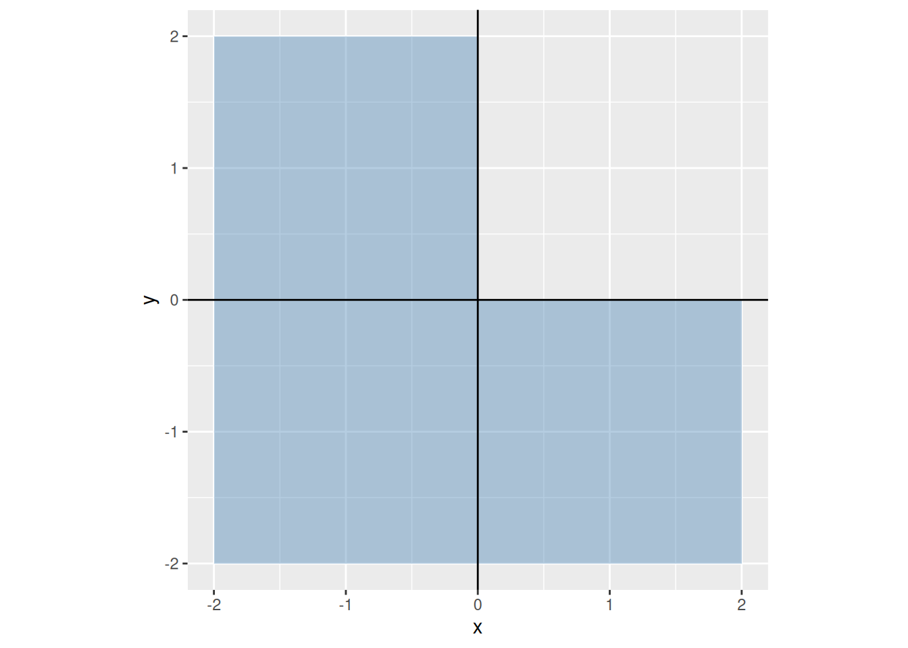

# Logical Equivalence and Negation

Code

- [Show All Code](javascript:void(0))

- [Hide All Code](javascript:void(0))

- 

  ------------------------------------------------------------------------

- [View Source](javascript:void(0))

When two propositions say the same thing, and how to say the opposite

Published

Last modified: 2026-11-12 11:28:26 (PST)

> **NOTE:**
>
> Adapted from Kameron Decker Harris’s Fall 2026 lecture notes “Logic 3”, which are typed transcriptions of Scott Wehrwein’s Spring 2025 handwritten lecture notes. The truth table for the distributive law of “and” over “or” comes from those notes; the exercises are new.

# 1 Logical equivalence

> **NOTE:**
>
> **Exercise 1 (A rule with a redundant part)** A server grants access to a user who is an administrator, or who is an administrator and is on the office network. Let $P$ be “the user is an administrator” and $Q$ be “the user is on the office network”.
>
> Make a truth table for $P \lor (P \land Q)$. In which rows does it have the same truth value as $P$?

> **NOTE:**
>
> *Solution 1*.
>
> | $P$ | $Q$ | $P \land Q$ | $P \lor (P \land Q)$ |
> |:---:|:---:|:-----------:|:--------------------:|
> |  T  |  T  |      T      |          T           |
> |  T  |  F  |      F      |          T           |
> |  F  |  T  |      F      |          F           |
> |  F  |  F  |      F      |          F           |
>
> The last column matches the $P$ column in every row, so the rule grants access exactly to the administrators, and the part about the office network changes nothing.

> **NOTE:**
>
> **Definition 1 (Logically equivalent)** Two [propositions](../chapters/propositional-logic.llms.md#def-proposition) $A$ and $B$, each built from some or all of the propositions $P_1, \ldots, P_n$ with [logical connectives](../chapters/propositional-logic.llms.md#def-logical-connective), are **logically equivalent** ([Wikipedia contributors 2026b](#ref-wikipedia_logical_equivalence)), written $A \equiv B$, when they have the same truth value in every row of a [truth table](../chapters/propositional-logic.llms.md#def-truth-table) on $P_1, \ldots, P_n$.

> **NOTE:**
>
> **Example 1 (An equivalence)** By [Exercise 1](#exr-absorption), $P \lor (P \land Q)$ is [logically equivalent](#def-logically-equivalent) to $P$: the truth table of $P \lor (P \land Q)$ has the same column as $P$, in a table with columns for both $P$ and $Q$.

> **NOTE:**
>
> *Remark 1* (Notation for logical equivalence). $A \equiv B$, read “$A$ is [logically equivalent](#def-logically-equivalent) to $B$”, is a claim about $A$ and $B$, not a new proposition built from them with a logical connective ([Definition: Logical connective](../chapters/propositional-logic.llms.md#def-logical-connective)). Some books write $A \Leftrightarrow B$ or $A \iff B$ for it instead, which is easy to confuse with the biconditional ([Definition: If and only if](../chapters/propositional-logic.llms.md#def-iff)); these notes use $\equiv$.
>
> Logical equivalence can be chained: if $A \equiv B$ and $B \equiv C$, then $A \equiv C$, since in each row $A$ has the value of $B$, which has the value of $C$.

> **NOTE:**
>
> **Exercise 2 (Not both)** A continuous integration server runs two test suites. Let $P$ be “the unit tests pass” and $Q$ be “the integration tests pass”.
>
> Is “it is not the case that both suites pass”, $\neg (P \land Q)$, [logically equivalent](#def-logically-equivalent) to “neither suite passes”, $\neg P \land \neg Q$?

> **NOTE:**
>
> *Solution 2*.
>
> | $P$ | $Q$ | $P \land Q$ | $\neg (P \land Q)$ | $\neg P$ | $\neg Q$ | $\neg P \land \neg Q$ |
> |:---:|:---:|:-----------:|:------------------:|:--------:|:--------:|:---------------------:|
> |  T  |  T  |      T      |         F          |    F     |    F     |           F           |
> |  T  |  F  |      F      |         T          |    F     |    T     |           F           |
> |  F  |  T  |      F      |         T          |    T     |    F     |           F           |
> |  F  |  F  |      F      |         T          |    T     |    T     |           T           |
>
> No. The two columns differ in the second and third rows, where exactly one suite passes: then it is true that not both pass, but false that neither passes.

> **NOTE:**
>
> **Definition 2 (Tautology)** A **tautology** is a [proposition](../chapters/propositional-logic.llms.md#def-proposition) that is true in every row of its [truth table](../chapters/propositional-logic.llms.md#def-truth-table).

> **NOTE:**
>
> **Example 2 (A tautology)** $P \lor \neg P$ is a tautology ([Definition 2](#def-tautology)):
>
> | $P$ | $\neg P$ | $P \lor \neg P$ |
> |:---:|:--------:|:---------------:|
> |  T  |    F     |        T        |
> |  F  |    T     |        T        |

> **NOTE:**
>
> **Definition 3 (Contradiction)** A **contradiction** is a [proposition](../chapters/propositional-logic.llms.md#def-proposition) that is false in every row of its [truth table](../chapters/propositional-logic.llms.md#def-truth-table).

> **NOTE:**
>
> **Example 3 (A contradiction)** $P \land \neg P$ is a contradiction ([Definition 3](#def-contradiction)):
>
> | $P$ | $\neg P$ | $P \land \neg P$ |
> |:---:|:--------:|:----------------:|
> |  T  |    F     |        F         |
> |  F  |    T     |        F         |

> **NOTE:**
>
> *Remark 2* (Contradictions in proofs). A proof by contradiction is named for this kind of proposition: it assumes the negation of what it proves, and derives a contradiction ([Definition 3](#def-contradiction)), such as $Q \land \neg Q$.

> **NOTE:**
>
> **Theorem 1 (Equivalence is a tautological biconditional)** For [propositions](../chapters/propositional-logic.llms.md#def-proposition) $A$ and $B$, $A$ and $B$ are [logically equivalent](#def-logically-equivalent) exactly when $A \Leftrightarrow B$ is a [tautology](#def-tautology).

> **NOTE:**
>
> *Proof*. By the definition of [if and only if](../chapters/propositional-logic.llms.md#def-iff), $A \Leftrightarrow B$ is true in a row of the [truth table](../chapters/propositional-logic.llms.md#def-truth-table) exactly when $A$ and $B$ have the same truth value in that row. So $A \Leftrightarrow B$ is true in every row exactly when $A$ and $B$ have the same truth value in every row, which is the definition of $A \equiv B$.

> **NOTE:**
>
> **Example 4 (An equivalence as a tautology)** Since $P \lor (P \land Q) \equiv P$ ([Example 1](#exm-logical-equivalence)), [Theorem 1](#thm-equivalence-iff) says that $(P \lor (P \land Q)) \Leftrightarrow P$ is a tautology.

> **NOTE:**
>
> **Exercise 3 (Does “or” distribute over “and”?)** In arithmetic, multiplication distributes over addition: $a (b + c) = a b + a c$. Use a truth table to decide whether “or” distributes over “and”: is $A \lor (B \land C) \equiv (A \lor B) \land (A \lor C)$?

> **NOTE:**
>
> *Solution 3*.
>
> | $A$ | $B$ | $C$ | $B \land C$ | $A \lor (B \land C)$ | $A \lor B$ | $A \lor C$ | $(A \lor B) \land (A \lor C)$ |
> |:--:|:--:|:--:|:--:|:--:|:--:|:--:|:--:|
> | T | T | T | T | T | T | T | T |
> | T | T | F | F | T | T | T | T |
> | T | F | T | F | T | T | T | T |
> | T | F | F | F | T | T | T | T |
> | F | T | T | T | T | T | T | T |
> | F | T | F | F | F | T | F | F |
> | F | F | T | F | F | F | T | F |
> | F | F | F | F | F | F | F | F |
>
> Yes: the fifth and last columns match in every row. Addition does not distribute over multiplication in arithmetic: $1 + 2 \cdot 3 = 7$, but $(1 + 2)(1 + 3) = 12$. But “or” distributes over “and”.

> **NOTE:**
>
> **Theorem 2 (Distributive laws for propositions)** For [propositions](../chapters/propositional-logic.llms.md#def-proposition) $A$, $B$ and $C$:
>
> $$\begin{aligned}
> A \land (B \lor C) &\equiv (A \land B) \lor (A \land C) \\
> A \lor (B \land C) &\equiv (A \lor B) \land (A \lor C)
> \end{aligned}$$

> **NOTE:**
>
> *Proof*. By the definitions of [and](../chapters/propositional-logic.llms.md#def-and) and [or](../chapters/propositional-logic.llms.md#def-or), the [truth table](../chapters/propositional-logic.llms.md#def-truth-table) for the first law is:
>
> | $A$ | $B$ | $C$ | $A \land (B \lor C)$ | $(A \land B) \lor (A \land C)$ |
> |:---:|:---:|:---:|:--------------------:|:------------------------------:|
> |  T  |  T  |  T  |          T           |               T                |
> |  T  |  T  |  F  |          T           |               T                |
> |  T  |  F  |  T  |          T           |               T                |
> |  T  |  F  |  F  |          F           |               F                |
> |  F  |  T  |  T  |          F           |               F                |
> |  F  |  T  |  F  |          F           |               F                |
> |  F  |  F  |  T  |          F           |               F                |
> |  F  |  F  |  F  |          F           |               F                |
>
> and for the second law:
>
> | $A$ | $B$ | $C$ | $A \lor (B \land C)$ | $(A \lor B) \land (A \lor C)$ |
> |:---:|:---:|:---:|:--------------------:|:-----------------------------:|
> |  T  |  T  |  T  |          T           |               T               |
> |  T  |  T  |  F  |          T           |               T               |
> |  T  |  F  |  T  |          T           |               T               |
> |  T  |  F  |  F  |          T           |               T               |
> |  F  |  T  |  T  |          T           |               T               |
> |  F  |  T  |  F  |          F           |               F               |
> |  F  |  F  |  T  |          F           |               F               |
> |  F  |  F  |  F  |          F           |               F               |
>
> In each table the last two columns match in every row, so each law is a [logical equivalence](#def-logically-equivalent).

> **NOTE:**
>
> **Example 5 (Distributing “and”)** For an integer $x$, “$x$ is even, and $x > 0$ or $x < 0$” is logically equivalent, by law 1 of [Theorem 2](#thm-distributive), to “$x$ is even and $x > 0$, or $x$ is even and $x < 0$”.

> **NOTE:**
>
> *Remark 3* (Checking an equivalence in Racket). A truth table is a loop over every combination of truth values, so a program can check an equivalence. In Racket, `for*/and` runs its body for every combination of `p` and `q`, and returns `#f` as soon as the body returns `#f`, and `#t` if it never does:
>
> ``` racket
> (for*/and ([p '(#t #f)]
>            [q '(#t #f)])
>   (equal? (or p (and p q)) p))
> ; #t
> ```
>
> The result agrees with [Exercise 1](#exr-absorption). With a new body, the same loop checks whether the two statements of [Exercise 2](#exr-not-and) are equivalent:
>
> ``` racket
> (for*/and ([p '(#t #f)]
>            [q '(#t #f)])
>   (equal? (not (and p q)) (and (not p) (not q))))
> ; #f
> ```
>
> This result agrees with [Exercise 2](#exr-not-and).

# 2 Negation

> **NOTE:**
>
> **Exercise 4 (When is the door locked?)** A door opens when the badge is valid, the PIN is correct, and it is a weekday. Let $B$ be “the badge is valid”, $N$ be “the PIN is correct” and $W$ be “it is a weekday”, so the door stays locked when $\neg (B \land N \land W)$ is true.
>
> Describe when the door stays locked with a sentence that puts “not” only in front of $B$, $N$ or $W$, never in front of a compound proposition.

> **NOTE:**
>
> *Solution 4*. The door stays locked when the badge is not valid, the PIN is not correct, or it is not a weekday: $\neg B \lor \neg N \lor \neg W$. $B \land N \land W$ is false exactly when at least one of $B$, $N$ and $W$ is false.

> **NOTE:**
>
> **Theorem 3 (Double negation)** For a [proposition](../chapters/propositional-logic.llms.md#def-proposition) $P$,
>
> $$\neg \neg P \equiv P.$$

> **NOTE:**
>
> *Proof*. By the definition of [not](../chapters/propositional-logic.llms.md#def-not), the [truth table](../chapters/propositional-logic.llms.md#def-truth-table) is:
>
> | $P$ | $\neg P$ | $\neg \neg P$ |
> |:---:|:--------:|:-------------:|
> |  T  |    F     |       T       |
> |  F  |    T     |       F       |
>
> The first and last columns match in both rows, so the two sides are [logically equivalent](#def-logically-equivalent).

> **NOTE:**
>
> **Example 6 (Not unreadable)** “It is not the case that the file is not readable” means “the file is readable” ([Theorem 3](#thm-double-negation)).

> **NOTE:**
>
> **Theorem 4 (Replacing a part by an equivalent part)** Let $A$ and $B$ be [logically equivalent](#def-logically-equivalent) [propositions](../chapters/propositional-logic.llms.md#def-proposition). Let $F$ be a [proposition](../chapters/propositional-logic.llms.md#def-proposition) built from $A$ and other propositions with [logical connectives](../chapters/propositional-logic.llms.md#def-logical-connective), and let $F'$ be $F$ with $A$ replaced by $B$. Then $F \equiv F'$.

> **NOTE:**
>
> *Proof*. The truth value of $F$ in a row of its [truth table](../chapters/propositional-logic.llms.md#def-truth-table) is computed from the truth values of its parts in that row, using the truth table of each connective. $F'$ is computed the same way, except that $B$ takes the place of $A$. $A$ and $B$ have the same truth value in every row, so each step of the computation gives the same value for $F'$ as for $F$. So $F$ and $F'$ have the same truth value in every row.

> **NOTE:**
>
> **Example 7 (Replacing a part)** Since $P \lor (P \land Q) \equiv P$ ([Example 1](#exm-logical-equivalence)), [Theorem 4](#thm-substitution-logic) gives $R \land (P \lor (P \land Q)) \equiv R \land P$ and $\neg (P \lor (P \land Q)) \equiv \neg P$.

> **NOTE:**
>
> **Example 8 (Simplifying part of a proposition)**  
>
> By [double negation](#thm-double-negation), $\neg \neg Q \equiv Q$. Take $F$ to be $\neg P \lor \neg \neg Q$, with $A = \neg \neg Q$ and $B = Q$. By [replacing a part by an equivalent part](#thm-substitution-logic),
>
> $$\neg P \lor \neg \neg Q \equiv \neg P \lor Q.$$

> **NOTE:**
>
> **Theorem 5 (De Morgan’s law for a conjunction)** For any [propositions](../chapters/propositional-logic.llms.md#def-proposition) $P$ and $Q$ ([Wikipedia contributors 2026a](#ref-wikipedia_de_morgans_laws)):
>
> $$\neg (P \land Q) \equiv \neg P \lor \neg Q$$

> **NOTE:**
>
> *Proof*. Each side is built from $P$ and $Q$, so by [Definition 1](#def-logically-equivalent) it is enough to compare the two sides in each of the four rows of a [truth table](../chapters/propositional-logic.llms.md#def-truth-table):
>
> | $P$ | $Q$ | $\neg (P \land Q)$ | $\neg P \lor \neg Q$ |
> |:---:|:---:|:------------------:|:--------------------:|
> |  T  |  T  |         F          |          F           |
> |  T  |  F  |         T          |          T           |
> |  F  |  T  |         T          |          T           |
> |  F  |  F  |         T          |          T           |
>
> The third and fourth columns agree in every row.

> **NOTE:**
>
> **Example 9 (Not both coordinates positive)** For real numbers $x$ and $y$, by [De Morgan’s law for a conjunction](#thm-de-morgan-logic), “not ($x > 0$ and $y > 0$)” is logically equivalent to “$x \le 0$ or $y \le 0$”. The plot that follows shades the points $(x, y)$ where both sentences are true: every point except those with both coordinates positive.
>
> Show code
>
> ``` r
> # the region x <= 0 or y <= 0, as two rectangles:
> # the left half, and the bottom right quarter
> regions <- tibble::tibble(
>   xmin = c(-2, 0),
>   xmax = c(0, 2),
>   ymin = c(-2, -2),
>   ymax = c(2, 0)
> )
>
> region_plot <- ggplot2::ggplot(regions) +
>   ggplot2::geom_rect(
>     ggplot2::aes(xmin = xmin, xmax = xmax, ymin = ymin, ymax = ymax),
>     fill = "steelblue",
>     alpha = 0.4
>   ) +
>   ggplot2::geom_hline(yintercept = 0) +
>   ggplot2::geom_vline(xintercept = 0) +
>   ggplot2::coord_equal() +
>   ggplot2::labs(x = "x", y = "y")
>
> region_plot
> ```
>
> [](equivalence-negation_files/figure-html/unnamed-chunk-3-1.png)

> **NOTE:**
>
> **Theorem 6 (De Morgan’s law for a disjunction)** For any [propositions](../chapters/propositional-logic.llms.md#def-proposition) $P$ and $Q$ ([Wikipedia contributors 2026a](#ref-wikipedia_de_morgans_laws)):
>
> $$\neg (P \lor Q) \equiv \neg P \land \neg Q$$

> **NOTE:**
>
> *Proof*. Each side is built from $P$ and $Q$, so by [Definition 1](#def-logically-equivalent) it is enough to compare the two sides in each of the four rows of a [truth table](../chapters/propositional-logic.llms.md#def-truth-table):
>
> | $P$ | $Q$ | $\neg (P \lor Q)$ | $\neg P \land \neg Q$ |
> |:---:|:---:|:-----------------:|:---------------------:|
> |  T  |  T  |         F         |           F           |
> |  T  |  F  |         F         |           F           |
> |  F  |  T  |         F         |           F           |
> |  F  |  F  |         T         |           T           |
>
> The third and fourth columns agree in every row.

> **NOTE:**
>
> **Example 10 (Neither coordinate positive)** For real numbers $x$ and $y$, by [De Morgan’s law for a disjunction](#thm-de-morgan-disjunction), “not ($x > 0$ or $y > 0$)” is logically equivalent to “$x \le 0$ and $y \le 0$”.

> **NOTE:**
>
> **Exercise 5 (A broken deployment rule)** A team’s rule is “if the tests pass, then the build is deployed”. Let $P$ be “the tests pass” and $Q$ be “the build is deployed”. The rule is broken on the days when $\neg (P \Rightarrow Q)$ is true.
>
> Write $\neg (P \Rightarrow Q)$ without $\Rightarrow$, and in English.

> **NOTE:**
>
> *Solution 5*. The rule is broken on a day when the tests pass and the build is not deployed: $P \land \neg Q$. On a day when the tests fail, the rule is not broken, whether or not the build is deployed.
>
> “If the tests pass, then the build is not deployed”, $P \Rightarrow \neg Q$, is not the negation: on a day when the tests fail, it is true, and so is the rule.

> **NOTE:**
>
> **Theorem 7 (Negating a conditional)** For [propositions](../chapters/propositional-logic.llms.md#def-proposition) $P$ and $Q$,
>
> $$\neg (P \Rightarrow Q) \equiv P \land \neg Q.$$

> **NOTE:**
>
> *Proof*. By the definition of [implies](../chapters/propositional-logic.llms.md#def-implies), $P \Rightarrow Q$ is false exactly when $P$ is true and $Q$ is false. So $\neg (P \Rightarrow Q)$ is true exactly in that row of the [truth table](../chapters/propositional-logic.llms.md#def-truth-table). By the definition of [and](../chapters/propositional-logic.llms.md#def-and), $P \land \neg Q$ is true exactly when $P$ is true and $\neg Q$ is true. That is the same row.

> **NOTE:**
>
> **Example 11 (When a search claim fails)** The negation of “if the list is sorted, then binary search finds the key” is “the list is sorted and binary search does not find the key” ([Theorem 7](#thm-negate-conditional)).

> **NOTE:**
>
> **Corollary 1 (A conditional without the arrow)** For [propositions](../chapters/propositional-logic.llms.md#def-proposition) $P$ and $Q$,
>
> $$(P \Rightarrow Q) \equiv (\neg P \lor Q).$$

> **NOTE:**
>
> *Proof*.
>
> 1.  By [double negation](#thm-double-negation), $P \Rightarrow Q \equiv \neg \neg (P \Rightarrow Q)$.
> 2.  By [negating a conditional](#thm-negate-conditional) and [replacing a part by an equivalent part](#thm-substitution-logic), $\neg \neg (P \Rightarrow Q) \equiv \neg (P \land \neg Q)$.
> 3.  By [De Morgan’s law for a conjunction](#thm-de-morgan-logic), $\neg (P \land \neg Q) \equiv \neg P \lor \neg \neg Q$.
> 4.  By double negation and replacing a part by an equivalent part again, $\neg P \lor \neg \neg Q \equiv \neg P \lor Q$.

> **NOTE:**
>
> **Example 12 (A rule as an “or”)** By [Corollary 1](#cor-conditional-as-or), “if the tests pass, then the build is deployed” is logically equivalent to “the tests fail or the build is deployed”.

# 3 Negating quantified propositions

> **NOTE:**
>
> **Exercise 6 (Not every test passes)** Let $T$ be the set of tests in a test suite, and let $P(t)$ be “test $t$ passes”. The report “every test passes” is $\forall t \in T, P(t)$.
>
> Write the negation of this report in English and in symbols, without putting $\neg$ in front of a quantifier.

> **NOTE:**
>
> *Solution 6*. “Some test fails”: $\exists t \in T, \neg P(t)$. “Every test passes” is false exactly when at least one test does not pass.
>
> “Every test fails”, $\forall t \in T, \neg P(t)$, is not the negation: when some tests pass and some fail, both it and “every test passes” are false.

> **NOTE:**
>
> **Theorem 8 (De Morgan’s law for a universal quantifier)** For a [set](../chapters/sets.llms.md#def-set) $S$ and a [predicate](../chapters/propositional-logic.llms.md#def-predicate) $P(x)$ whose [domain of discourse](../chapters/predicates-quantifiers.llms.md#def-domain-of-discourse) is $S$:
>
> $$\neg (\forall x \in S, P(x)) \equiv \exists x \in S, \neg P(x)$$

> **NOTE:**
>
> *Proof*. By the definition of the [universal quantifier](../chapters/predicates-quantifiers.llms.md#def-universal-quantifier), $\forall x \in S, P(x)$ is false exactly when $P(x)$ is false for at least one $x$ in $S$. By the definition of the [existential quantifier](../chapters/predicates-quantifiers.llms.md#def-existential-quantifier), that is exactly when $\exists x \in S, \neg P(x)$ is true.

> **NOTE:**
>
> **Theorem 9 (De Morgan’s law for an existential quantifier)** For a [set](../chapters/sets.llms.md#def-set) $S$ and a [predicate](../chapters/propositional-logic.llms.md#def-predicate) $P(x)$ whose [domain of discourse](../chapters/predicates-quantifiers.llms.md#def-domain-of-discourse) is $S$:
>
> $$\neg (\exists x \in S, P(x)) \equiv \forall x \in S, \neg P(x)$$

> **NOTE:**
>
> *Proof*. By the definition of the [existential quantifier](../chapters/predicates-quantifiers.llms.md#def-existential-quantifier), $\exists x \in S, P(x)$ is false exactly when $P(x)$ is false for every $x$ in $S$. By the definition of the [universal quantifier](../chapters/predicates-quantifiers.llms.md#def-universal-quantifier), that is exactly when $\forall x \in S, \neg P(x)$ is true.

> **NOTE:**
>
> **Example 13 (No natural square root of 2)** By [Theorem 9](#thm-negate-existential), $\neg (\exists n \in \mathbb{N}, n^2 = 2)$ has the same truth value as $\forall n \in \mathbb{N}, n^2 \ne 2$.

> **NOTE:**
>
> *Remark 4* (De Morgan’s laws for quantifiers). [Theorem 8](#thm-negate-quantifiers) and [Theorem 9](#thm-negate-existential) are often written $\neg \forall x, P(x) \equiv \exists x, \neg P(x)$ and $\neg \exists x, P(x) \equiv \forall x, \neg P(x)$. These notes say “has the same truth value” instead, because $P(x)$ is a predicate, not a proposition, so [Definition 1](#def-logically-equivalent), which compares truth tables, does not apply.
>
> On a finite set $S = \{a, b\}$, $\forall x \in S, P(x)$ has the same truth value as $P(a) \land P(b)$, and $\exists x \in S, P(x)$ has the same truth value as $P(a) \lor P(b)$, so these two theorems are De Morgan’s laws for a conjunction and a disjunction ([Theorem 5](#thm-de-morgan-logic), [Theorem 6](#thm-de-morgan-disjunction)) applied to $P(a)$ and $P(b)$.
>
> Racket shows the same pattern on a list: `(not (andmap even? (list 2 4 5)))` and `(ormap odd? (list 2 4 5))` both return `#t`.

> **NOTE:**
>
> *Remark 5* (Pushing a negation inward). To negate a proposition built with $\neg$, $\land$, $\lor$, $\Rightarrow$ and quantifiers, move the $\neg$ inward one step at a time:
>
> - across a quantifier, with [Theorem 8](#thm-negate-quantifiers) or [Theorem 9](#thm-negate-existential), which swap $\forall$ and $\exists$;
> - across $\land$ or $\lor$, with De Morgan’s laws ([Theorem 5](#thm-de-morgan-logic), [Theorem 6](#thm-de-morgan-disjunction));
> - across $\Rightarrow$, with [Theorem 7](#thm-negate-conditional);
> - across another $\neg$, with double negation ([Theorem 3](#thm-double-negation)).
>
> Stop when every $\neg$ sits in front of a proposition with no connective or quantifier inside it. The result is easier to read and to check than a $\neg$ in front of the whole proposition.

> **NOTE:**
>
> **Exercise 7 (Completing a palindrome)** Let $W$ be the set of words made of the letters a and b, including the empty word, and write $s t$ for word $s$ followed by word $t$. A palindrome is a word that reads the same forwards and backwards, such as abba.
>
> Write the negation of $$\forall s \in W,\ \exists t \in W,\ s t \text{ is a palindrome}$$ without putting $\neg$ in front of a quantifier.

> **NOTE:**
>
> *Solution 7*. Push the negation inward, from the outside in. First, by [Theorem 8](#thm-negate-quantifiers), the negation has the truth value of $$\exists s \in W,\ \neg (\exists t \in W,\ s t \text{ is a palindrome}).$$ For each word $s$, [Theorem 9](#thm-negate-existential) says that $\neg (\exists t \in W,\ s t \text{ is a palindrome})$ has the truth value of $\forall t \in W,\ s t \text{ is not a palindrome}$. These have the same truth value for every $s$, so the $\exists s$ propositions built from them do too ([Definition: Existential quantifier](../chapters/predicates-quantifiers.llms.md#def-existential-quantifier)), and the negation has the truth value of $$\exists s \in W,\ \forall t \in W,\ s t \text{ is not a palindrome}.$$ In English: some word cannot be made into a palindrome by adding letters at its end.

> **NOTE:**
>
> **Exercise 8 (Which one is true?)** Which is true: $\forall s \in W,\ \exists t \in W,\ s t \text{ is a palindrome}$, from [Exercise 7](#exr-palindrome), or its negation?

> **NOTE:**
>
> *Solution 8*. The original is true, so its negation is false. For any word $s$, let $t$ be $s$ written backwards; then $s t$ reads the same backwards. For example, for $s = \text{aab}$, $t = \text{baa}$ and $s t = \text{aabbaa}$.

# Definitions on this page

- [Definition 1 (Logically equivalent)](#def-logically-equivalent)
- [Definition 2 (Tautology)](#def-tautology)
- [Definition 3 (Contradiction)](#def-contradiction)

# References

Wikipedia contributors. 2026a. *De Morgan’s Laws — Wikipedia, the Free Encyclopedia*. <https://en.wikipedia.org/wiki/De_Morgan%27s_laws>.

Wikipedia contributors. 2026b. *Logical Equivalence — Wikipedia, the Free Encyclopedia*. <https://en.wikipedia.org/wiki/Logical_equivalence>.

Back to top
