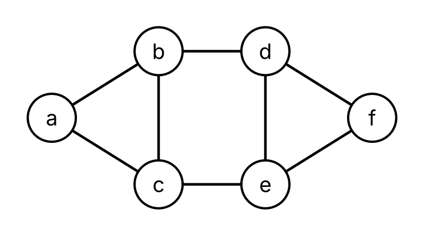
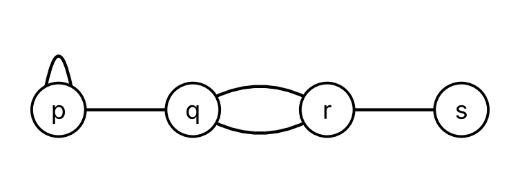
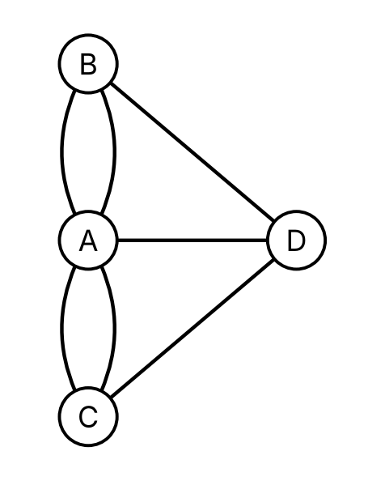
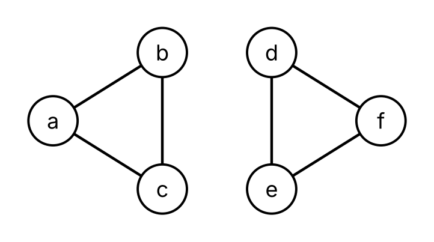
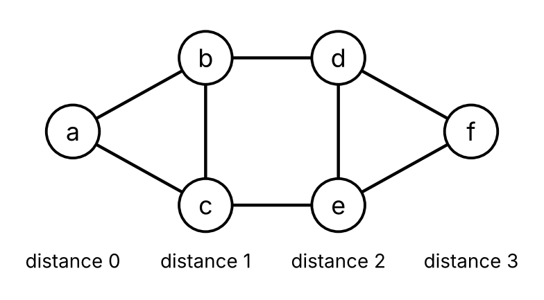

# Graphs

Code

Vertices and edges, degrees, walks and connectedness, Euler circuits, Hamiltonian cycles, and graph search

Published

Last modified: 2026-10-30 01:15:16 (PDT)

> **NOTE:**
>
> The topics of this chapter, and their order, follow the course calendar and Kameron Decker Harris’s Fall 2026 lecture notes on graphs. These come from those notes:
>
> - a graph as a set of vertices and a set of edges, each edge with one or two endpoints;
> - loops, parallel (multiple) edges, simple graphs and directed graphs;
> - adjacent vertices, the degree of a vertex, with a loop counted twice, and the in-degree and out-degree in a directed graph;
> - the handshake theorem, the fact that a graph has an even number of vertices of odd degree, and the sums of the in-degrees and out-degrees;
> - complete graphs \\K_n\\, cycle graphs \\C_n\\, bipartite graphs and subgraphs;
> - adjacency lists and adjacency matrices, with parallel edges counted in the matrix, and when a list takes less space than a matrix;
> - walks (which the notes call paths), circuits and cycles, connected graphs and connected components, and strongly connected directed graphs;
> - counting walks with the powers of the adjacency matrix, proved by induction on the length.
>
> The pseudocode for breadth-first and depth-first search, and the use of a queue and of recursion in them, follow the course’s handout on graph extensions. Euler circuits and trails and Hamiltonian cycles follow the course calendar, with the definitions cited with them. Incident edges, neighborhoods and weakly connected directed graphs are added here. The proofs of the handshake theorem, of the even number of vertices of odd degree and of counting walks follow the lecture notes. The examples, the exercises, the Racket functions and the other proofs are new.

# 1 Graphs

> **NOTE:**
>
> **Exercise 1 (Computers and cables)** An office has six computers, named \\a\\, \\b\\, \\c\\, \\d\\, \\e\\ and \\f\\. A cable joins the two computers in each of these eight pairs:
>
> \\ {\mathopen{}\left\\a, b\right\\\mathclose{}}, {\mathopen{}\left\\a, c\right\\\mathclose{}}, {\mathopen{}\left\\b, c\right\\\mathclose{}}, {\mathopen{}\left\\b, d\right\\\mathclose{}}, {\mathopen{}\left\\c, e\right\\\mathclose{}}, {\mathopen{}\left\\d, e\right\\\mathclose{}}, {\mathopen{}\left\\d, f\right\\\mathclose{}}, {\mathopen{}\left\\e, f\right\\\mathclose{}}. \\
>
> Draw a point for each computer and a line for each cable. How many cables have computer \\d\\ at one end?

> **NOTE:**
>
> *Solution 1*. [Figure 1](#fig-office) is one drawing. The cables with \\d\\ at one end are \\{\mathopen{}\left\\b, d\right\\\mathclose{}}\\, \\{\mathopen{}\left\\d, e\right\\\mathclose{}}\\ and \\{\mathopen{}\left\\d, f\right\\\mathclose{}}\\, so there are three of them.
>
> [](../images/graphs-office.png "Figure 1: The computers and cables of Exercise 1.")
>
> Figure 1: The computers and cables of [Exercise 1](#exr-office-cables).

> **NOTE:**
>
> **Definition 1 (Graph)** A **graph** \\G = (V, E)\\ ([Wikipedia contributors 2026o](#ref-wikipedia_graph_discrete_mathematics)) consists of
>
> - a nonempty finite set \\V\\ ([Definition: Finite set](../chapters/sets.llms.md#def-finite-set)), whose elements are called the *vertices* of \\G\\;
> - a finite set \\E\\, whose elements are called the *edges* of \\G\\;
> - for each edge, a set of one or two vertices, called the *endpoints* of the edge.
>
> An edge *joins* its endpoints. To stress that its edges have no direction, \\G\\ is also called an *undirected* graph.

> **NOTE:**
>
> **Example 1 (The office graph)** The computers and cables of [Exercise 1](#exr-office-cables) form a graph ([Definition 1](#def-graph-vertices-edges)) \\G = (V, E)\\, with one vertex for each computer and one edge for each cable:
>
> \\ \begin{aligned} V &= {\mathopen{}\left\\a, b, c, d, e, f\right\\\mathclose{}}, \\ E &= {\mathopen{}\left\\{\mathopen{}\left\\a, b\right\\\mathclose{}}, {\mathopen{}\left\\a, c\right\\\mathclose{}}, {\mathopen{}\left\\b, c\right\\\mathclose{}}, {\mathopen{}\left\\b, d\right\\\mathclose{}}, {\mathopen{}\left\\c, e\right\\\mathclose{}}, {\mathopen{}\left\\d, e\right\\\mathclose{}}, {\mathopen{}\left\\d, f\right\\\mathclose{}}, {\mathopen{}\left\\e, f\right\\\mathclose{}}\right\\\mathclose{}}. \end{aligned} \\
>
> Here each edge is written as the set of its endpoints: the edge \\{\mathopen{}\left\\b, d\right\\\mathclose{}}\\ joins the vertices \\b\\ and \\d\\. [Figure 1](#fig-office) draws \\G\\. We call \\G\\ the *office graph*.

> **NOTE:**
>
> *Remark 1* (A drawing is not the graph). A graph ([Definition 1](#def-graph-vertices-edges)) says only which vertices are the endpoints of which edges. A drawing of it adds things that are not part of the graph: where the points are, how long and how curved the lines are, and whether two lines cross. Two drawings that put the points in different places draw the same graph, as long as they join the same pairs of points.
>
> Graphs here are different objects from graphs of functions ([Definition: Graph of a function](../chapters/relations.llms.md#def-graph)), just as directed graphs of relations were ([Remark: Two uses of the word “graph”](../chapters/relations.llms.md#rem-graph-words)).

> **NOTE:**
>
> **Definition 2 (Loop)** A **loop** ([Wikipedia contributors 2026t](#ref-wikipedia_loop_graph_theory)) is an edge of a graph ([Definition 1](#def-graph-vertices-edges)) that has only one endpoint. It joins that vertex to itself.

> **NOTE:**
>
> **Definition 3 (Parallel edges)** Two different edges of a graph ([Definition 1](#def-graph-vertices-edges)) are **parallel edges** ([Wikipedia contributors 2026u](#ref-wikipedia_multiple_edges)) if they have the same set of endpoints.

> **NOTE:**
>
> **Example 2 (A loop and two parallel edges)** The graph in [Figure 2](#fig-loop-parallel) has vertices \\p\\, \\q\\, \\r\\ and \\s\\, and five edges:
>
> - a loop ([Definition 2](#def-graph-loop)) at \\p\\;
> - an edge joining \\p\\ and \\q\\;
> - two parallel edges ([Definition 3](#def-parallel-edges)) joining \\q\\ and \\r\\;
> - an edge joining \\r\\ and \\s\\.
>
> The two edges joining \\q\\ and \\r\\ have the same set of endpoints, \\{\mathopen{}\left\\q, r\right\\\mathclose{}}\\, so writing an edge as the set of its endpoints does not tell them apart. We name them instead, say \\e_1\\ and \\e_2\\, and say that each has endpoints \\q\\ and \\r\\.
>
> [](../images/graphs-loop-parallel.png "Figure 2: A graph with a loop at p and two parallel edges between q and r.")
>
> Figure 2: A graph with a loop at \\p\\ and two parallel edges between \\q\\ and \\r\\.

> **NOTE:**
>
> **Example 3 (The bridges of Königsberg)** The city of Königsberg was built on four pieces of land, divided by a river, with seven bridges between them ([Wikipedia contributors 2026x](#ref-wikipedia_seven_bridges_of_konigsberg)). Name the pieces of land \\A\\, \\B\\, \\C\\ and \\D\\, where \\A\\ is an island. Two bridges joined \\A\\ and \\B\\, two joined \\A\\ and \\C\\, and one bridge joined each of the pairs \\{\mathopen{}\left\\A, D\right\\\mathclose{}}\\, \\{\mathopen{}\left\\B, D\right\\\mathclose{}}\\ and \\{\mathopen{}\left\\C, D\right\\\mathclose{}}\\.
>
> [Figure 3](#fig-konigsberg) draws the graph ([Definition 1](#def-graph-vertices-edges)) with a vertex for each piece of land and an edge for each bridge. It has two pairs of parallel edges ([Definition 3](#def-parallel-edges)), and no loops ([Definition 2](#def-graph-loop)).
>
> [](../images/graphs-konigsberg.png "Figure 3: The bridges of Königsberg as a graph: a vertex for each piece of land, and an edge for each bridge.")
>
> Figure 3: The bridges of Königsberg as a graph: a vertex for each piece of land, and an edge for each bridge.

> **NOTE:**
>
> **Definition 4 (Simple graph)** A graph ([Definition 1](#def-graph-vertices-edges)) is **simple** ([Wikipedia contributors 2026o](#ref-wikipedia_graph_discrete_mathematics)) if it has no loops ([Definition 2](#def-graph-loop)) and no parallel edges ([Definition 3](#def-parallel-edges)).

> **NOTE:**
>
> **Example 4 (Simple or not)**  
>
> - The office graph of [Example 1](#exm-office-graph) is simple ([Definition 4](#def-simple-graph)): each of its edges has two endpoints, and no two of its edges have the same endpoints.
> - The graph of [Example 2](#exm-loop-parallel) is not simple, since it has a loop and two parallel edges.
> - The bridge graph of [Example 3](#exm-konigsberg) is not simple, since it has parallel edges.
>
> In a simple graph, each edge is the only edge with its two endpoints, so writing each edge as the set of its endpoints, as in [Example 1](#exm-office-graph), names every edge exactly once.

> **NOTE:**
>
> **Definition 5 (Directed graph (digraph))** A **directed graph**, or **digraph**, \\G = (V, E)\\ ([Wikipedia contributors 2026l](#ref-wikipedia_directed_graph)) consists of
>
> - a nonempty finite set \\V\\ of vertices;
> - a finite set \\E\\ of edges;
> - for each edge, a vertex where it *starts* and a vertex where it *ends*.
>
> An edge that starts at \\u\\ and ends at \\v\\ goes *from* \\u\\ *to* \\v\\. Two different edges of a directed graph are parallel edges ([Definition 3](#def-parallel-edges)) if they start at the same vertex and end at the same vertex. When \\G\\ has no parallel edges, we write each edge from \\u\\ to \\v\\ as the ordered pair \\(u, v)\\ ([Definition: Ordered pair](../chapters/sets.llms.md#def-ordered-pair)). An edge that starts and ends at the same vertex is a loop, as in [Definition 2](#def-graph-loop).

> **NOTE:**
>
> **Example 5 (Links between web pages)** A small website has four pages: home, about, blog and contact. [Figure 4](#fig-web) draws the directed graph ([Definition 5](#def-directed-graph)) with a vertex for each page and an edge from page \\u\\ to page \\v\\ when \\u\\ links to \\v\\. Its edges are
>
> \\ \begin{aligned} & (\text{home}, \text{about}), (\text{home}, \text{blog}), (\text{about}, \text{contact}), \\ & (\text{blog}, \text{home}), (\text{blog}, \text{blog}), (\text{blog}, \text{contact}), (\text{contact}, \text{home}). \end{aligned} \\
>
> The blog links to itself, so the edge \\(\text{blog}, \text{blog})\\ is a loop. The edges \\(\text{home}, \text{blog})\\ and \\(\text{blog}, \text{home})\\ are different edges: one starts at home and the other starts at blog.
>
> [](../images/graphs-web.png "Figure 4: The links between the four pages of a website.")
>
> Figure 4: The links between the four pages of a website.

> **NOTE:**
>
> *Remark 2* (Relations and directed graphs). Let \\R\\ be a relation on a set \\A\\. The drawing of [Definition: Directed graph of a relation](../chapters/relations.llms.md#def-relation-digraph) draws the directed graph ([Definition 5](#def-directed-graph)) with vertex set \\A\\ and edge set \\R\\. That directed graph has no parallel edges, since \\R\\ is a set and has each pair at most once. Going the other way, the edges of a directed graph with no parallel edges form a relation on its vertex set. The links of [Example 5](#exm-web-links) form the relation “links to” on the set of four pages.

# 2 Degree

> **NOTE:**
>
> **Exercise 2 (Adding up the cables)** For each computer of [Exercise 1](#exr-office-cables), count the cables that have that computer at one end. What is the sum of these six counts?

> **NOTE:**
>
> *Solution 2*. From [Figure 1](#fig-office), the counts are
>
> | Computer | \\a\\ | \\b\\ | \\c\\ | \\d\\ | \\e\\ | \\f\\ |
> |:--------:|:-----:|:-----:|:-----:|:-----:|:-----:|:-----:|
> |  Cables  |   2   |   3   |   3   |   3   |   3   |   2   |
>
> and their sum is \\2 + 3 + 3 + 3 + 3 + 2 = 16\\. That is twice the number of cables, 8, since each cable has two ends and is counted once at each.

> **NOTE:**
>
> **Definition 6 (Adjacent vertices (neighbors))** Two vertices \\u\\ and \\v\\ of a graph ([Definition 1](#def-graph-vertices-edges)) are **adjacent**, or **neighbors**, if some edge has endpoints \\u\\ and \\v\\.

> **NOTE:**
>
> **Example 6 (Neighbors in the office graph)** In the office graph ([Example 1](#exm-office-graph)), the neighbors ([Definition 6](#def-adjacent)) of \\b\\ are \\a\\, \\c\\ and \\d\\. The vertices \\a\\ and \\f\\ are not adjacent, since no edge has endpoints \\a\\ and \\f\\. In the graph of [Example 2](#exm-loop-parallel), the loop at \\p\\ makes \\p\\ adjacent to itself.

> **NOTE:**
>
> **Definition 7 (Incident)** An edge of a graph ([Definition 1](#def-graph-vertices-edges)) is **incident** with each of its endpoints.

> **NOTE:**
>
> **Example 7 (Edges at a vertex of the office graph)** In the office graph ([Example 1](#exm-office-graph)), the edges incident ([Definition 7](#def-incident)) with \\e\\ are \\{\mathopen{}\left\\c, e\right\\\mathclose{}}\\, \\{\mathopen{}\left\\d, e\right\\\mathclose{}}\\ and \\{\mathopen{}\left\\e, f\right\\\mathclose{}}\\. The edge \\{\mathopen{}\left\\c, e\right\\\mathclose{}}\\ is incident with \\c\\ and with \\e\\, and with no other vertex.

> **NOTE:**
>
> **Definition 8 (Neighborhood)** The **neighborhood** \\N(v)\\ of a vertex \\v\\ of a graph ([Definition 1](#def-graph-vertices-edges)) is the set of neighbors ([Definition 6](#def-adjacent)) of \\v\\.

> **NOTE:**
>
> **Example 8 (Neighborhoods with a loop and parallel edges)** In the graph of [Example 2](#exm-loop-parallel),
>
> \\ N(p) = {\mathopen{}\left\\p, q\right\\\mathclose{}}, \qquad N(q) = {\mathopen{}\left\\p, r\right\\\mathclose{}}, \qquad N(r) = {\mathopen{}\left\\q, s\right\\\mathclose{}}, \qquad N(s) = {\mathopen{}\left\\r\right\\\mathclose{}}. \\
>
> The loop at \\p\\ puts \\p\\ in its own neighborhood ([Definition 8](#def-neighborhood)). The two parallel edges joining \\q\\ and \\r\\ put \\r\\ in \\N(q)\\ only once, since \\N(q)\\ is a set.

> **NOTE:**
>
> **Definition 9 (Degree)** The **degree** \\\deg(v)\\ of a vertex \\v\\ of a graph ([Definition 1](#def-graph-vertices-edges)) ([Wikipedia contributors 2026j](#ref-wikipedia_degree_graph_theory)) is the number of edges that have \\v\\ as an endpoint, where each loop ([Definition 2](#def-graph-loop)) at \\v\\ counts twice.

> **NOTE:**
>
> **Example 9 (Degrees with a loop)** In the graph of [Example 2](#exm-loop-parallel) ([Figure 2](#fig-loop-parallel)), \\\deg(p) = 2 + 1 = 3\\ ([Definition 9](#def-degree)), since the loop at \\p\\ counts twice and one more edge joins \\p\\ to \\q\\. Both parallel edges ([Definition 3](#def-parallel-edges)) count at \\q\\ and at \\r\\, so
>
> \\ \deg(q) = 3, \quad \deg(r) = 3, \quad \deg(s) = 1. \\
>
> Each edge has two ends, and a loop has both of its ends at the same vertex. Counting a loop twice makes \\\deg(v)\\ the number of ends of edges at \\v\\.

> **NOTE:**
>
> **Theorem 1 (The handshake theorem)** For every graph \\G = (V, E)\\ ([Definition 1](#def-graph-vertices-edges)),
>
> \\ \sum\_{v \in V} \deg(v) = 2 {\mathopen{}\left\|E\right\|\mathclose{}}, \\
>
> where \\\deg(v)\\ is the degree ([Definition 9](#def-degree)) of \\v\\ and \\{\mathopen{}\left\|E\right\|\mathclose{}}\\ is the number of edges ([Definition: Cardinality](../chapters/sets.llms.md#def-cardinality)). It is called the handshake theorem ([Wikipedia contributors 2026r](#ref-wikipedia_handshaking_lemma)) because, when the vertices are the people at a party and the edges are the handshakes between them, it says that the numbers of hands that the people shook add up to twice the number of handshakes.

> **NOTE:**
>
> *Proof*. Each edge has two ends. An edge with two endpoints has one end at each endpoint, and a loop has both ends at its one endpoint. We count the set of all ends of all edges in two ways.
>
> Counted edge by edge, each edge gives two ends, so there are \\2 {\mathopen{}\left\|E\right\|\mathclose{}}\\ ends.
>
> Counted vertex by vertex, the ends at \\v\\ are one end of each non-loop edge with endpoint \\v\\ and two ends of each loop at \\v\\. That is \\\deg(v)\\ ends, by [Definition 9](#def-degree), and each end is at exactly one vertex, so there are \\\sum\_{v \in V} \deg(v)\\ ends.
>
> The two counts count the same set, so they are equal.

> **NOTE:**
>
> **Example 10 (Checking the handshake theorem)** In the office graph ([Example 1](#exm-office-graph)), the degrees add up to 16 ([Solution 2](#sol-degree-sum)), and \\2 {\mathopen{}\left\|E\right\|\mathclose{}} = 2 \cdot 8 = 16\\. In the graph of [Example 2](#exm-loop-parallel), the degrees of [Example 9](#exm-degree) add up to \\3 + 3 + 3 + 1 = 10\\, and \\2 {\mathopen{}\left\|E\right\|\mathclose{}} = 2 \cdot 5 = 10\\, as [Theorem 1](#thm-handshake) says.

> **NOTE:**
>
> **Corollary 1 (An even number of odd degrees)** Every graph ([Definition 1](#def-graph-vertices-edges)) has an even number of vertices of odd degree ([Definition 9](#def-degree)).

> **NOTE:**
>
> *Proof*. Let \\G = (V, E)\\ be a graph, let \\O\\ be the set of vertices of odd degree, and let \\N\\ be the set of vertices of even degree. By [Theorem 1](#thm-handshake),
>
> \\ \sum\_{v \in O} \deg(v) = 2 {\mathopen{}\left\|E\right\|\mathclose{}} - \sum\_{v \in N} \deg(v). \\
>
> The right side is an even number minus a sum of even numbers, so it is even ([Definition: Even integer](../chapters/direct-proof.llms.md#def-even-odd)). The left side is a sum of \\{\mathopen{}\left\|O\right\|\mathclose{}}\\ odd numbers. Pair the odd numbers off two at a time. The sum of each pair is even. If \\{\mathopen{}\left\|O\right\|\mathclose{}}\\ were odd, one odd number would be left over, and the left side would be an even number plus an odd number, which is odd. So \\{\mathopen{}\left\|O\right\|\mathclose{}}\\ cannot be odd, and it is even.

> **NOTE:**
>
> **Example 11 (Degrees that no graph has)** No graph has five vertices with degrees 4, 3, 3, 2 and 1. Such a graph would have three vertices of odd degree, the two of degree 3 and the one of degree 1, and [Corollary 1](#cor-odd-degree) says that the number of vertices of odd degree is even. Equivalently, by [Theorem 1](#thm-handshake), the degrees would add up to \\4 + 3 + 3 + 2 + 1 = 13\\, which is not twice a number of edges.

> **NOTE:**
>
> **Definition 10 (Out-degree)** The **out-degree** \\\deg^+(v)\\ of a vertex \\v\\ of a directed graph ([Definition 5](#def-directed-graph)) ([Wikipedia contributors 2026l](#ref-wikipedia_directed_graph)) is the number of edges that start at \\v\\.

> **NOTE:**
>
> **Definition 11 (In-degree)** The **in-degree** \\\deg^-(v)\\ of a vertex \\v\\ of a directed graph ([Definition 5](#def-directed-graph)) ([Wikipedia contributors 2026l](#ref-wikipedia_directed_graph)) is the number of edges that end at \\v\\.

> **NOTE:**
>
> **Theorem 2 (Degrees in a directed graph)** For every directed graph \\G = (V, E)\\ ([Definition 5](#def-directed-graph)),
>
> \\ \sum\_{v \in V} \deg^+(v) = {\mathopen{}\left\|E\right\|\mathclose{}} = \sum\_{v \in V} \deg^-(v), \\
>
> where \\\deg^+\\ is the out-degree ([Definition 10](#def-out-degree)) and \\\deg^-\\ is the in-degree ([Definition 11](#def-in-degree)).

> **NOTE:**
>
> *Proof*. Each edge starts at exactly one vertex, so sorting the edges by the vertex where they start puts each edge in exactly one group. The group of \\v\\ has \\\deg^+(v)\\ edges, so the sizes of the groups add up to \\\sum\_{v \in V} \deg^+(v) = {\mathopen{}\left\|E\right\|\mathclose{}}\\. Sorting the edges by the vertex where they end gives \\\sum\_{v \in V} \deg^-(v) = {\mathopen{}\left\|E\right\|\mathclose{}}\\ in the same way.

> **NOTE:**
>
> **Example 12 (Degrees of the web pages)** In the directed graph of [Example 5](#exm-web-links):
>
> |         Page          | home | about | blog | contact | Sum |
> |:---------------------:|:----:|:-----:|:----:|:-------:|:---:|
> | Out-degree \\\deg^+\\ |  2   |   1   |  3   |    1    |  7  |
> | In-degree \\\deg^-\\  |  2   |   1   |  2   |    2    |  7  |
>
> Both rows add up to 7, the number of edges, as [Theorem 2](#thm-directed-degrees) says. The loop at blog counts once in its out-degree ([Definition 10](#def-out-degree)) and once in its in-degree ([Definition 11](#def-in-degree)).

# 3 Special graphs and subgraphs

> **NOTE:**
>
> **Exercise 3 (A chess tournament)** A chess club has 8 members, and every two members play each other exactly once. How many games are played?

> **NOTE:**
>
> *Solution 3*. Draw a vertex for each member and an edge for each game. Each member plays the 7 others, so each vertex has degree 7 ([Definition 9](#def-degree)). By [Theorem 1](#thm-handshake), \\2 {\mathopen{}\left\|E\right\|\mathclose{}} = 8 \cdot 7 = 56\\, so there are \\{\mathopen{}\left\|E\right\|\mathclose{}} = 28\\ games.

> **NOTE:**
>
> **Definition 12 (Complete graph)** For a positive integer \\n\\, a **complete graph** \\K_n\\ ([Wikipedia contributors 2026e](#ref-wikipedia_complete_graph)) is a simple graph ([Definition 4](#def-simple-graph)) with \\n\\ vertices in which every two different vertices are adjacent ([Definition 6](#def-adjacent)). Two complete graphs with \\n\\ vertices differ only in the names of their vertices, so we write \\K_n\\ for any of them.

> **NOTE:**
>
> **Example 13 (The tournament graph)** The graph of [Solution 3](#sol-round-robin), with a vertex for each member and an edge for each game, is a complete graph on 8 vertices, \\K_8\\ ([Definition 12](#def-complete-graph)).

> **NOTE:**
>
> **Definition 13 (Cycle graph)** For an integer \\n \ge 3\\, a **cycle graph** \\C_n\\ ([Wikipedia contributors 2026i](#ref-wikipedia_cycle_graph)) is a simple graph ([Definition 4](#def-simple-graph)) with vertices \\v_1, \ldots, v_n\\ and the \\n\\ edges
>
> \\ {\mathopen{}\left\\v_1, v_2\right\\\mathclose{}}, {\mathopen{}\left\\v_2, v_3\right\\\mathclose{}}, \ldots, {\mathopen{}\left\\v\_{n - 1}, v_n\right\\\mathclose{}}, {\mathopen{}\left\\v_n, v_1\right\\\mathclose{}}. \\
>
> Going along these edges in order from \\v_1\\ visits every vertex and returns to \\v_1\\. Two cycle graphs with \\n\\ vertices differ only in the names of their vertices, so we write \\C_n\\ for any of them.

> **NOTE:**
>
> **Example 14 (A round table)** Nine people sit around a round table. The graph with a vertex for each person, and an edge between each two people who sit next to each other, is a cycle graph on 9 vertices, \\C_9\\ ([Definition 13](#def-cycle-graph)): going around the table visits each person once, and each person sits next to exactly two others.

> **NOTE:**
>
> **Definition 14 (Bipartite graph)** A graph \\G = (V, E)\\ ([Definition 1](#def-graph-vertices-edges)) is **bipartite** ([Wikipedia contributors 2026c](#ref-wikipedia_bipartite_graph)) if there are two sets \\V_1\\ and \\V_2\\ with \\V_1 \cup V_2 = V\\ and \\V_1 \cap V_2 = \emptyset\\ ([Definition: Union](../chapters/sets.llms.md#def-union), [Definition: Intersection](../chapters/sets.llms.md#def-intersection)), such that every edge has one endpoint in \\V_1\\ and the other endpoint in \\V_2\\.

> **NOTE:**
>
> **Example 15 (The cube graph is bipartite)** Let \\Q_3\\ be the graph whose vertices are the eight bit strings of length 3, with an edge between two strings when they differ in exactly one position ([Wikipedia contributors 2026s](#ref-wikipedia_hypercube_graph)). For example, \\000\\ and \\010\\ are adjacent ([Definition 6](#def-adjacent)), but \\000\\ and \\011\\ are not. [Figure 5](#fig-cube) draws \\Q_3\\ as the corners and edges of a cube.
>
> Let \\V_1\\ be the strings with an even number of ones, and \\V_2\\ the strings with an odd number of ones:
>
> \\ V_1 = {\mathopen{}\left\\000, 011, 101, 110\right\\\mathclose{}}, \qquad V_2 = {\mathopen{}\left\\001, 010, 100, 111\right\\\mathclose{}}. \\
>
> Changing one position of a string changes its number of ones by exactly one, from even to odd or from odd to even. So every edge has one endpoint in \\V_1\\ and the other in \\V_2\\, and \\Q_3\\ is bipartite ([Definition 14](#def-bipartite)).
>
> [](../images/graphs-cube.png "Figure 5: The cube graph Q_3, with the strings in V_1 shaded.")
>
> Figure 5: The cube graph \\Q_3\\, with the strings in \\V_1\\ shaded.

> **NOTE:**
>
> **Definition 15 (Subgraph)** A **subgraph** of a graph \\G = (V, E)\\ ([Definition 1](#def-graph-vertices-edges)) is a graph \\H = (W, F)\\ with \\W \subseteq V\\ and \\F \subseteq E\\ ([Definition: Subset](../chapters/sets.llms.md#def-subset)), where each edge of \\F\\ has the same endpoints in \\H\\ as in \\G\\. Since \\H\\ is a graph, the endpoints of each edge of \\F\\ are in \\W\\.

> **NOTE:**
>
> **Example 16 (Leaving out a computer)** Take the computer \\b\\ out of the office ([Example 1](#exm-office-graph)), with its cables \\{\mathopen{}\left\\a, b\right\\\mathclose{}}\\, \\{\mathopen{}\left\\b, c\right\\\mathclose{}}\\ and \\{\mathopen{}\left\\b, d\right\\\mathclose{}}\\. What is left is a subgraph ([Definition 15](#def-subgraph)) of the office graph, with vertex set \\{\mathopen{}\left\\a, c, d, e, f\right\\\mathclose{}}\\ and the five edges
>
> \\ {\mathopen{}\left\\a, c\right\\\mathclose{}}, {\mathopen{}\left\\c, e\right\\\mathclose{}}, {\mathopen{}\left\\d, e\right\\\mathclose{}}, {\mathopen{}\left\\d, f\right\\\mathclose{}}, {\mathopen{}\left\\e, f\right\\\mathclose{}}. \\
>
> Taking out \\b\\ but keeping the edge \\{\mathopen{}\left\\b, d\right\\\mathclose{}}\\ would not give a subgraph, since one endpoint of that edge would not be a vertex.

# 4 Representing graphs

> **NOTE:**
>
> **Exercise 4 (Storing the office graph)** A program can store the office graph ([Example 1](#exm-office-graph)) in either of two ways:
>
> - for each vertex, a list of its neighbors ([Definition 6](#def-adjacent));
> - a table with a row and a column for each vertex, and a 1 or a 0 in each of its cells, for “adjacent” or “not adjacent”.
>
> Which way stores fewer entries?

> **NOTE:**
>
> *Solution 4*. The lists of neighbors. The list of \\v\\ has \\\deg(v)\\ entries ([Definition 9](#def-degree)), since the office graph is simple ([Example 4](#exm-simple-graph)), so the lists have \\16\\ entries in all, by [Solution 2](#sol-degree-sum). The table has \\6 \cdot 6 = 36\\ cells.

> **NOTE:**
>
> **Definition 16 (Adjacency list)** Let \\G\\ be a graph ([Definition 1](#def-graph-vertices-edges)) or a directed graph ([Definition 5](#def-directed-graph)) with no parallel edges ([Definition 3](#def-parallel-edges)). An **adjacency list** of \\G\\ ([Wikipedia contributors 2026a](#ref-wikipedia_adjacency_list)) lists, for each vertex \\v\\,
>
> - if \\G\\ is a graph, the neighbors of \\v\\ ([Definition 6](#def-adjacent));
> - if \\G\\ is a directed graph, the vertices \\u\\ with an edge \\(v, u)\\ from \\v\\ to \\u\\.

> **NOTE:**
>
> **Example 17 (Two adjacency lists)** The adjacency list ([Definition 16](#def-adjacency-list)) of the office graph ([Example 1](#exm-office-graph)), on the left, and of the web pages ([Example 5](#exm-web-links)), on the right, are
>
> | Vertex |  Neighbors  |
> |:------:|:-----------:|
> | \\a\\  |  \\b, c\\   |
> | \\b\\  | \\a, c, d\\ |
> | \\c\\  | \\a, b, e\\ |
> | \\d\\  | \\b, e, f\\ |
> | \\e\\  | \\c, d, f\\ |
> | \\f\\  |  \\d, e\\   |
>
> |  Page   |      Links to       |
> |:-------:|:-------------------:|
> |  home   |     about, blog     |
> |  about  |       contact       |
> |  blog   | home, blog, contact |
> | contact |        home         |
>
> In the office graph, each edge \\{\mathopen{}\left\\u, v\right\\\mathclose{}}\\ appears twice: \\v\\ is in the list of \\u\\, and \\u\\ is in the list of \\v\\. In the web graph, each edge appears once, in the list of the page where it starts.

> **NOTE:**
>
> **Definition 17 (Adjacency matrix)** Let \\G\\ be a graph ([Definition 1](#def-graph-vertices-edges)) or a directed graph ([Definition 5](#def-directed-graph)), and list its vertices in a chosen order as \\v_1, \ldots, v_n\\. The **adjacency matrix** of \\G\\ ([Wikipedia contributors 2026b](#ref-wikipedia_adjacency_matrix)) is the \\n \times n\\ matrix ([Definition: Matrix](https://morrison-lab.github.io/mds/linear-algebra-matrices.html#def-matrix)) \\A_G\\ whose entry \\a\_{ij}\\ in row \\i\\ and column \\j\\ is
>
> - if \\G\\ is a graph, the number of edges with endpoints \\v_i\\ and \\v_j\\;
> - if \\G\\ is a directed graph, the number of edges from \\v_i\\ to \\v_j\\.
>
> So a loop at \\v_i\\ adds 1 to the diagonal entry \\a\_{ii}\\.

> **NOTE:**
>
> **Example 18 (The adjacency matrix of the office graph)** With its vertices in the order \\a, b, c, d, e, f\\, the office graph ([Example 1](#exm-office-graph)) has the adjacency matrix ([Definition 17](#def-adjacency-matrix))
>
> \\ A_G = \begin{bmatrix} 0 & 1 & 1 & 0 & 0 & 0 \\ 1 & 0 & 1 & 1 & 0 & 0 \\ 1 & 1 & 0 & 0 & 1 & 0 \\ 0 & 1 & 0 & 0 & 1 & 1 \\ 0 & 0 & 1 & 1 & 0 & 1 \\ 0 & 0 & 0 & 1 & 1 & 0 \end{bmatrix}. \\
>
> Row 2 has a 1 in columns 1, 3 and 4, since the neighbors of \\b\\ are \\a\\, \\c\\ and \\d\\.

> **NOTE:**
>
> **Example 19 (Counting parallel edges)** With its vertices in the order \\A, B, C, D\\, the bridge graph of [Example 3](#exm-konigsberg) has the adjacency matrix ([Definition 17](#def-adjacency-matrix))
>
> \\ \begin{bmatrix} 0 & 2 & 2 & 1 \\ 2 & 0 & 0 & 1 \\ 2 & 0 & 0 & 1 \\ 1 & 1 & 1 & 0 \end{bmatrix}. \\
>
> The entries 2 count the two parallel edges ([Definition 3](#def-parallel-edges)) between \\A\\ and \\B\\ and the two between \\A\\ and \\C\\.

> **NOTE:**
>
> **Example 20 (The adjacency matrix of a directed graph)** With its vertices in the order home, about, blog, contact, the directed graph of [Example 5](#exm-web-links) has the adjacency matrix ([Definition 17](#def-adjacency-matrix))
>
> \\ \begin{bmatrix} 0 & 1 & 1 & 0 \\ 0 & 0 & 0 & 1 \\ 1 & 0 & 1 & 1 \\ 1 & 0 & 0 & 0 \end{bmatrix}. \\
>
> The entry in row 1 and column 3 is 1, since home links to blog, and so is the entry in row 3 and column 1, since blog links to home. The entry in row 2 and column 1 is 0, since about does not link to home, although home links to about. The 1 in row 3 and column 3 is the loop at blog. This is the matrix of the relation “links to” ([Definition: Matrix of a relation](../chapters/relations.llms.md#def-relation-matrix), [Remark 2](#rem-relation-digraph-graph)).

> **NOTE:**
>
> *Remark 3* (What the adjacency matrix shows). Let \\A_G = (a\_{ij})\\ be the adjacency matrix ([Definition 17](#def-adjacency-matrix)) of \\G\\.
>
> - If \\G\\ is a graph, then \\a\_{ij} = a\_{ji}\\ for all \\i\\ and \\j\\, since an edge with endpoints \\v_i\\ and \\v_j\\ has endpoints \\v_j\\ and \\v_i\\.
> - If \\G\\ is a graph with no loops ([Definition 2](#def-graph-loop)), then row \\i\\ adds up to \\\deg(v_i)\\ ([Definition 9](#def-degree)). Some books put 2 on the diagonal for each loop ([Wikipedia contributors 2026b](#ref-wikipedia_adjacency_matrix)), which makes the rows add up to the degrees even with loops.
> - If \\G\\ is a directed graph, then row \\i\\ adds up to the out-degree \\\deg^+(v_i)\\ ([Definition 10](#def-out-degree)), and column \\i\\ adds up to the in-degree \\\deg^-(v_i)\\ ([Definition 11](#def-in-degree)).
>
> An adjacency list ([Definition 16](#def-adjacency-list)) of a graph with no loops has \\2 {\mathopen{}\left\|E\right\|\mathclose{}}\\ entries, by [Theorem 1](#thm-handshake), and an adjacency matrix has \\n^2\\ entries. When there are few edges, as in [Exercise 4](#exr-list-or-table), the list is shorter. When most pairs of vertices are adjacent, the matrix is about as long, and it answers “are \\v_i\\ and \\v_j\\ adjacent?” with a single entry.

# 5 Graphs in Racket

> **NOTE:**
>
> **Exercise 5 (Looking up a vertex)** In Racket, the adjacency list of the office graph ([Example 17](#exm-adjacency-list)) can be stored as a list with one list for each vertex, which starts with the vertex and goes on with its neighbors:
>
> ``` racket
> (define office
>   '((a b c)
>     (b a c d)
>     (c a b e)
>     (d b e f)
>     (e c d f)
>     (f d e)))
> ```
>
> The quote `'` makes Racket read what follows as data, so `'(a b c)` is the same list as `(list 'a 'b 'c)`. `(assoc x L)` returns the first element of the list `L` whose first element is `x`, and `#f` if there is none. What does `(assoc 'd office)` return?

> **NOTE:**
>
> *Solution 5*. It returns `'(d b e f)`, the element of `office` that starts with `d`. Its rest, `'(b e f)`, lists the neighbors of \\d\\ ([Definition 6](#def-adjacent)).

> **NOTE:**
>
> **Example 21 (Neighbors and degrees in Racket)** With `office` as in [Exercise 5](#exr-racket-assoc), these functions return the neighbors ([Definition 6](#def-adjacent)) and the degree ([Definition 9](#def-degree)) of a vertex of a graph with no loops or parallel edges:
>
> ``` racket
> (define (neighbors G v)
>   (rest (assoc v G)))
>
> (define (degree G v)
>   (length (neighbors G v)))
> ```
>
> `(neighbors office 'b)` returns `'(a c d)`, and `(degree office 'b)` returns 3. `(for/sum ([x L]) body)` adds up the values of `body` for each element `x` of the list `L`, so
>
> ``` racket
> (for/sum ([row office])
>   (degree office (first row)))
> ```
>
> adds up the degrees of the six vertices and returns 16, which is \\2 {\mathopen{}\left\|E\right\|\mathclose{}}\\, as [Theorem 1](#thm-handshake) says.

# 6 Walks, trails and paths

> **NOTE:**
>
> **Exercise 6 (A route through every computer)** In the office of [Exercise 1](#exr-office-cables), a message passes from computer to computer along cables. Give a route for a message that starts at \\a\\, ends at \\f\\, and passes through every computer exactly once.

> **NOTE:**
>
> *Solution 6*. One route is \\a, c, b, d, e, f\\. Each two computers next to each other in it are joined by a cable: \\{\mathopen{}\left\\a, c\right\\\mathclose{}}\\, \\{\mathopen{}\left\\c, b\right\\\mathclose{}}\\, \\{\mathopen{}\left\\b, d\right\\\mathclose{}}\\, \\{\mathopen{}\left\\d, e\right\\\mathclose{}}\\ and \\{\mathopen{}\left\\e, f\right\\\mathclose{}}\\ are all edges in [Figure 1](#fig-office). Another is \\a, b, c, e, d, f\\.

> **NOTE:**
>
> **Definition 18 (Walk)** Let \\G\\ be a graph ([Definition 1](#def-graph-vertices-edges)) and let \\n \ge 0\\ be an integer. A **walk** of length \\n\\ from a vertex \\u\\ to a vertex \\v\\ ([Wikipedia contributors 2026v](#ref-wikipedia_path_graph_theory)) is a sequence
>
> \\ v_0, e_1, v_1, e_2, v_2, \ldots, e_n, v_n \\
>
> of vertices \\v_i\\ and edges \\e_i\\, with \\v_0 = u\\ and \\v_n = v\\, such that the endpoints of each edge \\e_i\\ are \\v\_{i - 1}\\ and \\v_i\\. The *length* \\n\\ is the number of edges in the sequence, counted with repeats. In a directed graph ([Definition 5](#def-directed-graph)), each edge \\e_i\\ must go from \\v\_{i - 1}\\ to \\v_i\\.

> **NOTE:**
>
> **Example 22 (A walk in the office graph)** In a simple graph ([Definition 4](#def-simple-graph)), the vertices of a walk ([Definition 18](#def-walk)) name its edges, so we write the walk as its list of vertices. In the office graph ([Figure 1](#fig-office)),
>
> \\ a, b, c, a, b, d \\
>
> is a walk of length 5 from \\a\\ to \\d\\, along the edges \\{\mathopen{}\left\\a, b\right\\\mathclose{}}\\, \\{\mathopen{}\left\\b, c\right\\\mathclose{}}\\, \\{\mathopen{}\left\\c, a\right\\\mathclose{}}\\, \\{\mathopen{}\left\\a, b\right\\\mathclose{}}\\ and \\{\mathopen{}\left\\b, d\right\\\mathclose{}}\\. It uses the edge \\{\mathopen{}\left\\a, b\right\\\mathclose{}}\\ twice. A single vertex, such as \\a\\, is a walk of length 0 from \\a\\ to \\a\\.

> **NOTE:**
>
> **Definition 19 (Trail)** A **trail** ([Wikipedia contributors 2026v](#ref-wikipedia_path_graph_theory)) is a walk ([Definition 18](#def-walk)) whose edges \\e_1, \ldots, e_n\\ are all different.

> **NOTE:**
>
> **Definition 20 (Path)** A **path** ([Wikipedia contributors 2026v](#ref-wikipedia_path_graph_theory)) is a walk ([Definition 18](#def-walk)) whose vertices \\v_0, \ldots, v_n\\ are all different.

> **NOTE:**
>
> **Example 23 (Walks, trails and paths)** In the office graph ([Figure 1](#fig-office)):
>
> - \\a, b, c, a, b, d\\ ([Example 22](#exm-walk)) is not a trail ([Definition 19](#def-trail)), since it uses the edge \\{\mathopen{}\left\\a, b\right\\\mathclose{}}\\ twice.
> - \\b, c, a, b, d\\ is a trail, since its four edges \\{\mathopen{}\left\\b, c\right\\\mathclose{}}\\, \\{\mathopen{}\left\\c, a\right\\\mathclose{}}\\, \\{\mathopen{}\left\\a, b\right\\\mathclose{}}\\, \\{\mathopen{}\left\\b, d\right\\\mathclose{}}\\ are all different. It is not a path ([Definition 20](#def-graph-path)), since it visits \\b\\ twice.
> - \\a, c, e, f\\ is a path of length 3 from \\a\\ to \\f\\.
>
> A path is always a trail: if two of its edges were the same edge, they would have the same endpoints, and a vertex would repeat.

> **NOTE:**
>
> **Definition 21 (Circuit)** A **circuit** ([Wikipedia contributors 2026h](#ref-wikipedia_cycle_graph_theory)) is a trail ([Definition 19](#def-trail)) of length at least 1 that starts and ends at the same vertex.

> **NOTE:**
>
> **Definition 22 (Cycle)** A **cycle** ([Wikipedia contributors 2026h](#ref-wikipedia_cycle_graph_theory)) is a circuit ([Definition 21](#def-circuit)) \\v_0, e_1, v_1, \ldots, e_n, v_n\\ whose vertices \\v_0, v_1, \ldots, v\_{n - 1}\\ are all different. Its only repeated vertex is \\v_n = v_0\\.

> **NOTE:**
>
> *Remark 4* (Why cycle graphs are called that). In a cycle graph \\C_n\\ ([Definition 13](#def-cycle-graph)), the walk \\v_1, v_2, \ldots, v_n, v_1\\ is a cycle ([Definition 22](#def-graph-cycle)) that contains every vertex, which gives the graph its name.

> **NOTE:**
>
> **Example 24 (Circuits and cycles in three triangles)** [Figure 6](#fig-triangles) draws a simple graph ([Definition 4](#def-simple-graph)) \\T\\ made of three triangles in a row. In \\T\\:
>
> - \\1, 2, 3, 1\\ is a cycle ([Definition 22](#def-graph-cycle)) of length 3;
> - \\3, 4, 5, 6, 7, 5, 3\\ is a circuit ([Definition 21](#def-circuit)) of length 6, since its six edges are all different. It is not a cycle, since it visits \\5\\ twice before it comes back to \\3\\.
>
> In the office graph ([Figure 1](#fig-office)), \\b, d, f, e, c, b\\ is a cycle of length 5.
>
> [](../images/graphs-triangles.png "Figure 6: The graph T: three triangles in a row.")
>
> Figure 6: The graph \\T\\: three triangles in a row.

> **NOTE:**
>
> *Remark 5* (Other names for walks). Books do not agree on these names. Some, including Kameron Decker Harris’s notes for this course, call a walk ([Definition 18](#def-walk)) a “path”, call a trail ([Definition 19](#def-trail)) a “simple path”, and call a closed walk of positive length a circuit. Others call a cycle ([Definition 22](#def-graph-cycle)) a “simple circuit”. When you read about graphs elsewhere, check which definitions the author uses.

> **NOTE:**
>
> **Theorem 3 (A shortest walk is a path)** Let \\u\\ and \\v\\ be vertices of a graph ([Definition 1](#def-graph-vertices-edges)) or a directed graph ([Definition 5](#def-directed-graph)). If there is a walk ([Definition 18](#def-walk)) from \\u\\ to \\v\\, then every walk from \\u\\ to \\v\\ of the smallest possible length is a path ([Definition 20](#def-graph-path)). In particular, there is then a path from \\u\\ to \\v\\.

> **NOTE:**
>
> *Proof*. The lengths of the walks from \\u\\ to \\v\\, each plus 1, form a nonempty set of positive integers, so that set has a smallest element ([Remark: Smallest elements](../chapters/contrapositive-contradiction.llms.md#rem-well-ordering)), and subtracting 1 from it gives the smallest length of a walk from \\u\\ to \\v\\. Let \\v_0, e_1, v_1, \ldots, e_n, v_n\\ be a walk from \\u\\ to \\v\\ of that smallest length \\n\\.
>
> Suppose, for contradiction ([Definition: Proof by contradiction](../chapters/contrapositive-contradiction.llms.md#def-proof-by-contradiction)), that it is not a path. Then \\v_i = v_j\\ for some \\i \< j\\. Leaving out the part between them gives the sequence
>
> \\ v_0, e_1, \ldots, e_i, v_i, e\_{j + 1}, v\_{j + 1}, \ldots, e_n, v_n, \\
>
> which is still a walk from \\u\\ to \\v\\, since the edge \\e\_{j + 1}\\ joins \\v_j = v_i\\ to \\v\_{j + 1}\\ (in a directed graph, it goes from \\v_i\\ to \\v\_{j + 1}\\). When \\j = n\\, the sequence ends at \\v_i = v_n = v\\. Its length is \\n - (j - i) \< n\\, which contradicts the choice of \\n\\. So the walk is a path.

> **NOTE:**
>
> **Theorem 4 (Counting walks with powers of the adjacency matrix)** Let \\G\\ be a graph ([Definition 1](#def-graph-vertices-edges)) or a directed graph ([Definition 5](#def-directed-graph)) with vertices \\v_1, \ldots, v_n\\ and adjacency matrix \\A_G\\ ([Definition 17](#def-adjacency-matrix)). For every integer \\r \ge 1\\, the entry in row \\i\\ and column \\j\\ of the power \\A_G^r\\ ([Definition: Matrix power](https://morrison-lab.github.io/mds/linear-algebra-special-matrices.html#def-matrix-power)) is the number of walks ([Definition 18](#def-walk)) of length \\r\\ from \\v_i\\ to \\v_j\\.

> **NOTE:**
>
> *Proof*. Write \\(M)\_{ij}\\ for the entry in row \\i\\ and column \\j\\ of a matrix \\M\\, and \\a\_{ij} = (A_G)\_{ij}\\. We use induction ([Definition: Proof by induction](../chapters/induction.llms.md#def-proof-by-induction)) on \\r\\.
>
> **Base case.** A walk of length 1 from \\v_i\\ to \\v_j\\ is a sequence \\v_i, g, v_j\\, where \\g\\ is an edge with endpoints \\v_i\\ and \\v_j\\ (from \\v_i\\ to \\v_j\\, in a directed graph). There is one such walk for each such edge, so there are \\a\_{ij}\\ of them, by [Definition 17](#def-adjacency-matrix). A loop \\g\\ at \\v_i\\ gives one walk \\v_i, g, v_i\\, and adds 1 to \\a\_{ii}\\.
>
> **Inductive step.** Suppose that \\(A_G^r)\_{ik}\\ is the number of walks of length \\r\\ from \\v_i\\ to \\v_k\\, for all \\i\\ and \\k\\. Every walk of length \\r + 1\\ from \\v_i\\ to \\v_j\\ is a walk of length \\r\\ from \\v_i\\ to some vertex \\v_k\\, followed by an edge from \\v_k\\ to \\v_j\\ and the vertex \\v_j\\. Sort these walks by the vertex \\v_k\\ just before the last edge. For each \\k\\, a walk is made by choosing one of the \\(A_G^r)\_{ik}\\ walks to \\v_k\\ and one of the \\a\_{kj}\\ edges, and different choices give different walks, so there are \\(A_G^r)\_{ik} \\ a\_{kj}\\ walks with that \\v_k\\. Adding over \\k\\, and using the definition of the matrix product ([Definition: Matrix multiplication](https://morrison-lab.github.io/mds/linear-algebra-matrices.html#def-matrix-mult)), the number of walks of length \\r + 1\\ from \\v_i\\ to \\v_j\\ is
>
> \\ \sum\_{k = 1}^{n} (A_G^r)\_{ik} \\ a\_{kj} = (A_G^r A_G)\_{ij} = (A_G^{r + 1})\_{ij}. \\
>
> By induction, the statement holds for every \\r \ge 1\\.

> **NOTE:**
>
> **Example 25 (Walks in the office graph)** With the adjacency matrix \\A_G\\ of [Example 18](#exm-adjacency-matrix), in the order \\a, b, c, d, e, f\\,
>
> \\ A_G^2 = \begin{bmatrix} 2 & 1 & 1 & 1 & 1 & 0 \\ 1 & 3 & 1 & 0 & 2 & 1 \\ 1 & 1 & 3 & 2 & 0 & 1 \\ 1 & 0 & 2 & 3 & 1 & 1 \\ 1 & 2 & 0 & 1 & 3 & 1 \\ 0 & 1 & 1 & 1 & 1 & 2 \end{bmatrix}. \\
>
> By [Theorem 4](#thm-count-walks), there are 2 walks of length 2 from \\b\\ to \\e\\ (row 2, column 5): \\b, c, e\\ and \\b, d, e\\. In a simple graph ([Definition 4](#def-simple-graph)) such as this one, the diagonal entries are the degrees ([Definition 9](#def-degree)), since a walk of length 2 from \\v\\ back to \\v\\ goes out to a neighbor and comes back along the same edge.
>
> The entry of \\A_G^3\\ in row 1 and column 6 is 2: the walks of length 3 from \\a\\ to \\f\\ are \\a, b, d, f\\ and \\a, c, e, f\\.

# 7 Connected graphs

> **NOTE:**
>
> **Exercise 7 (Two cut cables)** The cables \\{\mathopen{}\left\\b, d\right\\\mathclose{}}\\ and \\{\mathopen{}\left\\c, e\right\\\mathclose{}}\\ of the office ([Exercise 1](#exr-office-cables)) are cut. [Figure 7](#fig-office-cut) draws the graph \\H\\ of the cables that are left. Is there still a walk ([Definition 18](#def-walk)) from \\a\\ to \\f\\ in \\H\\?
>
> [](../images/graphs-office-cut.png "Figure 7: The graph H: the office graph without the edges {\mathopen{}\left\{b, d\right\}\mathclose{}} and {\mathopen{}\left\{c, e\right\}\mathclose{}}.")
>
> Figure 7: The graph \\H\\: the office graph without the edges \\{\mathopen{}\left\\b, d\right\\\mathclose{}}\\ and \\{\mathopen{}\left\\c, e\right\\\mathclose{}}\\.

> **NOTE:**
>
> *Solution 7*. No. Every edge of \\H\\ that has an endpoint in \\{\mathopen{}\left\\a, b, c\right\\\mathclose{}}\\ has both endpoints in \\{\mathopen{}\left\\a, b, c\right\\\mathclose{}}\\. So a walk that starts at \\a\\ stays in \\{\mathopen{}\left\\a, b, c\right\\\mathclose{}}\\: by induction on \\i\\ ([Definition: Proof by induction](../chapters/induction.llms.md#def-proof-by-induction)), each vertex \\v_i\\ of the walk is in \\{\mathopen{}\left\\a, b, c\right\\\mathclose{}}\\. Since \\f\\ is not in that set, no walk from \\a\\ ends at \\f\\.

> **NOTE:**
>
> **Definition 23 (Connected graph)** A graph ([Definition 1](#def-graph-vertices-edges)) is **connected** ([Wikipedia contributors 2026g](#ref-wikipedia_connectivity_graph_theory)) if there is a walk ([Definition 18](#def-walk)) from \\u\\ to \\v\\ for every two vertices \\u\\ and \\v\\.

> **NOTE:**
>
> **Example 26 (Connected or not)** The office graph ([Example 1](#exm-office-graph)) is connected ([Definition 23](#def-connected)). The walks
>
> \\ a, b \qquad a, c \qquad a, b, d \qquad a, c, e \qquad a, b, d, f \\
>
> go from \\a\\ to each other vertex. For two vertices \\u\\ and \\v\\, reading the walk from \\a\\ to \\u\\ backward and then following the walk from \\a\\ to \\v\\ gives a walk from \\u\\ to \\v\\.
>
> The graph \\H\\ of [Exercise 7](#exr-cut-cables) is not connected, since it has no walk from \\a\\ to \\f\\.
>
> By [Theorem 3](#thm-walk-path), a graph is connected exactly when there is a path ([Definition 20](#def-graph-path)) between every two vertices.

> **NOTE:**
>
> **Definition 24 (Connected component)** A **connected component** of a graph \\G\\ ([Definition 1](#def-graph-vertices-edges)) ([Wikipedia contributors 2026f](#ref-wikipedia_component_graph_theory)) is a connected ([Definition 23](#def-connected)) subgraph ([Definition 15](#def-subgraph)) of \\G\\ that is not a subgraph of any other connected subgraph of \\G\\.

> **NOTE:**
>
> **Example 27 (The components of the cut office)** The graph \\H\\ of [Exercise 7](#exr-cut-cables) has two connected components ([Definition 24](#def-connected-component)): the subgraph with vertices \\a, b, c\\ and the three edges among them, and the subgraph with vertices \\d, e, f\\ and the three edges among them. Each of them is connected, and each already has every edge of \\H\\ between its vertices. A connected subgraph of \\H\\ that contained \\a\\ and one of \\d\\, \\e\\, \\f\\ would have a walk from \\a\\ to that vertex, and [Solution 7](#sol-cut-cables) showed that a walk from \\a\\ in \\H\\ stays in \\{\mathopen{}\left\\a, b, c\right\\\mathclose{}}\\. The same argument from \\d\\ shows that no connected subgraph contains \\d\\ and one of \\a\\, \\b\\, \\c\\.
>
> A connected graph, such as the office graph, has one connected component: the whole graph.

> **NOTE:**
>
> **Definition 25 (Strongly connected directed graph)** A directed graph ([Definition 5](#def-directed-graph)) is **strongly connected** ([Wikipedia contributors 2026y](#ref-wikipedia_strongly_connected_component)) if there is a walk ([Definition 18](#def-walk)) from \\u\\ to \\v\\ for every two vertices \\u\\ and \\v\\, where each edge of a walk is followed from its start to its end.

> **NOTE:**
>
> **Example 28 (Following the links)** The directed graph of [Example 5](#exm-web-links) is strongly connected ([Definition 25](#def-strongly-connected)). The walk home, about, contact, home goes from home to about and to contact and back, and the edges \\(\text{home}, \text{blog})\\ and \\(\text{blog}, \text{home})\\ join home and blog both ways. So there is a walk from every page to home, and from home to every page, and following one walk after the other goes from any page to any other.
>
> If the contact page lost its link to home, the graph would not be strongly connected: no edge would start at contact, so there would be no walk from contact to any other page.

> **NOTE:**
>
> **Definition 26 (Weakly connected directed graph)** A directed graph ([Definition 5](#def-directed-graph)) is **weakly connected** if the graph ([Definition 1](#def-graph-vertices-edges)) with the same vertices and edges, in which each edge has the same two endpoints but no direction, is connected ([Definition 23](#def-connected)).

> **NOTE:**
>
> **Example 29 (The steps of a software project)** A project moves between four steps: plan, code, test and ship. The directed graph with these steps as vertices has the four edges
>
> \\ (\text{plan}, \text{code}), \quad (\text{code}, \text{test}), \quad (\text{test}, \text{code}), \quad (\text{test}, \text{ship}), \\
>
> since after testing, the team either fixes the code or ships. It is weakly connected ([Definition 26](#def-weakly-connected)): ignoring the directions, the walk plan, code, test, ship visits every vertex, and the part of it between any two vertices, read in one direction or the other, is a walk between them. It is not strongly connected ([Definition 25](#def-strongly-connected)), since no edge starts at ship, so there is no walk from ship to any other step.

# 8 Euler circuits and trails

> **NOTE:**
>
> **Exercise 8 (Drawing an envelope)** Can you draw [Figure 8](#fig-envelope) without lifting your pencil from the paper and without drawing any line twice?
>
> [](../images/graphs-envelope.png "Figure 8: An envelope: a square with both diagonals and a roof.")
>
> Figure 8: An envelope: a square with both diagonals and a roof.

> **NOTE:**
>
> *Solution 8*. Yes. Start at \\v\\ and follow
>
> \\ v, w, x, v, y, x, z, y, w. \\
>
> This draws each of the eight lines once: \\{\mathopen{}\left\\v, w\right\\\mathclose{}}\\, \\{\mathopen{}\left\\w, x\right\\\mathclose{}}\\, \\{\mathopen{}\left\\x, v\right\\\mathclose{}}\\, \\{\mathopen{}\left\\v, y\right\\\mathclose{}}\\, \\{\mathopen{}\left\\y, x\right\\\mathclose{}}\\, \\{\mathopen{}\left\\x, z\right\\\mathclose{}}\\, \\{\mathopen{}\left\\z, y\right\\\mathclose{}}\\ and \\{\mathopen{}\left\\y, w\right\\\mathclose{}}\\. It is a trail ([Definition 19](#def-trail)) that uses every edge of the graph.

> **NOTE:**
>
> **Definition 27 (Euler circuit)** An **Euler circuit** of a graph ([Definition 1](#def-graph-vertices-edges)) ([Wikipedia contributors 2026n](#ref-wikipedia_eulerian_path)) is a circuit ([Definition 21](#def-circuit)) that contains every edge of the graph. Since a circuit is a trail, it contains each edge exactly once.

> **NOTE:**
>
> **Definition 28 (Euler trail)** An **Euler trail** of a graph ([Definition 1](#def-graph-vertices-edges)) ([Wikipedia contributors 2026n](#ref-wikipedia_eulerian_path)) is a trail ([Definition 19](#def-trail)) from a vertex \\u\\ to a different vertex \\v\\ that contains every edge of the graph.

> **NOTE:**
>
> **Example 30 (An Euler circuit and an Euler trail)** In the graph \\T\\ of [Figure 6](#fig-triangles),
>
> \\ 1, 2, 3, 4, 5, 6, 7, 5, 3, 1 \\
>
> is an Euler circuit ([Definition 27](#def-euler-circuit)): it is a circuit that goes from 1 to 5 along two edges of the left triangle and two edges of the middle triangle, around the whole right triangle back to 5, and back to 1 along the third edge of the middle triangle and the third edge of the left triangle, so it uses each of the nine edges once.
>
> The walk \\v, w, x, v, y, x, z, y, w\\ of [Solution 8](#sol-envelope) is an Euler trail ([Definition 28](#def-euler-trail)) from \\v\\ to \\w\\ of the envelope graph.

> **NOTE:**
>
> **Lemma 1 (Ends of the edges of a trail)** Let \\v_0, e_1, v_1, \ldots, e_n, v_n\\ be a trail ([Definition 19](#def-trail)) in a graph ([Definition 1](#def-graph-vertices-edges)), and let \\w\\ be a vertex. Count the ends at \\w\\ of the edges \\e_1, \ldots, e_n\\, as in the proof of [Theorem 1](#thm-handshake).
>
> - If the trail starts and ends at the same vertex, \\v_0 = v_n\\, then the count is even.
> - If \\v_0 \ne v_n\\, then the count is odd for \\w = v_0\\ and for \\w = v_n\\, and even for every other \\w\\.

> **NOTE:**
>
> *Proof*. The edge \\e_i\\ has one end at \\v\_{i - 1}\\ and its other end at \\v_i\\, both at the same vertex when \\e_i\\ is a loop. The edges \\e_1, \ldots, e_n\\ are all different, so no end is counted twice. Let \\k\\ be the number of indices \\i\\ with \\1 \le i \le n - 1\\ and \\v_i = w\\, and write \\\[P\]\\ for 1 if \\P\\ is true and 0 if \\P\\ is false. The ends at \\v\_{i - 1}\\, for \\i = 1, \ldots, n\\, give \\k + \[v_0 = w\]\\ ends at \\w\\, and the ends at \\v_i\\, for \\i = 1, \ldots, n\\, give \\k + \[v_n = w\]\\ ends at \\w\\. So the count is
>
> \\ 2k + \[v_0 = w\] + \[v_n = w\]. \\
>
> If \\v_0 = v_n\\, the last two terms are equal, so the count is even. If \\v_0 \ne v_n\\, the last two terms add up to 1 when \\w\\ is \\v_0\\ or \\v_n\\, and to 0 otherwise.

> **NOTE:**
>
> **Lemma 2 (A trail that cannot go on)** Let \\G\\ be a graph ([Definition 1](#def-graph-vertices-edges)) in which every vertex has even degree ([Definition 9](#def-degree)). Let \\v_0, e_1, v_1, \ldots, e_n, v_n\\ be a trail ([Definition 19](#def-trail)) in \\G\\ with \\n \ge 1\\ that cannot be extended: every edge with endpoint \\v_n\\ is one of \\e_1, \ldots, e_n\\. Then \\v_n = v_0\\, so the trail is a circuit ([Definition 21](#def-circuit)).

> **NOTE:**
>
> *Proof*. Suppose, for contradiction ([Definition: Proof by contradiction](../chapters/contrapositive-contradiction.llms.md#def-proof-by-contradiction)), that \\v_n \ne v_0\\. By [Lemma 1](#lem-trail-ends), the edges of the trail have an odd number of ends at \\v_n\\. The degree \\\deg(v_n)\\ is the number of ends at \\v_n\\ of all the edges of \\G\\, and it is even. So some end at \\v_n\\ belongs to an edge that is not in the trail. That edge has endpoint \\v_n\\ and is not one of \\e_1, \ldots, e_n\\, which contradicts the assumption that the trail cannot be extended.

> **NOTE:**
>
> **Theorem 5 (Euler circuits and even degrees)** Let \\G\\ be a connected graph ([Definition 23](#def-connected)) with at least one edge. Then \\G\\ has an Euler circuit ([Definition 27](#def-euler-circuit)) if and only if every vertex of \\G\\ has even degree ([Definition 9](#def-degree)).

> **NOTE:**
>
> *Proof*. **Only if.** Let \\C\\ be an Euler circuit, and let \\w\\ be a vertex. Every edge of \\G\\ is an edge of \\C\\, so the ends at \\w\\ of the edges of \\C\\ are all the ends at \\w\\, and there are \\\deg(w)\\ of them. By [Lemma 1](#lem-trail-ends), that number is even.
>
> **If.** Suppose every vertex has even degree. A trail has at most \\{\mathopen{}\left\|E\right\|\mathclose{}}\\ edges, since its edges are all different. So, given an edge and one of its endpoints, there is a trail of greatest length among the trails that start at that endpoint with that edge. That trail cannot be extended, so it is a circuit, by [Lemma 2](#lem-stuck-trail). So \\G\\ has at least one circuit. Let \\C\\ be a circuit \\v_0, e_1, v_1, \ldots, e_n, v_n\\ of greatest length in \\G\\. Suppose, for contradiction ([Definition: Proof by contradiction](../chapters/contrapositive-contradiction.llms.md#def-proof-by-contradiction)), that some edge \\h\\ is not in \\C\\.
>
> *Some edge that is not in \\C\\ has an endpoint on \\C\\.* Let \\y\\ be an endpoint of \\h\\. If \\y\\ is a vertex of \\C\\, take \\g = h\\. Otherwise, since \\G\\ is connected, there is a path ([Definition 20](#def-graph-path)) \\y = w_0, w_1, \ldots, w_m = v_0\\, by [Theorem 3](#thm-walk-path). Let \\j\\ be the smallest index with \\w_j\\ a vertex of \\C\\, so that \\j \ge 1\\. Let \\g\\ be the edge of the path between \\w\_{j - 1}\\ and \\w_j\\. It is not in \\C\\, since its endpoint \\w\_{j - 1}\\ is not a vertex of \\C\\, and its endpoint \\w_j\\ is a vertex of \\C\\.
>
> *A circuit outside \\C\\.* Let \\H\\ be the graph with the vertices of \\G\\ and the edges of \\G\\ that are not in \\C\\. By [Lemma 1](#lem-trail-ends), the edges of \\C\\ have an even number of ends at each vertex, so every vertex has even degree in \\H\\ too. The edge \\g\\ is in \\H\\ and has an endpoint \\v_k\\ on \\C\\. As in the first paragraph, a trail of greatest length in \\H\\ that starts at \\v_k\\ with the edge \\g\\ is a circuit \\D\\ in \\H\\, from \\v_k\\ to \\v_k\\, by [Lemma 2](#lem-stuck-trail).
>
> *A longer circuit.* Follow \\C\\ from \\v_0\\ to \\v_k\\, then go around \\D\\ back to \\v_k\\, then follow the rest of \\C\\ to \\v_n\\. This is a walk from \\v_0\\ to \\v_0\\. No edge repeats in it, since \\C\\ and \\D\\ are trails with no common edge, so it is a circuit. Its length is the length of \\C\\ plus the length of \\D\\, which is greater than the length of \\C\\. That contradicts the choice of \\C\\. So \\C\\ contains every edge, and it is an Euler circuit.

> **NOTE:**
>
> **Example 31 (No walk over each bridge once)** The people of Königsberg asked whether they could walk through the city, cross each bridge exactly once, and come back to where they started. In 1736, Leonhard Euler showed that they could not ([Wikipedia contributors 2026x](#ref-wikipedia_seven_bridges_of_konigsberg)). In the graph of [Example 3](#exm-konigsberg), such a walk is an Euler circuit ([Definition 27](#def-euler-circuit)). The graph is connected ([Definition 23](#def-connected)), since \\D\\ is adjacent ([Definition 6](#def-adjacent)) to \\A\\, \\B\\ and \\C\\. The degrees are
>
> \\ \deg(A) = 5, \quad \deg(B) = 3, \quad \deg(C) = 3, \quad \deg(D) = 3, \\
>
> all odd, so the graph has no Euler circuit, by [Theorem 5](#thm-euler-circuit).

> **NOTE:**
>
> **Theorem 6 (Euler trails and odd degrees)** Let \\G\\ be a connected graph ([Definition 23](#def-connected)), and let \\u\\ and \\v\\ be different vertices of \\G\\. Then \\G\\ has an Euler trail ([Definition 28](#def-euler-trail)) from \\u\\ to \\v\\ if and only if \\u\\ and \\v\\ have odd degree ([Definition 9](#def-degree)) and every other vertex has even degree.

> **NOTE:**
>
> *Proof*. Let \\G'\\ be the graph \\G\\ with one new edge \\h\\ with endpoints \\u\\ and \\v\\. It may be parallel ([Definition 3](#def-parallel-edges)) to an edge of \\G\\. \\G'\\ is connected, and has at least one edge. The edge \\h\\ adds 1 to the degrees of \\u\\ and \\v\\, and changes no other degree. So the condition on the degrees in \\G\\ says exactly that every vertex has even degree in \\G'\\.
>
> **Only if.** Let \\u = v_0, e_1, \ldots, e_n, v_n = v\\ be an Euler trail of \\G\\. Adding \\h\\ at the end gives the circuit \\v_0, e_1, \ldots, e_n, v, h, u\\ in \\G'\\, which contains every edge of \\G'\\. So every vertex has even degree in \\G'\\, by [Theorem 5](#thm-euler-circuit).
>
> **If.** Every vertex has even degree in \\G'\\, so \\G'\\ has an Euler circuit, by [Theorem 5](#thm-euler-circuit), and \\h\\ is one of its edges. A circuit can start at any of its vertices: moving the part before a vertex to the end gives a circuit with the same edges. Reading a circuit backward gives a circuit with the same edges, so we may assume that the Euler circuit crosses \\h\\ from \\v\\ to \\u\\. So \\G'\\ has an Euler circuit that starts at \\v\\ with the edge \\h\\, as \\v, h, u, \ldots, v\\. Leaving out \\v\\ and \\h\\ at the start gives a trail from \\u\\ to \\v\\ that contains every edge of \\G\\.

> **NOTE:**
>
> **Example 32 (Where an Euler trail can start)**  
>
> - The envelope graph ([Figure 8](#fig-envelope)) is connected ([Definition 23](#def-connected)), since \\x\\ is adjacent ([Definition 6](#def-adjacent)) to \\v\\, \\w\\, \\y\\ and \\z\\. In it, \\\deg(v) = \deg(w) = 3\\, \\\deg(x) = \deg(y) = 4\\ and \\\deg(z) = 2\\. By [Theorem 6](#thm-euler-trail), every Euler trail goes from \\v\\ to \\w\\ or from \\w\\ to \\v\\. A drawing of the envelope that starts at \\x\\ without lifting the pencil cannot draw every line once.
> - The office graph ([Figure 1](#fig-office)) is connected ([Example 26](#exm-connected)) and has four vertices of odd degree, \\b\\, \\c\\, \\d\\ and \\e\\ ([Solution 2](#sol-degree-sum)), so it has neither an Euler trail nor an Euler circuit.
> - The bridge graph ([Example 3](#exm-konigsberg)) is connected ([Example 31](#exm-konigsberg-euler)) and has four vertices of odd degree, so there is no walk that crosses each bridge once, even one that ends away from where it started.

# 9 Hamiltonian cycles

> **NOTE:**
>
> **Exercise 9 (A tour of the office)** A technician walks along the cables of the office ([Figure 1](#fig-office)), visits every computer once, and comes back to where she started. Is that possible?

> **NOTE:**
>
> *Solution 9*. Yes. She can walk \\a, b, d, f, e, c, a\\, around the outside of [Figure 1](#fig-office). This is a cycle ([Definition 22](#def-graph-cycle)) that contains every vertex of the office graph.

> **NOTE:**
>
> **Definition 29 (Hamiltonian cycle)** A **Hamiltonian cycle** of a graph ([Definition 1](#def-graph-vertices-edges)) ([Wikipedia contributors 2026p](#ref-wikipedia_hamiltonian_path)) is a cycle ([Definition 22](#def-graph-cycle)) that contains every vertex of the graph.

> **NOTE:**
>
> **Example 33 (Euler without Hamilton, and Hamilton without Euler)**  
>
> - The office graph has a Hamiltonian cycle ([Definition 29](#def-hamiltonian-cycle)), by [Solution 9](#sol-office-tour), and no Euler circuit ([Definition 27](#def-euler-circuit)), by [Example 32](#exm-euler-trail).
> - The graph \\T\\ of [Figure 6](#fig-triangles) has an Euler circuit, by [Example 30](#exm-euler-examples), and no Hamiltonian cycle. Suppose, for contradiction, that \\T\\ had a Hamiltonian cycle. Start it at 3, which a cycle visits only once before it comes back. Leaving out 3 at both ends leaves a walk through the other six vertices that never visits 3. Somewhere along that walk, a vertex of \\{\mathopen{}\left\\1, 2\right\\\mathclose{}}\\ and a vertex of \\{\mathopen{}\left\\4, 5, 6, 7\right\\\mathclose{}}\\ come next to each other, so an edge joins them. But every edge with an endpoint in \\{\mathopen{}\left\\1, 2\right\\\mathclose{}}\\ has its other endpoint in \\{\mathopen{}\left\\1, 2, 3\right\\\mathclose{}}\\.

> **NOTE:**
>
> *Remark 6* (No simple test for Hamiltonian cycles). [Theorem 5](#thm-euler-circuit) decides whether a connected graph has an Euler circuit by looking at its degrees, which takes one pass through an adjacency list. No test like that is known for Hamiltonian cycles ([Definition 29](#def-hamiltonian-cycle)). Deciding whether a graph has one is an NP-complete problem ([Wikipedia contributors 2026q](#ref-wikipedia_hamiltonian_path_problem)): no algorithm is known that decides it in a number of steps bounded by a polynomial in the number of vertices.

# 10 Breadth-first search

> **NOTE:**
>
> **Exercise 10 (The fewest cables)** A message goes from computer \\a\\ to computer \\f\\ in the office ([Figure 1](#fig-office)). What is the smallest number of cables it can cross?

> **NOTE:**
>
> *Solution 10*. Three. The route \\a, b, d, f\\ crosses three cables. No route crosses fewer: \\f\\ is not a neighbor ([Definition 6](#def-adjacent)) of \\a\\, so one cable is not enough, and the neighbors of \\a\\ are \\b\\ and \\c\\, neither of which is a neighbor of \\f\\, so two cables are not enough.

> **NOTE:**
>
> **Definition 30 (Distance)** Let \\u\\ and \\v\\ be vertices of a graph ([Definition 1](#def-graph-vertices-edges)) or a directed graph ([Definition 5](#def-directed-graph)), with a walk ([Definition 18](#def-walk)) from \\u\\ to \\v\\. The **distance** \\\operatorname{dist}(u, v)\\ from \\u\\ to \\v\\ ([Wikipedia contributors 2026m](#ref-wikipedia_distance_graph_theory)) is the smallest length of a walk from \\u\\ to \\v\\.

> **NOTE:**
>
> **Example 34 (Distances in the office graph)** In the office graph, the distances ([Definition 30](#def-graph-distance)) from \\a\\ are
>
> \\ \operatorname{dist}(a, a) = 0, \quad \operatorname{dist}(a, b) = \operatorname{dist}(a, c) = 1, \quad \operatorname{dist}(a, d) = \operatorname{dist}(a, e) = 2, \quad \operatorname{dist}(a, f) = 3, \\
>
> where the last is [Solution 10](#sol-office-distance). [Figure 9](#fig-office-levels) draws the graph with the vertices in columns by their distance from \\a\\. Every edge joins two vertices in the same column or in columns next to each other. By [Theorem 3](#thm-walk-path), a shortest walk is a path, such as \\a, b, d, f\\.
>
> [](../images/graphs-office-levels.png "Figure 9: The office graph, with its vertices in columns by their distance from a.")
>
> Figure 9: The office graph, with its vertices in columns by their distance from \\a\\.

> **NOTE:**
>
> **Definition 31 (Queue)** A **queue** ([Wikipedia contributors 2026w](#ref-wikipedia_queue_abstract_data_type)) is a list that a program changes in only two ways: it adds an element to the back of the list, and it removes the element at the front. So the elements leave in the order in which they arrived, as people do from a line at a counter.

> **NOTE:**
>
> **Definition 32 (Breadth-first search)** Let \\G\\ be a graph ([Definition 1](#def-graph-vertices-edges)) or a directed graph ([Definition 5](#def-directed-graph)) with no parallel edges ([Definition 3](#def-parallel-edges)), given by an adjacency list ([Definition 16](#def-adjacency-list)), and let \\s\\ be a vertex of \\G\\. **Breadth-first search** ([Wikipedia contributors 2026d](#ref-wikipedia_breadth_first_search)) from \\s\\ is the algorithm ([Definition: Algorithm](https://morrison-lab.github.io/mds/expressions-algorithms.html#def-algorithm)) `bfs`, written in the pseudocode of [Remark: How to read the pseudocode in this chapter](../chapters/loop-invariants.llms.md#rem-pseudocode):
>
> ``` text
> procedure bfs(G, s)
>     mark s, and set dist[s] := 0
>     Q := a queue containing only s
>     while Q is not empty
>         v := remove the front of Q
>         for each vertex u in the list of v, in order
>             if u is not marked
>                 mark u, and set dist[u] := dist[v] + 1
>                 add u to the back of Q
> ```
>
> Here \\Q\\ is a queue ([Definition 31](#def-queue)), and `dist[u]` is a label that the algorithm gives to \\u\\ when it marks \\u\\.

> **NOTE:**
>
> **Example 35 (Breadth-first search in the office graph)** Run `bfs` ([Definition 32](#def-bfs)) on the office graph from \\a\\, with the adjacency list of [Example 17](#exm-adjacency-list). Each row of the table is one pass through the `while` loop:
>
> | Removed \\v\\ | Newly marked \\u\\, with `dist[u]` | \\Q\\ after the pass |
> |:-------------:|:----------------------------------:|:--------------------:|
> |     \\a\\     |        \\b\\ (1), \\c\\ (1)        |       \\b, c\\       |
> |     \\b\\     |             \\d\\ (2)              |       \\c, d\\       |
> |     \\c\\     |             \\e\\ (2)              |       \\d, e\\       |
> |     \\d\\     |             \\f\\ (3)              |       \\e, f\\       |
> |     \\e\\     |                none                |        \\f\\         |
> |     \\f\\     |                none                |        empty         |
>
> When \\b\\ is removed, its list is \\a, c, d\\, but \\a\\ and \\c\\ are already marked, so only \\d\\ is new. The vertices leave \\Q\\ in the order \\a, b, c, d, e, f\\, which is one column of [Figure 9](#fig-office-levels) after another, and the labels `dist` are the distances from \\a\\ of [Example 34](#exm-office-distance).

> **NOTE:**
>
> **Theorem 7 (Breadth-first search finds distances)** Let \\G\\ and \\s\\ be as in [Definition 32](#def-bfs). Then `bfs(G, s)` stops. When it stops, a vertex \\v\\ is marked if and only if there is a walk ([Definition 18](#def-walk)) from \\s\\ to \\v\\, and then \\\texttt{dist}\[v\] = \operatorname{dist}(s, v)\\ ([Definition 30](#def-graph-distance)).

> **NOTE:**
>
> *Proof*. Write \\V\\ for the vertex set of \\G\\.
>
> **It stops.** A vertex is added to \\Q\\ only when it is marked, and a marked vertex is never marked again, so at most \\{\mathopen{}\left\|V\right\|\mathclose{}}\\ vertices are ever added to \\Q\\. Each pass through the loop removes one of them, so there are at most \\{\mathopen{}\left\|V\right\|\mathclose{}}\\ passes.
>
> **Each label is the length of a walk.** We show, by induction ([Definition: Proof by induction](../chapters/induction.llms.md#def-proof-by-induction)) on the order in which the vertices are marked, that for each marked \\u\\ there is a walk from \\s\\ to \\u\\ of length \\\texttt{dist}\[u\]\\. For \\s\\, the walk \\s\\ has length \\0 = \texttt{dist}\[s\]\\. Any other \\u\\ is marked in the pass that removes some \\v\\ from \\Q\\, where \\v\\ was marked earlier and \\u\\ is in the list of \\v\\. A walk from \\s\\ to \\v\\ of length \\\texttt{dist}\[v\]\\, followed by the edge from \\v\\ to \\u\\, is a walk from \\s\\ to \\u\\ of length \\\texttt{dist}\[v\] + 1 = \texttt{dist}\[u\]\\. So every marked vertex has a walk from \\s\\, and \\\texttt{dist}\[u\] \ge \operatorname{dist}(s, u)\\.
>
> **The labels leave \\Q\\ in order.** Let \\I\\ be the statement that, if \\x_1, \ldots, x_k\\ are the vertices in \\Q\\ from front to back, then
>
> \\ \texttt{dist}\[x_1\] \le \texttt{dist}\[x_2\] \le \cdots \le \texttt{dist}\[x_k\] \le \texttt{dist}\[x_1\] + 1. \\
>
> \\I\\ is true at the first test of the loop, when \\Q\\ holds only \\s\\. Suppose \\I\\ is true at a test, and the pass removes \\v = x_1\\. The vertices \\x_2, \ldots, x_k\\ that remain have labels from \\\texttt{dist}\[v\]\\ to \\\texttt{dist}\[v\] + 1\\, in order, and every vertex added in the pass gets the label \\\texttt{dist}\[v\] + 1\\. So the labels are still in order, and the last is at most \\\texttt{dist}\[v\] + 1\\, which is at most the new first label plus 1. So \\I\\ is a loop invariant, by [Theorem: The loop invariant theorem](../chapters/loop-invariants.llms.md#thm-loop-invariant). Every label in \\Q\\ after the pass is at least \\\texttt{dist}\[v\]\\, so the next vertex removed has a label at least \\\texttt{dist}\[v\]\\. So the vertices leave \\Q\\ with labels in nondecreasing order.
>
> **Each label is the distance.** We show, by strong induction ([Definition: Proof by strong induction](../chapters/induction.llms.md#def-strong-induction)) on \\k \ge 0\\, that every vertex \\v\\ with a walk from \\s\\ and \\\operatorname{dist}(s, v) = k\\ is marked with \\\texttt{dist}\[v\] \le k\\. If \\k = 0\\, then \\v = s\\, which is marked with label 0. Let \\k \ge 1\\, and let \\s = w_0, w_1, \ldots, w_k = v\\ be a walk of length \\k\\ from \\s\\ to \\v\\. Then \\w = w\_{k - 1}\\ has a walk of length \\k - 1\\ from \\s\\, so \\\operatorname{dist}(s, w) \le k - 1\\. By the induction hypothesis, \\w\\ is marked with \\\texttt{dist}\[w\] \le k - 1\\. Then \\w\\ was added to \\Q\\, so some pass removed it, since the loop runs until \\Q\\ is empty. That pass looks at \\v\\, which is in the list of \\w\\.
>
> - If \\v\\ is not marked yet, the pass marks it with \\\texttt{dist}\[v\] = \texttt{dist}\[w\] + 1 \le k\\.
> - If \\v\\ is already marked, then, since \\v \ne s\\, it was marked in an earlier pass that removed some \\x\\, with \\\texttt{dist}\[v\] = \texttt{dist}\[x\] + 1\\. Since \\x\\ left \\Q\\ before \\w\\, \\\texttt{dist}\[x\] \le \texttt{dist}\[w\] \le k - 1\\, so \\\texttt{dist}\[v\] \le k\\.
>
> So every vertex with a walk from \\s\\ is marked, and \\\texttt{dist}\[v\] \le \operatorname{dist}(s, v) \le \texttt{dist}\[v\]\\, by the second step.

> **NOTE:**
>
> **Example 36 (Breadth-first search in Racket)** This Racket version of `bfs` ([Definition 32](#def-bfs)) keeps the labels in a list of pairs `(list u d)`, one for each marked vertex \\u\\ with label \\d\\, so a vertex is marked when `assoc` ([Exercise 5](#exr-racket-assoc)) finds it in that list. It uses `neighbors` from [Example 21](#exm-racket-neighbors).
>
> ``` racket
> (define (unmarked vs dist)
>   (if (empty? vs)
>       empty
>       (if (assoc (first vs) dist)
>           (unmarked (rest vs) dist)
>           (cons (first vs) (unmarked (rest vs) dist)))))
>
> (define (label vs d)
>   (if (empty? vs)
>       empty
>       (cons (list (first vs) d) (label (rest vs) d))))
>
> (define (bfs-loop G queue dist)
>   (if (empty? queue)
>       dist
>       (let* ([v (first queue)]
>              [new (unmarked (neighbors G v) dist)]
>              [d (+ 1 (second (assoc v dist)))])
>         (bfs-loop G
>                   (append (rest queue) new)
>                   (append dist (label new d))))))
>
> (define (bfs G s)
>   (bfs-loop G (list s) (list (list s 0))))
> ```
>
> - `(unmarked vs dist)` keeps the vertices of the list `vs` that have no label yet.
> - `(label vs d)` pairs each vertex of `vs` with the label `d`.
> - `(let* ([x e] ...) body)` evaluates `e`, calls its value `x` inside the rest of the `let*`, and then evaluates `body`.
> - `(append L M)` is the list of the elements of `L` followed by those of `M`, so `(append (rest queue) new)` removes the front of the queue and adds the new vertices at the back.
>
> Each call of `bfs-loop` is one pass through the loop of [Definition 32](#def-bfs). `(bfs office 'a)` returns `'((a 0) (b 1) (c 1) (d 2) (e 2) (f 3))`, the marks and labels of [Example 35](#exm-bfs-trace).

# 11 Depth-first search

> **NOTE:**
>
> **Exercise 11 (Exploring as far as you can)** Explore the office graph ([Figure 1](#fig-office)) from \\a\\ by these rules:
>
> - from the vertex you are at, go to the first vertex in its list ([Example 17](#exm-adjacency-list)) that you have not visited yet;
> - when every vertex in its list has been visited, go back to the vertex you came from, and go on from there.
>
> In what order do you visit the six vertices?

> **NOTE:**
>
> *Solution 11*. In the order \\a, b, c, e, d, f\\. From \\a\\, the first unvisited vertex in the list is \\b\\. From \\b\\, it is \\c\\, since \\a\\ has been visited. From \\c\\, it is \\e\\, since \\a\\ and \\b\\ have been visited. From \\e\\, it is \\d\\, and from \\d\\, it is \\f\\. In this graph you never have to go back before every vertex is visited.

> **NOTE:**
>
> **Definition 33 (Depth-first search)** Let \\G\\ be a graph ([Definition 1](#def-graph-vertices-edges)) or a directed graph ([Definition 5](#def-directed-graph)) with no parallel edges ([Definition 3](#def-parallel-edges)), given by an adjacency list ([Definition 16](#def-adjacency-list)), and let \\s\\ be a vertex of \\G\\. **Depth-first search** ([Wikipedia contributors 2026k](#ref-wikipedia_depth_first_search)) from \\s\\ is the recursive algorithm ([Definition: Recursive algorithm](../chapters/recursion.llms.md#def-recursive-algorithm)) `dfs`, called as `dfs(G, s)` with no vertex marked:
>
> ``` text
> procedure dfs(G, v)
>     mark v
>     for each vertex u in the list of v, in order
>         if u is not marked
>             dfs(G, u)
> ```
>
> All the calls share the same marks.

> **NOTE:**
>
> **Example 37 (Depth-first search in three triangles)** Run `dfs` ([Definition 33](#def-dfs)) on the graph \\T\\ of [Figure 6](#fig-triangles) from 3, with each list of neighbors in increasing order. Each call is indented under the call that made it:
>
> ``` text
> dfs(T, 3)         marks 3; its list is 1, 2, 4, 5
>   dfs(T, 1)       marks 1; its list is 2, 3
>     dfs(T, 2)     marks 2; 1 and 3 are marked, so it returns
>                   back in dfs(T, 1): 3 is marked, so it returns
>                   back in dfs(T, 3): 2 is marked, so it goes on to 4
>   dfs(T, 4)       marks 4; its list is 3, 5
>     dfs(T, 5)     marks 5; its list is 3, 4, 6, 7
>       dfs(T, 6)   marks 6; its list is 5, 7
>         dfs(T, 7) marks 7; 5 and 6 are marked, so it returns
> ```
>
> After `dfs(T, 7)` returns, every remaining vertex in every list is marked, so each call returns in turn. The vertices are marked in the order \\3, 1, 2, 4, 5, 6, 7\\. After it marks 2, the search goes back up to 3 before it goes on to 4, unlike the exploration of the office graph in [Solution 11](#sol-follow-first).

> **NOTE:**
>
> **Theorem 8 (Depth-first search finds what can be reached)** Let \\G\\ and \\s\\ be as in [Definition 33](#def-dfs). Then `dfs(G, s)` stops, and it marks exactly the vertices \\v\\ for which there is a walk ([Definition 18](#def-walk)) from \\s\\ to \\v\\.

> **NOTE:**
>
> *Proof*. **It stops.** Each call `dfs(G, u)` is made only when \\u\\ is not marked, and it marks \\u\\ first, so there is at most one call for each vertex. Each call goes once through a finite list.
>
> **Only vertices with a walk from \\s\\ are marked.** The call `dfs(G, u)` is either the first call, with \\u = s\\, or is made by a call `dfs(G, v)` with \\u\\ in the list of \\v\\, so that there is an edge from \\v\\ to \\u\\. By induction ([Definition: Proof by induction](../chapters/induction.llms.md#def-proof-by-induction)) on the order of the calls, each marked vertex has a walk from \\s\\: a walk from \\s\\ to \\v\\ followed by the edge from \\v\\ to \\u\\ is a walk from \\s\\ to \\u\\.
>
> **Every vertex with a walk from \\s\\ is marked.** Suppose, for contradiction ([Definition: Proof by contradiction](../chapters/contrapositive-contradiction.llms.md#def-proof-by-contradiction)), that some vertex \\v\\ with a walk \\s = w_0, w_1, \ldots, w_k = v\\ is not marked. Let \\i\\ be the smallest index with \\w_i\\ not marked. Then \\i \ge 1\\, since \\s\\ is marked, and \\w\_{i - 1}\\ is marked, so the call to `dfs` on \\w\_{i - 1}\\ was made. That call looks at \\w_i\\, which is in the list of \\w\_{i - 1}\\. Either \\w_i\\ is marked already, or the call to `dfs` on \\w_i\\ marks it. Either way \\w_i\\ is marked, which contradicts the choice of \\i\\.

> **NOTE:**
>
> **Corollary 2 (Testing whether a graph is connected)** Let \\G\\ be a graph ([Definition 1](#def-graph-vertices-edges)) with no parallel edges, and let \\s\\ be any vertex of \\G\\. Then \\G\\ is connected ([Definition 23](#def-connected)) if and only if `dfs(G, s)` ([Definition 33](#def-dfs)) marks every vertex of \\G\\.

> **NOTE:**
>
> *Proof*. **Only if.** If \\G\\ is connected, every vertex has a walk from \\s\\, so every vertex is marked, by [Theorem 8](#thm-dfs-reachable).
>
> **If.** Suppose every vertex is marked, and let \\u\\ and \\v\\ be vertices. By [Theorem 8](#thm-dfs-reachable), there are walks from \\s\\ to \\u\\ and from \\s\\ to \\v\\. The edges of \\G\\ have no direction, so the walk from \\s\\ to \\u\\, read backward, is a walk from \\u\\ to \\s\\. Following it with the walk from \\s\\ to \\v\\ gives a walk from \\u\\ to \\v\\. So \\G\\ is connected.

> **NOTE:**
>
> **Example 38 (Is the office still connected?)** `dfs` ([Definition 33](#def-dfs)) from \\a\\ marks all six vertices of the office graph ([Solution 11](#sol-follow-first)), so the office graph is connected, by [Corollary 2](#cor-dfs-connected). In the graph \\H\\ of [Exercise 7](#exr-cut-cables), `dfs` from \\a\\ marks only \\a\\, \\b\\ and \\c\\, so \\H\\ is not connected, as [Solution 7](#sol-cut-cables) found by hand. [Theorem 7](#thm-bfs-distance) shows that `bfs` ([Definition 32](#def-bfs)) marks the same vertices as `dfs`, so `bfs` can test connectedness too.

> **NOTE:**
>
> **Example 39 (Depth-first search in Racket)** In Racket, `dfs` ([Definition 33](#def-dfs)) can return the list of marked vertices, in the order in which they were marked. Two functions call each other: `dfs-from` marks `v` and goes through its neighbors, and `dfs-each` goes through a list `vs` of vertices, calling `dfs-from` on each one that is not marked yet. It uses `neighbors` from [Example 21](#exm-racket-neighbors).
>
> ``` racket
> (define (dfs-from G v marked)
>   (dfs-each G (neighbors G v) (append marked (list v))))
>
> (define (dfs-each G vs marked)
>   (if (empty? vs)
>       marked
>       (if (member (first vs) marked)
>           (dfs-each G (rest vs) marked)
>           (dfs-each G (rest vs) (dfs-from G (first vs) marked)))))
>
> (define (dfs G s)
>   (dfs-from G s empty))
> ```
>
> With the graph \\T\\ of [Figure 6](#fig-triangles) stored as
>
> ``` racket
> (define triangles
>   '((1 2 3)
>     (2 1 3)
>     (3 1 2 4 5)
>     (4 3 5)
>     (5 3 4 6 7)
>     (6 5 7)
>     (7 5 6)))
> ```
>
> `(dfs triangles 3)` returns `'(3 1 2 4 5 6 7)`, the order of [Example 37](#exm-dfs-trace), and `(dfs office 'a)` returns `'(a b c e d f)`, the order of [Solution 11](#sol-follow-first).

# Definitions on this page

- [Definition 1 (Graph)](#def-graph-vertices-edges)
- [Definition 2 (Loop)](#def-graph-loop)
- [Definition 3 (Parallel edges)](#def-parallel-edges)
- [Definition 4 (Simple graph)](#def-simple-graph)
- [Definition 5 (Directed graph (digraph))](#def-directed-graph)
- [Definition 6 (Adjacent vertices (neighbors))](#def-adjacent)
- [Definition 7 (Incident)](#def-incident)
- [Definition 8 (Neighborhood)](#def-neighborhood)
- [Definition 9 (Degree)](#def-degree)
- [Definition 10 (Out-degree)](#def-out-degree)
- [Definition 11 (In-degree)](#def-in-degree)
- [Definition 12 (Complete graph)](#def-complete-graph)
- [Definition 13 (Cycle graph)](#def-cycle-graph)
- [Definition 14 (Bipartite graph)](#def-bipartite)
- [Definition 15 (Subgraph)](#def-subgraph)
- [Definition 16 (Adjacency list)](#def-adjacency-list)
- [Definition 17 (Adjacency matrix)](#def-adjacency-matrix)
- [Definition 18 (Walk)](#def-walk)
- [Definition 19 (Trail)](#def-trail)
- [Definition 20 (Path)](#def-graph-path)
- [Definition 21 (Circuit)](#def-circuit)
- [Definition 22 (Cycle)](#def-graph-cycle)
- [Definition 23 (Connected graph)](#def-connected)
- [Definition 24 (Connected component)](#def-connected-component)
- [Definition 25 (Strongly connected directed graph)](#def-strongly-connected)
- [Definition 26 (Weakly connected directed graph)](#def-weakly-connected)
- [Definition 27 (Euler circuit)](#def-euler-circuit)
- [Definition 28 (Euler trail)](#def-euler-trail)
- [Definition 29 (Hamiltonian cycle)](#def-hamiltonian-cycle)
- [Definition 30 (Distance)](#def-graph-distance)
- [Definition 31 (Queue)](#def-queue)
- [Definition 32 (Breadth-first search)](#def-bfs)
- [Definition 33 (Depth-first search)](#def-dfs)

# References

Wikipedia contributors. 2026a. *Adjacency List — Wikipedia, the Free Encyclopedia*. <https://en.wikipedia.org/wiki/Adjacency_list>.

Wikipedia contributors. 2026b. *Adjacency Matrix — Wikipedia, the Free Encyclopedia*. <https://en.wikipedia.org/wiki/Adjacency_matrix>.

Wikipedia contributors. 2026c. *Bipartite Graph — Wikipedia, the Free Encyclopedia*. <https://en.wikipedia.org/wiki/Bipartite_graph>.

Wikipedia contributors. 2026d. *Breadth-First Search — Wikipedia, the Free Encyclopedia*. <https://en.wikipedia.org/wiki/Breadth-first_search>.

Wikipedia contributors. 2026e. *Complete Graph — Wikipedia, the Free Encyclopedia*. <https://en.wikipedia.org/wiki/Complete_graph>.

Wikipedia contributors. 2026f. *Component (Graph Theory) — Wikipedia, the Free Encyclopedia*. <https://en.wikipedia.org/wiki/Component_(graph_theory)>.

Wikipedia contributors. 2026g. *Connectivity (Graph Theory) — Wikipedia, the Free Encyclopedia*. <https://en.wikipedia.org/wiki/Connectivity_(graph_theory)>.

Wikipedia contributors. 2026h. *Cycle (Graph Theory) — Wikipedia, the Free Encyclopedia*. <https://en.wikipedia.org/wiki/Cycle_(graph_theory)>.

Wikipedia contributors. 2026i. *Cycle Graph — Wikipedia, the Free Encyclopedia*. <https://en.wikipedia.org/wiki/Cycle_graph>.

Wikipedia contributors. 2026j. *Degree (Graph Theory) — Wikipedia, the Free Encyclopedia*. <https://en.wikipedia.org/wiki/Degree_(graph_theory)>.

Wikipedia contributors. 2026k. *Depth-First Search — Wikipedia, the Free Encyclopedia*. <https://en.wikipedia.org/wiki/Depth-first_search>.

Wikipedia contributors. 2026l. *Directed Graph — Wikipedia, the Free Encyclopedia*. <https://en.wikipedia.org/wiki/Directed_graph>.

Wikipedia contributors. 2026m. *Distance (Graph Theory) — Wikipedia, the Free Encyclopedia*. <https://en.wikipedia.org/wiki/Distance_(graph_theory)>.

Wikipedia contributors. 2026n. *Eulerian Path — Wikipedia, the Free Encyclopedia*. <https://en.wikipedia.org/wiki/Eulerian_path>.

Wikipedia contributors. 2026o. *Graph (Discrete Mathematics) — Wikipedia, the Free Encyclopedia*. <https://en.wikipedia.org/wiki/Graph_(discrete_mathematics)>.

Wikipedia contributors. 2026p. *Hamiltonian Path — Wikipedia, the Free Encyclopedia*. <https://en.wikipedia.org/wiki/Hamiltonian_path>.

Wikipedia contributors. 2026q. *Hamiltonian Path Problem — Wikipedia, the Free Encyclopedia*. <https://en.wikipedia.org/wiki/Hamiltonian_path_problem>.

Wikipedia contributors. 2026r. *Handshaking Lemma — Wikipedia, the Free Encyclopedia*. <https://en.wikipedia.org/wiki/Handshaking_lemma>.

Wikipedia contributors. 2026s. *Hypercube Graph — Wikipedia, the Free Encyclopedia*. <https://en.wikipedia.org/wiki/Hypercube_graph>.

Wikipedia contributors. 2026t. *Loop (Graph Theory) — Wikipedia, the Free Encyclopedia*. <https://en.wikipedia.org/wiki/Loop_(graph_theory)>.

Wikipedia contributors. 2026u. *Multiple Edges — Wikipedia, the Free Encyclopedia*. <https://en.wikipedia.org/wiki/Multiple_edges>.

Wikipedia contributors. 2026v. *Path (Graph Theory) — Wikipedia, the Free Encyclopedia*. <https://en.wikipedia.org/wiki/Path_(graph_theory)>.

Wikipedia contributors. 2026w. *Queue (Abstract Data Type) — Wikipedia, the Free Encyclopedia*. <https://en.wikipedia.org/wiki/Queue_(abstract_data_type)>.

Wikipedia contributors. 2026x. *Seven Bridges of Königsberg — Wikipedia, the Free Encyclopedia*. <https://en.wikipedia.org/wiki/Seven_Bridges_of_K%C3%B6nigsberg>.

Wikipedia contributors. 2026y. *Strongly Connected Component — Wikipedia, the Free Encyclopedia*. <https://en.wikipedia.org/wiki/Strongly_connected_component>.

Back to top
