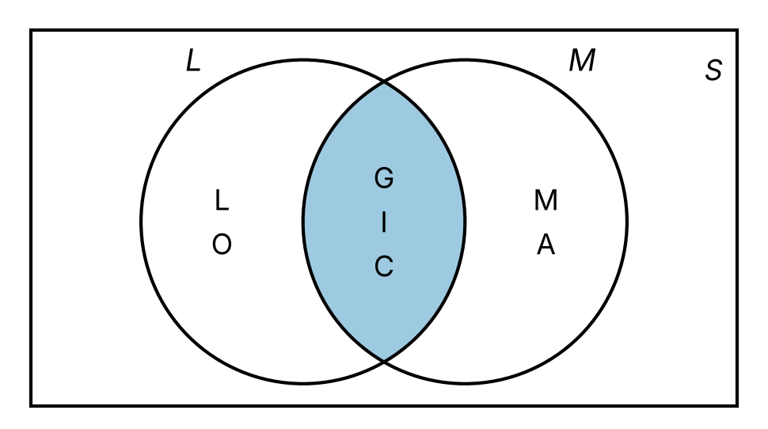

# Sets

Code

Elements, subsets, products and operations

Published

Last modified: 2026-10-29 08:04:26 (PDT)

> **NOTE:**
>
> Adapted from Kameron Decker Harris’s Fall 2026 lecture notes “Sets 0” to “Sets 3”, which are typed transcriptions of Scott Wehrwein’s Spring 2025 handwritten lecture notes. These come from those notes:
>
> - roster notation, and that order and repetition do not matter in a set;
> - the table of sets of numbers;
> - set-builder notation with a test and with an expression;
> - cardinality, and the pattern of the example of a set whose elements are sets;
> - countably infinite sets, and the diagonal argument that the real numbers are not countable;
> - subsets, strict subsets and power sets;
> - tuples and Cartesian products, including products of three sets;
> - union, intersection, difference, complement and the universal set (with its example of the even integers), with their other notations;
> - Venn diagrams.
>
> The exercises are new.

# 1 Sets and their elements

> **NOTE:**
>
> **Exercise 1 (Days that begin with T)** Let \\W\\ be the set of days of the week whose English names begin with the letter T. List the elements of \\W\\.

> **NOTE:**
>
> *Solution 1*. \\W = {\mathopen{}\left\\\text{Tuesday}, \text{Thursday}\right\\\mathclose{}}\\.

> **NOTE:**
>
> **Definition 1 (Set)** A **set** ([Wikipedia contributors 2026n](#ref-wikipedia_set_mathematics)) is a collection of distinct objects, called its elements. We write \\a \in A\\ when \\a\\ is an element of the set \\A\\, and \\a \notin A\\ when it is not. Two sets are equal when they have exactly the same elements.

> **NOTE:**
>
> *Remark 1* (Naive and formal set theory). [Definition 1](#def-set) is the informal (“naive”) notion of a set, which is all these notes need. Formal set theory states axioms for sets instead ([Wikipedia contributors 2026n](#ref-wikipedia_set_mathematics)). For example, the last sentence of [Definition 1](#def-set), that two sets are equal when they have exactly the same elements, is one of those axioms, the *axiom of extensionality*.

> **NOTE:**
>
> **Example 1 (Sets of die rolls)** The possible results of rolling a six-sided die form the set \\{\mathopen{}\left\\1, 2, 3, 4, 5, 6\right\\\mathclose{}}\\, with \\3 \in {\mathopen{}\left\\1, 2, 3, 4, 5, 6\right\\\mathclose{}}\\ and \\7 \notin {\mathopen{}\left\\1, 2, 3, 4, 5, 6\right\\\mathclose{}}\\. The sets \\{\mathopen{}\left\\1, 2, 3\right\\\mathclose{}}\\ and \\{\mathopen{}\left\\3, 2, 1\right\\\mathclose{}}\\ are equal, because they have the same elements; the order in which the elements are listed does not matter.

> **NOTE:**
>
> **Definition 2 (Roster notation)** Writing a set ([Definition 1](#def-set)) by listing its elements between braces, as in \\{\mathopen{}\left\\1, 2, 3\right\\\mathclose{}}\\, is called **roster notation** ([Wikipedia contributors 2026n](#ref-wikipedia_set_mathematics)). An ellipsis, “\\\ldots\\”, can stand for elements that follow a clear pattern, as in \\{\mathopen{}\left\\10, 20, 30, \ldots, 90\right\\\mathclose{}}\\.

> **NOTE:**
>
> **Example 2 (Order and repetition do not matter)** The sets \\{\mathopen{}\left\\3, 1, 2\right\\\mathclose{}}\\, \\{\mathopen{}\left\\1, 2, 3\right\\\mathclose{}}\\ and \\{\mathopen{}\left\\1, 1, 2, 3, 3\right\\\mathclose{}}\\ are equal, because each has exactly the elements \\1\\, \\2\\ and \\3\\ ([Definition 1](#def-set)). A roster can list any objects, not only numbers: \\{\mathopen{}\left\\\text{red}, \text{green}, \text{blue}\right\\\mathclose{}}\\ is a set with three elements.

> **NOTE:**
>
> **Definition 3 (Natural numbers (our convention))** In these notes, the **natural numbers** ([Wikipedia contributors 2026j](#ref-wikipedia_natural_number)) are the positive integers ([Definition: Positive integers](../chapters/direct-proof.llms.md#def-positive-integer)):
>
> \\\mathbb{N}\stackrel{\text{def}}{=}\mathopen{}\left\\1, 2, 3, \ldots\right\\\mathclose{}\\

> **NOTE:**
>
> Other sources may define \\\mathbb{N}\\ differently, so check each source’s definition before reading its formulas:
>
> - Many sources include \\0\\ in \\\mathbb{N}\\. The international standard ISO 80000-2 defines \\\mathbb{N}\\ to include \\0\\, continuing the earlier standard ISO 31-11 (1978).
> - Other sources start \\\mathbb{N}\\ at \\1\\, as these notes do.
> - To remove the ambiguity, some sources write \\\mathbb{N}\_1\\ or \\\mathbb{Z}^+\\ for \\\mathopen{}\left\\1, 2, 3, \ldots\right\\\mathclose{}\\, and \\\mathbb{N}\_0\\ or \\\mathbb{Z}^{0+}\\ for \\\mathopen{}\left\\0, 1, 2, \ldots\right\\\mathclose{}\\.
> - The words vary too. “Positive integers” (\\\mathopen{}\left\\1, 2, 3, \ldots\right\\\mathclose{}\\) and “non-negative integers” (\\\mathopen{}\left\\0, 1, 2, \ldots\right\\\mathclose{}\\) are unambiguous. “Whole numbers” usually includes \\0\\, but can also mean all of the integers, negative ones included. “Counting numbers” usually starts at \\1\\, but some sources include \\0\\.
> - Some older texts write \\J\\ for the natural numbers.
>
> When a formula’s meaning depends on whether \\0\\ is included, we write the set out explicitly, for example \\\mathopen{}\left\\0, 1, 2, \ldots\right\\\mathclose{}\\ or \\\mathopen{}\left\\1, \ldots, n\right\\\mathclose{}\\.
>
> Source: [Wikipedia, “Natural number”, “Terminology and notation” and “Zero as natural number”](https://en.wikipedia.org/w/index.php?title=Natural_number&oldid=1375965996), which cites ISO 80000-2:2019 and the textbooks using each notation.

> **NOTE:**
>
> **Definition 4 (Real numbers)** A **real number** ([Wikipedia contributors 2026m](#ref-wikipedia_real_number)) is a number that can be written as a decimal expansion: an integer part, followed by a decimal point and a finite or infinite list of decimal places after it. Equivalently, the real numbers are the points on the number line. The set of real numbers is written \\\mathbb{R}\\.

> **NOTE:**
>
> *Remark 2* (A working definition). [Definition 4](#def-real-numbers) is a working definition, not a construction: it does not say what an infinite decimal expansion is, or how to add or multiply two of them. Rudin ([1976](#ref-rudin1976principles), Appendix to Chapter 1) constructs the real numbers rigorously. Some real numbers have two decimal expansions: for example, \\0.999\ldots\\ and \\1.000\ldots\\ are the same real number, \\1\\.

> **NOTE:**
>
> *Remark 3* (Sets of numbers). These notes use these sets of numbers:
>
> | Symbol | Name | Elements |
> |:--:|:---|:---|
> | \\\mathbb{N}\\ | natural numbers ([Definition 3](#def-natural-numbers)) | \\1, 2, 3, \ldots\\ |
> | \\\mathbb{Z}\\ | integers ([Definition: Integers](../chapters/direct-proof.llms.md#def-integers)) | \\\ldots, -2, -1, 0, 1, 2, \ldots\\ |
> | \\\mathbb{Q}\\ | rational numbers ([Definition: Rational numbers](../chapters/contrapositive-contradiction.llms.md#def-rational-numbers)) | fractions \\\frac{a}{b}\\ of integers with \\b \ne 0\\ |
> | \\\mathbb{R}\\ | real numbers ([Definition 4](#def-real-numbers)) | decimal expansions |

# 2 Set-builder notation

> **NOTE:**
>
> **Exercise 2 (Natural numbers with small cubes)** List the natural numbers ([Definition 3](#def-natural-numbers)) \\n\\ with \\n^3 \< 100\\.

> **NOTE:**
>
> *Solution 2*. \\1\\, \\2\\, \\3\\ and \\4\\, whose cubes are \\1\\, \\8\\, \\27\\ and \\64\\. Every other natural number \\n\\ has \\n \ge 5\\, so \\n^3 \ge 125\\, which is not less than \\100\\.

> **NOTE:**
>
> **Definition 5 (Set-builder notation)** For a set \\A\\ and a statement \\P(x)\\ about an element \\x\\, **set-builder notation** ([Wikipedia contributors 2026o](#ref-wikipedia_set_builder_notation)) \\{\mathopen{}\left\\x \in A : P(x)\right\\\mathclose{}}\\ denotes the set of elements \\x\\ of \\A\\ for which \\P(x)\\ is true.

> **NOTE:**
>
> **Example 3 (Even die rolls in set-builder notation)** \\{\mathopen{}\left\\x \in {\mathopen{}\left\\1, 2, 3, 4, 5, 6\right\\\mathclose{}} : x \text{ is even}\right\\\mathclose{}} = {\mathopen{}\left\\2, 4, 6\right\\\mathclose{}}\\ is the set of [even](../chapters/direct-proof.llms.md#def-even-odd) rolls, and \\{\mathopen{}\left\\x \in \mathbb{R}: x \> 0\right\\\mathclose{}}\\ is the set of positive [real numbers](../chapters/sets.llms.md#def-real-numbers).

> **NOTE:**
>
> **Definition 6 (Empty set)** The **empty set** ([Wikipedia contributors 2026f](#ref-wikipedia_empty_set)), denoted \\\emptyset\\, is the set that has no elements.

> **NOTE:**
>
> *Remark 4* (Other notation for the empty set). Other sources write \\{\mathopen{}\left\\\right\\\mathclose{}}\\ for \\\emptyset\\ ([Wikipedia contributors 2026f](#ref-wikipedia_empty_set)). Some sources call it the **null set**, but in measure theory a “null set” usually means a set of [measure zero](https://morrison-lab.github.io/mds/measures.html#def-measure-zero), which need not be empty. For example, the interval \\\[0, 0\] = {\mathopen{}\left\\0\right\\\mathclose{}}\\ has length \\0 - 0 = 0\\, so it is a null set in that sense, but it is not empty, because \\0 \in {\mathopen{}\left\\0\right\\\mathclose{}}\\.

> **NOTE:**
>
> **Example 4 (Impossible die rolls)** No roll of a six-sided die is greater than 6, so \\{\mathopen{}\left\\x \in {\mathopen{}\left\\1, 2, 3, 4, 5, 6\right\\\mathclose{}} : x \> 6\right\\\mathclose{}} = \emptyset\\.

> **NOTE:**
>
> **Definition 7 (Set-builder notation with an expression)** For a set \\A\\ and an expression \\f(x)\\ that has a value for each element \\x\\ of \\A\\, the notation \\{\mathopen{}\left\\f(x) : x \in A\right\\\mathclose{}}\\ denotes the set of the values \\f(x)\\ for \\x \in A\\ ([Wikipedia contributors 2026o](#ref-wikipedia_set_builder_notation)). That is, an object \\y\\ is an element of \\{\mathopen{}\left\\f(x) : x \in A\right\\\mathclose{}}\\ when \\y = f(x)\\ for some \\x \in A\\.

> **NOTE:**
>
> **Example 5 (Two ways to build a set)**  
>
> - The numbers of [Exercise 2](#exr-small-cubes) form the set \\{\mathopen{}\left\\n \in \mathbb{N}: n^3 \< 100\right\\\mathclose{}} = {\mathopen{}\left\\1, 2, 3, 4\right\\\mathclose{}}\\ ([Definition 5](#def-set-builder)).
> - Their cubes form the set \\{\mathopen{}\left\\n^3 : n \in {\mathopen{}\left\\1, 2, 3, 4\right\\\mathclose{}}\right\\\mathclose{}} = {\mathopen{}\left\\1, 8, 27, 64\right\\\mathclose{}}\\ ([Definition 7](#def-set-builder-expression)).
> - \\{\mathopen{}\left\\2^k : k \in \mathbb{N}\right\\\mathclose{}} = {\mathopen{}\left\\2, 4, 8, 16, \ldots\right\\\mathclose{}}\\, the powers of \\2\\ after \\2^0\\.
> - \\{\mathopen{}\left\\(-1)^k : k \in \mathbb{N}\right\\\mathclose{}} = {\mathopen{}\left\\-1, 1\right\\\mathclose{}}\\: many values of \\k\\ give the same value, and each value is one element of the set.

# 3 Cardinality

> **NOTE:**
>
> **Exercise 3 (Letters in a word)** How many different letters does the word MISSISSIPPI use?

> **NOTE:**
>
> *Solution 3*. Four: M, I, S and P. The set of its letters is \\{\mathopen{}\left\\\text{M}, \text{I}, \text{S}, \text{P}\right\\\mathclose{}}\\, and listing a letter again, as the word does, does not add an element ([Example 2](#exm-roster-notation)).

> **NOTE:**
>
> **Definition 8 (Finite set)** A set \\A\\ is **finite** ([Wikipedia contributors 2026g](#ref-wikipedia_finite_set)) if it is empty, or if, for some natural number \\n\\, its elements can be listed as a finite sequence ([Definition: Finite sequence](https://morrison-lab.github.io/mds/functions.html#def-finite-sequence)) \\a_1, \ldots, a_n\\ in which each element of \\A\\ appears exactly once.

> **NOTE:**
>
> **Definition 9 (Cardinality)** For a finite set \\A\\ ([Definition 8](#def-finite-set)), the number \\n\\ in such a list is the **cardinality** ([Wikipedia contributors 2026b](#ref-wikipedia_cardinality)) of \\A\\, its number of elements, written \\\mathopen{}\left\|A\right\|\mathclose{}\\; the empty set has cardinality \\\mathopen{}\left\|\emptyset\right\|\mathclose{} = 0\\.

> **NOTE:**
>
> *Remark 5* (Two meanings of \\\mathopen{}\left\|\cdot\right\|\mathclose{}\\). Applied to a set, the bars \\\mathopen{}\left\|A\right\|\mathclose{}\\ mean the cardinality of \\A\\. Applied to a number, \\\mathopen{}\left\|x\right\|\mathclose{}\\ means its [absolute value](https://morrison-lab.github.io/mds/algebra.html#def-absolute-value), or its [modulus](https://morrison-lab.github.io/mds/algebra.html#def-complex-modulus) when \\x\\ is complex. For example, \\\mathopen{}\left\|{\mathopen{}\left\\-3\right\\\mathclose{}}\right\|\mathclose{} = 1\\, but \\\mathopen{}\left\|-3\right\|\mathclose{} = 3\\.

> **NOTE:**
>
> **Definition 10 (Infinite set)** A set that is not finite ([Definition 8](#def-finite-set)) is **infinite** ([Wikipedia contributors 2026h](#ref-wikipedia_infinite_set)).

> **NOTE:**
>
> **Example 6 (Finite and infinite sets)**  
>
> - \\{\mathopen{}\left\\2, 4, 6\right\\\mathclose{}}\\ is finite, with \\\mathopen{}\left\|{\mathopen{}\left\\2, 4, 6\right\\\mathclose{}}\right\|\mathclose{} = 3\\.
> - \\{\mathopen{}\left\\1, 1, 2\right\\\mathclose{}} = {\mathopen{}\left\\1, 2\right\\\mathclose{}}\\, so \\\mathopen{}\left\|{\mathopen{}\left\\1, 1, 2\right\\\mathclose{}}\right\|\mathclose{} = 2\\: a repeated listing does not count twice.
> - \\\emptyset\\ is finite, with \\\mathopen{}\left\|\emptyset\right\|\mathclose{} = 0\\.
> - The natural numbers \\\mathbb{N}= {\mathopen{}\left\\1, 2, 3, \ldots\right\\\mathclose{}}\\ are infinite: for any \\n\\, a list \\a_1, \ldots, a_n\\ of natural numbers misses the natural number \\a_1 + \cdots + a_n + 1\\, which is larger than every number in the list.

> **NOTE:**
>
> *Remark 6* (Sets can be elements of sets). The elements of a set can themselves be sets. For example, \\S = {\mathopen{}\left\\{\mathopen{}\left\\1, 2\right\\\mathclose{}}, 3, {\mathopen{}\left\\3\right\\\mathclose{}}\right\\\mathclose{}}\\ has three elements: the set \\{\mathopen{}\left\\1, 2\right\\\mathclose{}}\\, the number \\3\\, and the set \\{\mathopen{}\left\\3\right\\\mathclose{}}\\. So \\{\mathopen{}\left\\1, 2\right\\\mathclose{}} \in S\\, but \\1 \notin S\\, because \\1\\ is an element of an element of \\S\\, not an element of \\S\\. And \\3 \ne {\mathopen{}\left\\3\right\\\mathclose{}}\\: one is a number, and the other is a set with one element. So \\\mathopen{}\left\|S\right\|\mathclose{} = 3\\ ([Definition 9](#def-cardinality)).

> **NOTE:**
>
> **Definition 11 (Countable set)** A set is **countable** ([Wikipedia contributors 2026e](#ref-wikipedia_countable_set)) if it is finite ([Definition 8](#def-finite-set)), or if its elements can be listed as a sequence ([Definition: Sequence](https://morrison-lab.github.io/mds/functions.html#def-sequence)) \\a_1, a_2, a_3, \ldots\\ in which every element appears.

> **NOTE:**
>
> **Definition 12 (Countably infinite set)** A set is **countably infinite** if it is [countable](#def-countable-set) and not finite.

> **NOTE:**
>
> **Example 7 (Countable and uncountable sets)**  
>
> - \\{\mathopen{}\left\\1, 2, 3, 4, 5, 6\right\\\mathclose{}}\\ is countable, because it is finite.
> - The [non-negative integers](https://morrison-lab.github.io/mds/number-systems.html#def-nonnegative-integers) \\{\mathopen{}\left\\0, 1, 2, \ldots\right\\\mathclose{}}\\ are countably infinite: the sequence \\0, 1, 2, \ldots\\ lists them.
> - The [integers](../chapters/direct-proof.llms.md#def-integers) are countably infinite too: the sequence \\0, 1, -1, 2, -2, 3, -3, \ldots\\ lists every one of them.

> **NOTE:**
>
> *Remark 7* (Numbers with only one decimal expansion). These notes use one more fact about the real numbers without proving it. A real number has two decimal expansions only if one of them ends in repeating \\9\\s and the other in repeating \\0\\s, as \\0.999\ldots\\ and \\1.000\ldots\\ do ([Remark 2](#rem-real-numbers-working-definition)). So a number whose decimal places are all \\4\\s and \\5\\s, such as \\0.545454\ldots\\, has only one decimal expansion.

> **NOTE:**
>
> **Theorem 1 (The real numbers are not countable)** The set of real numbers \\\mathbb{R}\\ ([Definition 4](#def-real-numbers)) is not countable ([Definition 11](#def-countable-set)) ([Wikipedia contributors 2026a](#ref-wikipedia_cantors_diagonal_argument)).

> **NOTE:**
>
> *Proof*. Suppose, for contradiction ([Definition: Proof by contradiction](../chapters/contrapositive-contradiction.llms.md#def-proof-by-contradiction)), that \\\mathbb{R}\\ is countable. \\\mathbb{R}\\ is not finite, because it contains the natural numbers, and a list of every real number would include a list of every natural number, which cannot be finite ([Example 6](#exm-finite-set)). So the elements of \\\mathbb{R}\\ can be listed as a sequence \\r_1, r_2, r_3, \ldots\\ in which every real number appears. Write each \\r_n\\ as a decimal expansion, choosing one if \\r_n\\ has two. Let \\d\\ be the number between \\0\\ and \\1\\ whose \\n\\th decimal place is
>
> - \\5\\, if the \\n\\th decimal place of \\r_n\\ is not \\5\\;
> - \\4\\, if the \\n\\th decimal place of \\r_n\\ is \\5\\.
>
> Then \\d\\ is a real number, so \\d = r_m\\ for some \\m\\. The decimal places of \\d\\ are all \\4\\s and \\5\\s, so \\d\\ has only one decimal expansion ([Remark 7](#rem-unique-expansion)), and the expansion chosen for \\r_m\\ must be that one. But the two expansions differ in the \\m\\th decimal place, by the choice of \\d\\. That is a contradiction, so \\\mathbb{R}\\ is not countable.

> **NOTE:**
>
> **Example 8 (The diagonal number for a list)** Suppose a list of real numbers starts
>
> \\ \begin{aligned} r_1 &= 0.\mathbf{7}071\ldots \\ r_2 &= 3.1\mathbf{4}15\ldots \\ r_3 &= -2.71\mathbf{8}2\ldots \\ r_4 &= 0.555\mathbf{5}\ldots \end{aligned} \\
>
> The bold digits are the \\n\\th decimal places of the \\r_n\\: \\7\\, \\4\\, \\8\\ and \\5\\. The proof of [Theorem 1](#thm-reals-uncountable) builds \\d = 0.5554\ldots\\, which differs from \\r_1\\ in the first decimal place, from \\r_2\\ in the second, from \\r_3\\ in the third, and from \\r_4\\ in the fourth. However the list continues, \\d\\ is not on it.

# 4 Subsets and power sets

> **NOTE:**
>
> **Exercise 4 (An element that is also a subset)** Let \\B = {\mathopen{}\left\\1, {\mathopen{}\left\\1\right\\\mathclose{}}\right\\\mathclose{}}\\. A set \\A\\ is a subset of \\B\\ when every element of \\A\\ is an element of \\B\\. Find a set that is both an element of \\B\\ and a subset of \\B\\.

> **NOTE:**
>
> *Solution 4*. The set \\{\mathopen{}\left\\1\right\\\mathclose{}}\\ works. It is listed in \\B\\, so it is an element of \\B\\. And \\1\\, the one element of \\{\mathopen{}\left\\1\right\\\mathclose{}}\\, is also listed in \\B\\, so every element of \\{\mathopen{}\left\\1\right\\\mathclose{}}\\ is an element of \\B\\.

> **NOTE:**
>
> **Definition 13 (Subset)** A set \\A\\ is a **subset** ([Wikipedia contributors 2026p](#ref-wikipedia_subset)) of a set \\B\\, written \\A \subseteq B\\, if every element of \\A\\ is an element of \\B\\.

> **NOTE:**
>
> **Example 9 (Even die rolls)** The even die rolls form a subset of the possible rolls: \\{\mathopen{}\left\\2, 4, 6\right\\\mathclose{}} \subseteq {\mathopen{}\left\\1, 2, 3, 4, 5, 6\right\\\mathclose{}}\\, because each of \\2\\, \\4\\, and \\6\\ is a possible roll. The set \\{\mathopen{}\left\\2, 4, 7\right\\\mathclose{}}\\ is not a subset of \\{\mathopen{}\left\\1, 2, 3, 4, 5, 6\right\\\mathclose{}}\\, because \\7\\ is not a possible roll.

> **NOTE:**
>
> **Definition 14 (Strict subset (proper subset))** A [set](#def-set) \\A\\ is a **strict subset** (also called a **proper subset**) of a set \\B\\, written \\A \subsetneq B\\, if \\A\\ is a [subset](#def-subset) of \\B\\ and \\A \neq B\\.

> **NOTE:**
>
> *Remark 8* (The symbol \\\subset\\). Sources disagree about the symbol \\\subset\\: some use it for “subset” (\\\subseteq\\), and others for “strict subset” (\\\subsetneq\\) ([Wikipedia contributors 2026p](#ref-wikipedia_subset)). For example, \\{\mathopen{}\left\\1, 2\right\\\mathclose{}} \subset {\mathopen{}\left\\1, 2\right\\\mathclose{}}\\ is true in the first reading, because \\{\mathopen{}\left\\1, 2\right\\\mathclose{}} \subseteq {\mathopen{}\left\\1, 2\right\\\mathclose{}}\\, and false in the second, because the two sets are equal. These notes avoid \\\subset\\ and write \\\subseteq\\ or \\\subsetneq\\.

> **NOTE:**
>
> **Example 10 (Strict subsets)**  
>
> - \\{\mathopen{}\left\\2, 4, 6\right\\\mathclose{}} \subsetneq {\mathopen{}\left\\1, 2, 3, 4, 5, 6\right\\\mathclose{}}\\, because \\{\mathopen{}\left\\2, 4, 6\right\\\mathclose{}} \subseteq {\mathopen{}\left\\1, 2, 3, 4, 5, 6\right\\\mathclose{}}\\ ([Example 9](#exm-subset)), and \\1\\ is in the second set but not the first.
> - \\\mathbb{N}\subsetneq \mathbb{Z}\\, because every natural number is an integer, and \\-1\\ is an integer that is not a natural number.
> - \\\mathbb{Z} \subseteq \mathbb{Z}\\, because every integer is an integer, but \\\mathbb{Z}\\ is not a strict subset of itself.

> **NOTE:**
>
> **Theorem 2 (The empty set is a subset of every set)** For every set \\A\\, \\\emptyset \subseteq A\\.

> **NOTE:**
>
> *Proof*. By [Definition 13](#def-subset), \\\emptyset \subseteq A\\ fails only if some element of \\\emptyset\\ is not in \\A\\. The [empty set](#def-empty-set) has no elements, so no such element exists.

> **NOTE:**
>
> **Theorem 3 (Every set is a subset of itself)** For every set \\A\\, \\A \subseteq A\\.

> **NOTE:**
>
> *Proof*. Every element of \\A\\ is an element of \\A\\, which is [Definition 13](#def-subset) with \\B = A\\.

> **NOTE:**
>
> **Definition 15 (Power set)** The **power set** of a set \\A\\, written \\\mathcal{P}(A)\\, is the set of all subsets ([Definition 13](#def-subset)) of \\A\\ ([Wikipedia contributors 2026l](#ref-wikipedia_power_set)):
>
> \\ \mathcal{P}(A) \stackrel{\text{def}}{=}{\mathopen{}\left\\S : S \subseteq A\right\\\mathclose{}}. \\

> **NOTE:**
>
> **Example 11 (The subsets of a three-element set)** \\ \mathcal{P}({\mathopen{}\left\\a, b, c\right\\\mathclose{}}) = {\mathopen{}\left\\\emptyset, {\mathopen{}\left\\a\right\\\mathclose{}}, {\mathopen{}\left\\b\right\\\mathclose{}}, {\mathopen{}\left\\c\right\\\mathclose{}}, {\mathopen{}\left\\a, b\right\\\mathclose{}}, {\mathopen{}\left\\a, c\right\\\mathclose{}}, {\mathopen{}\left\\b, c\right\\\mathclose{}}, {\mathopen{}\left\\a, b, c\right\\\mathclose{}}\right\\\mathclose{}}. \\
>
> Each element of \\\mathcal{P}({\mathopen{}\left\\a, b, c\right\\\mathclose{}})\\ is a set. For example, \\{\mathopen{}\left\\a\right\\\mathclose{}} \in \mathcal{P}({\mathopen{}\left\\a, b, c\right\\\mathclose{}})\\, but \\a \notin \mathcal{P}({\mathopen{}\left\\a, b, c\right\\\mathclose{}})\\. The list includes \\\emptyset\\ ([Theorem 2](#thm-empty-subset)) and \\{\mathopen{}\left\\a, b, c\right\\\mathclose{}}\\ itself ([Theorem 3](#thm-subset-reflexive)).

# 5 Ordered pairs and Cartesian products

> **NOTE:**
>
> **Exercise 5 (Sandwich orders)** A sandwich shop makes sandwiches on rye or wheat bread, with a filling of ham, cheese or tomato. List every choice of one bread and one filling, writing each choice as (bread, filling).

> **NOTE:**
>
> *Solution 5*. (rye, ham), (rye, cheese), (rye, tomato), (wheat, ham), (wheat, cheese) and (wheat, tomato).

> **NOTE:**
>
> **Definition 16 (Ordered pair)** An **ordered pair** ([Wikipedia contributors 2026k](#ref-wikipedia_ordered_pair)) \\(a, b)\\ is a pair of objects listed in order, with \\a\\ first and \\b\\ second; two ordered pairs are equal, \\(a, b) = (c, d)\\, when \\a = c\\ and \\b = d\\.

> **NOTE:**
>
> **Definition 17 (Tuple)** For a natural number \\n\\, an **\\n\\-tuple** \\(a_1, a_2, \ldots, a_n)\\ is a list of \\n\\ objects in order ([Wikipedia contributors 2026q](#ref-wikipedia_tuple)). Two \\n\\-tuples are equal when their entries are equal in each position. A \\2\\-tuple is an ordered pair ([Definition 16](#def-ordered-pair)).

> **NOTE:**
>
> **Example 12 (Tuples are not sets)**  
>
> - \\(1, 2) \ne (2, 1)\\, because their first entries differ, but \\{\mathopen{}\left\\1, 2\right\\\mathclose{}} = {\mathopen{}\left\\2, 1\right\\\mathclose{}}\\, because order does not matter in a set ([Definition 1](#def-set)).
> - \\(4, 4, 1)\\ is a \\3\\-tuple whose first two entries are equal, but \\{\mathopen{}\left\\4, 4, 1\right\\\mathclose{}} = {\mathopen{}\left\\1, 4\right\\\mathclose{}}\\ has two elements.

> **NOTE:**
>
> **Definition 18 (Cartesian product)** The **Cartesian product** ([Wikipedia contributors 2026c](#ref-wikipedia_cartesian_product)) of sets \\A\\ and \\B\\, written \\A \times B\\, is the set of ordered pairs whose first entry is in \\A\\ and whose second entry is in \\B\\:
>
> \\A \times B \stackrel{\text{def}}{=}{\mathopen{}\left\\(a, b) : a \in A \text{ and } b \in B\right\\\mathclose{}}\\

> **NOTE:**
>
> **Definition 19 (Cartesian product of several sets)** For a natural number \\n\\ and sets \\A_1, A_2, \ldots, A_n\\, the **Cartesian product** \\A_1 \times A_2 \times \cdots \times A_n\\ is the set of \\n\\-tuples ([Definition 17](#def-tuple)) whose \\i\\th entry is in \\A_i\\ for each \\i\\ ([Wikipedia contributors 2026c](#ref-wikipedia_cartesian_product)):
>
> \\ A_1 \times \cdots \times A_n \stackrel{\text{def}}{=}{\mathopen{}\left\\(a_1, \ldots, a_n) : a_i \in A_i \text{ for each } i\right\\\mathclose{}}. \\
>
> For \\n = 2\\ this is [Definition 18](#def-cartesian-product).

> **NOTE:**
>
> **Example 13 (Cartesian products)**  
>
> - The choices in [Exercise 5](#exr-menu) are the Cartesian product \\{\mathopen{}\left\\\text{rye}, \text{wheat}\right\\\mathclose{}} \times {\mathopen{}\left\\\text{ham}, \text{cheese}, \text{tomato}\right\\\mathclose{}}\\ ([Definition 18](#def-cartesian-product)).
> - \\{\mathopen{}\left\\\text{ham}, \text{cheese}, \text{tomato}\right\\\mathclose{}} \times {\mathopen{}\left\\\text{rye}, \text{wheat}\right\\\mathclose{}}\\ is a different set: it holds \\(\text{ham}, \text{rye})\\, which is not \\(\text{rye}, \text{ham})\\ ([Example 12](#exm-tuple)).
> - \\\mathbb{R}\times \mathbb{R}\\ is the set of points \\(x, y)\\ in the plane.
> - Adding a choice of drink gives \\3\\-tuples ([Definition 19](#def-cartesian-product-many)), such as \\(\text{rye}, \text{ham}, \text{tea}) \in {\mathopen{}\left\\\text{rye}, \text{wheat}\right\\\mathclose{}} \times {\mathopen{}\left\\\text{ham}, \text{cheese}, \text{tomato}\right\\\mathclose{}} \times {\mathopen{}\left\\\text{tea}, \text{juice}\right\\\mathclose{}}\\.

# 6 Set operations

> **NOTE:**
>
> **Exercise 6 (Two sets from their overlap)** Find sets \\A\\ and \\B\\ whose common elements are exactly \\2\\ and \\3\\, and whose elements together are exactly \\1\\, \\2\\, \\3\\ and \\4\\.

> **NOTE:**
>
> *Solution 6*. \\A = {\mathopen{}\left\\1, 2, 3\right\\\mathclose{}}\\ and \\B = {\mathopen{}\left\\2, 3, 4\right\\\mathclose{}}\\ work: the elements in both are \\2\\ and \\3\\, and the elements in one or the other are \\1\\, \\2\\, \\3\\ and \\4\\. So do \\A = {\mathopen{}\left\\1, 2, 3, 4\right\\\mathclose{}}\\ and \\B = {\mathopen{}\left\\2, 3\right\\\mathclose{}}\\.

> **NOTE:**
>
> **Definition 20 (Union)** The **union** ([Wikipedia contributors 2026r](#ref-wikipedia_union_set_theory)) of sets \\A\\ and \\B\\, written \\A \cup B\\, is the set of elements that are in \\A\\, in \\B\\, or in both:
>
> \\A \cup B \stackrel{\text{def}}{=}{\mathopen{}\left\\x : x \in A \text{ or } x \in B\right\\\mathclose{}}\\

> **NOTE:**
>
> **Definition 21 (Intersection)** The **intersection** ([Wikipedia contributors 2026i](#ref-wikipedia_intersection_set_theory)) of sets \\A\\ and \\B\\, written \\A \cap B\\, is the set of elements that are in both \\A\\ and \\B\\:
>
> \\A \cap B \stackrel{\text{def}}{=}{\mathopen{}\left\\x : x \in A \text{ and } x \in B\right\\\mathclose{}}\\

> **NOTE:**
>
> **Definition 22 (Set difference)** The **set difference** ([Wikipedia contributors 2026d](#ref-wikipedia_complement_set_theory)) of sets \\A\\ and \\B\\, written \\A \setminus B\\, is the set of elements of \\A\\ that are not in \\B\\:
>
> \\A \setminus B \stackrel{\text{def}}{=}{\mathopen{}\left\\x \in A : x \notin B\right\\\mathclose{}}\\

> **NOTE:**
>
> *Remark 9* (Other notation for the set difference). Some sources write \\A - B\\ for \\A \setminus B\\ ([Wikipedia contributors 2026d](#ref-wikipedia_complement_set_theory)).

> **NOTE:**
>
> **Example 14 (Combining sets of die rolls)** Let \\A = {\mathopen{}\left\\2, 4, 6\right\\\mathclose{}}\\ (the even rolls) and \\B = {\mathopen{}\left\\1, 2, 3\right\\\mathclose{}}\\ (the rolls of at most 3). Then:
>
> - \\A \cup B = {\mathopen{}\left\\1, 2, 3, 4, 6\right\\\mathclose{}}\\, the rolls that are even or at most 3;
> - \\A \cap B = {\mathopen{}\left\\2\right\\\mathclose{}}\\, the only roll that is both;
> - \\A \setminus B = {\mathopen{}\left\\4, 6\right\\\mathclose{}}\\, the even rolls greater than 3;
> - \\{\mathopen{}\left\\2, 4, 6\right\\\mathclose{}} \cap {\mathopen{}\left\\1, 3, 5\right\\\mathclose{}} = \emptyset\\: no roll is both even and odd.

> **NOTE:**
>
> **Definition 23 (Complement)** Let \\A\\ be a [subset](#def-subset) of a set \\S\\. The **complement** ([Wikipedia contributors 2026d](#ref-wikipedia_complement_set_theory)) of \\A\\ in \\S\\ is the set difference ([Definition 22](#def-set-difference)) \\S \setminus A\\: the elements of \\S\\ that are not in \\A\\. When the set \\S\\ is clear from context, the complement of \\A\\ is written \\A^c\\:
>
> \\A^c \stackrel{\text{def}}{=}S \setminus A = {\mathopen{}\left\\x \in S : x \notin A\right\\\mathclose{}}\\

> **NOTE:**
>
> *Remark 10* (The universal set, and other notation for the complement). The set \\S\\ in [Definition 23](#def-complement) is sometimes called the *universal set*. Which universal set to use depends on the context: for a set of even integers it might be \\\mathbb{Z}\\, and for a set of letters it might be the 26 letters of the alphabet. Some sources write \\\overline{A}\\ for \\A^c\\ ([Wikipedia contributors 2026d](#ref-wikipedia_complement_set_theory)).

> **NOTE:**
>
> **Example 15 (Complements of sets of die rolls)** Let \\S = {\mathopen{}\left\\1, 2, 3, 4, 5, 6\right\\\mathclose{}}\\ be the possible rolls of a die.
>
> - The complement of the even rolls \\A = {\mathopen{}\left\\2, 4, 6\right\\\mathclose{}}\\ is \\A^c = {\mathopen{}\left\\1, 3, 5\right\\\mathclose{}}\\, the odd rolls.
> - The complement of \\S\\ itself is \\S^c = \emptyset\\, and the complement of \\\emptyset\\ is \\\emptyset^c = S\\.
>
> The complement depends on \\S\\: in \\S = {\mathopen{}\left\\1, 2, 3, 4, 5, 6\right\\\mathclose{}}\\, the complement of \\{\mathopen{}\left\\2, 4, 6\right\\\mathclose{}}\\ is \\{\mathopen{}\left\\1, 3, 5\right\\\mathclose{}}\\, but in \\S = {\mathopen{}\left\\2, 4, 6, 8\right\\\mathclose{}}\\, it is \\{\mathopen{}\left\\8\right\\\mathclose{}}\\.

> **NOTE:**
>
> **Definition 24 (Venn diagram)** A **Venn diagram** draws sets as overlapping circles inside a rectangle, which stands for the set \\S\\ that the sets are subsets of, as in [Definition 23](#def-complement). Each region of the picture stands for the elements that are in some of the sets and not in the others.

> **NOTE:**
>
> **Example 16 (Letters of two words)** Let \\L\\ be the set of letters in the word LOGIC, and \\M\\ the set of letters in the word MAGIC, inside the set \\S\\ of the 26 letters of the alphabet. [Figure 1](#fig-venn-letters) draws them.
>
>  and of MAGIC (M), with L \cap M shaded.")
>
> Figure 1: The letters of LOGIC (\\L\\) and of MAGIC (\\M\\), with \\L \cap M\\ shaded.
>
> - The shaded region, inside both circles, is \\L \cap M = {\mathopen{}\left\\\text{G}, \text{I}, \text{C}\right\\\mathclose{}}\\.
> - The part of circle \\L\\ outside circle \\M\\ is \\L \setminus M = {\mathopen{}\left\\\text{L}, \text{O}\right\\\mathclose{}}\\.
> - Everything inside either circle is \\L \cup M = {\mathopen{}\left\\\text{L}, \text{O}, \text{G}, \text{I}, \text{C}, \text{M}, \text{A}\right\\\mathclose{}}\\.
> - Everything in the rectangle outside circle \\L\\ is \\L^c\\, the 21 letters not in LOGIC.

# References

Rudin, Walter. 1976. *Principles of Mathematical Analysis*. 3rd ed. International Series in Pure and Applied Mathematics. McGraw-Hill.

Wikipedia contributors. 2026a. *Cantor’s Diagonal Argument — Wikipedia, the Free Encyclopedia*. <https://en.wikipedia.org/wiki/Cantor%27s_diagonal_argument>.

Wikipedia contributors. 2026b. *Cardinality — Wikipedia, the Free Encyclopedia*. <https://en.wikipedia.org/wiki/Cardinality>.

Wikipedia contributors. 2026c. *Cartesian Product — Wikipedia, the Free Encyclopedia*. <https://en.wikipedia.org/wiki/Cartesian_product>.

Wikipedia contributors. 2026d. *Complement (Set Theory) — Wikipedia, the Free Encyclopedia*. <https://en.wikipedia.org/wiki/Complement_(set_theory)>.

Wikipedia contributors. 2026e. *Countable Set — Wikipedia, the Free Encyclopedia*. <https://en.wikipedia.org/wiki/Countable_set>.

Wikipedia contributors. 2026f. *Empty Set — Wikipedia, the Free Encyclopedia*. <https://en.wikipedia.org/wiki/Empty_set>.

Wikipedia contributors. 2026g. *Finite Set — Wikipedia, the Free Encyclopedia*. <https://en.wikipedia.org/wiki/Finite_set>.

Wikipedia contributors. 2026h. *Infinite Set — Wikipedia, the Free Encyclopedia*. <https://en.wikipedia.org/wiki/Infinite_set>.

Wikipedia contributors. 2026i. *Intersection (Set Theory) — Wikipedia, the Free Encyclopedia*. <https://en.wikipedia.org/wiki/Intersection_(set_theory)>.

Wikipedia contributors. 2026j. *Natural Number — Wikipedia, the Free Encyclopedia*. <https://en.wikipedia.org/wiki/Natural_number>.

Wikipedia contributors. 2026k. *Ordered Pair — Wikipedia, the Free Encyclopedia*. <https://en.wikipedia.org/wiki/Ordered_pair>.

Wikipedia contributors. 2026l. *Power Set — Wikipedia, the Free Encyclopedia*. <https://en.wikipedia.org/wiki/Power_set>.

Wikipedia contributors. 2026m. *Real Number — Wikipedia, the Free Encyclopedia*. <https://en.wikipedia.org/wiki/Real_number>.

Wikipedia contributors. 2026n. *Set (Mathematics) — Wikipedia, the Free Encyclopedia*. <https://en.wikipedia.org/wiki/Set_(mathematics)>.

Wikipedia contributors. 2026o. *Set-Builder Notation — Wikipedia, the Free Encyclopedia*. <https://en.wikipedia.org/wiki/Set-builder_notation>.

Wikipedia contributors. 2026p. *Subset — Wikipedia, the Free Encyclopedia*. <https://en.wikipedia.org/wiki/Subset>.

Wikipedia contributors. 2026q. *Tuple — Wikipedia, the Free Encyclopedia*. <https://en.wikipedia.org/wiki/Tuple>.

Wikipedia contributors. 2026r. *Union (Set Theory) — Wikipedia, the Free Encyclopedia*. <https://en.wikipedia.org/wiki/Union_(set_theory)>.

Back to top
