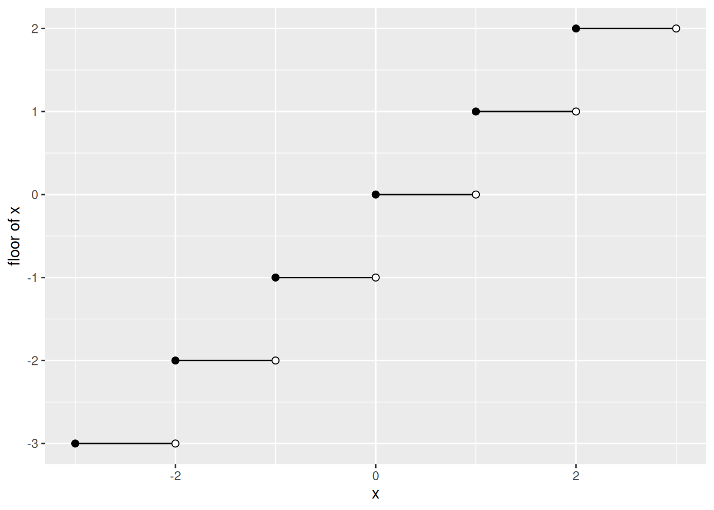

# Number Systems

Code

- [Show All Code](javascript:void(0))

- [Hide All Code](javascript:void(0))

- 

  ------------------------------------------------------------------------

- [View Source](javascript:void(0))

Published

Last modified: 2026-11-12 01:23:00 (PST)

> **NOTE:**
>
> *Remark*. Probability and statistics count with the integers and natural numbers and measure with the real numbers. This page defines those number systems. It also defines the words that sort their members: even and odd integers, and rational and irrational real numbers. Finally, it defines divisibility, [primes](#def-prime) and congruence, and the [factorial](#def-factorial) of a [non-negative integer](#def-nonnegative-integers).

# 1 Natural numbers

> **NOTE:**
>
> **Exercise 1 (Which numbers are natural?)** List the elements of the set $\mathopen{}\left\{n \in \mathbb{N}: n < 3\right\}\mathclose{}$. Is your answer the same in every textbook?

> **NOTE:**
>
> *Solution 1*. The answer depends on whether the source counts $0$ as a natural number:
>
> - if $\mathbb{N}$ starts at $0$, the set is $\mathopen{}\left\{0, 1, 2\right\}\mathclose{}$;
> - if $\mathbb{N}$ starts at $1$, the set is $\mathopen{}\left\{1, 2\right\}\mathclose{}$.
>
> Both conventions are in common use, so the answer is not the same in every textbook.

> **NOTE:**
>
> **Definition 1 (Integers)** The **integers** ([Wikipedia contributors 2026c](#ref-wikipedia_integer)) are the whole numbers, together with their negatives and $0$:
>
> $$\mathbb{Z} \stackrel{\text{def}}{=}\mathopen{}\left\{\ldots, -3, -2, -1, 0, 1, 2, 3, \ldots\right\}\mathclose{}$$
>
> An **integer** is an element of $\mathbb{Z}$.

> **NOTE:**
>
> **Definition 2 (Positive integers)** The integers ([Definition 1](#def-integers)) greater than $0$ are the **positive integers**.

> **NOTE:**
>
> **Definition 3 (Negative integers)** The integers ([Definition 1](#def-integers)) less than $0$ are the **negative integers**.

> **NOTE:**
>
> **Example 1 (Integers and non-integers)**  
>
> - $-7$, $0$, and $12$ are integers.
> - $\frac{1}{2}$ and $-2.5$ are not integers.
> - $\frac{6}{3}$ is an integer, because $\frac{6}{3} = 2$.

> **NOTE:**
>
> **Definition 4 (Even integer)** An integer ([Definition 1](#def-integers)) $n$ is **even** ([Wikipedia contributors 2026g](#ref-wikipedia_parity_mathematics)) if $n = 2k$ for some integer $k$.

> **NOTE:**
>
> **Definition 5 (Odd integer)** An integer ([Definition 1](#def-integers)) $n$ is **odd** ([Wikipedia contributors 2026g](#ref-wikipedia_parity_mathematics)) if $n = 2k + 1$ for some integer $k$.

> **NOTE:**
>
> **Example 2 (Even and odd integers)**  
>
> - $6$ is even, because $6 = 2 \cdot 3$.
> - $0$ is even, because $0 = 2 \cdot 0$.
> - $-3$ is odd, because $-3 = 2 \cdot(-2) + 1$.
> - $7$ is odd, because $7 = 2 \cdot 3 + 1$.
> - $2.5$ is neither even nor odd, because it is not an integer.

> **NOTE:**
>
> **Definition 6 (Natural numbers (our convention))** In these notes, the **natural numbers** ([Wikipedia contributors 2026f](#ref-wikipedia_natural_number)) are the positive integers ([Definition 2](#def-positive-integer)):
>
> $$\mathbb{N}\stackrel{\text{def}}{=}\mathopen{}\left\{1, 2, 3, \ldots\right\}\mathclose{}$$

> **NOTE:**
>
> **Definition 7 (Non-negative integers)** The **non-negative integers** are the natural numbers ([Definition 6](#def-natural-numbers)) together with $0$:
>
> $$\mathbb{N}_0 \stackrel{\text{def}}{=}\mathopen{}\left\{0, 1, 2, 3, \ldots\right\}\mathclose{} = \mathbb{N}\cup \mathopen{}\left\{0\right\}\mathclose{}$$

> **NOTE:**
>
> **Example 3 (Natural numbers in a data analysis)**  
>
> - Observation indices start at $1$, so we write $i \in \mathopen{}\left\{1, \ldots, n\right\}\mathclose{}$ with $n \in \mathbb{N}$.
> - A count outcome, such as the number of hospital visits in a year, can be $0$, so the set of values it can take is $\mathbb{N}_0$, not $\mathbb{N}$.

> **NOTE:**
>
> Other sources may define $\mathbb{N}$ differently, so check each source’s definition before reading its formulas:
>
> - Many sources include $0$ in $\mathbb{N}$. The international standard ISO 80000-2 defines $\mathbb{N}$ to include $0$, continuing the earlier standard ISO 31-11 (1978).
> - Other sources start $\mathbb{N}$ at $1$, as these notes do.
> - To remove the ambiguity, some sources write $\mathbb{N}_1$ or $\mathbb{Z}^+$ for $\mathopen{}\left\{1, 2, 3, \ldots\right\}\mathclose{}$, and $\mathbb{N}_0$ or $\mathbb{Z}^{0+}$ for $\mathopen{}\left\{0, 1, 2, \ldots\right\}\mathclose{}$.
> - The words vary too. “Positive integers” ($\mathopen{}\left\{1, 2, 3, \ldots\right\}\mathclose{}$) and “non-negative integers” ($\mathopen{}\left\{0, 1, 2, \ldots\right\}\mathclose{}$) are unambiguous. “Whole numbers” usually includes $0$, but can also mean all of the integers, negative ones included. “Counting numbers” usually starts at $1$, but some sources include $0$.
> - Some older texts write $J$ for the natural numbers.
>
> When a formula’s meaning depends on whether $0$ is included, we write the set out explicitly, for example $\mathopen{}\left\{0, 1, 2, \ldots\right\}\mathclose{}$ or $\mathopen{}\left\{1, \ldots, n\right\}\mathclose{}$.
>
> Source: [Wikipedia, “Natural number”, “Terminology and notation” and “Zero as natural number”](https://en.wikipedia.org/w/index.php?title=Natural_number&oldid=1375965996), which cites ISO 80000-2:2019 and the textbooks using each notation.

> **NOTE:**
>
> **Definition 8 (Factorial)** For a [non-negative integer](#def-nonnegative-integers) $n$, the **factorial** of $n$ ([Wikipedia contributors 2026a](#ref-wikipedia_factorial)), written ${{n}!}$, is $1 \cdot 2 \cdots n$, the [natural numbers](#def-natural-numbers) from 1 to $n$ multiplied together. For $n = 0$ there is nothing to multiply, and ${{0}!} = 1$.

> **NOTE:**
>
> **Example 4 (Factorials)**  
>
> - ${{3}!} = 1 \cdot 2 \cdot 3 = 6$.
> - ${{4}!} = 1 \cdot 2 \cdot 3 \cdot 4 = 24$.
> - ${{0}!} = 1$, by the [definition of the factorial](#def-factorial).

# 2 Divisibility, primes and congruence

> **NOTE:**
>
> **Definition 9 (Divides)** Let $a$ and $b$ each be an [integer](#def-integers). We say that $a$ **divides** $b$, written $a \mid b$, if $b = a c$ for some integer $c$. When $a$ does not divide $b$, we write $a \nmid b$.

> **NOTE:**
>
> **Example 5 (Divisors and non-divisors)**  
>
> - $3$ [divides](#def-divides) $12$, $3 \mid 12$, because $12 = 3 \cdot 4$ and $4$ is an [integer](#def-integers).
> - $5 \nmid 12$, because $5 \cdot 2 = 10 < 12 < 15 = 5 \cdot 3$, so no integer $c$ has $5 c = 12$.
> - Every integer $a$ [divides](#def-divides) $0$, because $0 = a \cdot 0$.

> **NOTE:**
>
> **Definition 10 (Prime number)** An [integer](#def-integers) $n \ge 2$ is **prime** if no [positive integer](#def-positive-integer) other than $1$ and $n$ [divides](#def-divides) it ([Wikipedia contributors 2026h](#ref-wikipedia_prime_number)).

> **NOTE:**
>
> **Example 6 (Primes and non-primes)**  
>
> - $7$ is [prime](#def-prime): none of $2$, $3$, $4$, $5$ and $6$ [divides](#def-divides) $7$, and no [integer](#def-integers) above $7$ does, so its only positive divisors are $1$ and $7$.
> - $9$ is not prime, because $3$ divides $9$.
> - $1$ is not prime, because the definition requires $n \ge 2$.

> **NOTE:**
>
> **Definition 11 (Congruence modulo** $n$) Let $a$ and $b$ be [integers](#def-integers), and let $n$ be a [positive integer](#def-positive-integer). We say that $a$ is **congruent to** $b$ modulo $n$, written $a \equiv b \pmod{n}$, if $n$ [divides](#def-divides) $a - b$, written $n \mid (a - b)$, ([Wikipedia contributors 2026e](#ref-wikipedia_modular_arithmetic)). When $a$ is not congruent to $b$ modulo $n$, we write $a \not\equiv b \pmod{n}$.

> **NOTE:**
>
> **Example 7 (Clock arithmetic)**  
>
> - $17$ is [congruent to](#def-congruence) $5$ modulo $12$, $17 \equiv 5 \pmod{12}$, because $17 - 5 = 12$ and $12 \mid 12$. On a 12-hour clock, hour 17 is 5 o’clock.
> - $17 \not\equiv 4 \pmod{12}$, because $17 - 4 = 13$ and $12 \nmid 13$.

# 3 Rational, real, and irrational numbers

> **NOTE:**
>
> **Definition 12 (Rational numbers)** A **rational number** ([Wikipedia contributors 2026j](#ref-wikipedia_rational_number)) is a number that can be written as a fraction $\frac{a}{b}$, where $a$ and $b$ are integers ([Definition 1](#def-integers)) and $b \ne 0$. The set of rational numbers is written $\mathbb{Q}$:
>
> $$\mathbb{Q} \stackrel{\text{def}}{=}\mathopen{}\left\{\frac{a}{b} : a \in \mathbb{Z},\ b \in \mathbb{Z},\ b \ne 0\right\}\mathclose{}$$

> **NOTE:**
>
> **Example 8 (Rational numbers)**  
>
> - $\frac{3}{4}$ is rational, with $a = 3$ and $b = 4$.
> - $0.75$ is rational, because $0.75 = \frac{3}{4}$.
> - Every integer is rational: for example, $-5 = \frac{-5}{1}$.
> - $0.333\ldots$, with the $3$s repeating forever, is rational, because $0.333\ldots = \frac{1}{3}$.

> **NOTE:**
>
> **Definition 13 (Real numbers)** A **real number** ([Wikipedia contributors 2026k](#ref-wikipedia_real_number)) is a number that can be written as a decimal expansion: an integer part, followed by a decimal point and a finite or infinite list of decimal places after it. Equivalently, the real numbers are the points on the number line. The set of real numbers is written $\mathbb{R}$.

> **NOTE:**
>
> *Remark 1* (A working definition). [Definition 13](#def-real-numbers) is a working definition, not a construction: it does not say what an infinite decimal expansion is, or how to add or multiply two of them. Rudin ([1976](#ref-rudin1976principles), Appendix to Chapter 1) constructs the real numbers rigorously. Some real numbers have two decimal expansions: for example, $0.999\ldots$ and $1.000\ldots$ are the same real number, $1$.

> **NOTE:**
>
> **Example 9 (Real numbers)**  
>
> - $3$, $-0.5$, and $\frac{1}{3} = 0.333\ldots$ are real numbers.
> - $\pi = 3.14159\ldots$ is a real number.
> - Every rational number ([Definition 12](#def-rational-numbers)) is a real number, so $\mathbb{N}\subseteq \mathbb{Z} \subseteq \mathbb{Q} \subseteq \mathbb{R}$.

> **NOTE:**
>
> **Definition 14 (Floor)** The **floor** $\mathopen{}\left\lfloor x\right\rfloor\mathclose{}$ of a [real number](#def-real-numbers) $x$ ([Wikipedia contributors 2026b](#ref-wikipedia_floor_ceiling)) is the largest [integer](#def-integers) that is at most $x$.

> **NOTE:**
>
> **Example 10 (Floors)**  
>
> - $\mathopen{}\left\lfloor 2.7\right\rfloor\mathclose{} = 2$, by the [definition of the floor](#def-floor).
> - $\mathopen{}\left\lfloor 3\right\rfloor\mathclose{} = 3$, because $3$ is already an [integer](#def-integers).
> - $\mathopen{}\left\lfloor-1.5\right\rfloor\mathclose{} = -2$, because $-2 \le -1.5 < -1$.
>
> The [graph](functions.llms.md#def-graph) of $\mathopen{}\left\lfloor x\right\rfloor\mathclose{}$ is a staircase: each step starts at an integer, with a filled dot, and stops before the next integer, at an open dot.
>
> Show code
>
> ``` r
> # one step per integer k, from x = k to x = k + 1 at height k
> k <- -3:2
> steps <- tibble::tibble(x = k, xend = k + 1, y = k)
>
> floor_plot <- ggplot2::ggplot(steps) +
>   ggplot2::geom_segment(ggplot2::aes(x = x, xend = xend, y = y, yend = y)) +
>   ggplot2::geom_point(ggplot2::aes(x = x, y = y), size = 2) +
>   ggplot2::geom_point(
>     ggplot2::aes(x = xend, y = y),
>     size = 2, shape = 21, fill = "white"
>   ) +
>   ggplot2::labs(x = "x", y = "floor of x")
>
> floor_plot
> ```
>
> [](number-systems_files/figure-html/unnamed-chunk-1-1.png)

> **NOTE:**
>
> **Definition 15 (Irrational numbers)** An **irrational number** ([Wikipedia contributors 2026d](#ref-wikipedia_irrational_number)) is a real number ([Definition 13](#def-real-numbers)) that is not rational ([Definition 12](#def-rational-numbers)).

> **NOTE:**
>
> **Example 11 (Irrational numbers)**  
>
> - $\sqrt{2} = 1.41421\ldots$, the [square root](https://morrison-lab.github.io/mds/algebra.html#def-square-root) of $2$, is irrational: no fraction of integers $\frac{a}{b}$ squares to $2$ ([Wikipedia contributors 2026l](#ref-wikipedia_square_root_of_2)).
> - $\pi = 3.14159\ldots$ is irrational ([Wikipedia contributors 2026i](#ref-wikipedia_proof_that_pi_is_irrational)).
> - $1.5$ is not irrational, because $1.5 = \frac{3}{2}$ is rational.

# Definitions on this page

- [Definition 1 (Integers)](#def-integers)
- [Definition 2 (Positive integers)](#def-positive-integer)
- [Definition 3 (Negative integers)](#def-negative-integer)
- [Definition 4 (Even integer)](#def-even-odd)
- [Definition 5 (Odd integer)](#def-odd)
- [Definition 6 (Natural numbers (our convention))](#def-natural-numbers)
- [Definition 7 (Non-negative integers)](#def-nonnegative-integers)
- [Definition 8 (Factorial)](#def-factorial)
- [Definition 9 (Divides)](#def-divides)
- [Definition 10 (Prime number)](#def-prime)
- [Definition 11 (Congruence modulo](#def-congruence) $n$)
- [Definition 12 (Rational numbers)](#def-rational-numbers)
- [Definition 13 (Real numbers)](#def-real-numbers)
- [Definition 14 (Floor)](#def-floor)
- [Definition 15 (Irrational numbers)](#def-irrational-numbers)

# References

Rudin, Walter. 1976. *Principles of Mathematical Analysis*. 3rd ed. International Series in Pure and Applied Mathematics. McGraw-Hill.

Wikipedia contributors. 2026a. *Factorial — Wikipedia, the Free Encyclopedia*. <https://en.wikipedia.org/wiki/Factorial>.

Wikipedia contributors. 2026b. *Floor and Ceiling Functions — Wikipedia, the Free Encyclopedia*. <https://en.wikipedia.org/wiki/Floor_and_ceiling_functions>.

Wikipedia contributors. 2026c. *Integer — Wikipedia, the Free Encyclopedia*. <https://en.wikipedia.org/wiki/Integer>.

Wikipedia contributors. 2026d. *Irrational Number — Wikipedia, the Free Encyclopedia*. <https://en.wikipedia.org/wiki/Irrational_number>.

Wikipedia contributors. 2026e. *Modular Arithmetic — Wikipedia, the Free Encyclopedia*. <https://en.wikipedia.org/wiki/Modular_arithmetic>.

Wikipedia contributors. 2026f. *Natural Number — Wikipedia, the Free Encyclopedia*. <https://en.wikipedia.org/wiki/Natural_number>.

Wikipedia contributors. 2026g. *Parity (Mathematics) — Wikipedia, the Free Encyclopedia*. <https://en.wikipedia.org/wiki/Parity_(mathematics)>.

Wikipedia contributors. 2026h. *Prime Number — Wikipedia, the Free Encyclopedia*. <https://en.wikipedia.org/wiki/Prime_number>.

Wikipedia contributors. 2026i. *Proof That Pi Is Irrational — Wikipedia, the Free Encyclopedia*. <https://en.wikipedia.org/wiki/Proof_that_%CF%80_is_irrational>.

Wikipedia contributors. 2026j. *Rational Number — Wikipedia, the Free Encyclopedia*. <https://en.wikipedia.org/wiki/Rational_number>.

Wikipedia contributors. 2026k. *Real Number — Wikipedia, the Free Encyclopedia*. <https://en.wikipedia.org/wiki/Real_number>.

Wikipedia contributors. 2026l. *Square Root of 2 — Wikipedia, the Free Encyclopedia*. <https://en.wikipedia.org/wiki/Square_root_of_2>.

Back to top
