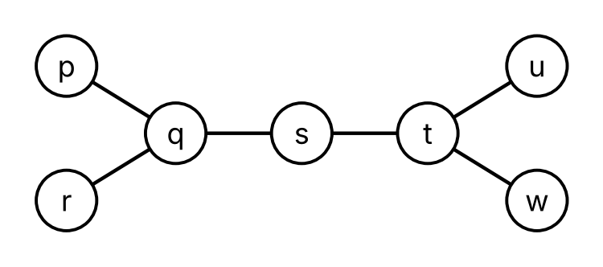
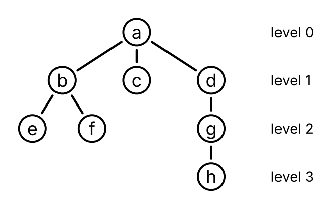
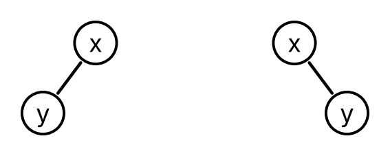
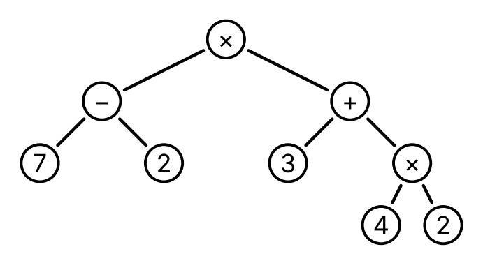
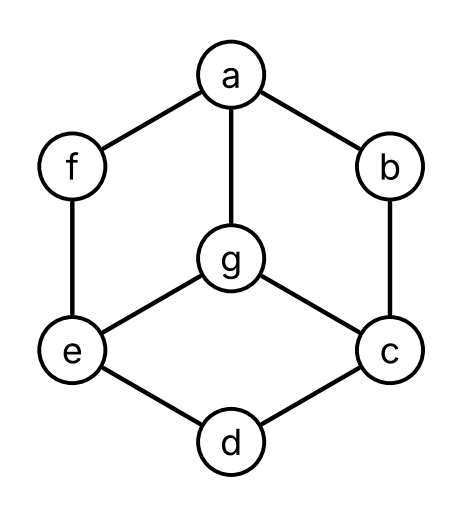

# Trees

Code

Trees and forests, rooted trees, binary trees, preorder, inorder, postorder and level order, expression trees, and spanning trees

Published

Last modified: 2026-10-26 21:49:29 (PDT)

> **NOTE:**
>
> The topics of this chapter follow the course calendar, and their order follows Kameron Decker Harris’s Fall 2026 lecture notes on trees. These come from those notes:
>
> - a tree as a connected graph with no cycles (the notes say no simple circuits), and a forest, whose connected components are trees;
> - the theorem that a graph is a tree if and only if there is exactly one path between every two of its vertices;
> - rooted trees, with the root, parents, children, ancestors, descendants, leaves, internal vertices and subtrees, and the fact that choosing a different root gives a different rooted tree;
> - the level of a vertex and the height of a rooted tree;
> - ordered rooted trees, and binary trees, with their left and right subtrees;
> - the theorem that a tree with \\n\\ vertices has \\n - 1\\ edges;
> - preorder, inorder and postorder traversal;
> - expression trees, and the infix, prefix (Polish) and postfix (reverse Polish) forms of an expression, with parentheses needed only in the infix form;
> - spanning trees, the theorem that a graph is connected if and only if it has a spanning tree, and the spanning trees that depth-first and breadth-first search build.
>
> The notes define the traversals for ordered rooted trees, by pseudocode; here they are defined recursively for binary trees, as lists, and a remark extends preorder and postorder to ordered rooted trees. In the notes a forest is not connected; here a forest is any graph with no cycles, so a tree is a forest too. The notes’ \\m\\-ary trees, full \\m\\-ary trees, balanced trees, and the counting theorems for them, siblings, back edges, and spanning forests of directed graphs are left out. A bound on the number of vertices of a binary tree of a given height is in their place. The definition of a parse tree is included from the [mathematics prerequisites](https://morrison-lab.github.io/mds/) notes, so it reads the same in both places. Level order, as breadth-first search from the root, follows the course calendar’s “tree traversal”. The proof that a tree with \\n\\ vertices has \\n - 1\\ edges, the other proofs, the examples, the exercises and the Racket functions are new.

# 1 Trees

> **NOTE:**
>
> **Exercise 1 (Pipes between houses)** Seven houses, named \\p\\, \\q\\, \\r\\, \\s\\, \\t\\, \\u\\ and \\w\\, share a water system. A pipe joins the two houses in each of these six pairs:
>
> \\ {\mathopen{}\left\\p, q\right\\\mathclose{}}, {\mathopen{}\left\\q, r\right\\\mathclose{}}, {\mathopen{}\left\\q, s\right\\\mathclose{}}, {\mathopen{}\left\\s, t\right\\\mathclose{}}, {\mathopen{}\left\\t, u\right\\\mathclose{}}, {\mathopen{}\left\\t, w\right\\\mathclose{}}. \\
>
> [Figure 1](#fig-pipes) draws them. How many routes are there from house \\r\\ to house \\w\\ that go along pipes and visit no house twice?
>
> [](../images/trees-pipes.png "Figure 1: The houses and pipes of Exercise 1.")
>
> Figure 1: The houses and pipes of [Exercise 1](#exr-pipes).

> **NOTE:**
>
> *Solution 1*. One: the route \\r, q, s, t, w\\. A route from \\r\\ starts along the only pipe at \\r\\, to \\q\\. From \\q\\, the pipes lead to \\p\\, \\r\\ and \\s\\. The route cannot go back to \\r\\, and if it goes to \\p\\ it cannot go on, since the only pipe at \\p\\ leads back to \\q\\. So it goes to \\s\\, and from \\s\\ along its only other pipe to \\t\\. From \\t\\, the pipe to \\u\\ leads to a house with no other pipe, so the route takes the pipe to \\w\\.

> **NOTE:**
>
> **Lemma 1 (A vertex of degree 1 is on no cycle)** Let \\v\\ be a vertex of degree 1 ([Definition: Degree](../chapters/graphs.llms.md#def-degree)) of a graph \\G\\ ([Definition: Graph](../chapters/graphs.llms.md#def-graph-vertices-edges)), and let \\H\\ be the subgraph ([Definition: Subgraph](../chapters/graphs.llms.md#def-subgraph)) of \\G\\ left when \\v\\ and its one edge are taken out. Then every cycle ([Definition: Cycle](../chapters/graphs.llms.md#def-graph-cycle)) of \\G\\ is a cycle of \\H\\.
>
> So if taking out vertices of degree 1, one at a time, each of degree 1 in the graph left at that point, ends with a graph that has no edges, then \\G\\ has no cycles.

> **NOTE:**
>
> *Proof*. Let \\v_0, e_1, v_1, \ldots, e_n, v_n\\ be a cycle of \\G\\, with \\v_n = v_0\\. Each of its vertices has degree at least 2. If \\n = 1\\, then \\e_1\\ is a loop ([Definition: Loop](../chapters/graphs.llms.md#def-graph-loop)) at \\v_0\\, which counts twice in \\\deg(v_0)\\. If \\n \ge 2\\, then each \\v_i\\ is an endpoint of two edges of the cycle, the edge just before it and the edge just after it (for \\v_0\\, these are \\e_n\\ and \\e_1\\), and these two edges are different, since a cycle is a trail ([Definition: Trail](../chapters/graphs.llms.md#def-trail)). So \\v\\ is not on the cycle. The edge of \\v\\ is not on the cycle either, since every edge of the cycle has its endpoints on the cycle. So the cycle is a cycle of \\H\\.
>
> For the second statement, each step keeps every cycle, so a cycle of \\G\\ would be a cycle of the last graph, which has no edges and so no cycles.

> **NOTE:**
>
> **Definition 1 (Tree)** A **tree** ([Wikipedia contributors 2026i](#ref-wikipedia_tree_graph_theory)) is a connected ([Definition: Connected graph](../chapters/graphs.llms.md#def-connected)) graph ([Definition: Graph](../chapters/graphs.llms.md#def-graph-vertices-edges)) with no cycles ([Definition: Cycle](../chapters/graphs.llms.md#def-graph-cycle)).

> **NOTE:**
>
> **Example 1 (The pipes form a tree)** The houses and pipes of [Exercise 1](#exr-pipes) form a graph ([Definition: Graph](../chapters/graphs.llms.md#def-graph-vertices-edges)) \\P\\, with vertex set \\{\mathopen{}\left\\p, q, r, s, t, u, w\right\\\mathclose{}}\\ and the six edges listed there. \\P\\ is a tree ([Definition 1](#def-tree)).
>
> - It is connected ([Definition: Connected graph](../chapters/graphs.llms.md#def-connected)). The walks \\q, p\\ and \\q, r\\ and \\q, s\\ and \\q, s, t\\ and \\q, s, t, u\\ and \\q, s, t, w\\ go from \\q\\ to every other vertex, and reading one of them backward and then following another gives a walk between any two vertices.
> - It has no cycles, by [Lemma 1](#lem-degree-one). Take out \\p\\, \\r\\, \\u\\ and \\w\\, which have degree 1. Then \\q\\ and \\t\\ have degree 1; take out \\q\\. Then \\t\\ has degree 1; take it out. What is left is the vertex \\s\\ with no edges.

> **NOTE:**
>
> **Example 2 (Trees and graphs that are not trees)** In [Figure 2](#fig-trees-or-not):
>
> - \\T\\ is a tree ([Definition 1](#def-tree)). It is connected, since \\b\\ is adjacent ([Definition: Adjacent vertices (neighbors)](../chapters/graphs.llms.md#def-adjacent)) to \\a\\, \\c\\ and \\d\\, and \\d\\ to \\e\\. Taking out \\a\\, \\c\\ and \\e\\, then \\b\\, leaves \\d\\ with no edges, so \\T\\ has no cycles, by [Lemma 1](#lem-degree-one).
> - \\H\\ is not a tree, since \\b, c, d, b\\ is a cycle ([Definition: Cycle](../chapters/graphs.llms.md#def-graph-cycle)).
> - \\F\\ is not a tree, since it is not connected: no edge has \\a\\ as an endpoint, so there is no walk from \\a\\ to \\b\\.
>
> [](../images/trees-or-not.png "Figure 2: A tree T and two graphs, H and F, that are not trees.")
>
> Figure 2: A tree \\T\\ and two graphs, \\H\\ and \\F\\, that are not trees.

> **NOTE:**
>
> *Remark 1* (A tree is a simple graph). A loop ([Definition: Loop](../chapters/graphs.llms.md#def-graph-loop)) \\e\\ at a vertex \\v\\ gives the circuit ([Definition: Circuit](../chapters/graphs.llms.md#def-circuit)) \\v, e, v\\ of length 1, which is a cycle ([Definition: Cycle](../chapters/graphs.llms.md#def-graph-cycle)). Two parallel edges ([Definition: Parallel edges](../chapters/graphs.llms.md#def-parallel-edges)) \\e_1\\ and \\e_2\\ that join \\u\\ and \\v\\ give the circuit \\u, e_1, v, e_2, u\\ of length 2, which is a cycle, since \\u \ne v\\. So a graph with no cycles, and a tree ([Definition 1](#def-tree)) in particular, is simple ([Definition: Simple graph](../chapters/graphs.llms.md#def-simple-graph)). Each edge of a tree is the only edge with its two endpoints, so, as in [Example: Simple or not](../chapters/graphs.llms.md#exm-simple-graph), we write it as the set of its endpoints, and we write a walk ([Definition: Walk](../chapters/graphs.llms.md#def-walk)) in a tree by its vertices alone, as in [Solution 1](#sol-pipes).

> **NOTE:**
>
> **Theorem 1 (A tree has exactly one path between two vertices)** Let \\G\\ be a graph ([Definition: Graph](../chapters/graphs.llms.md#def-graph-vertices-edges)) with no loops ([Definition: Loop](../chapters/graphs.llms.md#def-graph-loop)). Then \\G\\ is a tree ([Definition 1](#def-tree)) if and only if, for every two vertices \\u\\ and \\v\\ of \\G\\, there is exactly one path ([Definition: Path](../chapters/graphs.llms.md#def-graph-path)) from \\u\\ to \\v\\.

> **NOTE:**
>
> *Proof*. **A tree has exactly one path between two vertices.** Let \\G\\ be a tree, and let \\u\\ and \\v\\ be vertices of \\G\\. Since \\G\\ is connected ([Definition: Connected graph](../chapters/graphs.llms.md#def-connected)), there is a walk from \\u\\ to \\v\\, so there is a path from \\u\\ to \\v\\, by [Theorem: A shortest walk is a path](../chapters/graphs.llms.md#thm-walk-path).
>
> Suppose, for contradiction ([Definition: Proof by contradiction](../chapters/contrapositive-contradiction.llms.md#def-proof-by-contradiction)), that there are two different paths from \\u\\ to \\v\\, written by their vertices ([Remark 1](#rem-tree-simple)) as
>
> \\ \begin{aligned} u &= p_0, p_1, \ldots, p_m = v, \\ u &= q_0, q_1, \ldots, q_k = v. \end{aligned} \\
>
> If \\p_j = q_j\\ for every \\j \le \min(m, k)\\, the paths are the same: if \\m \< k\\, then \\q_m = p_m = v = q_k\\ would repeat a vertex of the second path, and \\k \< m\\ is ruled out in the same way. So there is a smallest \\j \ge 1\\ with \\p_j \ne q_j\\. Let \\i = j - 1\\, so that \\p_i = q_i\\ and \\p\_{i + 1} \ne q\_{i + 1}\\.
>
> The vertex \\p_m = v = q_k\\ of the first path is one of \\q\_{i + 1}, \ldots, q_k\\. Let \\a \> i\\ be the smallest index for which \\p_a\\ is one of \\q\_{i + 1}, \ldots, q_k\\, say \\p_a = q_b\\ with \\b \> i\\. Then
>
> \\ p_i, p\_{i + 1}, \ldots, p_a = q_b, q\_{b - 1}, \ldots, q\_{i + 1}, q_i = p_i \\
>
> is a closed walk from \\p_i\\ to itself. Its vertices before the last one are all different: \\p_i, \ldots, p_a\\ are vertices of a path, and so are \\q\_{b - 1}, \ldots, q\_{i + 1}, q_i\\; by the choice of \\a\\, none of \\p\_{i + 1}, \ldots, p\_{a - 1}\\ is one of \\q\_{i + 1}, \ldots, q\_{b - 1}\\; \\p_a = q_b\\ is not one of \\q\_{i + 1}, \ldots, q\_{b - 1}\\; and \\p_i = q_i\\ is not one of \\q\_{i + 1}, \ldots, q\_{b - 1}\\. Its length is \\(a - i) + (b - i) \ge 3\\, since both terms are at least 1, and \\a = b = i + 1\\ would give \\p\_{i + 1} = q\_{i + 1}\\. Each edge of the closed walk joins two consecutive vertices, and since there are at least three vertices before the last one, all different, no two of these pairs of consecutive vertices are the same set. So the edges are all different, and the closed walk is a cycle ([Definition: Cycle](../chapters/graphs.llms.md#def-graph-cycle)), which contradicts that \\G\\ is a tree. So there is exactly one path from \\u\\ to \\v\\.
>
> **A graph with exactly one path between every two vertices is a tree.** Suppose that \\G\\ has no loops and exactly one path between every two vertices. A path is a walk, so \\G\\ is connected. Suppose, for contradiction, that \\G\\ has a cycle \\v_0, e_1, v_1, \ldots, e_n, v_n\\, with \\v_n = v_0\\. Then \\n \ge 2\\, since a cycle of length 1 is a loop. Both
>
> \\ \begin{aligned} & v_0, e_1, v_1, \\ & v_0, e_n, v\_{n - 1}, e\_{n - 1}, \ldots, e_2, v_1 \end{aligned} \\
>
> are paths from \\v_0\\ to \\v_1\\, since the vertices \\v_0, \ldots, v\_{n - 1}\\ of the cycle are all different. They are different paths: if \\n \ge 3\\, the first has length 1 and the second has length \\n - 1 \ge 2\\, and if \\n = 2\\, they use the edges \\e_1\\ and \\e_2\\, which are different since a cycle is a trail ([Definition: Trail](../chapters/graphs.llms.md#def-trail)). This contradicts that there is exactly one path from \\v_0\\ to \\v_1\\. So \\G\\ has no cycles, and \\G\\ is a tree.

> **NOTE:**
>
> *Remark 2* (Why [Theorem 1](#thm-tree-paths) needs no loops). The graph with one vertex and one loop ([Definition: Loop](../chapters/graphs.llms.md#def-graph-loop)) shows that the condition of no loops in [Theorem 1](#thm-tree-paths) is needed: its only path ([Definition: Path](../chapters/graphs.llms.md#def-graph-path)) from its vertex to itself is the path of length 0, but the loop is a cycle ([Remark 1](#rem-tree-simple)), so the graph is not a tree ([Definition 1](#def-tree)).

> **NOTE:**
>
> **Definition 2 (Forest)** A **forest** ([Wikipedia contributors 2026i](#ref-wikipedia_tree_graph_theory)) is a graph ([Definition: Graph](../chapters/graphs.llms.md#def-graph-vertices-edges)) with no cycles ([Definition: Cycle](../chapters/graphs.llms.md#def-graph-cycle)).

> **NOTE:**
>
> **Example 3 (A forest of four trees)** The graph \\F\\ of [Figure 2](#fig-trees-or-not) is a forest ([Definition 2](#def-forest)): taking out \\d\\, \\f\\, \\g\\ and \\h\\, which have degree 1, leaves no edges, so \\F\\ has no cycles, by [Lemma 1](#lem-degree-one). Its connected components ([Definition: Connected component](../chapters/graphs.llms.md#def-connected-component)) are
>
> - the vertex \\a\\, with no edges;
> - the vertex \\b\\, with no edges;
> - the vertices \\c\\ and \\d\\, with the edge \\{\mathopen{}\left\\c, d\right\\\mathclose{}}\\;
> - the vertices \\e\\, \\f\\, \\g\\ and \\h\\, with the edges \\{\mathopen{}\left\\e, f\right\\\mathclose{}}\\, \\{\mathopen{}\left\\e, g\right\\\mathclose{}}\\ and \\{\mathopen{}\left\\e, h\right\\\mathclose{}}\\.
>
> Each of them is a tree ([Definition 1](#def-tree)). The tree \\T\\ of [Figure 2](#fig-trees-or-not) is a forest too, and the graph \\H\\ is not a forest.

> **NOTE:**
>
> *Remark 3* (Trees and forests). By their definitions, a tree ([Definition 1](#def-tree)) is a forest ([Definition 2](#def-forest)) that is connected ([Definition: Connected graph](../chapters/graphs.llms.md#def-connected)). Each connected component ([Definition: Connected component](../chapters/graphs.llms.md#def-connected-component)) of a forest is connected, and has no cycles, since a cycle in a subgraph is a cycle in the whole graph. So each connected component of a forest is a tree, which is where the name comes from. Some authors also require a forest to be not connected, so that a tree is not a forest; here a tree is a forest with one connected component.

# 2 Rooted trees

> **NOTE:**
>
> **Exercise 2 (Passing the news)** Eight members of a club, \\a\\, \\b\\, \\c\\, \\d\\, \\e\\, \\f\\, \\g\\ and \\h\\, pass news by phone. Member \\a\\ hears it first and calls \\b\\, \\c\\ and \\d\\. Then \\b\\ calls \\e\\ and \\f\\, \\d\\ calls \\g\\, and \\g\\ calls \\h\\. [Figure 3](#fig-phone) draws the calls, with each caller above the members it calls. How many calls does the news pass through on its way from \\a\\ to \\h\\, counting the call to \\h\\?
>
> [](../images/trees-phone.png "Figure 3: The calls of Exercise 2.")
>
> Figure 3: The calls of [Exercise 2](#exr-phone-calls).

> **NOTE:**
>
> *Solution 2*. Three. Member \\h\\ hears the news only from \\g\\, \\g\\ only from \\d\\, and \\d\\ only from \\a\\, so the news goes \\a, d, g, h\\, through the three calls from \\a\\ to \\d\\, from \\d\\ to \\g\\ and from \\g\\ to \\h\\.

> **NOTE:**
>
> **Definition 3 (Rooted tree)** A **rooted tree** ([Wikipedia contributors 2026i](#ref-wikipedia_tree_graph_theory)) is a tree ([Definition 1](#def-tree)) \\T\\ together with one of its vertices \\r\\, called the *root* of \\T\\.

> **NOTE:**
>
> **Example 4 (The phone tree)** The calls of [Exercise 2](#exr-phone-calls) form a graph ([Definition: Graph](../chapters/graphs.llms.md#def-graph-vertices-edges)) \\C\\, with the eight members as vertices and an edge for each call:
>
> \\ {\mathopen{}\left\\a, b\right\\\mathclose{}}, {\mathopen{}\left\\a, c\right\\\mathclose{}}, {\mathopen{}\left\\a, d\right\\\mathclose{}}, {\mathopen{}\left\\b, e\right\\\mathclose{}}, {\mathopen{}\left\\b, f\right\\\mathclose{}}, {\mathopen{}\left\\d, g\right\\\mathclose{}}, {\mathopen{}\left\\g, h\right\\\mathclose{}}. \\
>
> \\C\\ is a tree ([Definition 1](#def-tree)). It is connected ([Definition: Connected graph](../chapters/graphs.llms.md#def-connected)), since the news goes from \\a\\ to every member along calls, and two of those walks, one read backward, join any two members. It has no cycles, by [Lemma 1](#lem-degree-one): take out \\c\\, \\e\\, \\f\\ and \\h\\, which have degree 1, then \\b\\ and \\g\\, then \\a\\, and \\d\\ is left with no edges. With \\a\\ as its root, \\C\\ is a rooted tree ([Definition 3](#def-rooted-tree)), the *phone tree*. [Figure 3](#fig-phone) draws it with the root at the top.

> **NOTE:**
>
> **Definition 4 (Parent)** Let \\T\\ be a rooted tree ([Definition 3](#def-rooted-tree)) with root \\r\\, and let \\v \ne r\\ be a vertex of \\T\\. By [Theorem 1](#thm-tree-paths), there is exactly one path ([Definition: Path](../chapters/graphs.llms.md#def-graph-path)) \\r = v_0, v_1, \ldots, v_k = v\\ from \\r\\ to \\v\\, and \\k \ge 1\\ since \\v \ne r\\. The **parent** of \\v\\ ([Wikipedia contributors 2026i](#ref-wikipedia_tree_graph_theory)) is the vertex \\v\_{k - 1}\\ just before \\v\\ on this path. The root has no parent.

> **NOTE:**
>
> **Example 5 (Parents in the phone tree)** In the phone tree ([Example 4](#exm-phone-tree)), the path from \\a\\ to \\h\\ is \\a, d, g, h\\, so the parent ([Definition 4](#def-tree-parent)) of \\h\\ is \\g\\. The path from \\a\\ to \\b\\ is \\a, b\\, so the parent of \\b\\ is \\a\\. The parent of each member other than \\a\\ is the member who called them.

> **NOTE:**
>
> **Definition 5 (Child)** A vertex \\v\\ of a rooted tree ([Definition 3](#def-rooted-tree)) is a **child** of a vertex \\u\\ ([Wikipedia contributors 2026i](#ref-wikipedia_tree_graph_theory)) if \\u\\ is the parent ([Definition 4](#def-tree-parent)) of \\v\\.

> **NOTE:**
>
> **Example 6 (Children in the phone tree)** In the phone tree ([Example 4](#exm-phone-tree)),
>
> - the children ([Definition 5](#def-tree-child)) of \\a\\ are \\b\\, \\c\\ and \\d\\;
> - the children of \\b\\ are \\e\\ and \\f\\;
> - the only child of \\d\\ is \\g\\, and the only child of \\g\\ is \\h\\;
> - \\c\\, \\e\\, \\f\\ and \\h\\ have no children.
>
> These are the members each member calls.

> **NOTE:**
>
> **Lemma 2 (Every edge joins a vertex to its parent)** Let \\T\\ be a rooted tree ([Definition 3](#def-rooted-tree)). For every edge \\{\mathopen{}\left\\u, w\right\\\mathclose{}}\\ of \\T\\, one of \\u\\ and \\w\\ is the parent ([Definition 4](#def-tree-parent)) of the other.

> **NOTE:**
>
> *Proof*. Let \\r\\ be the root, and let \\r = p_0, p_1, \ldots, p_m = u\\ be the path from \\r\\ to \\u\\ ([Theorem 1](#thm-tree-paths)). Also \\w \ne u\\, since a tree has no loops ([Remark 1](#rem-tree-simple)).
>
> - If \\w\\ is not on this path, then \\p_0, \ldots, p_m, w\\ is a path from \\r\\ to \\w\\, since its vertices are all different and \\{\mathopen{}\left\\u, w\right\\\mathclose{}}\\ is an edge. By [Theorem 1](#thm-tree-paths) it is the path from \\r\\ to \\w\\, so \\u\\ is the parent of \\w\\.
> - If \\w\\ is on this path, then \\w = p_i\\ for some \\i \< m\\. If \\i = m - 1\\, then \\w\\ is the parent of \\u\\. Suppose, for contradiction ([Definition: Proof by contradiction](../chapters/contrapositive-contradiction.llms.md#def-proof-by-contradiction)), that \\i \le m - 2\\. Then \\p_i, p\_{i + 1}, \ldots, p_m, p_i\\, whose last step uses the edge \\{\mathopen{}\left\\u, w\right\\\mathclose{}}\\, is a closed walk of length \\m - i + 1 \ge 3\\ whose vertices before the last one are all different. As in the proof of [Theorem 1](#thm-tree-paths), its edges are all different, so it is a cycle ([Definition: Cycle](../chapters/graphs.llms.md#def-graph-cycle)), which a tree does not have.

> **NOTE:**
>
> **Definition 6 (Ancestor)** Let \\T\\ be a rooted tree ([Definition 3](#def-rooted-tree)) with root \\r\\, and let \\v\\ be a vertex of \\T\\. A vertex \\u \ne v\\ is an **ancestor** of \\v\\ ([Wikipedia contributors 2026i](#ref-wikipedia_tree_graph_theory)) if \\u\\ is on the path ([Definition: Path](../chapters/graphs.llms.md#def-graph-path)) from \\r\\ to \\v\\.

> **NOTE:**
>
> **Example 7 (Ancestors in the phone tree)** In the phone tree ([Example 4](#exm-phone-tree)), the path from \\a\\ to \\h\\ is \\a, d, g, h\\, so the ancestors ([Definition 6](#def-ancestor)) of \\h\\ are \\a\\, \\d\\ and \\g\\. The root \\a\\ is an ancestor of every other vertex, and has no ancestors itself. The parent of a vertex is always one of its ancestors.

> **NOTE:**
>
> **Definition 7 (Descendant)** A vertex \\v\\ of a rooted tree ([Definition 3](#def-rooted-tree)) is a **descendant** of a vertex \\u\\ ([Wikipedia contributors 2026i](#ref-wikipedia_tree_graph_theory)) if \\u\\ is an ancestor ([Definition 6](#def-ancestor)) of \\v\\.

> **NOTE:**
>
> **Example 8 (Descendants in the phone tree)** In the phone tree ([Example 4](#exm-phone-tree)),
>
> - the descendants ([Definition 7](#def-descendant)) of \\d\\ are \\g\\ and \\h\\, the members who hear the news through \\d\\;
> - the descendants of \\a\\ are the seven other members;
> - \\c\\ has no descendants.

> **NOTE:**
>
> **Definition 8 (Leaf)** A **leaf** of a rooted tree ([Definition 3](#def-rooted-tree)) ([Wikipedia contributors 2026i](#ref-wikipedia_tree_graph_theory)) is a vertex with no children ([Definition 5](#def-tree-child)).

> **NOTE:**
>
> **Example 9 (Leaves of the phone tree)** The leaves ([Definition 8](#def-tree-leaf)) of the phone tree ([Example 4](#exm-phone-tree)) are \\c\\, \\e\\, \\f\\ and \\h\\, the members who call no one. In a rooted tree with only one vertex, the root is a leaf.

> **NOTE:**
>
> **Definition 9 (Internal vertex)** An **internal vertex** of a rooted tree ([Definition 3](#def-rooted-tree)) ([Wikipedia contributors 2026i](#ref-wikipedia_tree_graph_theory)) is a vertex with at least one child ([Definition 5](#def-tree-child)).

> **NOTE:**
>
> **Example 10 (Internal vertices of the phone tree)** The internal vertices ([Definition 9](#def-internal-vertex)) of the phone tree ([Example 4](#exm-phone-tree)) are \\a\\, \\b\\, \\d\\ and \\g\\, the members who call someone. Each vertex of a rooted tree is either a leaf ([Definition 8](#def-tree-leaf)) or an internal vertex, and not both.

> **NOTE:**
>
> **Definition 10 (Subtree)** Let \\T\\ be a rooted tree ([Definition 3](#def-rooted-tree)), and let \\v\\ be a vertex of \\T\\. The **subtree** of \\T\\ rooted at \\v\\ ([Wikipedia contributors 2026i](#ref-wikipedia_tree_graph_theory)) is the subgraph ([Definition: Subgraph](../chapters/graphs.llms.md#def-subgraph)) of \\T\\ whose vertices are \\v\\ and its descendants ([Definition 7](#def-descendant)), and whose edges are the edges of \\T\\ with both endpoints among those vertices, with \\v\\ as its root.

> **NOTE:**
>
> **Example 11 (A subtree of the phone tree)** In the phone tree ([Example 4](#exm-phone-tree)), the subtree ([Definition 10](#def-subtree)) rooted at \\d\\ has the vertices \\d\\, \\g\\ and \\h\\ and the edges \\{\mathopen{}\left\\d, g\right\\\mathclose{}}\\ and \\{\mathopen{}\left\\g, h\right\\\mathclose{}}\\. It is the part of [Figure 3](#fig-phone) below \\d\\, together with \\d\\. The subtree rooted at a leaf, such as \\c\\, has one vertex and no edges, and the subtree rooted at \\a\\ is the whole phone tree.

> **NOTE:**
>
> *Remark 4* (A subtree is a tree). The subtree ([Definition 10](#def-subtree)) of a rooted tree \\T\\ rooted at \\v\\ is a tree ([Definition 1](#def-tree)), so it is a rooted tree. It has no cycles, since a cycle in it would be a cycle in \\T\\. It is connected: let \\d\\ be a descendant ([Definition 7](#def-descendant)) of \\v\\, and let \\r = x_0, x_1, \ldots, x_k = d\\ be the path from the root \\r\\ of \\T\\ to \\d\\, which goes through \\v = x_i\\. For each \\j \> i\\, the path \\x_0, \ldots, x_j\\ goes from \\r\\ to \\x_j\\ and passes through \\v\\, so it is the path from \\r\\ to \\x_j\\ ([Theorem 1](#thm-tree-paths)), and \\x_j\\ is a descendant of \\v\\. So \\x_i, \ldots, x_k\\ is a walk from \\v\\ to \\d\\ in the subtree.

> **NOTE:**
>
> **Definition 11 (Level)** The **level** \\\operatorname{level}(v)\\ of a vertex \\v\\ of a rooted tree ([Definition 3](#def-rooted-tree)) with root \\r\\ ([Wikipedia contributors 2026i](#ref-wikipedia_tree_graph_theory)) is the length of the path ([Definition: Path](../chapters/graphs.llms.md#def-graph-path)) from \\r\\ to \\v\\.

> **NOTE:**
>
> **Example 12 (Levels in the phone tree)** In the phone tree ([Example 4](#exm-phone-tree)), as [Figure 3](#fig-phone) marks,
>
> - the root \\a\\ is at level ([Definition 11](#def-tree-level)) 0;
> - \\b\\, \\c\\ and \\d\\ are at level 1;
> - \\e\\, \\f\\ and \\g\\ are at level 2;
> - \\h\\ is at level 3.
>
> The level of a member is the number of calls the news passes through to reach that member, which [Solution 2](#sol-phone-calls) found for \\h\\.

> **NOTE:**
>
> **Lemma 3 (A child is one level below its parent)** Let \\v\\ be a vertex of a rooted tree ([Definition 3](#def-rooted-tree)) other than the root \\r\\, and let \\u\\ be its parent ([Definition 4](#def-tree-parent)). Then the path from \\r\\ to \\v\\ is the path from \\r\\ to \\u\\ followed by \\v\\, and
>
> \\ \operatorname{level}(v) = \operatorname{level}(u) + 1. \\

> **NOTE:**
>
> *Proof*. Let \\r = v_0, v_1, \ldots, v_k = v\\ be the path from \\r\\ to \\v\\, so that \\u = v\_{k - 1}\\. The vertices \\v_0, \ldots, v\_{k - 1}\\ are all different, so \\v_0, \ldots, v\_{k - 1}\\ is a path from \\r\\ to \\u\\, and by [Theorem 1](#thm-tree-paths) it is the path from \\r\\ to \\u\\. Its length is \\k - 1\\, so \\\operatorname{level}(u) = k - 1 = \operatorname{level}(v) - 1\\ ([Definition 11](#def-tree-level)).

> **NOTE:**
>
> **Definition 12 (Height)** The **height** of a rooted tree ([Definition 3](#def-rooted-tree)) ([Wikipedia contributors 2026i](#ref-wikipedia_tree_graph_theory)) is the largest level ([Definition 11](#def-tree-level)) of its vertices.

> **NOTE:**
>
> **Example 13 (The height of the phone tree)** The phone tree ([Example 4](#exm-phone-tree)) has height ([Definition 12](#def-tree-height)) 3, since its deepest vertex, \\h\\, is at level 3 ([Example 12](#exm-tree-level)). The news reaches every member within three calls.

> **NOTE:**
>
> **Example 14 (Another root)** Suppose that \\c\\ hears the news first, and it travels along the same seven edges of the tree \\C\\ of [Example 4](#exm-phone-tree). Then \\C\\ with root \\c\\ is a different rooted tree ([Definition 3](#def-rooted-tree)), drawn in [Figure 4](#fig-phone-c).
>
> - The parent ([Definition 4](#def-tree-parent)) of \\a\\ is now \\c\\, and \\a\\ has two children, \\b\\ and \\d\\.
> - The path from \\c\\ to \\h\\ is \\c, a, d, g, h\\, so \\h\\ is at level ([Definition 11](#def-tree-level)) 4, and the height ([Definition 12](#def-tree-height)) is 4.
> - The leaves ([Definition 8](#def-tree-leaf)) are \\e\\, \\f\\ and \\h\\, and \\c\\ is now an internal vertex.
>
> [](../images/trees-phone-c.png "Figure 4: The tree C with root c.")
>
> Figure 4: The tree \\C\\ with root \\c\\.

# 3 Counting edges

> **NOTE:**
>
> **Exercise 3 (Counting the calls)** A club with 40 members passes news by phone. One member hears it first, and every other member hears it in exactly one call, from a member who already knows it. How many calls are made in all?

> **NOTE:**
>
> *Solution 3*. There are 39 calls. Each call goes to exactly one member who did not know the news, and each of the 39 members other than the first gets exactly one call. So there is one call for each of those 39 members.

> **NOTE:**
>
> **Theorem 2 (A tree with \\n\\ vertices has \\n - 1\\ edges)** Every tree \\T = (V, E)\\ ([Definition 1](#def-tree)) with \\n\\ vertices has \\n - 1\\ edges.

> **NOTE:**
>
> *Proof*. Choose any vertex \\r\\ of \\T\\ as a root ([Definition 3](#def-rooted-tree)). For each vertex \\v \ne r\\, let \\e(v)\\ be the edge joining \\v\\ to its parent ([Definition 4](#def-tree-parent)) \\u\\, which is an edge since \\u\\ and \\v\\ are consecutive vertices of a path.
>
> **Every edge is \\e(v)\\ for some \\v\\.** By [Lemma 2](#lem-parent-edge), one endpoint of each edge is the parent of the other endpoint \\v\\, and then the edge is \\e(v)\\.
>
> **Different vertices give different edges.** Suppose, for contradiction ([Definition: Proof by contradiction](../chapters/contrapositive-contradiction.llms.md#def-proof-by-contradiction)), that \\e(v) = e(w)\\ for two vertices \\v \ne w\\. The endpoints of this edge are \\v\\ and its parent, and also \\w\\ and its parent, so \\w\\ is the parent of \\v\\ and \\v\\ is the parent of \\w\\. By [Lemma 3](#lem-level-parent),
>
> \\ \operatorname{level}(v) = \operatorname{level}(w) + 1 = \operatorname{level}(v) + 2, \\
>
> which is false.
>
> So, listing the \\n - 1\\ vertices other than \\r\\ as \\v_1, \ldots, v\_{n - 1}\\, the list \\e(v_1), \ldots, e(v\_{n - 1})\\ has each edge of \\T\\ exactly once, and \\{\mathopen{}\left\|E\right\|\mathclose{}} = n - 1\\ ([Definition: Cardinality](../chapters/sets.llms.md#def-cardinality)).

> **NOTE:**
>
> **Example 15 (Counting edges)**  
>
> - The pipes tree of [Example 1](#exm-pipes-tree) has 7 vertices and 6 edges, and the phone tree of [Example 4](#exm-phone-tree) has 8 vertices and 7 edges, as [Theorem 2](#thm-tree-edges) says.
> - Each connected component of the forest \\F\\ of [Example 3](#exm-forest) is a tree, with 1, 1, 2 and 4 vertices, so it has 0, 0, 1 and 3 edges. \\F\\ has 8 vertices and \\0 + 0 + 1 + 3 = 4\\ edges.
> - The graph \\H\\ of [Figure 2](#fig-trees-or-not) is connected and has 5 vertices and 5 edges, so it is not a tree, by [Theorem 2](#thm-tree-edges), without finding its cycle.

# 4 Binary trees

> **NOTE:**
>
> **Exercise 4 (Shapes with three vertices)** A binary tree is either empty, or a root together with two binary trees, a left one and a right one, drawn below the root to its left and to its right. Ignoring the names of the vertices, how many binary trees have exactly three vertices?

> **NOTE:**
>
> *Solution 4*. Five, drawn in [Figure 5](#fig-three-vertices). The root is one of the three vertices, so the left and right binary trees have two vertices between them: 2 and 0, 1 and 1, or 0 and 2. There is one binary tree with no vertices, the empty one, and one with one vertex, a root with two empty binary trees. There are two with two vertices: a root with one vertex in its left binary tree, or in its right one. So there are \\2 \cdot 1 + 1 \cdot 1 + 1 \cdot 2 = 5\\ binary trees with three vertices.
>
> [](../images/trees-three-vertices.png "Figure 5: The five binary trees with three vertices.")
>
> Figure 5: The five binary trees with three vertices.

> **NOTE:**
>
> **Definition 13 (Ordered rooted tree)** An **ordered rooted tree** ([Wikipedia contributors 2026i](#ref-wikipedia_tree_graph_theory)) is a rooted tree ([Definition 3](#def-rooted-tree)) in which the children ([Definition 5](#def-tree-child)) of each vertex are listed in an order: a first child, a second child, and so on. We draw the children of each vertex from left to right in their order.

> **NOTE:**
>
> **Example 16 (The order of the calls)** In the phone tree ([Example 4](#exm-phone-tree)), list the children of each member in the order of their calls: \\a\\ calls \\b\\, then \\c\\, then \\d\\, and \\b\\ calls \\e\\, then \\f\\. This makes the phone tree an ordered rooted tree ([Definition 13](#def-ordered-rooted-tree)), drawn in [Figure 3](#fig-phone). If \\a\\ called \\d\\ first, the ordered rooted tree would be different, although the rooted tree would be the same.

> **NOTE:**
>
> **Definition 14 (Binary tree)** Let \\A\\ be a set ([Definition: Set](../chapters/sets.llms.md#def-set)) of labels. The set of **binary trees** with labels in \\A\\ ([Wikipedia contributors 2026a](#ref-wikipedia_binary_tree)) is the recursively defined set ([Definition: Recursively defined set](../chapters/recursion.llms.md#def-recursive-set)) with
>
> - base case: the *empty tree*, written \\\mathtt{nil}\\, is a binary tree;
> - recursive rule: if \\x \in A\\ and \\L\\ and \\R\\ are binary trees, then \\\operatorname{node}(x, L, R)\\ is a binary tree, whose *root* has the label \\x\\, and whose *left subtree* is \\L\\ and *right subtree* is \\R\\.
>
> The vertices of \\\operatorname{node}(x, L, R)\\ are its root and the vertices of \\L\\ and of \\R\\; the empty tree has no vertices. The root, the vertices of \\L\\ and the vertices of \\R\\ are taken as different vertices, even when \\L\\ and \\R\\ are the same binary tree: a vertex is a position in the tree, such as “the root of the left subtree”, and its label is the element of \\A\\ at that position. So \\\operatorname{node}(x, L, R)\\ has one more vertex than \\L\\ and \\R\\ together, and two vertices may have the same label.

> **NOTE:**
>
> *Remark 5* (Writing a binary tree with one vertex). For a label \\x\\, we write \\\operatorname{single}(x)\\ for \\\operatorname{node}(x, \mathtt{nil}, \mathtt{nil})\\, the binary tree ([Definition 14](#def-binary-tree)) whose only vertex is its root, labeled \\x\\.

> **NOTE:**
>
> **Example 17 (A binary tree with nine vertices)** With \\\operatorname{single}\\ as in [Remark 5](#rem-single), the recursive rule of binary trees ([Definition 14](#def-binary-tree)) builds
>
> \\ \begin{aligned} B_1 &= \operatorname{node}\mathopen{}\left(f, \operatorname{single}(c), \operatorname{node}\mathopen{}\left(h, \mathtt{nil}, \operatorname{single}(j)\right)\mathclose{}\right)\mathclose{}, \\ B_2 &= \operatorname{node}\mathopen{}\left(t, \operatorname{node}\mathopen{}\left(r, \operatorname{single}(p), \mathtt{nil}\right)\mathclose{}, \operatorname{single}(w)\right)\mathclose{}, \\ B &= \operatorname{node}(m, B_1, B_2). \end{aligned} \\
>
> The binary tree \\B\\ has the nine vertices labeled \\m\\, \\f\\, \\c\\, \\h\\, \\j\\, \\t\\, \\r\\, \\p\\ and \\w\\. Its root is labeled \\m\\, its left subtree is \\B_1\\ and its right subtree is \\B_2\\. [Figure 6](#fig-binary) draws it.
>
> [](../images/trees-binary.png "Figure 6: The binary tree B.")
>
> Figure 6: The binary tree \\B\\.

> **NOTE:**
>
> *Remark 6* (A binary tree as a rooted tree). We draw \\\operatorname{node}(x, L, R)\\ ([Definition 14](#def-binary-tree)) with its root at the top, the drawing of \\L\\ below it to the left, and the drawing of \\R\\ below it to the right, with an edge from the root to the root of each of \\L\\ and \\R\\ that is not empty. The drawing of a binary tree that is not empty is a tree ([Definition 1](#def-tree)), and with the root of the binary tree as its root it is a rooted tree ([Definition 3](#def-rooted-tree)), in which each vertex has at most two children ([Definition 5](#def-tree-child)): the roots of its subtrees that are not empty. Levels ([Definition 11](#def-tree-level)), height ([Definition 12](#def-tree-height)), leaves ([Definition 8](#def-tree-leaf)) and the other words for rooted trees apply to a binary tree through its drawing. The empty tree has no drawing, since a graph has at least one vertex.
>
> In a binary tree \\T\\ that is not empty, each vertex \\v\\ is the root of exactly one of the binary trees \\\operatorname{node}(y, L_v, R_v)\\ from which the recursive rule builds \\T\\, and \\L_v\\ and \\R_v\\ are the *left subtree* and *right subtree* of \\v\\. For the root of \\T\\, they are the left and right subtrees of \\T\\. When \\L_v\\ is not empty, its root is a child of \\v\\, and the drawing of \\L_v\\ is the subtree ([Definition 10](#def-subtree)) of the drawing of \\T\\ rooted at that child, since the descendants ([Definition 7](#def-descendant)) of that child are the vertices of \\L_v\\. The same holds for \\R_v\\.
>
> The drawing is a tree, by structural induction ([Definition: Structural induction](../chapters/recursion.llms.md#def-structural-induction)). It is connected, since the root is joined to the roots of the subtrees that are not empty, whose drawings are connected. Every edge of the drawing of \\\operatorname{node}(x, L, R)\\ lies in the drawing of \\L\\, lies in the drawing of \\R\\, or joins the root to the root of \\L\\ or of \\R\\. A cycle cannot lie in the drawing of \\L\\ or of \\R\\, which have no cycles, so it uses an edge at the root, say the edge to the root of \\L\\. Then the cycle has a vertex in the drawing of \\L\\ and a vertex, the root, outside it. Going once around the cycle, it crosses between the drawing of \\L\\ and the rest at least twice, each time along an edge with one endpoint in the drawing of \\L\\ and the other outside it. But there is only one such edge, and a cycle uses each edge once. So the drawing has no cycles.

> **NOTE:**
>
> **Example 18 (Left is not right)** The binary trees ([Definition 14](#def-binary-tree)), with \\\operatorname{single}\\ as in [Remark 5](#rem-single),
>
> \\ \operatorname{node}\mathopen{}\left(x, \operatorname{single}(y), \mathtt{nil}\right)\mathclose{} \quad \text{and} \quad \operatorname{node}\mathopen{}\left(x, \mathtt{nil}, \operatorname{single}(y)\right)\mathclose{} \\
>
> are different: \\y\\ is the root of the left subtree of the first, and of the right subtree of the second. [Figure 7](#fig-left-right) draws them. As rooted trees ([Remark 6](#rem-binary-drawing)), they are the same: a root \\x\\ with one child \\y\\. So a binary tree says more than its rooted tree: it says whether each child is on the left or on the right.
>
> [](../images/trees-left-right.png "Figure 7: Two different binary trees with the same rooted tree.")
>
> Figure 7: Two different binary trees with the same rooted tree.

> **NOTE:**
>
> *Remark 7* (Size and height, recursively). For a binary tree \\T\\ ([Definition 14](#def-binary-tree)), write \\\operatorname{size}(T)\\ for its number of vertices, and \\\operatorname{height}(T)\\ for the height ([Definition 12](#def-tree-height)) of its drawing ([Remark 6](#rem-binary-drawing)), with \\\operatorname{height}(\mathtt{nil}) = -1\\ for the empty tree. These follow the recursive definition of binary trees:
>
> \\ \begin{aligned} \operatorname{size}(\mathtt{nil}) &= 0, \\ \operatorname{size}\mathopen{}\left(\operatorname{node}(x, L, R)\right)\mathclose{} &= 1 + \operatorname{size}(L) + \operatorname{size}(R), \\ \operatorname{height}\mathopen{}\left(\operatorname{node}(x, L, R)\right)\mathclose{} &= 1 + {\max\mathopen{}\left(\operatorname{height}(L), \operatorname{height}(R)\right)\mathclose{}}. \end{aligned} \\
>
> For the height: in the drawing of \\\operatorname{node}(x, L, R)\\, the path from the root to a vertex \\v\\ of \\L\\ is the root followed by the path from the root of \\L\\ to \\v\\ in the drawing of \\L\\ ([Theorem 1](#thm-tree-paths)), so the level of \\v\\ is one more than its level in \\L\\, and the same holds for \\R\\. So the largest level is 0 when \\L\\ and \\R\\ are both empty, and otherwise 1 plus the largest height of the subtrees that are not empty. With \\\operatorname{height}(\mathtt{nil}) = -1\\, both cases give the formula above.

> **NOTE:**
>
> **Theorem 3 (A short binary tree has few vertices)** For every binary tree \\T\\ ([Definition 14](#def-binary-tree)), with size and height as in [Remark 7](#rem-size-height),
>
> \\ \operatorname{size}(T) \le 2^{\operatorname{height}(T) + 1} - 1. \\

> **NOTE:**
>
> *Proof*. We use structural induction ([Definition: Structural induction](../chapters/recursion.llms.md#def-structural-induction)) on \\T\\.
>
> **Base case.** \\\operatorname{size}(\mathtt{nil}) = 0 = 2^{-1 + 1} - 1\\.
>
> **Inductive step.** Let \\T = \operatorname{node}(x, L, R)\\, where \\L\\ and \\R\\ satisfy the inequality, and let \\h = \operatorname{height}(T)\\. By [Remark 7](#rem-size-height), \\\operatorname{height}(L) \le h - 1\\ and \\\operatorname{height}(R) \le h - 1\\. Then, using the formula for size in [Remark 7](#rem-size-height) first,
>
> \\ \begin{aligned} \operatorname{size}(T) &= 1 + \operatorname{size}(L) + \operatorname{size}(R) && \text{(formula for size)} \\&\le 1 + \mathopen{}\left(2^{\operatorname{height}(L) + 1} - 1\right)\mathclose{} + \mathopen{}\left(2^{\operatorname{height}(R) + 1} - 1\right)\mathclose{} && \text{(induction hypothesis)} \\&\le 1 + \mathopen{}\left(2^{h} - 1\right)\mathclose{} + \mathopen{}\left(2^{h} - 1\right)\mathclose{} \\&= 2^{h + 1} - 1. \end{aligned} \\
>
> By structural induction, the inequality holds for every binary tree.

> **NOTE:**
>
> **Example 19 (Using the bound)**  
>
> - The binary tree \\B\\ of [Example 17](#exm-binary-tree) has size 9 and height 3, and \\9 \le 2^{4} - 1 = 15\\, as [Theorem 3](#thm-binary-size) says.
> - The binary tree \\\operatorname{node}\mathopen{}\left(d, \operatorname{node}\mathopen{}\left(b, \operatorname{single}(a), \operatorname{single}(c)\right)\mathclose{}, \operatorname{node}\mathopen{}\left(f, \operatorname{single}(e), \operatorname{single}(g)\right)\mathclose{}\right)\mathclose{}\\ (with \\\operatorname{single}\\ as in [Remark 5](#rem-single)) has size 7 and height 2, and \\7 = 2^{3} - 1\\, so the bound can be reached.
> - A binary tree with 1000 vertices has height at least 9: a binary tree of height at most 8 has at most \\2^{9} - 1 = 511\\ vertices.

# 5 Preorder, inorder and postorder

> **NOTE:**
>
> **Exercise 5 (Root first)** List the labels of the binary tree \\B\\ of [Figure 6](#fig-binary) by this rule: list the root, then list the left subtree by the same rule, then list the right subtree by the same rule. What list do you get?

> **NOTE:**
>
> *Solution 5*. \\m, f, c, h, j, t, r, p, w\\. The root \\m\\ comes first. Next comes the left subtree, rooted at \\f\\: first \\f\\, then its left subtree, \\c\\, then its right subtree, \\h\\ followed by \\j\\. Last comes the right subtree, rooted at \\t\\: first \\t\\, then \\r\\ followed by \\p\\, then \\w\\.

> **NOTE:**
>
> **Definition 15 (Preorder)** The **preorder** \\\operatorname{preorder}(T)\\ of a binary tree \\T\\ ([Definition 14](#def-binary-tree)) ([Wikipedia contributors 2026j](#ref-wikipedia_tree_traversal)) is the list ([Definition: List](../chapters/recursion.llms.md#def-list)) of the labels of its vertices defined recursively, following the recursive definition of binary trees:
>
> \\ \begin{aligned} \operatorname{preorder}(\mathtt{nil}) &= \mathtt{empty}, \\ \operatorname{preorder}\mathopen{}\left(\operatorname{node}(x, L, R)\right)\mathclose{} &= \operatorname{cons}\mathopen{}\left(x, \operatorname{app}\mathopen{}\left(\operatorname{preorder}(L), \operatorname{preorder}(R)\right)\mathclose{}\right)\mathclose{}, \end{aligned} \\
>
> where \\\operatorname{app}\\ is the append ([Definition: Appending two lists](../chapters/recursion.llms.md#def-append)). The root comes before its subtrees.

> **NOTE:**
>
> **Example 20 (Preorder, step by step)** For the subtree \\\operatorname{node}\mathopen{}\left(h, \mathtt{nil}, \operatorname{single}(j)\right)\mathclose{}\\ of \\B\\ ([Example 17](#exm-binary-tree)), the definition of preorder ([Definition 15](#def-preorder)) gives first
>
> \\ \begin{aligned} \operatorname{preorder}\mathopen{}\left(\operatorname{single}(j)\right)\mathclose{} &= \operatorname{cons}\mathopen{}\left(j, \operatorname{app}(\mathtt{empty}, \mathtt{empty})\right)\mathclose{} \\&= \operatorname{cons}(j, \mathtt{empty}), \end{aligned} \\
>
> and then
>
> \\ \begin{aligned} & \operatorname{preorder}\mathopen{}\left(\operatorname{node}\mathopen{}\left(h, \mathtt{nil}, \operatorname{single}(j)\right)\mathclose{}\right)\mathclose{} \\&= \operatorname{cons}\mathopen{}\left(h, \operatorname{app}\mathopen{}\left(\mathtt{empty}, \operatorname{cons}(j, \mathtt{empty})\right)\mathclose{}\right)\mathclose{} \\&= \operatorname{cons}\mathopen{}\left(h, \operatorname{cons}(j, \mathtt{empty})\right)\mathclose{}, \end{aligned} \\
>
> the list \\h, j\\. In the same way, \\\operatorname{preorder}(B)\\ is the list \\m, f, c, h, j, t, r, p, w\\ of [Solution 5](#sol-root-first).

> **NOTE:**
>
> **Definition 16 (Inorder)** The **inorder** \\\operatorname{inorder}(T)\\ of a binary tree \\T\\ ([Definition 14](#def-binary-tree)) ([Wikipedia contributors 2026j](#ref-wikipedia_tree_traversal)) is the list ([Definition: List](../chapters/recursion.llms.md#def-list)) of the labels of its vertices defined recursively by
>
> \\ \begin{aligned} \operatorname{inorder}(\mathtt{nil}) &= \mathtt{empty}, \\ \operatorname{inorder}\mathopen{}\left(\operatorname{node}(x, L, R)\right)\mathclose{} &= \operatorname{app}\mathopen{}\left(\operatorname{inorder}(L), \operatorname{cons}\mathopen{}\left(x, \operatorname{inorder}(R)\right)\mathclose{}\right)\mathclose{}. \end{aligned} \\
>
> The root comes between its left subtree and its right subtree.

> **NOTE:**
>
> **Example 21 (Inorder of \\B\\)** The inorder ([Definition 16](#def-inorder)) of the binary tree \\B\\ of [Example 17](#exm-binary-tree) is the list
>
> \\ c, f, h, j, m, p, r, t, w. \\
>
> It is the inorder of \\B_1\\, which is \\c, f, h, j\\, then the root \\m\\, then the inorder of \\B_2\\, which is \\p, r, t, w\\. The labels come out in alphabetical order, because \\B\\ was built so that every label in a left subtree comes before the label of its root in the alphabet, and every label in a right subtree comes after it.

> **NOTE:**
>
> **Definition 17 (Postorder)** The **postorder** \\\operatorname{postorder}(T)\\ of a binary tree \\T\\ ([Definition 14](#def-binary-tree)) ([Wikipedia contributors 2026j](#ref-wikipedia_tree_traversal)) is the list ([Definition: List](../chapters/recursion.llms.md#def-list)) of the labels of its vertices defined recursively by
>
> \\ \begin{aligned} \operatorname{postorder}(\mathtt{nil}) &= \mathtt{empty}, \\ \operatorname{postorder}\mathopen{}\left(\operatorname{node}(x, L, R)\right)\mathclose{} &= \operatorname{app}\mathopen{}\left(\operatorname{postorder}(L), \operatorname{app}\mathopen{}\left(\operatorname{postorder}(R), \operatorname{cons}(x, \mathtt{empty})\right)\mathclose{}\right)\mathclose{}. \end{aligned} \\
>
> The root comes after its subtrees.

> **NOTE:**
>
> **Example 22 (Postorder of \\B\\)** The postorder ([Definition 17](#def-postorder)) of the binary tree \\B\\ of [Example 17](#exm-binary-tree) is the list
>
> \\ c, j, h, f, p, r, w, t, m. \\
>
> Each vertex comes after all of its descendants ([Definition 7](#def-descendant)). So postorder is the order to use when the work at a vertex needs the results from its subtrees, such as finding the size of each subtree, or deleting the files in a folder before the folder.

> **NOTE:**
>
> **Theorem 4 (A traversal has one entry for each vertex)** For every binary tree \\T\\ ([Definition 14](#def-binary-tree)),
>
> \\ \operatorname{len}\mathopen{}\left(\operatorname{preorder}(T)\right)\mathclose{} = \operatorname{len}\mathopen{}\left(\operatorname{inorder}(T)\right)\mathclose{} = \operatorname{len}\mathopen{}\left(\operatorname{postorder}(T)\right)\mathclose{} = \operatorname{size}(T), \\
>
> where \\\operatorname{len}\\ is the length of a list ([Definition: Length of a list](../chapters/recursion.llms.md#def-list-length)) and \\\operatorname{size}(T)\\ is the number of vertices ([Remark 7](#rem-size-height)).

> **NOTE:**
>
> *Proof*. We use structural induction ([Definition: Structural induction](../chapters/recursion.llms.md#def-structural-induction)) on \\T\\.
>
> **Base case.** All three traversals of \\\mathtt{nil}\\ are \\\mathtt{empty}\\, of length \\0 = \operatorname{size}(\mathtt{nil})\\.
>
> **Inductive step.** Let \\T = \operatorname{node}(x, L, R)\\, where the three lengths for \\L\\ are \\\operatorname{size}(L)\\ and those for \\R\\ are \\\operatorname{size}(R)\\. By [Theorem: Appending adds lengths](../chapters/recursion.llms.md#thm-append-length) and the definition of \\\operatorname{len}\\, for the preorder ([Definition 15](#def-preorder)),
>
> \\ \begin{aligned} & \operatorname{len}\mathopen{}\left(\operatorname{preorder}(T)\right)\mathclose{} \\&= 1 + \operatorname{len}\mathopen{}\left(\operatorname{app}\mathopen{}\left(\operatorname{preorder}(L), \operatorname{preorder}(R)\right)\mathclose{}\right)\mathclose{} \\&= 1 + \operatorname{len}\mathopen{}\left(\operatorname{preorder}(L)\right)\mathclose{} + \operatorname{len}\mathopen{}\left(\operatorname{preorder}(R)\right)\mathclose{} \\&= 1 + \operatorname{size}(L) + \operatorname{size}(R), \end{aligned} \\
>
> for the inorder ([Definition 16](#def-inorder)),
>
> \\ \begin{aligned} & \operatorname{len}\mathopen{}\left(\operatorname{inorder}(T)\right)\mathclose{} \\&= \operatorname{len}\mathopen{}\left(\operatorname{inorder}(L)\right)\mathclose{} + \operatorname{len}\mathopen{}\left(\operatorname{cons}\mathopen{}\left(x, \operatorname{inorder}(R)\right)\mathclose{}\right)\mathclose{} \\&= \operatorname{len}\mathopen{}\left(\operatorname{inorder}(L)\right)\mathclose{} + 1 + \operatorname{len}\mathopen{}\left(\operatorname{inorder}(R)\right)\mathclose{} \\&= \operatorname{size}(L) + 1 + \operatorname{size}(R), \end{aligned} \\
>
> and for the postorder ([Definition 17](#def-postorder)),
>
> \\ \begin{aligned} & \operatorname{len}\mathopen{}\left(\operatorname{postorder}(T)\right)\mathclose{} \\&= \operatorname{len}\mathopen{}\left(\operatorname{postorder}(L)\right)\mathclose{} + \operatorname{len}\mathopen{}\left(\operatorname{app}\mathopen{}\left(\operatorname{postorder}(R), \operatorname{cons}(x, \mathtt{empty})\right)\mathclose{}\right)\mathclose{} \\&= \operatorname{len}\mathopen{}\left(\operatorname{postorder}(L)\right)\mathclose{} + \operatorname{len}\mathopen{}\left(\operatorname{postorder}(R)\right)\mathclose{} + \operatorname{len}\mathopen{}\left(\operatorname{cons}(x, \mathtt{empty})\right)\mathclose{} \\&= \operatorname{size}(L) + \operatorname{size}(R) + 1. \end{aligned} \\
>
> Each of these is \\\operatorname{size}(T)\\, by [Remark 7](#rem-size-height). By structural induction, the equations hold for every binary tree.

> **NOTE:**
>
> *Remark 8* (Preorder and postorder of ordered rooted trees). Preorder ([Definition 15](#def-preorder)) and postorder ([Definition 17](#def-postorder)) make sense for any ordered rooted tree ([Definition 13](#def-ordered-rooted-tree)). If the root \\x\\ has the children \\c_1, \ldots, c_k\\, in order, the preorder is \\x\\ followed by the preorders of the subtrees ([Definition 10](#def-subtree)) rooted at \\c_1, \ldots, c_k\\, in turn, and the postorder is the postorders of those subtrees, in turn, followed by \\x\\. For the ordered phone tree of [Example 16](#exm-ordered-phone),
>
> - the preorder is \\a, b, e, f, c, d, g, h\\;
> - the postorder is \\e, f, b, c, h, g, d, a\\.
>
> Inorder has no standard meaning when a vertex has more than two children, since there is no single place for the root among them.

# 6 Level order

> **NOTE:**
>
> **Exercise 6 (Level by level)** List the labels of the binary tree \\B\\ of [Figure 6](#fig-binary) level by level ([Definition 11](#def-tree-level)): first the vertices at level 0, then those at level 1, and so on, each level from left to right as drawn. What list do you get?

> **NOTE:**
>
> *Solution 6*. \\m, f, t, c, h, r, w, j, p\\. Level 0 holds \\m\\; level 1 holds \\f\\ and \\t\\; level 2 holds \\c\\, \\h\\, \\r\\ and \\w\\; and level 3 holds \\j\\ and \\p\\.

> **NOTE:**
>
> **Definition 18 (Level order)** Let \\B\\ be a binary tree ([Definition 14](#def-binary-tree)) that is not empty, and let \\T\\ be its drawing ([Remark 6](#rem-binary-drawing)), with root \\r\\. Give \\T\\ the adjacency list ([Definition: Adjacency list](../chapters/graphs.llms.md#def-adjacency-list)) in which the list of each vertex \\v\\ is its parent ([Definition 4](#def-tree-parent)), if \\v\\ has one, then the root of its left subtree and the root of its right subtree, if these subtrees are not empty. The **level order** of \\B\\ ([Wikipedia contributors 2026j](#ref-wikipedia_tree_traversal)) is the order in which `bfs(T, r)` ([Definition: Breadth-first search](../chapters/graphs.llms.md#def-bfs)) removes the vertices of \\T\\ from its queue ([Definition: Queue](../chapters/graphs.llms.md#def-queue)).

> **NOTE:**
>
> **Example 23 (Level order of \\B\\)** Run `bfs` ([Definition: Breadth-first search](../chapters/graphs.llms.md#def-bfs)) on the drawing of the binary tree \\B\\ ([Figure 6](#fig-binary)) from its root \\m\\, with the lists of [Definition 18](#def-level-order). Each row of the table is one pass through the `while` loop:
>
> | Removed \\v\\ | Newly marked \\u\\, with `dist[u]` | \\Q\\ after the pass |
> |:-------------:|:----------------------------------:|:--------------------:|
> |     \\m\\     |        \\f\\ (1), \\t\\ (1)        |       \\f, t\\       |
> |     \\f\\     |        \\c\\ (2), \\h\\ (2)        |     \\t, c, h\\      |
> |     \\t\\     |        \\r\\ (2), \\w\\ (2)        |    \\c, h, r, w\\    |
> |     \\c\\     |                none                |     \\h, r, w\\      |
> |     \\h\\     |             \\j\\ (3)              |     \\r, w, j\\      |
> |     \\r\\     |             \\p\\ (3)              |     \\w, j, p\\      |
> |     \\w\\     |                none                |       \\j, p\\       |
> |     \\j\\     |                none                |        \\p\\         |
> |     \\p\\     |                none                |        empty         |
>
> When \\f\\ is removed, its list is \\m, c, h\\, and \\m\\ is already marked. The level order ([Definition 18](#def-level-order)) of \\B\\ is the order of the first column, \\m, f, t, c, h, r, w, j, p\\, the list of [Solution 6](#sol-level-by-level), and each label `dist[u]` is the level of \\u\\.

> **NOTE:**
>
> **Lemma 4 (Breadth-first search removes vertices in order of their labels)** Let \\G\\ and \\s\\ be as in [Definition: Breadth-first search](../chapters/graphs.llms.md#def-bfs). Then `bfs(G, s)` removes the vertices from its queue ([Definition: Queue](../chapters/graphs.llms.md#def-queue)) with their labels \\\texttt{dist}\\ in nondecreasing order.

> **NOTE:**
>
> *Proof*. Let \\I\\ be the statement that, if \\x_1, \ldots, x_k\\ are the vertices in the queue \\Q\\ from front to back, then
>
> \\ \texttt{dist}\[x_1\] \le \texttt{dist}\[x_2\] \le \cdots \le \texttt{dist}\[x_k\] \le \texttt{dist}\[x_1\] + 1. \\
>
> **\\I\\ holds at the first test of the loop.** Then \\Q\\ holds only \\s\\, and \\\texttt{dist}\[s\] \le \texttt{dist}\[s\] + 1\\.
>
> **\\I\\ is a loop invariant.** Suppose \\I\\ holds at a test, and the pass removes \\v = x_1\\. The vertices \\x_2, \ldots, x_k\\ that remain have labels in nondecreasing order, each from \\\texttt{dist}\[v\]\\ to \\\texttt{dist}\[v\] + 1\\. Every vertex the pass adds goes to the back, with the label \\\texttt{dist}\[v\] + 1\\, which is at least every label before it. So the labels in \\Q\\ are still in nondecreasing order. Each of them is at most \\\texttt{dist}\[v\] + 1\\, and the new first label is at least \\\texttt{dist}\[v\]\\, so the last label is at most the new first label plus 1. So \\I\\ holds at the next test, and \\I\\ is a loop invariant, by [Theorem: The loop invariant theorem](../chapters/loop-invariants.llms.md#thm-loop-invariant).
>
> **The labels never decrease.** Suppose a pass removes \\v\\, and the next pass removes \\w\\. At the test between them, \\I\\ holds, and \\w\\ is at the front of \\Q\\. Every label in \\Q\\ at that test is either the label of a vertex that was behind \\v\\, which is at least \\\texttt{dist}\[v\]\\ by \\I\\ before the pass, or \\\texttt{dist}\[v\] + 1\\. So \\\texttt{dist}\[w\] \ge \texttt{dist}\[v\]\\.

> **NOTE:**
>
> **Theorem 5 (Level order goes level by level)** In the level order ([Definition 18](#def-level-order)) of a binary tree that is not empty, every vertex at level \\k\\ ([Definition 11](#def-tree-level)) comes before every vertex at level \\k + 1\\.

> **NOTE:**
>
> *Proof*. Let \\T\\ and \\r\\ be as in [Definition 18](#def-level-order). For each vertex \\v\\, a walk ([Definition: Walk](../chapters/graphs.llms.md#def-walk)) from \\r\\ to \\v\\ of the smallest length is a path ([Theorem: A shortest walk is a path](../chapters/graphs.llms.md#thm-walk-path)), and the only path from \\r\\ to \\v\\ ([Theorem 1](#thm-tree-paths)) has length \\\operatorname{level}(v)\\, so \\\operatorname{dist}(r, v) = \operatorname{level}(v)\\ ([Definition: Distance](../chapters/graphs.llms.md#def-graph-distance)). Since \\T\\ is connected, [Theorem: Breadth-first search finds distances](../chapters/graphs.llms.md#thm-bfs-distance) says that `bfs(T, r)` marks every vertex \\v\\, with \\\texttt{dist}\[v\] = \operatorname{dist}(r, v) = \operatorname{level}(v)\\. By [Lemma 4](#lem-bfs-order), the vertices leave the queue with their labels \\\texttt{dist}\\ in nondecreasing order. So the levels of the vertices in the level order never decrease, and every vertex at level \\k\\ comes before every vertex at level \\k + 1\\.

# 7 Binary trees in Racket

> **NOTE:**
>
> **Exercise 7 (A binary tree in Racket)** In Racket, store the empty tree ([Definition 14](#def-binary-tree)) as `'()`, and \\\operatorname{node}(x, L, R)\\ as the list `(list x L R)` of its label and its two subtrees. The binary tree \\B\\ of [Example 17](#exm-binary-tree) is then
>
> ``` racket
> (define B
>   '(m (f (c () ())
>          (h () (j () ())))
>       (t (r (p () ()) ())
>          (w () ()))))
> ```
>
> `(second L)` and `(third L)` return the second and the third element of a list `L`. What does `(first (second (third B)))` return?

> **NOTE:**
>
> *Solution 7*. It returns `'r`. `(third B)` is the right subtree of \\B\\, `'(t (r (p () ()) ()) (w () ()))`. Its second element is its left subtree, `'(r (p () ()) ())`, and the first element of that is its label, `'r`.

> **NOTE:**
>
> **Example 24 (The three traversals in Racket)** These functions follow the definitions of preorder ([Definition 15](#def-preorder)), inorder ([Definition 16](#def-inorder)) and postorder ([Definition 17](#def-postorder)), with `B` as in [Exercise 7](#exr-racket-tree):
>
> ``` racket
> (define (preorder T)
>   (if (empty? T)
>       empty
>       (cons (first T)
>             (append (preorder (second T)) (preorder (third T))))))
>
> (define (inorder T)
>   (if (empty? T)
>       empty
>       (append (inorder (second T))
>               (cons (first T) (inorder (third T))))))
>
> (define (postorder T)
>   (if (empty? T)
>       empty
>       (append (postorder (second T))
>               (postorder (third T))
>               (list (first T)))))
> ```
>
> `(append L M N)` is the list of the elements of `L`, then `M`, then `N`.
>
> - `(preorder B)` returns `'(m f c h j t r p w)`.
> - `(inorder B)` returns `'(c f h j m p r t w)`.
> - `(postorder B)` returns `'(c j h f p r w t m)`.

> **NOTE:**
>
> **Example 25 (Size and height in Racket)** The recursive formulas of [Remark 7](#rem-size-height) become
>
> ``` racket
> (define (size T)
>   (if (empty? T)
>       0
>       (+ 1 (size (second T)) (size (third T)))))
>
> (define (height T)
>   (if (empty? T)
>       -1
>       (+ 1 (max (height (second T)) (height (third T))))))
> ```
>
> Here `(max a b)` returns the larger of the numbers `a` and `b`.
>
> With `B` as in [Exercise 7](#exr-racket-tree), `(size B)` returns 9 and `(height B)` returns 3, and `(height '())` returns -1.

> **NOTE:**
>
> **Example 26 (Level order in Racket)** The level order ([Definition 18](#def-level-order)) needs a queue ([Definition: Queue](../chapters/graphs.llms.md#def-queue)). Here the queue holds subtrees rather than vertices: removing a subtree that is not empty lists its root and adds its two subtrees at the back, and removing an empty tree adds nothing.
>
> ``` racket
> (define (level-loop queue)
>   (if (empty? queue)
>       empty
>       (let ([T (first queue)])
>         (if (empty? T)
>             (level-loop (rest queue))
>             (cons (first T)
>                   (level-loop (append (rest queue)
>                                       (list (second T) (third T)))))))))
>
> (define (level-order T)
>   (level-loop (list T)))
> ```
>
> - `(let ([name value]) body)` gives `name` the value `value`, and then returns the value of `body`. Here it names the front of the queue `T`.
> - `(append xs ys)` is the list of the elements of `xs` followed by those of `ys`, so the two subtrees go to the back of the queue.
>
> With `B` as in [Exercise 7](#exr-racket-tree), `(level-order B)` returns `'(m f t c h r w j p)`, the level order of [Example 23](#exm-level-order). Each subtree that is not empty enters the queue when its parent’s subtree is removed, just as `bfs` marks a child when it removes the parent.

# 8 Expression trees

> **NOTE:**
>
> **Exercise 8 (The last operation)** To compute \\(7 - 2) \times (3 + 4 \times 2)\\ by hand, which operation do you carry out last?

> **NOTE:**
>
> *Solution 8*. The multiplication between the two parenthesized parts. Both parts have to be computed before it: \\7 - 2 = 5\\, and, since multiplication comes before addition, \\3 + 4 \times 2 = 3 + 8 = 11\\. Then \\5 \times 11 = 55\\.

> **NOTE:**
>
> **Definition 19 (Parse tree)** The **parse tree** ([Wikipedia contributors 2026d](#ref-wikipedia_parse_tree)) of an [expression](https://morrison-lab.github.io/mds/expressions-algorithms.html#def-expression) is the tree that shows how its symbols group into operations. Its leaves are the constants and variables of the expression, and each internal node is an operation applied to the nodes below it.

> **NOTE:**
>
> **Example 27 (The parse tree of \\(7 - 2) \times (3 + 4 \times 2)\\)** The parse tree ([Definition 19](#def-parse-tree)) of \\(7 - 2) \times (3 + 4 \times 2)\\ is the binary tree ([Definition 14](#def-binary-tree))
>
> \\ \operatorname{node}\mathopen{}\left(\times, \operatorname{node}\mathopen{}\left(-, \operatorname{single}(7), \operatorname{single}(2)\right)\mathclose{}, \operatorname{node}\mathopen{}\left(+, \operatorname{single}(3), \operatorname{node}\mathopen{}\left(\times, \operatorname{single}(4), \operatorname{single}(2)\right)\mathclose{}\right)\mathclose{}\right)\mathclose{}, \\
>
> with \\\operatorname{single}\\ as in [Remark 5](#rem-single), drawn in [Figure 8](#fig-expression). Its root is the last operation, found in [Solution 8](#sol-last-operation), its leaves ([Definition 8](#def-tree-leaf)) are the numbers, and each internal vertex ([Definition 9](#def-internal-vertex)) is an operation with its two operands as its subtrees. Two vertices have the label 2, and two have the label \\\times\\.
>
> [](../images/trees-expression.png "Figure 8: The parse tree of (7 - 2) \times (3 + 4 \times 2).")
>
> Figure 8: The parse tree of \\(7 - 2) \times (3 + 4 \times 2)\\.

> **NOTE:**
>
> *Remark 9* (Expression trees). A parse tree ([Definition 19](#def-parse-tree)) in which every operation has two operands is a binary tree ([Definition 14](#def-binary-tree)) whose leaves ([Definition 8](#def-tree-leaf)) are the constants and variables and whose internal vertices ([Definition 9](#def-internal-vertex)) are the operations, each with two children. The *internal nodes* of [Definition 19](#def-parse-tree) are these internal vertices: the two names mean the same. It is also called an *expression tree*. The [traversals](#sec-traversals) turn it back into a string of symbols, in three different ways.

> **NOTE:**
>
> **Definition 20 (Prefix form (Polish notation))** The **prefix form**, or **Polish notation** ([Wikipedia contributors 2026e](#ref-wikipedia_polish_notation)), of an expression whose operations each have two operands is the preorder ([Definition 15](#def-preorder)) of its parse tree ([Definition 19](#def-parse-tree)). Each operation comes before its two operands.

> **NOTE:**
>
> **Example 28 (A prefix form)** The prefix form ([Definition 20](#def-prefix-form)) of \\(7 - 2) \times (3 + 4 \times 2)\\, the preorder of the tree of [Figure 8](#fig-expression), is
>
> \\ \times \\ - \\ 7 \\ 2 \\ + \\ 3 \\ \times \\ 4 \\ 2. \\
>
> The first \\\times\\ applies to the two operands that follow it, \\- \\ 7 \\ 2\\ and \\+ \\ 3 \\ \times \\ 4 \\ 2\\, and the \\+\\ applies to \\3\\ and \\\times \\ 4 \\ 2\\.

> **NOTE:**
>
> **Definition 21 (Postfix form (reverse Polish notation))** The **postfix form**, or **reverse Polish notation** ([Wikipedia contributors 2026f](#ref-wikipedia_reverse_polish_notation)), of an expression whose operations each have two operands is the postorder ([Definition 17](#def-postorder)) of its parse tree ([Definition 19](#def-parse-tree)). Each operation comes after its two operands.

> **NOTE:**
>
> **Example 29 (A postfix form)** The postfix form ([Definition 21](#def-postfix-form)) of \\(7 - 2) \times (3 + 4 \times 2)\\, the postorder of the tree of [Figure 8](#fig-expression), is
>
> \\ 7 \\ 2 \\ - \\ 3 \\ 4 \\ 2 \\ \times \\ + \\ \times. \\

> **NOTE:**
>
> *Remark 10* (Inorder needs parentheses). The inorder ([Definition 16](#def-inorder)) of the tree of [Figure 8](#fig-expression) is
>
> \\ 7 - 2 \times 3 + 4 \times 2, \\
>
> the symbols of the expression in their order, without the parentheses. With the usual precedence ([Remark: Expressions, precedence and parse trees](https://morrison-lab.github.io/mds/expressions-algorithms.html#rem-expression-parse-tree)), this string groups as \\(7 - (2 \times 3)) + (4 \times 2)\\, whose parse tree has \\+\\ at its root and whose value is 9, not 55. So the inorder needs parentheses to give back the expression, for example a pair around each operation: \\((7 - 2) \times (3 + (4 \times 2)))\\. The prefix form ([Definition 20](#def-prefix-form)) and the postfix form ([Definition 21](#def-postfix-form)) need no parentheses, since each operation has exactly two operands.

> **NOTE:**
>
> **Definition 22 (Stack)** A **stack** ([Wikipedia contributors 2026h](#ref-wikipedia_stack_abstract_data_type)) is a list that a program changes in only two ways: it adds an element at the front of the list, which is called *pushing* the element, and it removes the element at the front, which is called *popping* it. So the last element pushed is the first one popped, as with a stack of plates. A queue ([Definition: Queue](../chapters/graphs.llms.md#def-queue)), in contrast, adds at the back.

> **NOTE:**
>
> **Example 30 (Computing a postfix form with a stack)** To compute the value of a postfix form ([Definition 21](#def-postfix-form)), read it from left to right with a stack ([Definition 22](#def-stack)) that starts empty:
>
> - push each number;
> - for each operation, pop a number \\b\\, then pop a number \\a\\, and push the result of \\a\\ and \\b\\ under that operation.
>
> At the end the stack holds only the value. For \\7 \\ 2 \\ - \\ 3 \\ 4 \\ 2 \\ \times \\ + \\ \times\\ ([Example 29](#exm-postfix-form)), with the front of the stack written first:
>
> |    Read    | Stack after it                        |
> |:----------:|:--------------------------------------|
> |   \\7\\    | \\7\\                                 |
> |   \\2\\    | \\2, 7\\                              |
> |   \\-\\    | \\5\\, since \\7 - 2 = 5\\            |
> |   \\3\\    | \\3, 5\\                              |
> |   \\4\\    | \\4, 3, 5\\                           |
> |   \\2\\    | \\2, 4, 3, 5\\                        |
> | \\\times\\ | \\8, 3, 5\\, since \\4 \times 2 = 8\\ |
> |   \\+\\    | \\11, 5\\, since \\3 + 8 = 11\\       |
> | \\\times\\ | \\55\\, since \\5 \times 11 = 55\\    |
>
> The value is 55, as in [Solution 8](#sol-last-operation).

> **NOTE:**
>
> **Example 31 (Evaluating a parse tree in Racket)** In Racket, store a parse tree ([Definition 19](#def-parse-tree)) as a number for a leaf, and as a list `(op a b)` for an operation `op` with operands `a` and `b`. The tree of [Figure 8](#fig-expression) is `'(* (- 7 2) (+ 3 (* 4 2)))`. These functions compute its value, working from the leaves up:
>
> ``` racket
> (define (apply-op op a b)
>   (cond [(eq? op '+) (+ a b)]
>         [(eq? op '-) (- a b)]
>         [(eq? op '*) (* a b)]
>         [(eq? op '/) (/ a b)]))
>
> (define (evaluate e)
>   (if (number? e)
>       e
>       (apply-op (first e) (evaluate (second e)) (evaluate (third e)))))
> ```
>
> - `(cond [test value] ...)` returns the `value` of the first clause whose `test` is true.
> - `(eq? x y)` is true when `x` and `y` are the same symbol.
> - `(number? e)` is true when `e` is a number.
>
> `(evaluate '(* (- 7 2) (+ 3 (* 4 2))))` returns 55. Without the quote, `(* (- 7 2) (+ 3 (* 4 2)))` is itself Racket code, and it also returns 55: Racket writes each arithmetic operation in prefix form ([Definition 20](#def-prefix-form)), with a pair of parentheses around each operation.

> **NOTE:**
>
> **Example 32 (A postfix calculator in Racket)** The method of [Example 30](#exm-postfix-stack) uses a list as the stack ([Definition 22](#def-stack)): `cons` pushes, and `first` and `rest` pop. With `apply-op` from [Example 31](#exm-racket-evaluate),
>
> ``` racket
> (define (postfix-loop symbols stack)
>   (cond [(empty? symbols) (first stack)]
>         [(number? (first symbols))
>          (postfix-loop (rest symbols) (cons (first symbols) stack))]
>         [else
>          (postfix-loop (rest symbols)
>                        (cons (apply-op (first symbols)
>                                        (second stack)
>                                        (first stack))
>                              (rest (rest stack))))]))
>
> (define (evaluate-postfix symbols)
>   (postfix-loop symbols empty))
> ```
>
> In the last clause, `(first stack)` is the number \\b\\ popped first and `(second stack)` is the number \\a\\ under it. `(evaluate-postfix '(7 2 - 3 4 2 * + *))` returns 55.

# 9 Spanning trees

> **NOTE:**
>
> **Exercise 9 (The fewest roads)** Seven towns, \\a\\ to \\g\\, lie in a valley, with \\g\\ in the middle. [Figure 9](#fig-hub) draws the nine roads that could be built between them. The county wants to build as few of these roads as it can, so that people can drive between every two towns. How many roads must it build?
>
> [](../images/trees-hub.png "Figure 9: The towns and the roads that could be built.")
>
> Figure 9: The towns and the roads that could be built.

> **NOTE:**
>
> *Solution 9*. Six. The six roads \\{\mathopen{}\left\\a, b\right\\\mathclose{}}\\, \\{\mathopen{}\left\\b, c\right\\\mathclose{}}\\, \\{\mathopen{}\left\\c, g\right\\\mathclose{}}\\, \\{\mathopen{}\left\\g, e\right\\\mathclose{}}\\, \\{\mathopen{}\left\\e, d\right\\\mathclose{}}\\ and \\{\mathopen{}\left\\e, f\right\\\mathclose{}}\\ are enough: they join \\a\\, \\b\\, \\c\\, \\g\\ and \\e\\ in a row, and \\d\\ and \\f\\ to \\e\\. Five roads are not enough. Before any road is built, the seven towns form seven groups of towns that can reach each other. Each road that is built either joins two towns of the same group, or joins two groups into one, so after \\k\\ roads there are at least \\7 - k\\ groups. To have only one group, the county needs \\7 - k \le 1\\, that is, \\k \ge 6\\.

> **NOTE:**
>
> **Definition 23 (Spanning tree)** A **spanning tree** of a graph \\G\\ ([Definition: Graph](../chapters/graphs.llms.md#def-graph-vertices-edges)) ([Wikipedia contributors 2026g](#ref-wikipedia_spanning_tree)) is a subgraph ([Definition: Subgraph](../chapters/graphs.llms.md#def-subgraph)) of \\G\\ that is a tree ([Definition 1](#def-tree)) and has every vertex of \\G\\.

> **NOTE:**
>
> **Example 33 (A spanning tree of the town graph)** Let \\W\\ be the graph of [Figure 9](#fig-hub), the *town graph*. The six roads of [Solution 9](#sol-fewest-roads), with all seven towns, form a spanning tree ([Definition 23](#def-spanning-tree)) \\S\\ of \\W\\, drawn thick in [Figure 10](#fig-hub-spanning). \\S\\ is connected, by [Solution 9](#sol-fewest-roads). It has no cycles, by [Lemma 1](#lem-degree-one): in \\S\\, take out \\a\\, \\d\\ and \\f\\, which have degree 1, then \\b\\, then \\c\\, then \\g\\, and \\e\\ is left with no edges.
>
> [](../images/trees-hub-spanning.png "Figure 10: A spanning tree S of the town graph, in thick lines.")
>
> Figure 10: A spanning tree \\S\\ of the town graph, in thick lines.

> **NOTE:**
>
> **Theorem 6 (A graph is connected exactly when it has a spanning tree)** A graph \\G\\ ([Definition: Graph](../chapters/graphs.llms.md#def-graph-vertices-edges)) is connected ([Definition: Connected graph](../chapters/graphs.llms.md#def-connected)) if and only if it has a spanning tree ([Definition 23](#def-spanning-tree)).

> **NOTE:**
>
> *Proof*. **A graph with a spanning tree is connected.** Let \\S\\ be a spanning tree of \\G\\, and let \\u\\ and \\v\\ be vertices of \\G\\. They are vertices of \\S\\, which is connected, so there is a walk from \\u\\ to \\v\\ in \\S\\, and it is also a walk in \\G\\.
>
> **A connected graph has a spanning tree.** We use strong induction ([Definition: Proof by strong induction](../chapters/induction.llms.md#def-strong-induction)) on the number \\m \ge 0\\ of edges, proving that every connected graph with \\m\\ edges has a spanning tree. Let \\G\\ be a connected graph with \\m\\ edges, and suppose that every connected graph with fewer than \\m\\ edges has a spanning tree.
>
> If \\G\\ has no cycles ([Definition: Cycle](../chapters/graphs.llms.md#def-graph-cycle)), it is a tree, and it is a spanning tree of itself.
>
> Otherwise, let \\v_0, e_1, v_1, \ldots, e_n, v_n\\ be a cycle of \\G\\, with \\v_n = v_0\\, and let \\H\\ be the subgraph ([Definition: Subgraph](../chapters/graphs.llms.md#def-subgraph)) of \\G\\ with all the vertices of \\G\\ and all its edges but \\e_1\\. \\H\\ is connected. Take a walk in \\G\\ between two vertices, and change each step along \\e_1\\:
>
> - if \\n = 1\\, then \\e_1\\ is a loop at \\v_0\\, and the step \\v_0, e_1, v_0\\ can be left out;
> - if \\n \ge 2\\, then \\e_1\\ joins \\v_0\\ and \\v_1\\, and the walk \\v_1, e_2, v_2, \ldots, e_n, v_0\\ goes from \\v_1\\ to \\v_0\\ without \\e_1\\, since the edges of a cycle are all different; a step along \\e_1\\ from \\v_1\\ to \\v_0\\ can be replaced by it, and a step from \\v_0\\ to \\v_1\\ by it read backward.
>
> The result is a walk in \\H\\ between the same two vertices. \\H\\ has \\m - 1\\ edges, so by the induction hypothesis it has a spanning tree. That tree is a subgraph of \\G\\ with every vertex of \\G\\, so it is a spanning tree of \\G\\.
>
> By strong induction, every connected graph has a spanning tree.

> **NOTE:**
>
> **Corollary 1 (A connected graph has at least \\n - 1\\ edges)** Let \\G = (V, E)\\ be a connected ([Definition: Connected graph](../chapters/graphs.llms.md#def-connected)) graph with \\n\\ vertices. Then \\{\mathopen{}\left\|E\right\|\mathclose{}} \ge n - 1\\, and \\{\mathopen{}\left\|E\right\|\mathclose{}} = n - 1\\ only if \\G\\ is a tree ([Definition 1](#def-tree)).

> **NOTE:**
>
> *Proof*. By [Theorem 6](#thm-spanning-tree), \\G\\ has a spanning tree \\S = (V, E_S)\\, which has \\n - 1\\ edges by [Theorem 2](#thm-tree-edges). Since \\E_S \subseteq E\\, \\{\mathopen{}\left\|E\right\|\mathclose{}} \ge {\mathopen{}\left\|E_S\right\|\mathclose{}} = n - 1\\. If \\{\mathopen{}\left\|E\right\|\mathclose{}} = n - 1\\, then \\E_S\\ is a subset of \\E\\ with as many elements as \\E\\, so \\E_S = E\\, and \\G = S\\ is a tree.

> **NOTE:**
>
> **Example 34 (Counting edges instead of looking for cycles)**  
>
> - The town graph ([Example 33](#exm-spanning-tree)) has 7 vertices, so a connected subgraph with all seven towns has at least 6 edges, by [Corollary 1](#cor-connected-edges), as [Solution 9](#sol-fewest-roads) found.
> - The pipes graph \\P\\ of [Example 1](#exm-pipes-tree) is connected and has 7 vertices and 6 edges. By [Corollary 1](#cor-connected-edges) it is a tree, without taking out any vertices.

> **NOTE:**
>
> **Definition 24 (Breadth-first search tree)** Let \\G\\ be a connected ([Definition: Connected graph](../chapters/graphs.llms.md#def-connected)) graph with no parallel edges ([Definition: Parallel edges](../chapters/graphs.llms.md#def-parallel-edges)), given by an adjacency list ([Definition: Adjacency list](../chapters/graphs.llms.md#def-adjacency-list)), and let \\s\\ be a vertex of \\G\\. By [Theorem: Breadth-first search finds distances](../chapters/graphs.llms.md#thm-bfs-distance), `bfs(G, s)` ([Definition: Breadth-first search](../chapters/graphs.llms.md#def-bfs)) marks every vertex, and it marks each vertex \\u \ne s\\ in the pass through its loop that removes some vertex \\v\\ from its queue. The **breadth-first search tree** of \\G\\ from \\s\\ ([Wikipedia contributors 2026b](#ref-wikipedia_breadth_first_search)) is the subgraph ([Definition: Subgraph](../chapters/graphs.llms.md#def-subgraph)) of \\G\\ with every vertex of \\G\\ and, for each vertex \\u \ne s\\, the edge \\{\mathopen{}\left\\v, u\right\\\mathclose{}}\\.

> **NOTE:**
>
> **Theorem 7 (Breadth-first search builds a spanning tree)** Let \\G\\ and \\s\\ be as in [Definition 24](#def-bfs-tree). Then the breadth-first search tree of \\G\\ from \\s\\ is a spanning tree ([Definition 23](#def-spanning-tree)) of \\G\\, and, with \\s\\ as its root, the level ([Definition 11](#def-tree-level)) of each vertex \\u\\ is its distance \\\operatorname{dist}(s, u)\\ ([Definition: Distance](../chapters/graphs.llms.md#def-graph-distance)) from \\s\\ in \\G\\.

> **NOTE:**
>
> *Proof*. Let \\S\\ be the breadth-first search tree, let \\n\\ be the number of vertices of \\G\\, and for each vertex \\u \ne s\\ let \\v(u)\\ be the vertex whose removal marks \\u\\, so that \\{\mathopen{}\left\\v(u), u\right\\\mathclose{}}\\ is the edge of \\S\\ for \\u\\. Since \\v(u)\\ was marked before \\u\\, \\v(u) \ne u\\.
>
> **\\S\\ has \\n - 1\\ edges.** There is one edge for each of the \\n - 1\\ vertices \\u \ne s\\. Suppose, for contradiction ([Definition: Proof by contradiction](../chapters/contrapositive-contradiction.llms.md#def-proof-by-contradiction)), that two vertices \\u \ne w\\ give the same edge. Then \\w = v(u)\\ and \\u = v(w)\\, so \\w\\ was marked before \\u\\ and \\u\\ was marked before \\w\\, which is impossible. So these \\n - 1\\ edges are all different.
>
> **\\S\\ is connected, and each level is the distance.** We show, by strong induction ([Definition: Proof by strong induction](../chapters/induction.llms.md#def-strong-induction)) on the order in which the vertices are marked, that for each vertex \\u\\ there is a path ([Definition: Path](../chapters/graphs.llms.md#def-graph-path)) in \\S\\ from \\s\\ to \\u\\ of length \\\texttt{dist}\[u\]\\, whose vertices were marked in the order of the path. For \\s\\, the path \\s\\ has length \\0 = \texttt{dist}\[s\]\\. For \\u \ne s\\, the vertex \\v(u)\\ was marked earlier, so there is such a path from \\s\\ to \\v(u)\\ of length \\\texttt{dist}\[v(u)\]\\. All its vertices were marked no later than \\v(u)\\, so before \\u\\, and following it with the edge \\{\mathopen{}\left\\v(u), u\right\\\mathclose{}}\\ gives a path from \\s\\ to \\u\\, of length \\\texttt{dist}\[v(u)\] + 1 = \texttt{dist}\[u\]\\ ([Definition: Breadth-first search](../chapters/graphs.llms.md#def-bfs)).
>
> So \\S\\ has a walk from \\s\\ to every vertex, and two of these walks, one read backward, join any two vertices. \\S\\ is connected with \\n\\ vertices and \\n - 1\\ edges, so it is a tree by [Corollary 1](#cor-connected-edges). With root \\s\\, the path just built is the only path from \\s\\ to \\u\\ ([Theorem 1](#thm-tree-paths)), so \\\operatorname{level}(u) = \texttt{dist}\[u\] = \operatorname{dist}(s, u)\\, by [Theorem: Breadth-first search finds distances](../chapters/graphs.llms.md#thm-bfs-distance).

> **NOTE:**
>
> **Example 35 (A breadth-first search tree of the town graph)** Give the town graph ([Example 33](#exm-spanning-tree)) the adjacency list in which each list is in alphabetical order:
>
> \\ \begin{aligned} a &: b, f, g & b &: a, c & c &: b, d, g & d &: c, e \\ e &: d, f, g & f &: a, e & g &: a, c, e \end{aligned} \\
>
> Then `bfs` ([Definition: Breadth-first search](../chapters/graphs.llms.md#def-bfs)) from \\a\\ runs as follows:
>
> | Removed \\v\\ | Newly marked \\u\\, with `dist[u]` | \\Q\\ after the pass |
> |:-------------:|:----------------------------------:|:--------------------:|
> |     \\a\\     |  \\b\\ (1), \\f\\ (1), \\g\\ (1)   |     \\b, f, g\\      |
> |     \\b\\     |             \\c\\ (2)              |     \\f, g, c\\      |
> |     \\f\\     |             \\e\\ (2)              |     \\g, c, e\\      |
> |     \\g\\     |                none                |       \\c, e\\       |
> |     \\c\\     |             \\d\\ (3)              |       \\e, d\\       |
> |     \\e\\     |                none                |        \\d\\         |
> |     \\d\\     |                none                |        empty         |
>
> The breadth-first search tree ([Definition 24](#def-bfs-tree)) from \\a\\ has the six edges
>
> \\ {\mathopen{}\left\\a, b\right\\\mathclose{}}, {\mathopen{}\left\\a, f\right\\\mathclose{}}, {\mathopen{}\left\\a, g\right\\\mathclose{}}, {\mathopen{}\left\\b, c\right\\\mathclose{}}, {\mathopen{}\left\\f, e\right\\\mathclose{}}, {\mathopen{}\left\\c, d\right\\\mathclose{}}, \\
>
> drawn thick in [Figure 11](#fig-hub-bfs). With root \\a\\, its levels are the distances from \\a\\, as [Theorem 7](#thm-bfs-tree) says: \\b\\, \\f\\ and \\g\\ are at level 1, \\c\\ and \\e\\ at level 2, and \\d\\ at level 3. It is a different spanning tree from the one of [Example 33](#exm-spanning-tree).
>
> [](../images/trees-hub-bfs.png "Figure 11: The breadth-first search tree of the town graph from a, in thick lines.")
>
> Figure 11: The breadth-first search tree of the town graph from \\a\\, in thick lines.

> **NOTE:**
>
> **Lemma 5 (Depth-first search calls itself once on each vertex)** Let \\G\\ be a connected ([Definition: Connected graph](../chapters/graphs.llms.md#def-connected)) graph with no parallel edges ([Definition: Parallel edges](../chapters/graphs.llms.md#def-parallel-edges)), given by an adjacency list ([Definition: Adjacency list](../chapters/graphs.llms.md#def-adjacency-list)), and let \\s\\ be a vertex of \\G\\. Then `dfs(G, s)` ([Definition: Depth-first search](../chapters/graphs.llms.md#def-dfs)) makes exactly one call `dfs(G, u)` on each vertex \\u\\ of \\G\\, and for \\u \ne s\\ that call is made by a call `dfs(G, v)` with \\v\\ adjacent ([Definition: Adjacent vertices (neighbors)](../chapters/graphs.llms.md#def-adjacent)) to \\u\\.

> **NOTE:**
>
> *Proof*. **At most one call.** Apart from the first call, a call `dfs(G, u)` is made only when \\u\\ is not marked, and every call `dfs(G, u)` marks \\u\\ before it makes any other call. Marks are never removed, so after the first call on \\u\\, \\u\\ stays marked, and no later call on \\u\\ is made.
>
> **At least one call.** Since \\G\\ is connected, there is a walk ([Definition: Walk](../chapters/graphs.llms.md#def-walk)) from \\s\\ to every vertex, so [Theorem: Depth-first search finds what can be reached](../chapters/graphs.llms.md#thm-dfs-reachable) says that `dfs(G, s)` marks every vertex. A vertex is marked only by a call on it, so there is a call on every vertex.
>
> **Who makes the call.** For \\u \ne s\\, the call on \\u\\ is not the first call, so it is made by a call `dfs(G, v)` while it goes through the list of \\v\\, and \\u\\ is in that list, so \\u\\ is adjacent to \\v\\.

> **NOTE:**
>
> **Definition 25 (Depth-first search tree)** Let \\G\\ be a connected ([Definition: Connected graph](../chapters/graphs.llms.md#def-connected)) graph with no parallel edges ([Definition: Parallel edges](../chapters/graphs.llms.md#def-parallel-edges)), given by an adjacency list ([Definition: Adjacency list](../chapters/graphs.llms.md#def-adjacency-list)), and let \\s\\ be a vertex of \\G\\. By [Lemma 5](#lem-dfs-one-call), `dfs(G, s)` ([Definition: Depth-first search](../chapters/graphs.llms.md#def-dfs)) makes exactly one call `dfs(G, u)` on each vertex \\u\\, and for \\u \ne s\\ that call is made by a call `dfs(G, v)` for some vertex \\v\\. The **depth-first search tree** of \\G\\ from \\s\\ ([Wikipedia contributors 2026c](#ref-wikipedia_depth_first_search)) is the subgraph ([Definition: Subgraph](../chapters/graphs.llms.md#def-subgraph)) of \\G\\ with every vertex of \\G\\ and, for each vertex \\u \ne s\\, the edge \\{\mathopen{}\left\\v, u\right\\\mathclose{}}\\.

> **NOTE:**
>
> **Theorem 8 (Depth-first search builds a spanning tree)** Let \\G\\ and \\s\\ be as in [Definition 25](#def-dfs-tree). Then the depth-first search tree of \\G\\ from \\s\\ is a spanning tree ([Definition 23](#def-spanning-tree)) of \\G\\.

> **NOTE:**
>
> *Proof*. Let \\S\\ be the depth-first search tree, let \\n\\ be the number of vertices of \\G\\, and for each vertex \\u \ne s\\ let \\v(u)\\ be the vertex whose call makes the call `dfs(G, u)`. The call on \\v(u)\\ starts before the call on \\u\\, so \\v(u) \ne u\\.
>
> **\\S\\ has \\n - 1\\ edges.** There is one edge \\{\mathopen{}\left\\v(u), u\right\\\mathclose{}}\\ for each of the \\n - 1\\ vertices \\u \ne s\\. If two vertices \\u \ne w\\ gave the same edge, then \\w = v(u)\\ and \\u = v(w)\\, so the call on \\w\\ started before the call on \\u\\, and the call on \\u\\ started before the call on \\w\\, which is impossible.
>
> **\\S\\ is connected.** By strong induction ([Definition: Proof by strong induction](../chapters/induction.llms.md#def-strong-induction)) on the order in which the calls start, there is a walk in \\S\\ from \\s\\ to each vertex \\u\\: for \\u = s\\ the walk \\s\\, and for \\u \ne s\\ a walk from \\s\\ to \\v(u)\\, whose call started earlier, followed by the edge \\{\mathopen{}\left\\v(u), u\right\\\mathclose{}}\\. Two of these walks, one read backward, join any two vertices.
>
> \\S\\ is connected with \\n\\ vertices and \\n - 1\\ edges, so it is a tree by [Corollary 1](#cor-connected-edges), and it has every vertex of \\G\\.

> **NOTE:**
>
> **Example 36 (A depth-first search tree of the town graph)** With the adjacency list of [Example 35](#exm-bfs-tree), `dfs` ([Definition: Depth-first search](../chapters/graphs.llms.md#def-dfs)) from \\a\\ makes these calls, each indented under the call that made it:
>
> ``` text
> dfs(W, a)             marks a; its list is b, f, g
>   dfs(W, b)           marks b; its list is a, c
>     dfs(W, c)         marks c; its list is b, d, g
>       dfs(W, d)       marks d; its list is c, e
>         dfs(W, e)     marks e; its list is d, f, g
>           dfs(W, f)   marks f; a and e are marked, so it returns
>           dfs(W, g)   marks g; a, c and e are marked, so it returns
> ```
>
> After that every vertex is marked, and each call returns in turn. The depth-first search tree ([Definition 25](#def-dfs-tree)) from \\a\\ has the six edges
>
> \\ {\mathopen{}\left\\a, b\right\\\mathclose{}}, {\mathopen{}\left\\b, c\right\\\mathclose{}}, {\mathopen{}\left\\c, d\right\\\mathclose{}}, {\mathopen{}\left\\d, e\right\\\mathclose{}}, {\mathopen{}\left\\e, f\right\\\mathclose{}}, {\mathopen{}\left\\e, g\right\\\mathclose{}}, \\
>
> drawn thick in [Figure 12](#fig-hub-dfs). With root \\a\\, it has height 5, with \\f\\ and \\g\\ at level 5, while the breadth-first search tree of [Example 35](#exm-bfs-tree) has height 3. The level of \\g\\ is 5, but \\\operatorname{dist}(a, g) = 1\\: unlike the breadth-first search tree, the depth-first search tree does not give distances.
>
> [](../images/trees-hub-dfs.png "Figure 12: The depth-first search tree of the town graph from a, in thick lines.")
>
> Figure 12: The depth-first search tree of the town graph from \\a\\, in thick lines.

# References

Wikipedia contributors. 2026a. *Binary Tree — Wikipedia, the Free Encyclopedia*. <https://en.wikipedia.org/wiki/Binary_tree>.

Wikipedia contributors. 2026b. *Breadth-First Search — Wikipedia, the Free Encyclopedia*. <https://en.wikipedia.org/wiki/Breadth-first_search>.

Wikipedia contributors. 2026c. *Depth-First Search — Wikipedia, the Free Encyclopedia*. <https://en.wikipedia.org/wiki/Depth-first_search>.

Wikipedia contributors. 2026d. *Parse Tree — Wikipedia, the Free Encyclopedia*. <https://en.wikipedia.org/wiki/Parse_tree>.

Wikipedia contributors. 2026e. *Polish Notation — Wikipedia, the Free Encyclopedia*. <https://en.wikipedia.org/wiki/Polish_notation>.

Wikipedia contributors. 2026f. *Reverse Polish Notation — Wikipedia, the Free Encyclopedia*. <https://en.wikipedia.org/wiki/Reverse_Polish_notation>.

Wikipedia contributors. 2026g. *Spanning Tree — Wikipedia, the Free Encyclopedia*. <https://en.wikipedia.org/wiki/Spanning_tree>.

Wikipedia contributors. 2026h. *Stack (Abstract Data Type) — Wikipedia, the Free Encyclopedia*. <https://en.wikipedia.org/wiki/Stack_(abstract_data_type)>.

Wikipedia contributors. 2026i. *Tree (Graph Theory) — Wikipedia, the Free Encyclopedia*. <https://en.wikipedia.org/wiki/Tree_(graph_theory)>.

Wikipedia contributors. 2026j. *Tree Traversal — Wikipedia, the Free Encyclopedia*. <https://en.wikipedia.org/wiki/Tree_traversal>.

Back to top
