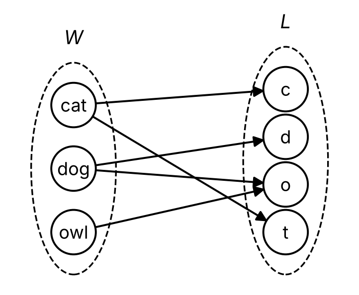
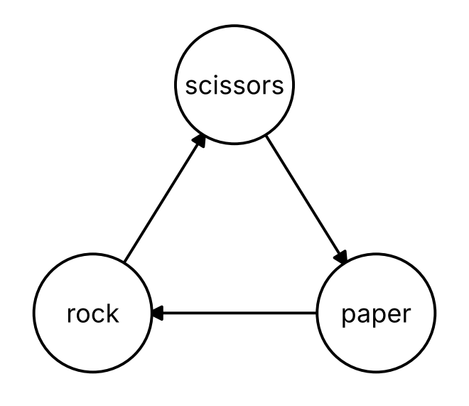
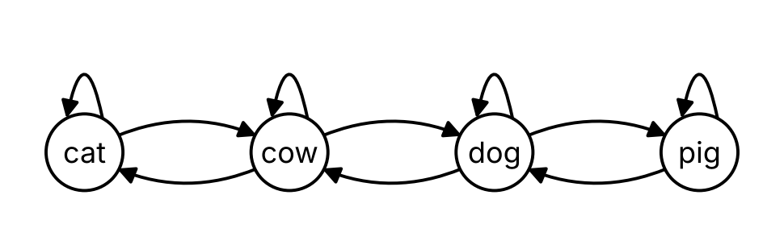

# Relations

Code

Relations between sets, their properties, equivalence relations, partitions and functions

Published

Last modified: 2026-10-29 14:08:21 (PDT)

> **NOTE:**
>
> The topics of this chapter, and their order, follow the course calendar and Kameron Decker Harris’s Fall 2026 lecture notes on relations. These come from those notes:
>
> - a relation from a set \\A\\ to a set \\B\\ as a subset of \\A \times B\\, and a relation on a set \\A\\ as a subset of \\A \times A\\;
> - the notation \\a \mathrel{R} b\\ for \\(a, b) \in R\\;
> - arrow diagrams, directed graphs and zero-one matrices as ways to draw a relation;
> - reading reflexivity and symmetry from a matrix or a directed graph;
> - the inverse of a relation, and the powers of a relation;
> - the powers of a relation whose arrows go around a cycle, adapted here from a cycle of four elements to rock, paper, scissors;
> - equivalence relations and equivalence classes;
> - a function from \\A\\ to \\B\\ as a relation that relates each element of \\A\\ to exactly one element of \\B\\;
> - the domain, codomain and range of a function;
> - injective, surjective and bijective functions, the identity function, and the fact that a function has an inverse function exactly when it is bijective.
>
> The definitions included from mds come from that site, and the definitions of an antisymmetric relation, the composition of relations and a partition follow the standard ones cited with them. The exercises, the other examples, the Racket functions and all the proofs are new.

# 1 Relations

> **NOTE:**
>
> **Exercise 1 (Letters in words)** Let \\W = {\mathopen{}\left\\\text{cat}, \text{dog}, \text{owl}\right\\\mathclose{}}\\ be a set of words and \\L = {\mathopen{}\left\\\text{c}, \text{d}, \text{o}, \text{t}\right\\\mathclose{}}\\ a set of letters. List the ordered pairs \\(w, x)\\ in the Cartesian product \\W \times L\\ ([Definition: Cartesian product](../chapters/sets.llms.md#def-cartesian-product)) for which the letter \\x\\ appears in the word \\w\\.

> **NOTE:**
>
> *Solution 1*. Go through the words one at a time:
>
> - cat has the letters c and t from \\L\\;
> - dog has the letters d and o;
> - owl has only o, since w and l are not in \\L\\.
>
> So the pairs are
>
> \\ (\text{cat}, \text{c}), \quad (\text{cat}, \text{t}), \quad (\text{dog}, \text{d}), \quad (\text{dog}, \text{o}), \quad (\text{owl}, \text{o}). \\
>
> The other pairs of \\W \times L\\, such as \\(\text{owl}, \text{t})\\, are left out.

> **NOTE:**
>
> **Definition 1 (Relation from one set to another)** Let \\A\\ and \\B\\ be sets ([Definition: Set](../chapters/sets.llms.md#def-set)). A **relation from \\A\\ to \\B\\** ([Wikipedia contributors 2026c](#ref-wikipedia_binary_relation)) is a subset ([Definition: Subset](../chapters/sets.llms.md#def-subset)) \\R\\ of the Cartesian product \\A \times B\\ ([Definition: Cartesian product](../chapters/sets.llms.md#def-cartesian-product)). When \\(a, b) \in R\\, we write \\a \mathrel{R} b\\ and say that \\a\\ is related to \\b\\.

> **NOTE:**
>
> **Example 1 (Words and their letters)** The pairs found in [Solution 1](#sol-word-letters) form a relation ([Definition 1](#def-binary-relation)) from \\W\\ to \\L\\,
>
> \\ H = {\mathopen{}\left\\(\text{cat}, \text{c}), (\text{cat}, \text{t}), (\text{dog}, \text{d}), (\text{dog}, \text{o}), (\text{owl}, \text{o})\right\\\mathclose{}}, \\
>
> where \\w \mathrel{H} x\\ means that the word \\w\\ has the letter \\x\\. So \\\text{cat} \mathrel{H} \text{t}\\, but \\(\text{owl}, \text{t}) \notin H\\. The word cat is related to two letters, and the letter o has two words related to it.
>
> The empty set and \\W \times L\\ itself are relations from \\W\\ to \\L\\ too: the first relates no word to any letter, and the second relates every word to every letter.

> **NOTE:**
>
> **Definition 2 (Relation)** A **relation** \\\sim\\ on a set \\S\\ ([Wikipedia contributors 2026c](#ref-wikipedia_binary_relation)) is a rule that, for each [ordered pair](../chapters/sets.llms.md#def-ordered-pair) of elements \\a, b \in S\\, says whether \\a \sim b\\ holds (“\\a\\ is related to \\b\\”).

> **NOTE:**
>
> **Example 2 (Relations on the real numbers)** \\=\\, \\\<\\ and \\\le\\ are relations on \\\mathbb{R}\\. For \\\<\\, the pair \\(2, 5)\\ is related, since \\2 \< 5\\, but the pair \\(5, 2)\\ is not, since \\5 \< 2\\ is false: the order of the pair matters.

> **NOTE:**
>
> *Remark 1* (A relation on a set is a set of pairs). A relation \\\sim\\ on a set \\S\\ ([Definition 2](#def-relation)) decides, for each ordered pair \\(a, b)\\ of elements of \\S\\, whether \\a \sim b\\. The pairs for which it holds form the set \\{\mathopen{}\left\\(a, b) \in S \times S : a \sim b\right\\\mathclose{}}\\, which is a relation from \\S\\ to \\S\\ ([Definition 1](#def-binary-relation)). In the other direction, a subset \\R \subseteq S \times S\\ decides, for each pair, whether \\a \mathrel{R} b\\. So a relation on \\S\\ is the same as a relation from \\S\\ to \\S\\, and from here on we treat it as a subset of \\S \times S\\, named with a letter such as \\R\\ or with a symbol such as \\\sim\\.
>
> For example, the relation \\\<\\ on \\\mathbb{R}\\ of [Example 2](#exm-relation) is the set of points \\(x, y)\\ of the plane with \\x \< y\\, which are the points above the line \\y = x\\.

> **NOTE:**
>
> **Example 3 (Parents in a family)** Let \\F = {\mathopen{}\left\\\text{Ada}, \text{Ben}, \text{Cora}, \text{Dev}, \text{Eva}\right\\\mathclose{}}\\ be five people in a family, where Ada is the parent of Ben and of Cora, Ben is the parent of Dev, and Cora is the parent of Eva. The relation “is a parent of” on \\F\\ ([Remark 1](#rem-relation-on-set)) is the set of four pairs
>
> \\ P = {\mathopen{}\left\\(\text{Ada}, \text{Ben}), (\text{Ada}, \text{Cora}), (\text{Ben}, \text{Dev}), (\text{Cora}, \text{Eva})\right\\\mathclose{}}. \\
>
> So \\\text{Ben} \mathrel{P} \text{Dev}\\, but \\(\text{Dev}, \text{Ben}) \notin P\\, since Dev is Ben’s child, not Ben’s parent.

# 2 Drawing relations

> **NOTE:**
>
> **Exercise 2 (Rock, paper, scissors)** In the game rock, paper, scissors, rock beats scissors, scissors beats paper, and paper beats rock. Write the relation “beats” on the set \\G = {\mathopen{}\left\\\text{rock}, \text{paper}, \text{scissors}\right\\\mathclose{}}\\ as a set of ordered pairs ([Remark 1](#rem-relation-on-set)).

> **NOTE:**
>
> *Solution 2*. Each statement “\\a\\ beats \\b\\” gives the pair \\(a, b)\\, with the winner first:
>
> \\ B = {\mathopen{}\left\\(\text{rock}, \text{scissors}), (\text{scissors}, \text{paper}), (\text{paper}, \text{rock})\right\\\mathclose{}}. \\
>
> No element of \\G\\ beats itself, so no pair of \\B\\ has the same entry twice.

> **NOTE:**
>
> **Example 4 (The relation “beats”)** By [Solution 2](#sol-beats), the relation “beats” on \\G = {\mathopen{}\left\\\text{rock}, \text{paper}, \text{scissors}\right\\\mathclose{}}\\ ([Remark 1](#rem-relation-on-set)) is
>
> \\ B = {\mathopen{}\left\\(\text{rock}, \text{scissors}), (\text{scissors}, \text{paper}), (\text{paper}, \text{rock})\right\\\mathclose{}}. \\
>
> So \\\text{rock} \mathrel{B} \text{scissors}\\, but \\(\text{scissors}, \text{rock}) \notin B\\, since the first entry of each pair is the winner.

> **NOTE:**
>
> **Definition 3 (Arrow diagram)** Let \\R\\ be a relation from a set \\A\\ to a set \\B\\ ([Definition 1](#def-binary-relation)). The **arrow diagram** of \\R\\ draws the elements of \\A\\ in one column and the elements of \\B\\ in another, with an arrow from \\a\\ to \\b\\ for each pair \\(a, b) \in R\\.

> **NOTE:**
>
> **Example 5 (An arrow diagram of words and letters)** [Figure 1](#fig-word-letters) is the arrow diagram ([Definition 3](#def-arrow-diagram)) of the relation \\H\\ of [Example 1](#exm-word-letters). Each of the five pairs of \\H\\ is one arrow. Two arrows leave cat, and two arrive at o.
>
> [](../images/relations-word-letters.png "Figure 1: The arrow diagram of the relation H from the words W to the letters L they contain.")
>
> Figure 1: The arrow diagram of the relation \\H\\ from the words \\W\\ to the letters \\L\\ they contain.

> **NOTE:**
>
> **Definition 4 (Directed graph of a relation)** Let \\R\\ be a relation on a set \\A\\ ([Remark 1](#rem-relation-on-set)). The **directed graph** of \\R\\ ([Wikipedia contributors 2026g](#ref-wikipedia_directed_graph)) draws each element of \\A\\ once, as a labeled point, with an arrow from \\a\\ to \\b\\ for each pair \\(a, b) \in R\\. A pair \\(a, a)\\ is drawn as an arrow that leaves \\a\\ and comes back to \\a\\.

> **NOTE:**
>
> **Example 6 (The directed graph of “beats”)** [Figure 2](#fig-beats) is the directed graph ([Definition 4](#def-relation-digraph)) of the relation \\B\\ of [Example 4](#exm-beats). Each element of \\G\\ appears once, where an arrow diagram ([Definition 3](#def-arrow-diagram)) of \\B\\ would draw \\G\\ twice, once in each column. Starting from any element and following the arrows leads around the triangle, and back to the start after three arrows.
>
> [](../images/relations-beats.png "Figure 2: The directed graph of the relation “beats” on G.")
>
> Figure 2: The directed graph of the relation “beats” on \\G\\.

> **NOTE:**
>
> **Definition 5 (Matrix of a relation)** Let \\R\\ be a relation from a finite set \\A\\ to a finite set \\B\\ ([Definition: Finite set](../chapters/sets.llms.md#def-finite-set)), and list their elements in a chosen order as \\A = {\mathopen{}\left\\a_1, \ldots, a_m\right\\\mathclose{}}\\ and \\B = {\mathopen{}\left\\b_1, \ldots, b_n\right\\\mathclose{}}\\. The **matrix** of \\R\\ ([Wikipedia contributors 2026q](#ref-wikipedia_logical_matrix)) is the \\m \times n\\ matrix ([Definition: Matrix](https://morrison-lab.github.io/mds/linear-algebra-matrices.html#def-matrix)) \\M_R\\ whose entry in row \\i\\ and column \\j\\ is
>
> \\ m\_{ij} \stackrel{\text{def}}{=} \begin{cases} 1 & \text{if } (a_i, b_j) \in R, \\ 0 & \text{if } (a_i, b_j) \notin R. \end{cases} \\
>
> For a relation on a set \\A\\, the rows and the columns list \\A\\ in the same order.

> **NOTE:**
>
> **Example 7 (Matrices of two relations)** List the words of \\W\\ in the order cat, dog, owl, and the letters of \\L\\ in the order c, d, o, t. The relation \\H\\ of [Example 1](#exm-word-letters) has the matrix ([Definition 5](#def-relation-matrix))
>
> \\ M_H = \begin{bmatrix} 1 & 0 & 0 & 1 \\ 0 & 1 & 1 & 0 \\ 0 & 0 & 1 & 0 \end{bmatrix}. \\
>
> Row 1, for cat, has a 1 in the columns for c and t, the two arrows that leave cat in [Figure 1](#fig-word-letters).
>
> List \\G\\ in the order rock, paper, scissors. The relation \\B\\ of [Example 4](#exm-beats) has the matrix
>
> \\ M_B = \begin{bmatrix} 0 & 0 & 1 \\ 1 & 0 & 0 \\ 0 & 1 & 0 \end{bmatrix}. \\
>
> Its entries on the diagonal, \\m\_{11}\\, \\m\_{22}\\ and \\m\_{33}\\, are 0, since nothing beats itself. Listing the elements in another order would move the rows and columns around, but the new matrix would hold the same pairs.

# 3 Properties of relations

> **NOTE:**
>
> **Exercise 3 (Does rock beat paper?)** In the relation \\B\\ of [Example 4](#exm-beats), rock beats scissors and scissors beats paper. Does rock beat paper?

> **NOTE:**
>
> *Solution 3*. No. The pair \\(\text{rock}, \text{paper})\\ is not in \\B\\; paper beats rock, not the other way around. So for \\B\\, “\\a\\ beats \\b\\ and \\b\\ beats \\c\\” does not guarantee “\\a\\ beats \\c\\”. The properties in this section are rules of this kind, which a relation may or may not follow.

> **NOTE:**
>
> **Example 8 (Words that share a letter)** Let \\V = {\mathopen{}\left\\\text{cat}, \text{cow}, \text{dog}, \text{pig}\right\\\mathclose{}}\\, and on \\V\\ let \\a \mathrel{T} b\\ when the words \\a\\ and \\b\\ have at least one letter in common ([Remark 1](#rem-relation-on-set)). For example, \\\text{cat} \mathrel{T} \text{cow}\\, since both have a c, and \\\text{cow} \mathrel{T} \text{dog}\\, since both have an o, but \\(\text{cat}, \text{dog}) \notin T\\. [Figure 3](#fig-shares-letter) is the directed graph ([Definition 4](#def-relation-digraph)) of \\T\\. Each word has a letter in common with itself, so each point has an arrow that comes back to it.
>
> [](../images/relations-shares-letter.png "Figure 3: The directed graph of the relation “shares a letter with” on V.")
>
> Figure 3: The directed graph of the relation “shares a letter with” on \\V\\.

> **NOTE:**
>
> **Definition 6 (Reflexive relation)** Let \\\sim\\ be a [relation](../chapters/relations.llms.md#def-relation) on a [set](../chapters/sets.llms.md#def-set) \\S\\. The relation \\\sim\\ is **reflexive** ([Wikipedia contributors 2026t](#ref-wikipedia_reflexive_relation)) if \\a \sim a\\ for every \\a \in S\\.

> **NOTE:**
>
> **Example 9 (Reflexive or not)**  
>
> - The relation \\T\\ of [Example 8](#exm-shares-letter) is reflexive ([Definition 6](#def-reflexive)), since every word of \\V\\ has a letter in common with itself.
> - The relation \\B\\ of [Example 4](#exm-beats) is not reflexive, since rock does not beat rock.
> - The relation \\P\\ of [Example 3](#exm-parent) is not reflexive, since Ada is not her own parent.

> **NOTE:**
>
> **Definition 7 (Symmetric relation)** Let \\\sim\\ be a [relation](../chapters/relations.llms.md#def-relation) on a [set](../chapters/sets.llms.md#def-set) \\S\\. The relation \\\sim\\ is **symmetric** ([Wikipedia contributors 2026v](#ref-wikipedia_symmetric_relation)) if, [for all](../chapters/predicates-quantifiers.llms.md#def-universal-quantifier) \\a, b \in S\\, \\a \sim b\\ [implies](../chapters/propositional-logic.llms.md#def-implies) \\b \sim a\\.

> **NOTE:**
>
> **Example 10 (Symmetric or not)**  
>
> - The relation \\T\\ of [Example 8](#exm-shares-letter) is symmetric ([Definition 7](#def-symmetric-relation)): if \\a\\ has a letter in common with \\b\\, then \\b\\ has the same letter in common with \\a\\.
> - The relation \\B\\ of [Example 4](#exm-beats) is not symmetric: rock beats scissors, but scissors does not beat rock.
> - The relation \\P\\ of [Example 3](#exm-parent) is not symmetric: Ada is a parent of Ben, but Ben is not a parent of Ada.

> **NOTE:**
>
> **Definition 8 (Antisymmetric relation)** Let \\R\\ be a relation on a set \\S\\ ([Remark 1](#rem-relation-on-set)). The relation \\R\\ is **antisymmetric** ([Wikipedia contributors 2026a](#ref-wikipedia_antisymmetric_relation)) if, for all \\a, b \in S\\, \\a \mathrel{R} b\\ and \\b \mathrel{R} a\\ together imply \\a = b\\.

> **NOTE:**
>
> **Example 11 (Antisymmetric or not)** By its contrapositive ([Definition: Contrapositive](../chapters/contrapositive-contradiction.llms.md#def-contrapositive)), a relation \\R\\ is antisymmetric ([Definition 8](#def-antisymmetric)) exactly when, for any two different elements \\a \ne b\\, at most one of \\a \mathrel{R} b\\ and \\b \mathrel{R} a\\ holds.
>
> - The relation \\B\\ of [Example 4](#exm-beats) is antisymmetric: no two different elements of \\G\\ beat each other.
> - The relation \\P\\ of [Example 3](#exm-parent) is antisymmetric: no two people of \\F\\ are each other’s parent.
> - The relation \\T\\ of [Example 8](#exm-shares-letter) is not antisymmetric: \\\text{cat} \mathrel{T} \text{cow}\\ and \\\text{cow} \mathrel{T} \text{cat}\\, but cat and cow are different words.
> - For a set \\U\\, the relation \\\subseteq\\ ([Definition: Subset](../chapters/sets.llms.md#def-subset)) on the power set \\\mathcal{P}(U)\\ ([Definition: Power set](../chapters/sets.llms.md#def-power-set)) is antisymmetric: if \\X \subseteq Y\\ and \\Y \subseteq X\\, then \\X = Y\\, by [Theorem: Equal sets are subsets of each other](../chapters/set-proofs.llms.md#thm-double-inclusion).

> **NOTE:**
>
> **Definition 9 (Transitive relation)** Let \\\sim\\ be a [relation](../chapters/relations.llms.md#def-relation) on a set \\S\\. The relation \\\sim\\ is **transitive** ([Wikipedia contributors 2026w](#ref-wikipedia_transitive_relation)) if, for all \\a, b, c \in S\\, \\a \sim b\\ and \\b \sim c\\ together imply \\a \sim c\\.

> **NOTE:**
>
> **Example 12 (Transitive or not)**  
>
> - The relation \\B\\ of [Example 4](#exm-beats) is not transitive ([Definition 9](#def-transitive)), as [Solution 3](#sol-beats-transitive) found.
> - The relation \\T\\ of [Example 8](#exm-shares-letter) is not transitive: \\\text{cat} \mathrel{T} \text{cow}\\ and \\\text{cow} \mathrel{T} \text{dog}\\, but \\(\text{cat}, \text{dog}) \notin T\\.
> - The relation \\P\\ of [Example 3](#exm-parent) is not transitive: Ada is a parent of Ben and Ben is a parent of Dev, but Ada is not a parent of Dev.
> - For a set \\U\\, the relation \\\subseteq\\ on \\\mathcal{P}(U)\\ is transitive, by [Theorem: Subsets of subsets](../chapters/set-proofs.llms.md#thm-subset-transitive).

> **NOTE:**
>
> *Remark 2* (Antisymmetric is not the opposite of symmetric). A relation can be symmetric ([Definition 7](#def-symmetric-relation)) and antisymmetric ([Definition 8](#def-antisymmetric)), only one of the two, or neither:
>
> - the relation \\{\mathopen{}\left\\(\text{cow}, \text{cow}), (\text{dog}, \text{dog})\right\\\mathclose{}}\\ on \\V\\ is both, since it relates no word to a different word, so no pair can break either property;
> - the relation \\T\\ of [Example 8](#exm-shares-letter) is symmetric but not antisymmetric;
> - the relation \\B\\ of [Example 4](#exm-beats) is antisymmetric but not symmetric;
> - the relation \\{\mathopen{}\left\\(\text{cat}, \text{cow}), (\text{cow}, \text{cat}), (\text{dog}, \text{pig})\right\\\mathclose{}}\\ on \\V\\ is neither: it relates cat and cow both ways, so it is not antisymmetric, and it has \\(\text{dog}, \text{pig})\\ but not \\(\text{pig}, \text{dog})\\, so it is not symmetric.
>
> A relation with both properties never relates two different elements: if \\a \mathrel{R} b\\, then \\b \mathrel{R} a\\ by symmetry, and then \\a = b\\ by antisymmetry. So “not symmetric” and “antisymmetric” say different things. A relation is not symmetric when one pair \\(a, b)\\ in it has its reverse \\(b, a)\\ missing, while it is antisymmetric when no two different elements are related both ways.

> **NOTE:**
>
> *Remark 3* (Three properties in a matrix and a directed graph). Let \\R\\ be a relation on a finite set, with matrix \\M_R = (m\_{ij})\\ ([Definition 5](#def-relation-matrix)) and a directed graph ([Definition 4](#def-relation-digraph)).
>
> - \\R\\ is reflexive ([Definition 6](#def-reflexive)) exactly when every diagonal entry \\m\_{ii}\\ is 1, and exactly when every point of the directed graph has an arrow that comes back to it.
> - \\R\\ is symmetric ([Definition 7](#def-symmetric-relation)) exactly when \\m\_{ij} = m\_{ji}\\ for all \\i\\ and \\j\\, and exactly when every arrow from \\a\\ to \\b\\ comes with an arrow from \\b\\ to \\a\\.
> - \\R\\ is antisymmetric ([Definition 8](#def-antisymmetric)) exactly when \\m\_{ij}\\ and \\m\_{ji}\\ are never both 1 for \\i \ne j\\, and exactly when no two different points have arrows both ways between them.
>
> For example, [Figure 3](#fig-shares-letter) has an arrow back to every point, and every arrow there comes with its reverse, so it shows again that \\T\\ is reflexive and symmetric.

# 4 Relations in Racket

> **NOTE:**
>
> **Exercise 4 (Looking up a pair)** In Racket, the relation \\B\\ of [Example 4](#exm-beats) can be stored as a list of two-element lists:
>
> ``` racket
> (define beats
>   (list (list 'rock 'scissors)
>         (list 'scissors 'paper)
>         (list 'paper 'rock)))
> ```
>
> `(member x L)` returns `#f` when `x` is not an element of the list `L`. Does `(member (list 'rock 'paper) beats)` return `#f`?

> **NOTE:**
>
> *Solution 4*. Yes. The list `(list 'rock 'paper)` is not an element of `beats`, since rock does not beat paper ([Solution 3](#sol-beats-transitive)), so `member` returns `#f`. When `x` is an element of `L`, `member` returns the part of `L` that starts at `x`, which is not `#f`: `(member (list 'paper 'rock) beats)` returns `'((paper rock))`.

> **NOTE:**
>
> **Example 13 (Checking properties in Racket)** The predicate `related?` turns the answer of `member` into `#t` or `#f`:
>
> ``` racket
> (define (related? R a b)
>   (if (member (list a b) R) #t #f))
> ```
>
> `(for/and ([x L]) body)` evaluates `body` once for each element `x` of the list `L`, and returns `#f` as soon as `body` returns `#f`, and `#t` if it never does. `for*/and`, which [Remark: Checking an equivalence in Racket](../chapters/equivalence-negation.llms.md#rem-racket-equivalence) uses to go through the rows of a truth table, does the same for every combination of values of its variables, here every two pairs of a relation:
>
> ``` racket
> (define (reflexive? S R)
>   (for/and ([a S])
>     (related? R a a)))
>
> (define (symmetric? R)
>   (for/and ([p R])
>     (related? R (second p) (first p))))
>
> (define (transitive? R)
>   (for*/and ([p R]
>              [q R])
>     (or (not (equal? (second p) (first q)))
>         (related? R (first p) (second q)))))
> ```
>
> - `reflexive?` checks \\a \mathrel{R} a\\ for each element \\a\\ of the set `S` ([Definition 6](#def-reflexive)). It needs `S`, because the list `R` says nothing about an element that is in no pair.
> - `symmetric?` checks, for each pair \\(a, b)\\ in `R`, that \\(b, a)\\ is in `R` too ([Definition 7](#def-symmetric-relation)).
> - `transitive?` checks, for every two pairs \\(a, b)\\ and \\(b', c)\\ of `R`, the conditional “if \\b = b'\\, then \\a \mathrel{R} c\\” ([Definition 9](#def-transitive)), written as an `or` by [Corollary: A conditional without the arrow](../chapters/equivalence-negation.llms.md#cor-conditional-as-or).
>
> All three of `(reflexive? (list 'rock 'paper 'scissors) beats)`, `(symmetric? beats)` and `(transitive? beats)` return `#f`, as [Example 9](#exm-reflexive-or-not), [Example 10](#exm-symmetric-or-not) and [Example 12](#exm-transitive-or-not) found.

# 5 Inverses and composition

> **NOTE:**
>
> **Exercise 5 (Grandparents)** In the family of [Example 3](#exm-parent), a person \\a\\ is a grandparent of a person \\c\\ when \\a\\ is a parent of some person \\b\\ who is a parent of \\c\\. List the pairs \\(a, c)\\ of people in \\F\\ for which \\a\\ is a grandparent of \\c\\.

> **NOTE:**
>
> *Solution 5*. Follow two pairs of \\P\\ in a row, where the second entry of the first pair is the first entry of the second:
>
> - \\(\text{Ada}, \text{Ben})\\ and then \\(\text{Ben}, \text{Dev})\\ give \\(\text{Ada}, \text{Dev})\\;
> - \\(\text{Ada}, \text{Cora})\\ and then \\(\text{Cora}, \text{Eva})\\ give \\(\text{Ada}, \text{Eva})\\.
>
> No other two pairs chain together, since Dev and Eva are nobody’s parent in \\F\\. So the pairs are \\(\text{Ada}, \text{Dev})\\ and \\(\text{Ada}, \text{Eva})\\.

> **NOTE:**
>
> **Definition 10 (Inverse relation (converse relation))** Let \\R\\ be a relation from a set \\A\\ to a set \\B\\ ([Definition 1](#def-binary-relation)). The **inverse** of \\R\\ ([Wikipedia contributors 2026f](#ref-wikipedia_converse_relation)) (also called the **converse** of \\R\\) is the relation from \\B\\ to \\A\\ that reverses each pair of \\R\\:
>
> \\ R^{-1} \stackrel{\text{def}}{=}{\mathopen{}\left\\(b, a) : (a, b) \in R\right\\\mathclose{}}. \\

> **NOTE:**
>
> **Example 14 (Reversing pairs)**  
>
> - The inverse ([Definition 10](#def-inverse-relation)) of the relation \\P\\ of [Example 3](#exm-parent) is the relation “is a child of”,
>
>   \\ P^{-1} = {\mathopen{}\left\\(\text{Ben}, \text{Ada}), (\text{Cora}, \text{Ada}), (\text{Dev}, \text{Ben}), (\text{Eva}, \text{Cora})\right\\\mathclose{}}. \\
>
> - The inverse of the relation \\H\\ of [Example 1](#exm-word-letters) is the relation from \\L\\ to \\W\\ in which \\x \mathrel{H^{-1}} w\\ when the letter \\x\\ appears in the word \\w\\; for example, \\\text{o} \mathrel{H^{-1}} \text{dog}\\ and \\\text{o} \mathrel{H^{-1}} \text{owl}\\.
>
> - The inverse of the relation \\B\\ of [Example 4](#exm-beats) is “is beaten by”. Its directed graph ([Definition 4](#def-relation-digraph)) is [Figure 2](#fig-beats) with every arrow reversed, and its matrix ([Definition 5](#def-relation-matrix)) is the transpose ([Definition: Transpose](https://morrison-lab.github.io/mds/linear-algebra-vectors.html#def-transpose)) of \\M_B\\ from [Example 7](#exm-relation-matrix):
>
>   \\ M\_{B^{-1}} = \begin{bmatrix} 0 & 1 & 0 \\ 0 & 0 & 1 \\ 1 & 0 & 0 \end{bmatrix}. \\

> **NOTE:**
>
> **Theorem 1 (Symmetric relations are their own inverses)** Let \\R\\ be a relation on a set \\S\\ ([Remark 1](#rem-relation-on-set)). Then \\R\\ is symmetric ([Definition 7](#def-symmetric-relation)) if and only if \\R^{-1} = R\\ ([Definition 10](#def-inverse-relation)).

> **NOTE:**
>
> *Proof*. (\\\Rightarrow\\) Suppose \\R\\ is symmetric. We show \\R^{-1} = R\\ by double inclusion ([Theorem: Equal sets are subsets of each other](../chapters/set-proofs.llms.md#thm-double-inclusion)).
>
> - Let \\(a, b) \in R^{-1}\\. Then \\(b, a) \in R\\, by the definition of \\R^{-1}\\. Since \\R\\ is symmetric, \\(a, b) \in R\\. So \\R^{-1} \subseteq R\\.
> - Let \\(a, b) \in R\\. Since \\R\\ is symmetric, \\(b, a) \in R\\, so \\(a, b) \in R^{-1}\\, by the definition of \\R^{-1}\\. So \\R \subseteq R^{-1}\\.
>
> (\\\Leftarrow\\) Suppose \\R^{-1} = R\\, and let \\a \mathrel{R} b\\. Then \\(b, a) \in R^{-1}\\, by the definition of \\R^{-1}\\, and \\R^{-1} = R\\, so \\b \mathrel{R} a\\. So \\R\\ is symmetric.

> **NOTE:**
>
> **Definition 11 (Composition of relations)** Let \\R\\ be a relation from a set \\A\\ to a set \\B\\, and \\Q\\ a relation from \\B\\ to a set \\E\\ ([Definition 1](#def-binary-relation)). The **composition** of \\R\\ and \\Q\\ ([Wikipedia contributors 2026e](#ref-wikipedia_composition_of_relations)) is the relation from \\A\\ to \\E\\
>
> \\ Q \circ R \stackrel{\text{def}}{=}{\mathopen{}\left\\(a, e) \in A \times E : a \mathrel{R} b \text{ and } b \mathrel{Q} e \text{ for some } b \in B\right\\\mathclose{}}. \\
>
> The relation used first, \\R\\, is written on the right.

> **NOTE:**
>
> **Example 15 (Grandparents and siblings)**  
>
> - The grandparent relation of [Exercise 5](#exr-grandparent) is the composition ([Definition 11](#def-relation-composition)) of the relation \\P\\ of [Example 3](#exm-parent) with itself:
>
>   \\ P \circ P = {\mathopen{}\left\\(\text{Ada}, \text{Dev}), (\text{Ada}, \text{Eva})\right\\\mathclose{}}. \\
>
> - In \\P \circ P^{-1}\\, a person \\a\\ is related to \\c\\ when some \\b\\ has \\a \mathrel{P^{-1}} b\\ and \\b \mathrel{P} c\\, that is, when \\b\\ is a parent of \\a\\ and of \\c\\ ([Example 14](#exm-inverse-relation)). So \\P \circ P^{-1}\\ is the relation “has a parent in common with”:
>
>   \\ \begin{aligned} P \circ P^{-1} = \\&(\text{Ben}, \text{Ben}), (\text{Ben}, \text{Cora}), (\text{Cora}, \text{Ben}), (\text{Cora}, \text{Cora}), \\ &(\text{Dev}, \text{Dev}), (\text{Eva}, \text{Eva})\\. \end{aligned} \\
>
>   Ada is in no pair, since her parents are not in \\F\\.

> **NOTE:**
>
> **Definition 12 (Power of a relation)** Let \\R\\ be a relation on a set \\S\\ ([Remark 1](#rem-relation-on-set)). The **powers** of \\R\\ are the relations \\R^n\\ on \\S\\, for integers \\n \ge 1\\, given by the recursive definition ([Definition: Recursive definition](../chapters/recursion.llms.md#def-recursive-definition))
>
> - base case: \\R^1 = R\\;
> - recursive rule: \\R^{n + 1} = R^n \circ R\\ for \\n \ge 1\\ ([Definition 11](#def-relation-composition)).

> **NOTE:**
>
> **Example 16 (Powers of “beats”)** For the relation \\B\\ of [Example 4](#exm-beats), \\B^2 = B \circ B\\ ([Definition 12](#def-relation-power)) relates \\a\\ to \\c\\ when \\a\\ beats something that beats \\c\\:
>
> \\ B^2 = {\mathopen{}\left\\(\text{rock}, \text{paper}), (\text{scissors}, \text{rock}), (\text{paper}, \text{scissors})\right\\\mathclose{}}, \\
>
> which is the inverse \\B^{-1}\\ of [Example 14](#exm-inverse-relation). Then \\B^3 = B^2 \circ B\\ relates each element to itself:
>
> \\ B^3 = {\mathopen{}\left\\(\text{rock}, \text{rock}), (\text{paper}, \text{paper}), (\text{scissors}, \text{scissors})\right\\\mathclose{}}, \\
>
> as following three arrows of [Figure 2](#fig-beats) leads back to the start. So \\B^4 = B^3 \circ B = B\\, and the powers of \\B\\ repeat after every three steps.
>
> For the relation \\P\\ of [Example 3](#exm-parent), \\P^2\\ is the grandparent relation of [Example 15](#exm-relation-composition), and \\P^3 = \emptyset\\, since no one in \\F\\ has a great-grandchild in \\F\\.

> **NOTE:**
>
> **Theorem 2 (Transitive relations contain their squares)** Let \\R\\ be a relation on a set \\S\\ ([Remark 1](#rem-relation-on-set)). Then \\R\\ is transitive ([Definition 9](#def-transitive)) if and only if \\R^2 \subseteq R\\ ([Definition 12](#def-relation-power)).

> **NOTE:**
>
> *Proof*. (\\\Rightarrow\\) Suppose \\R\\ is transitive, and let \\(a, c) \in R^2 = R \circ R\\. By the definition of composition ([Definition 11](#def-relation-composition)), \\a \mathrel{R} b\\ and \\b \mathrel{R} c\\ for some \\b \in S\\. Since \\R\\ is transitive, \\a \mathrel{R} c\\. So \\R^2 \subseteq R\\ ([Definition: Subset](../chapters/sets.llms.md#def-subset)).
>
> (\\\Leftarrow\\) Suppose \\R^2 \subseteq R\\, and let \\a \mathrel{R} b\\ and \\b \mathrel{R} c\\. Then \\(a, c) \in R \circ R = R^2\\, by the definition of composition, so \\(a, c) \in R\\. So \\R\\ is transitive.

> **NOTE:**
>
> **Example 17 (Checking transitivity with a square)**  
>
> - For the relation \\B\\ of [Example 4](#exm-beats), \\B^2 = B^{-1}\\ by [Example 16](#exm-relation-power), and \\B^2\\ has no pair in common with \\B\\. So \\B^2 \not\subseteq B\\, and \\B\\ is not transitive, by [Theorem 2](#thm-transitive-composition), as [Solution 3](#sol-beats-transitive) found.
> - For the relation \\T\\ of [Example 8](#exm-shares-letter), \\T^2\\ holds \\(\text{cat}, \text{dog})\\, since \\\text{cat} \mathrel{T} \text{cow}\\ and \\\text{cow} \mathrel{T} \text{dog}\\. That pair is not in \\T\\, so \\T\\ is not transitive.

# 6 Equivalence relations

> **NOTE:**
>
> **Exercise 6 (Words of the same length)** Let \\K = {\mathopen{}\left\\\text{if}, \text{let}, \text{cond}, \text{list}, \text{cons}, \text{define}\right\\\mathclose{}}\\, six words used in Racket, and on \\K\\ let \\a \sim b\\ when the words \\a\\ and \\b\\ have the same number of letters. Which words \\a \in K\\ have \\a \sim \text{cond}\\?

> **NOTE:**
>
> *Solution 6*. The word cond has 4 letters. The words of \\K\\ with 4 letters are cond, list and cons, so these three are the words related to cond. The list includes cond itself, since cond has as many letters as cond.

> **NOTE:**
>
> **Definition 13 (Equivalence relation)** Let \\\sim\\ be a [relation](../chapters/relations.llms.md#def-relation) on a [set](../chapters/sets.llms.md#def-set) \\S\\. The relation \\\sim\\ is an **equivalence relation** ([Wikipedia contributors 2026j](#ref-wikipedia_equivalence_relation)) if it is [reflexive](#def-reflexive), [symmetric](#def-symmetric-relation), and [transitive](../chapters/relations.llms.md#def-transitive).

> **NOTE:**
>
> **Example 18 (Having the same length is an equivalence relation)** The relation \\\sim\\ of [Exercise 6](#exr-same-length) is an equivalence relation ([Definition 13](#def-equivalence-relation)). Write \\\operatorname{len}(a)\\ for the length of the word \\a\\, its number of letters, as for the length of a list ([Definition: Length of a list](../chapters/recursion.llms.md#def-list-length)), so that \\a \sim b\\ means \\\operatorname{len}(a) = \operatorname{len}(b)\\.
>
> **Reflexive.** For each word \\a\\, \\\operatorname{len}(a) = \operatorname{len}(a)\\, so \\a \sim a\\ ([Definition 6](#def-reflexive)).
>
> **Symmetric.** If \\\operatorname{len}(a) = \operatorname{len}(b)\\, then \\\operatorname{len}(b) = \operatorname{len}(a)\\, so \\a \sim b\\ implies \\b \sim a\\ ([Definition 7](#def-symmetric-relation)).
>
> **Transitive.** If \\\operatorname{len}(a) = \operatorname{len}(b)\\ and \\\operatorname{len}(b) = \operatorname{len}(c)\\, then \\\operatorname{len}(a) = \operatorname{len}(c)\\ ([Theorem: Equalities are transitive](https://morrison-lab.github.io/mds/algebra-basics.html#thm-equal-trans)), so \\a \sim b\\ and \\b \sim c\\ imply \\a \sim c\\ ([Definition 9](#def-transitive)).
>
> The relation \\T\\ of [Example 8](#exm-shares-letter) is not an equivalence relation, since it is not transitive ([Example 12](#exm-transitive-or-not)).

> **NOTE:**
>
> **Theorem 3 (Having the same value is an equivalence relation)** Let \\f : A \to B\\ be a function ([Definition: Function (map, mapping, transformation)](../chapters/functional-programming.llms.md#def-function)), and on \\A\\ let \\a \sim a'\\ when \\f(a) = f(a')\\. Then \\\sim\\ is an equivalence relation ([Definition 13](#def-equivalence-relation)).

> **NOTE:**
>
> *Proof*. The steps of [Example 18](#exm-same-length) work for any function in place of \\\operatorname{len}\\.
>
> **Reflexive.** For each \\a \in A\\, \\f(a) = f(a)\\, so \\a \sim a\\.
>
> **Symmetric.** If \\a \sim a'\\, then \\f(a) = f(a')\\, so \\f(a') = f(a)\\, and \\a' \sim a\\.
>
> **Transitive.** If \\a \sim a'\\ and \\a' \sim a''\\, then \\f(a) = f(a')\\ and \\f(a') = f(a'')\\, so \\f(a) = f(a'')\\ ([Theorem: Equalities are transitive](https://morrison-lab.github.io/mds/algebra-basics.html#thm-equal-trans)), and \\a \sim a''\\.

> **NOTE:**
>
> **Example 19 (Real numbers that differ by an integer)** On the real numbers \\\mathbb{R}\\, let \\x \sim y\\ when \\x - y\\ is an integer ([Definition: Integers](../chapters/direct-proof.llms.md#def-integers)). For example, \\3.25 \sim 0.25\\, since \\3.25 - 0.25 = 3\\, but \\0.75 \not\sim 0.25\\, since \\0.75 - 0.25 = 0.5\\. The relation \\\sim\\ is an equivalence relation ([Definition 13](#def-equivalence-relation)).
>
> **Reflexive.** For every real number \\x\\, \\x - x = 0\\, which is an integer, so \\x \sim x\\.
>
> **Symmetric.** Suppose \\x \sim y\\, so \\x - y = n\\ for some integer \\n\\. Then \\y - x = -(x - y) = -n\\, which is an integer, so \\y \sim x\\.
>
> **Transitive.** Suppose \\x \sim y\\ and \\y \sim z\\, so \\x - y = m\\ and \\y - z = n\\ for some integers \\m\\ and \\n\\. Then
>
> \\ \begin{aligned} x - z &= (x - y) + (y - z) && \text{(the } y \text{ terms cancel)} \\ &= m + n, && \text{(} x - y = m \text{ and } y - z = n \text{)} \end{aligned} \\
>
> which is an integer, so \\x \sim z\\.

> **NOTE:**
>
> **Definition 14 (Equivalence class)** Let \\\sim\\ be an [equivalence relation](#def-equivalence-relation) on a [set](../chapters/sets.llms.md#def-set) \\S\\, and let \\a \in S\\. The **equivalence class** ([Wikipedia contributors 2026i](#ref-wikipedia_equivalence_class)) of \\a\\ is the set of elements of \\S\\ related to \\a\\:
>
> \\ \[a\] \stackrel{\text{def}}{=}{\mathopen{}\left\\b \in S : b \sim a\right\\\mathclose{}}. \\

> **NOTE:**
>
> **Example 20 (Equivalence classes of two relations)**  
>
> - For the relation \\\sim\\ of [Example 18](#exm-same-length), the equivalence class ([Definition 14](#def-equivalence-class)) of cond is the set found in [Solution 6](#sol-same-length),
>
>   \\ \[\text{cond}\] = {\mathopen{}\left\\\text{cond}, \text{list}, \text{cons}\right\\\mathclose{}}, \\
>
>   and \\\[\text{list}\]\\ and \\\[\text{cons}\]\\ are the same set. The other classes are \\\[\text{if}\] = {\mathopen{}\left\\\text{if}\right\\\mathclose{}}\\, \\\[\text{let}\] = {\mathopen{}\left\\\text{let}\right\\\mathclose{}}\\ and \\\[\text{define}\] = {\mathopen{}\left\\\text{define}\right\\\mathclose{}}\\, so the relation has four different equivalence classes.
>
> - For the relation \\\sim\\ of [Example 19](#exm-integer-difference), the class of \\0.25\\ holds the real numbers \\y\\ with \\y - 0.25\\ an integer:
>
>   \\ \[0.25\] = {\mathopen{}\left\\0.25 + n : n \in \mathbb{Z}\right\\\mathclose{}} = {\mathopen{}\left\\\ldots, -1.75, -0.75, 0.25, 1.25, 2.25, \ldots\right\\\mathclose{}}. \\
>
>   The class \\\[3.25\]\\ is the same set, and the class \\\[0\]\\ is the set of integers.

> **NOTE:**
>
> **Theorem 4 (Related elements have the same class)** Let \\\sim\\ be an equivalence relation on a set \\S\\ ([Definition 13](#def-equivalence-relation)), and let \\a, b \in S\\. Then \\a \sim b\\ if and only if \\\[a\] = \[b\]\\ ([Definition 14](#def-equivalence-class)).

> **NOTE:**
>
> *Proof*. (\\\Leftarrow\\) Suppose \\\[a\] = \[b\]\\. Since \\\sim\\ is reflexive, \\a \sim a\\, so \\a \in \[a\]\\. So \\a \in \[b\]\\, which means \\a \sim b\\.
>
> (\\\Rightarrow\\) Suppose \\a \sim b\\. We show \\\[a\] = \[b\]\\ by double inclusion ([Theorem: Equal sets are subsets of each other](../chapters/set-proofs.llms.md#thm-double-inclusion)).
>
> - Let \\x \in \[a\]\\, so \\x \sim a\\. Since \\a \sim b\\ and \\\sim\\ is transitive, \\x \sim b\\, so \\x \in \[b\]\\. So \\\[a\] \subseteq \[b\]\\.
> - Let \\x \in \[b\]\\, so \\x \sim b\\. Since \\\sim\\ is symmetric, \\a \sim b\\ gives \\b \sim a\\, and then transitivity gives \\x \sim a\\, so \\x \in \[a\]\\. So \\\[b\] \subseteq \[a\]\\.

# 7 Partitions

> **NOTE:**
>
> **Exercise 7 (Grouping words by their first letter)** Split the words of the set \\K\\ of [Exercise 6](#exr-same-length) into groups, so that each word is in exactly one group, and two words are in the same group exactly when they start with the same letter. List the groups.

> **NOTE:**
>
> *Solution 7*. The first letters are i, l, c and d, which give four groups:
>
> \\ {\mathopen{}\left\\\text{if}\right\\\mathclose{}}, \quad {\mathopen{}\left\\\text{let}, \text{list}\right\\\mathclose{}}, \quad {\mathopen{}\left\\\text{cond}, \text{cons}\right\\\mathclose{}}, \quad {\mathopen{}\left\\\text{define}\right\\\mathclose{}}. \\
>
> Every word of \\K\\ is in one of them, and no word is in two.

> **NOTE:**
>
> **Definition 15 (Partition of a set)** Let \\S\\ be a set. A **partition** of \\S\\ ([Wikipedia contributors 2026r](#ref-wikipedia_partition_of_a_set)) is a collection \\\mathcal{C}\\ ([Definition: Collection of sets (family of sets)](https://morrison-lab.github.io/mds/sets.html#def-collection)) of subsets of \\S\\ such that
>
> - every set in \\\mathcal{C}\\ is nonempty;
> - any two different sets in \\\mathcal{C}\\ are disjoint: their intersection ([Definition: Intersection](../chapters/sets.llms.md#def-intersection)) is empty;
> - every element of \\S\\ is in some set in \\\mathcal{C}\\.
>
> So each element of \\S\\ is in exactly one set in \\\mathcal{C}\\.

> **NOTE:**
>
> **Example 21 (Partitions and collections that are not partitions)**  
>
> - The four groups of [Solution 7](#sol-first-letter) are a partition ([Definition 15](#def-set-partition)) of \\K\\.
> - The collection \\{\mathopen{}\left\\{\mathopen{}\left\\\text{if}, \text{let}\right\\\mathclose{}}, {\mathopen{}\left\\\text{let}, \text{list}, \text{cond}, \text{cons}, \text{define}\right\\\mathclose{}}\right\\\mathclose{}}\\ is not a partition of \\K\\, since let is in both of its sets.
> - The collection \\{\mathopen{}\left\\{\mathopen{}\left\\\text{if}\right\\\mathclose{}}, {\mathopen{}\left\\\text{let}, \text{list}\right\\\mathclose{}}, {\mathopen{}\left\\\text{cond}, \text{cons}\right\\\mathclose{}}\right\\\mathclose{}}\\ is not a partition of \\K\\, since define is in none of its sets.
> - The set of even integers and the set of odd integers ([Definition: Even integer](../chapters/direct-proof.llms.md#def-even-odd)) form a partition of \\\mathbb{Z}\\, since every integer is even or odd, and none is both.

> **NOTE:**
>
> **Theorem 5 (Equivalence classes form a partition)** Let \\\sim\\ be an equivalence relation on a set \\S\\ ([Definition 13](#def-equivalence-relation)). Then the collection of the different equivalence classes \\\[a\]\\, for \\a \in S\\ ([Definition 14](#def-equivalence-class)), is a partition of \\S\\ ([Definition 15](#def-set-partition)).

> **NOTE:**
>
> *Proof*. Each class \\\[a\]\\ is a subset of \\S\\, by [Definition 14](#def-equivalence-class). We check the three conditions of [Definition 15](#def-set-partition).
>
> **Nonempty.** Since \\\sim\\ is reflexive, \\a \sim a\\, so \\a \in \[a\]\\.
>
> **Different classes are disjoint.** Let \\\[a\]\\ and \\\[b\]\\ be two classes that share an element \\x\\. Then \\x \sim a\\ and \\x \sim b\\. Since \\\sim\\ is symmetric, \\a \sim x\\, and since \\\sim\\ is transitive, \\a \sim b\\. So \\\[a\] = \[b\]\\, by [Theorem 4](#thm-related-classes). So two different classes share no element.
>
> **Every element is in a class.** Each \\a \in S\\ is in its own class \\\[a\]\\, as in the first step.

> **NOTE:**
>
> **Theorem 6 (A partition gives an equivalence relation)** Let \\\mathcal{C}\\ be a partition of a set \\S\\ ([Definition 15](#def-set-partition)), and on \\S\\ let \\a \sim b\\ when \\a\\ and \\b\\ are in the same set in \\\mathcal{C}\\. Then \\\sim\\ is an equivalence relation ([Definition 13](#def-equivalence-relation)), and its equivalence classes ([Definition 14](#def-equivalence-class)) are exactly the sets in \\\mathcal{C}\\.

> **NOTE:**
>
> *Proof*. **Reflexive.** Each \\a \in S\\ is in some set in \\\mathcal{C}\\, so \\a\\ and \\a\\ are in the same set, and \\a \sim a\\.
>
> **Symmetric.** If \\a\\ and \\b\\ are in the same set in \\\mathcal{C}\\, then so are \\b\\ and \\a\\.
>
> **Transitive.** Suppose \\a \sim b\\ and \\b \sim c\\: \\a\\ and \\b\\ are in a set \\X \in \mathcal{C}\\, and \\b\\ and \\c\\ are in a set \\Y \in \mathcal{C}\\. Then \\b \in X \cap Y\\. Different sets in \\\mathcal{C}\\ are disjoint, so \\X = Y\\, and \\a\\ and \\c\\ are both in \\X\\, so \\a \sim c\\.
>
> **Each class is a set in \\\mathcal{C}\\.** Let \\a \in S\\, and let \\X\\ be the set in \\\mathcal{C}\\ that holds \\a\\. An element \\b\\ has \\b \sim a\\ exactly when \\b\\ is in the set that holds \\a\\, which is \\X\\. So \\\[a\] = X\\.
>
> **Each set in \\\mathcal{C}\\ is a class.** Let \\X \in \mathcal{C}\\. Since \\X\\ is nonempty, it holds some element \\a\\, and then \\X = \[a\]\\, by the previous step.

> **NOTE:**
>
> **Example 22 (Starting with the same letter)** By [Theorem 6](#thm-partition-equivalence), the partition of \\K\\ in [Solution 7](#sol-first-letter) gives the equivalence relation “starts with the same letter as”, whose equivalence classes are the four groups. For example, \\\[\text{let}\] = {\mathopen{}\left\\\text{let}, \text{list}\right\\\mathclose{}}\\. By [Theorem 5](#thm-classes-partition), the relation “has the same length as” of [Example 18](#exm-same-length) gives the partition of \\K\\ into its four classes from [Example 20](#exm-equivalence-classes), which is a different partition of the same set.

# 8 Functions as relations

> **NOTE:**
>
> **Exercise 8 (How many does each one beat?)** In the relation \\B\\ of [Example 4](#exm-beats), how many elements of \\G\\ does each element of \\G\\ beat?

> **NOTE:**
>
> *Solution 8*. Exactly one each: rock beats only scissors, paper beats only rock, and scissors beats only paper. So “the element that \\a\\ beats” names one element of \\G\\ for each \\a \in G\\, which is what a function ([Definition: Function (map, mapping, transformation)](../chapters/functional-programming.llms.md#def-function)) from \\G\\ to \\G\\ does.

> **NOTE:**
>
> **Definition 16 (Domain of a function)** The **domain** of a function \\f : A \to B\\ ([Definition: Function (map, mapping, transformation)](../chapters/functional-programming.llms.md#def-function)) ([Wikipedia contributors 2026h](#ref-wikipedia_domain_of_a_function)) is the set \\A\\ of elements that \\f\\ assigns values to.

> **NOTE:**
>
> **Definition 17 (Codomain)** The **codomain** ([Wikipedia contributors 2026d](#ref-wikipedia_codomain)) of a [function](../chapters/functional-programming.llms.md#def-function) \\f : A \to B\\ is the set \\B\\ that its values are required to lie in.

> **NOTE:**
>
> **Definition 18 (Graph of a function)** The **graph** ([Wikipedia contributors 2026l](#ref-wikipedia_graph_of_a_function)) of a [function](../chapters/functional-programming.llms.md#def-function) \\f : A \to B\\ is the set of [ordered pairs](../chapters/sets.llms.md#def-ordered-pair) \\(a, f(a))\\, one for each element \\a\\ of its domain:
>
> \\{\mathopen{}\left\\(a, f(a)) : a \in A\right\\\mathclose{}}\\

> **NOTE:**
>
> **Example 23 (The graph of a length function)** Let \\\operatorname{len}\_K : K \to \mathbb{N}\\ ([Definition: Function (map, mapping, transformation)](../chapters/functional-programming.llms.md#def-function), [Definition: Natural numbers (our convention)](../chapters/sets.llms.md#def-natural-numbers)) give the length of each word of the set \\K\\ of [Exercise 6](#exr-same-length), so \\\operatorname{len}\_K(a) = \operatorname{len}(a)\\, as in [Example 18](#exm-same-length). Its domain ([Definition 16](#def-function-domain)) is \\K\\ and its codomain ([Definition 17](#def-codomain)) is \\\mathbb{N}\\. Its graph ([Definition 18](#def-graph)) is the set of six pairs
>
> \\ {\mathopen{}\left\\(\text{if}, 2), (\text{let}, 3), (\text{cond}, 4), (\text{list}, 4), (\text{cons}, 4), (\text{define}, 6)\right\\\mathclose{}}, \\
>
> a subset of \\K \times \mathbb{N}\\, and so a relation from \\K\\ to \\\mathbb{N}\\ ([Definition 1](#def-binary-relation)). Each word appears as the first entry of exactly one pair.

> **NOTE:**
>
> *Remark 4* (Two uses of the word “graph”). The graph of a function ([Definition 18](#def-graph)) is a set of ordered pairs: the relation that the function gives. The directed graph of a relation ([Definition 4](#def-relation-digraph)) is a drawing of a relation on a set, with points and arrows. The two share a word but are different things. For a function from a set to itself, the directed graph of its graph draws one arrow from each point.

> **NOTE:**
>
> **Theorem 7 (Functions are relations with one output per input)** Let \\A\\ and \\B\\ be sets, and let \\R\\ be a relation from \\A\\ to \\B\\ ([Definition 1](#def-binary-relation)). Then \\R\\ is the graph ([Definition 18](#def-graph)) of a function \\f : A \to B\\ ([Definition: Function (map, mapping, transformation)](../chapters/functional-programming.llms.md#def-function)) if and only if each \\a \in A\\ is related by \\R\\ to exactly one \\b \in B\\. That function is then the only one whose graph is \\R\\.

> **NOTE:**
>
> *Proof*. (\\\Rightarrow\\) Suppose \\R = {\mathopen{}\left\\(a, f(a)) : a \in A\right\\\mathclose{}}\\ for a function \\f : A \to B\\, and let \\a \in A\\. Then \\a \mathrel{R} f(a)\\. If also \\a \mathrel{R} b\\, then \\(a, b) = (a', f(a'))\\ for some \\a' \in A\\, so \\a' = a\\ and \\b = f(a)\\ ([Definition: Ordered pair](../chapters/sets.llms.md#def-ordered-pair)). So \\f(a)\\ is the only element of \\B\\ related to \\a\\.
>
> (\\\Leftarrow\\) Suppose each \\a \in A\\ is related to exactly one element of \\B\\, and let \\f(a)\\ be that element. Then \\f\\ assigns exactly one element of \\B\\ to each \\a \in A\\, so it is a function \\f : A \to B\\. Its graph is \\R\\, since \\(a, b) \in R\\ exactly when \\b\\ is the element related to \\a\\, which is \\f(a)\\.
>
> Two functions \\f, g : A \to B\\ with the same graph \\R\\ have \\f(a) = g(a)\\ for every \\a \in A\\, since each is the one element related to \\a\\ by \\R\\. So they are the same function.

> **NOTE:**
>
> *Remark 5* (What a function is fundamentally). [Definition: Function (map, mapping, transformation)](../chapters/functional-programming.llms.md#def-function) defines what a function *does*: it assigns an output to each input. In formal set theory, what a function *is* is described in terms of [ordered pairs](../chapters/sets.llms.md#def-ordered-pair) and its graph ([Definition 18](#def-graph)): the set of pairs \\G = {\mathopen{}\left\\(a, f(a)) : a \in A\right\\\mathclose{}} \subseteq A \times B\\. Authors define a function formally in one of two ways:
>
> 1.  **As its graph** ([Halmos 1974, sec. 8](#ref-halmos1974naive), p. 30): a function is a subset of \\A \times B\\ containing exactly one pair \\(a, b)\\ for each \\a \in A\\, where \\b = f(a)\\, and the statement \\f(a) = b\\ is notation for \\(a, b) \in f\\. Under this convention, the codomain \\B\\ is specified alongside the graph in the declaration \\f : A \to B\\.
> 2.  **As a triple \\(A, B, G)\\**: the function consists of the domain \\A\\, the codomain \\B\\, and the graph \\G \subseteq A \times B\\. This explicit packaging retains the codomain \\B\\ as part of the function itself, distinguishing functions that have the same graph but different codomains (such as a function mapping into \\\mathbb{R}\\ versus into integers).
>
> For example, the die-doubling function in [Example: Doubling a die roll](https://morrison-lab.github.io/mds/functions.html#exm-function) has the graph of six ordered pairs \\{\mathopen{}\left\\(1, 2), (2, 4), (3, 6), (4, 8), (5, 10), (6, 12)\right\\\mathclose{}}\\.
>
> This distinction clarifies what a function is and is not:
>
> - **Not an algebraic formula:** A function is not fundamentally an equation or algebraic expression. While many functions are specified by a formula (such as \\f(x) = x^2\\), many others cannot be written in closed form (such as empirical measurements or a lookup table), yet every function has a well-defined set of input-output pairs.
> - **Not a curve:** A curve or plot is a geometric visualization of a function whose domain and codomain are subsets of \\\mathbb{R}\\, but functions can map between arbitrary sets (such as sets of words, matrices, or probability distributions).
> - **Sets of pairs with unique first entries:** Any subset of \\A \times B\\ in which no two distinct pairs share the same first element defines a function from the set of those first elements to \\B\\.
>
> In computer science, viewing a function as a set of key-value pairs corresponds directly to a **dictionary**, **lookup table**, or **hash map**. Evaluating an expression computes outputs on demand; caching computed outputs \\(a, f(a))\\ on demand to return on future calls without recomputing is known as **memoization**.

> **NOTE:**
>
> **Example 24 (Relations that are functions and relations that are not)**  
>
> - The relation \\B\\ of [Example 4](#exm-beats) relates each element of \\G\\ to exactly one element, as [Solution 8](#sol-beats-one) found. By [Theorem 7](#thm-function-relation), it is the graph of a function \\b : G \to G\\, with \\b(\text{rock}) = \text{scissors}\\, \\b(\text{scissors}) = \text{paper}\\ and \\b(\text{paper}) = \text{rock}\\.
> - The relation \\H\\ of [Example 1](#exm-word-letters) is not the graph of a function from \\W\\ to \\L\\, since cat is related to two letters, c and t.
> - The relation \\P\\ of [Example 3](#exm-parent) is not the graph of a function from \\F\\ to \\F\\, for two reasons: Ada is related to two people, and Dev is related to none.

> **NOTE:**
>
> **Example 25 (Checking for one output per input in Racket)** `(for/sum ([x L]) body)` evaluates `body` once for each element `x` of the list `L`, and returns the sum of the values. With a finite relation stored as a list of pairs, as in [Exercise 4](#exr-racket-member), `count-outputs` uses it to count the pairs whose first entry is `a`, and `function?` uses `for/and` ([Example 13](#exm-racket-properties)) to check the condition of [Theorem 7](#thm-function-relation) for each element of the list `A`:
>
> ``` racket
> (define (count-outputs R a)
>   (for/sum ([p R])
>     (if (equal? (first p) a) 1 0)))
>
> (define (function? A R)
>   (for/and ([a A])
>     (= (count-outputs R a) 1)))
> ```
>
> `(function? (list 'rock 'paper 'scissors) beats)` returns `#t`, as [Example 24](#exm-function-or-not) found, since `(count-outputs beats a)` is 1 for each of the three elements.

> **NOTE:**
>
> **Definition 19 (Image)** The **image** ([Wikipedia contributors 2026n](#ref-wikipedia_image_mathematics)) of a [function](../chapters/functional-programming.llms.md#def-function) \\f : A \to B\\ is the set of values that \\f\\ actually takes:
>
> \\f(A) \stackrel{\text{def}}{=}{\mathopen{}\left\\f(a) : a \in A\right\\\mathclose{}}\\
>
> For a single element \\a \in A\\, the value \\f(a)\\ is also called the **image of** \\a\\ under \\f\\.

> **NOTE:**
>
> **Example 26 (The images of two functions)**  
>
> - The function \\\operatorname{len}\_K : K \to \mathbb{N}\\ of [Example 23](#exm-graph-length) has the image ([Definition 19](#def-image)) \\\operatorname{len}\_K(K) = {\mathopen{}\left\\2, 3, 4, 6\right\\\mathclose{}}\\, the lengths that occur. Most natural numbers, such as 1 and 5, are in its codomain ([Definition 17](#def-codomain)) \\\mathbb{N}\\ but not in its image.
> - The function \\b : G \to G\\ of [Example 24](#exm-function-or-not) has domain ([Definition 16](#def-function-domain)) and codomain \\G\\, and its image is all of \\G\\, since each element of \\G\\ is beaten by some element.

> **NOTE:**
>
> **Definition 20 (Range)** The word **range** of a [function](../chapters/functional-programming.llms.md#def-function) \\f : A \to B\\ has two conflicting meanings, and sources use one or the other:
>
> - the [image](#def-image) of \\f\\, the set \\f(A)\\ of values that \\f\\ actually takes;
> - the [codomain](#def-codomain) of \\f\\, the set \\B\\ that its values are required to lie in.
>
> To avoid the ambiguity, these notes write “image” or “codomain” instead, and recommend that you do too ([Wikipedia contributors 2026s](#ref-wikipedia_range_of_a_function)).

> **NOTE:**
>
> **Exercise 9 (Writing a string twice)** Let \\{\mathopen{}\left\\0, 1\right\\\mathclose{}}^\*\\ be the set of strings over the alphabet \\{\mathopen{}\left\\0, 1\right\\\mathclose{}}\\ ([Definition: String](../chapters/recursion.llms.md#def-string), [Definition: Alphabet](../chapters/recursion.llms.md#def-alphabet)), and let \\\operatorname{dup} : {\mathopen{}\left\\0, 1\right\\\mathclose{}}^\* \to {\mathopen{}\left\\0, 1\right\\\mathclose{}}^\*\\ write a string twice: \\\operatorname{dup}(s) = s s\\, the string \\s\\ followed by \\s\\. For example, \\\operatorname{dup}(01) = 0101\\. Is there a string \\s \in {\mathopen{}\left\\0, 1\right\\\mathclose{}}^\*\\ with \\\operatorname{dup}(s) = 010\\?

> **NOTE:**
>
> *Solution 9*. No. If \\s\\ has \\n\\ symbols, then \\\operatorname{dup}(s) = s s\\ has \\2n\\ symbols, an even number. The string \\010\\ has 3 symbols, an odd number, so it is not \\\operatorname{dup}(s)\\ for any \\s\\. So \\010\\ is in the codomain \\{\mathopen{}\left\\0, 1\right\\\mathclose{}}^\*\\ of \\\operatorname{dup}\\ but not in its image ([Definition 19](#def-image)).

> **NOTE:**
>
> **Definition 21 (Injective function (one-to-one function))** A function \\f : A \to B\\ ([Definition: Function (map, mapping, transformation)](../chapters/functional-programming.llms.md#def-function)) is **injective** ([Wikipedia contributors 2026o](#ref-wikipedia_injective_function)) (also called **one-to-one**) if, for all \\a, a' \in A\\, \\f(a) = f(a')\\ implies \\a = a'\\.

> **NOTE:**
>
> **Example 27 (Injective or not)** By its contrapositive ([Definition: Contrapositive](../chapters/contrapositive-contradiction.llms.md#def-contrapositive)), a function is injective ([Definition 21](#def-injective)) exactly when different inputs always give different outputs.
>
> - The function \\\operatorname{dup}\\ of [Exercise 9](#exr-dup-odd) is injective. Suppose \\\operatorname{dup}(s) = \operatorname{dup}(t)\\, so \\s s = t t\\. The two sides have the same length, so \\s\\ and \\t\\ have the same length \\n\\, and the first \\n\\ symbols of each side are \\s\\ on the left and \\t\\ on the right. So \\s = t\\.
> - The function \\\operatorname{len}\_K\\ of [Example 23](#exm-graph-length) is not injective, since \\\operatorname{len}\_K(\text{cond}) = \operatorname{len}\_K(\text{list}) = 4\\ but \\\text{cond} \ne \text{list}\\.
> - The function \\\operatorname{len} : {\mathopen{}\left\\0, 1\right\\\mathclose{}}^\* \to \mathbb{N}\cup {\mathopen{}\left\\0\right\\\mathclose{}}\\ that gives the length of a string, its number of symbols, as for the length of a list ([Definition: Length of a list](../chapters/recursion.llms.md#def-list-length)), is not injective, since \\\operatorname{len}(01) = \operatorname{len}(10) = 2\\.

> **NOTE:**
>
> **Definition 22 (Surjective function (onto function))** A function \\f : A \to B\\ ([Definition: Function (map, mapping, transformation)](../chapters/functional-programming.llms.md#def-function)) is **surjective** ([Wikipedia contributors 2026u](#ref-wikipedia_surjective_function)) (also called **onto**) if, for every \\b \in B\\, there is some \\a \in A\\ with \\f(a) = b\\.

> **NOTE:**
>
> **Example 28 (Surjective or not)** A function is surjective ([Definition 22](#def-surjective)) exactly when its image ([Definition 19](#def-image)) is its whole codomain ([Definition 17](#def-codomain)).
>
> - The function \\\operatorname{len} : {\mathopen{}\left\\0, 1\right\\\mathclose{}}^\* \to \mathbb{N}\cup {\mathopen{}\left\\0\right\\\mathclose{}}\\ of [Example 27](#exm-injective-or-not) is surjective: for each \\n \ge 0\\, the string of \\n\\ zeros has length \\n\\.
> - The function \\\operatorname{dup}\\ of [Exercise 9](#exr-dup-odd) is not surjective, since \\010\\ is not in its image ([Solution 9](#sol-dup-odd)).
> - The function \\\operatorname{len}\_K\\ of [Example 23](#exm-graph-length) is not surjective, since no word of \\K\\ has length 5.

> **NOTE:**
>
> **Definition 23 (Bijective function (bijection))** A function \\f : A \to B\\ ([Definition: Function (map, mapping, transformation)](../chapters/functional-programming.llms.md#def-function)) is **bijective** ([Wikipedia contributors 2026b](#ref-wikipedia_bijection)) (also called a **bijection**) if it is injective ([Definition 21](#def-injective)) and surjective ([Definition 22](#def-surjective)).

> **NOTE:**
>
> **Example 29 (Bijective or not)**  
>
> - Let \\\operatorname{flip} : {\mathopen{}\left\\0, 1\right\\\mathclose{}}^\* \to {\mathopen{}\left\\0, 1\right\\\mathclose{}}^\*\\ change every 0 of a string to 1 and every 1 to 0, so that \\\operatorname{flip}(0010) = 1101\\. Flipping twice changes each symbol back, so \\\operatorname{flip}(\operatorname{flip}(s)) = s\\ for every \\s \in {\mathopen{}\left\\0, 1\right\\\mathclose{}}^\*\\. It follows that \\\operatorname{flip}\\ is bijective ([Definition 23](#def-bijective)). It is injective, since \\\operatorname{flip}(s) = \operatorname{flip}(t)\\ gives \\s = \operatorname{flip}(\operatorname{flip}(s)) = \operatorname{flip}(\operatorname{flip}(t)) = t\\. It is surjective, since each \\s \in {\mathopen{}\left\\0, 1\right\\\mathclose{}}^\*\\ is \\\operatorname{flip}(t)\\ for \\t = \operatorname{flip}(s)\\.
> - The function \\b : G \to G\\ of [Example 24](#exm-function-or-not) is bijective: its three values are the three different elements of \\G\\.
> - The functions \\\operatorname{dup}\\, \\\operatorname{len}\\ and \\\operatorname{len}\_K\\ of [Example 27](#exm-injective-or-not) are not bijective, since each fails to be injective or fails to be surjective.

# 9 Inverse functions and composition

> **NOTE:**
>
> **Exercise 10 (Flipping twice)** With \\\operatorname{flip}\\ as in [Example 29](#exm-bijective-or-not), what is \\\operatorname{flip}(\operatorname{flip}(0110))\\?

> **NOTE:**
>
> *Solution 10*. First \\\operatorname{flip}(0110) = 1001\\, and then \\\operatorname{flip}(1001) = 0110\\. So flipping twice gives back the string we started with, \\0110\\.

> **NOTE:**
>
> **Definition 24 (Identity function)** The **identity function** on a set \\A\\ ([Wikipedia contributors 2026m](#ref-wikipedia_identity_function)) is the function \\\operatorname{id}\_A : A \to A\\ ([Definition: Function (map, mapping, transformation)](../chapters/functional-programming.llms.md#def-function)) with \\\operatorname{id}\_A(a) = a\\ for every \\a \in A\\.

> **NOTE:**
>
> **Example 30 (Identity functions)**  
>
> - Flipping twice is the identity function ([Definition 24](#def-identity-function)) on \\{\mathopen{}\left\\0, 1\right\\\mathclose{}}^\*\\: \\\operatorname{flip}(\operatorname{flip}(s)) = s\\ for every \\s \in {\mathopen{}\left\\0, 1\right\\\mathclose{}}^\*\\, as [Solution 10](#sol-flip-twice) found for \\s = 0110\\.
> - The graph ([Definition 18](#def-graph)) of \\\operatorname{id}\_G\\ is the relation \\B^3\\ of [Example 16](#exm-relation-power), which relates each element of \\G\\ to itself.

> **NOTE:**
>
> **Definition 25 (Inverse function)** Let \\f : A \to B\\ be a [function](../chapters/functional-programming.llms.md#def-function). A function \\g : B \to A\\ is the **inverse function** ([Wikipedia contributors 2026p](#ref-wikipedia_inverse_function)) of \\f\\, written \\f^{-1}\\, if both
>
> - \\g(f(a)) = a\\ for every \\a \in A\\, and
> - \\f(g(b)) = b\\ for every \\b \in B\\.
>
> A function that has an inverse function is **invertible**.

> **NOTE:**
>
> *Remark 6* (\\f^{-1}\\ is not \\1/f\\). The \\-1\\ in \\f^{-1}\\ does not mean a reciprocal: \\f^{-1}(b)\\ is the input that \\f\\ maps to \\b\\, not \\\frac{1}{f(b)}\\. For example, with \\f(x) = 2x\\ on \\\mathbb{R}\\, \\f^{-1}(4) = 2\\, but \\\frac{1}{f(4)} = \frac{1}{8}\\.

> **NOTE:**
>
> **Example 31 (Inverse functions of strings and games)**  
>
> - \\\operatorname{flip}\\ is its own inverse function ([Definition 25](#def-inverse-function)), \\\operatorname{flip}^{-1} = \operatorname{flip}\\, since \\\operatorname{flip}(\operatorname{flip}(s)) = s\\ for every \\s \in {\mathopen{}\left\\0, 1\right\\\mathclose{}}^\*\\ ([Example 30](#exm-identity-function)).
> - The function \\b : G \to G\\ of [Example 24](#exm-function-or-not) has the inverse function “the element that beats \\a\\”, with \\b^{-1}(\text{scissors}) = \text{rock}\\, \\b^{-1}(\text{paper}) = \text{scissors}\\ and \\b^{-1}(\text{rock}) = \text{paper}\\. Its graph is the inverse relation \\B^{-1}\\ of [Example 14](#exm-inverse-relation).
> - The function \\\operatorname{len}\_K\\ of [Example 23](#exm-graph-length) has no inverse function, since an inverse \\g\\ would need \\g(4)\\ to be cond, list and cons at once.

> **NOTE:**
>
> **Theorem 8 (A function has an inverse exactly when it is a bijection)** A function \\f : A \to B\\ ([Definition: Function (map, mapping, transformation)](../chapters/functional-programming.llms.md#def-function)) has an inverse function ([Definition 25](#def-inverse-function)) if and only if \\f\\ is bijective ([Definition 23](#def-bijective)). The graph ([Definition 18](#def-graph)) of the inverse function is then the inverse relation ([Definition 10](#def-inverse-relation)) of the graph of \\f\\.

> **NOTE:**
>
> *Proof*. (\\\Rightarrow\\) Suppose \\g : B \to A\\ is an inverse function of \\f\\.
>
> **Injective.** If \\f(a) = f(a')\\, then \\a = g(f(a)) = g(f(a')) = a'\\.
>
> **Surjective.** Each \\b \in B\\ has \\b = f(g(b))\\, so \\b\\ is the value of \\f\\ at \\g(b) \in A\\.
>
> (\\\Leftarrow\\) Suppose \\f\\ is bijective, and let \\b \in B\\. Since \\f\\ is surjective, some \\a \in A\\ has \\f(a) = b\\, and since \\f\\ is injective, only one \\a\\ does. Let \\g(b)\\ be that \\a\\. Then \\g : B \to A\\ is a function with \\f(g(b)) = b\\ for every \\b \in B\\. For \\a \in A\\, \\g(f(a))\\ is the one element \\a'\\ with \\f(a') = f(a)\\, which is \\a\\ itself. So \\g\\ is an inverse function of \\f\\.
>
> **The graph of the inverse.** In both cases, \\f(g(b)) = b\\ for every \\b \in B\\ and \\g(f(a)) = a\\ for every \\a \in A\\. Let \\a \in A\\ and \\b \in B\\. If \\g(b) = a\\, then \\f(a) = f(g(b)) = b\\. If \\f(a) = b\\, then \\g(b) = g(f(a)) = a\\. So \\(b, a)\\ is in the graph of \\g\\ exactly when \\(a, b)\\ is in the graph of \\f\\.

> **NOTE:**
>
> **Definition 26 (Composition)** Let \\g : A \to B\\ and \\f : B \to C\\ be [functions](../chapters/functional-programming.llms.md#def-function). The **composition** ([Wikipedia contributors 2026k](#ref-wikipedia_function_composition)) of \\f\\ and \\g\\ is the function \\f \circ g : A \to C\\ defined by
>
> \\(f \circ g)(a) \stackrel{\text{def}}{=}f(g(a)) \quad \text{for each } a \in A.\\

> **NOTE:**
>
> **Definition 27 (Inner function)** In a composition \\f \circ g\\ ([Definition 26](#def-composition)), \\g\\ is the **inner function**, applied first.

> **NOTE:**
>
> **Definition 28 (Outer function)** In a composition \\f \circ g\\ ([Definition 26](#def-composition)), \\f\\ is the **outer function**, applied to the result.

> **NOTE:**
>
> **Theorem 9 (The graph of a composition is a composition of graphs)** Let \\g : A \to B\\ and \\f : B \to C\\ be functions ([Definition: Function (map, mapping, transformation)](../chapters/functional-programming.llms.md#def-function)), and write \\\Gamma_f\\ for the graph ([Definition 18](#def-graph)) of \\f\\. Then the graph of the composition \\f \circ g\\ ([Definition 26](#def-composition)) is the composition of relations ([Definition 11](#def-relation-composition))
>
> \\ \Gamma\_{f \circ g} = \Gamma_f \circ \Gamma_g. \\

> **NOTE:**
>
> *Proof*. Let \\a \in A\\ and \\c \in C\\. By the definition of composition of relations, \\(a, c) \in \Gamma_f \circ \Gamma_g\\ exactly when some \\b \in B\\ has \\(a, b) \in \Gamma_g\\ and \\(b, c) \in \Gamma_f\\, that is, \\b = g(a)\\ and \\c = f(b)\\. Only \\b = g(a)\\ can work, so this holds exactly when \\c = f(g(a)) = (f \circ g)(a)\\, which is when \\(a, c) \in \Gamma\_{f \circ g}\\.

> **NOTE:**
>
> **Example 32 (Composing functions of strings and games)**  
>
> - Let \\\operatorname{pad} : {\mathopen{}\left\\0, 1\right\\\mathclose{}}^\* \to {\mathopen{}\left\\0, 1\right\\\mathclose{}}^\*\\ put a 0 at the end of a string, so \\\operatorname{pad}(s) = s 0\\, the string \\s\\ followed by \\0\\. The order of a composition ([Definition 26](#def-composition)) matters:
>
>   \\ \begin{aligned} (\operatorname{flip} \circ \operatorname{pad})(1) &= \operatorname{flip}(10) = 01, \\ (\operatorname{pad} \circ \operatorname{flip})(1) &= \operatorname{pad}(0) = 00. \end{aligned} \\
>
> - \\\operatorname{len}(\operatorname{dup}(s)) = 2 \operatorname{len}(s)\\ for every \\s \in {\mathopen{}\left\\0, 1\right\\\mathclose{}}^\*\\, so \\\operatorname{len} \circ \operatorname{dup}\\ doubles the length of a string.
>
> - The graph of \\b\\ is \\B\\, so by [Theorem 9](#thm-composition-graph) the graph of \\b \circ b\\ is \\B \circ B = B^2\\, which is \\B^{-1}\\ by [Example 16](#exm-relation-power). By [Theorem 8](#thm-inverse-bijective), \\B^{-1}\\ is also the graph of \\b^{-1}\\, and by [Theorem 7](#thm-function-relation) only one function has that graph, so \\b \circ b = b^{-1}\\, the inverse function of [Example 31](#exm-inverse-strings): the element that \\a\\’s victim beats is the element that beats \\a\\.

# References

Halmos, Paul R. 1974. *Naive Set Theory*. Undergraduate Texts in Mathematics. Springer. <https://doi.org/10.1007/978-1-4757-1645-0>.

Wikipedia contributors. 2026a. *Antisymmetric Relation — Wikipedia, the Free Encyclopedia*. <https://en.wikipedia.org/wiki/Antisymmetric_relation>.

Wikipedia contributors. 2026b. *Bijection — Wikipedia, the Free Encyclopedia*. <https://en.wikipedia.org/wiki/Bijection>.

Wikipedia contributors. 2026c. *Binary Relation — Wikipedia, the Free Encyclopedia*. <https://en.wikipedia.org/wiki/Binary_relation>.

Wikipedia contributors. 2026d. *Codomain — Wikipedia, the Free Encyclopedia*. <https://en.wikipedia.org/wiki/Codomain>.

Wikipedia contributors. 2026e. *Composition of Relations — Wikipedia, the Free Encyclopedia*. <https://en.wikipedia.org/wiki/Composition_of_relations>.

Wikipedia contributors. 2026f. *Converse Relation — Wikipedia, the Free Encyclopedia*. <https://en.wikipedia.org/wiki/Converse_relation>.

Wikipedia contributors. 2026g. *Directed Graph — Wikipedia, the Free Encyclopedia*. <https://en.wikipedia.org/wiki/Directed_graph>.

Wikipedia contributors. 2026h. *Domain of a Function — Wikipedia, the Free Encyclopedia*. <https://en.wikipedia.org/wiki/Domain_of_a_function>.

Wikipedia contributors. 2026i. *Equivalence Class — Wikipedia, the Free Encyclopedia*. <https://en.wikipedia.org/wiki/Equivalence_class>.

Wikipedia contributors. 2026j. *Equivalence Relation — Wikipedia, the Free Encyclopedia*. <https://en.wikipedia.org/wiki/Equivalence_relation>.

Wikipedia contributors. 2026k. *Function Composition — Wikipedia, the Free Encyclopedia*. <https://en.wikipedia.org/wiki/Function_composition>.

Wikipedia contributors. 2026l. *Graph of a Function — Wikipedia, the Free Encyclopedia*. <https://en.wikipedia.org/wiki/Graph_of_a_function>.

Wikipedia contributors. 2026m. *Identity Function — Wikipedia, the Free Encyclopedia*. <https://en.wikipedia.org/wiki/Identity_function>.

Wikipedia contributors. 2026n. *Image (Mathematics) — Wikipedia, the Free Encyclopedia*. <https://en.wikipedia.org/wiki/Image_(mathematics)>.

Wikipedia contributors. 2026o. *Injective Function — Wikipedia, the Free Encyclopedia*. <https://en.wikipedia.org/wiki/Injective_function>.

Wikipedia contributors. 2026p. *Inverse Function — Wikipedia, the Free Encyclopedia*. <https://en.wikipedia.org/wiki/Inverse_function>.

Wikipedia contributors. 2026q. *Logical Matrix — Wikipedia, the Free Encyclopedia*. <https://en.wikipedia.org/wiki/Logical_matrix>.

Wikipedia contributors. 2026r. *Partition of a Set — Wikipedia, the Free Encyclopedia*. <https://en.wikipedia.org/wiki/Partition_of_a_set>.

Wikipedia contributors. 2026s. *Range of a Function — Wikipedia, the Free Encyclopedia*. <https://en.wikipedia.org/wiki/Range_of_a_function>.

Wikipedia contributors. 2026t. *Reflexive Relation — Wikipedia, the Free Encyclopedia*. <https://en.wikipedia.org/wiki/Reflexive_relation>.

Wikipedia contributors. 2026u. *Surjective Function — Wikipedia, the Free Encyclopedia*. <https://en.wikipedia.org/wiki/Surjective_function>.

Wikipedia contributors. 2026v. *Symmetric Relation — Wikipedia, the Free Encyclopedia*. <https://en.wikipedia.org/wiki/Symmetric_relation>.

Wikipedia contributors. 2026w. *Transitive Relation — Wikipedia, the Free Encyclopedia*. <https://en.wikipedia.org/wiki/Transitive_relation>.

Back to top
